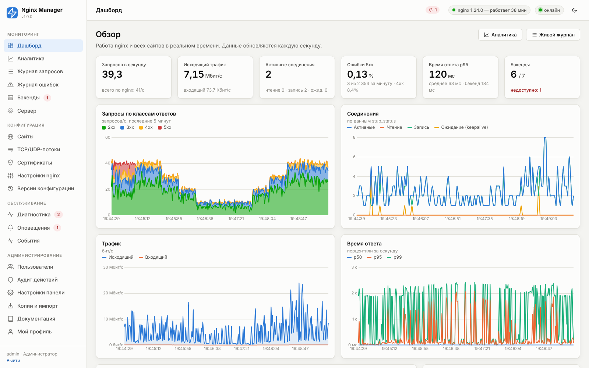

# Nginx Manager

Сервис и веб-панель для управления nginx в роли **обратного прокси** перед несколькими сайтами на одном внешнем IP:
графическая настройка всех параметров, статистика и аналитика в реальном времени, автоматическая диагностика,
оповещения, выпуск сертификатов Let's Encrypt, история версий конфигурации с откатом.



## Возможности

**Конфигурация в графическом виде**
- Сайты: обратный прокси, перенаправление, статический сайт; несколько доменов, IDN (кириллические домены), wildcard и регулярные выражения.
- Бэкенды: несколько серверов, веса, резервные (backup), max_fails/fail_timeout, max_conns, keepalive; 6 методов балансировки.
- HTTPS: Let's Encrypt (автовыпуск и автопродление), загрузка своих сертификатов, самоподписанные, файлы на диске; HTTP/2, HTTP/3, HSTS, OCSP, профили TLS Mozilla.
- Локации: разные пути → разные бэкенды, замена пути, статика, редиректы, ответы, запреты, свои лимиты и доступ; готовые шаблоны.
- Проксирование: заголовки, WebSocket, таймауты, буферы, повтор на другом сервере, скрытие заголовков, https-бэкенды.
- Кэширование: зоны кэша, время жизни по кодам, обход по cookie/заголовкам/шаблону, «устаревший кэш при падении бэкенда».
- Безопасность: белые/чёрные списки IP, Basic Auth, ограничение частоты и соединений, блокировка ботов и эксплойтов, скрытых файлов, методов, заголовки безопасности, CSP.
- Режим обслуживания с собственной страницей, красивые страницы ошибок 4xx/5xx.
- TCP/UDP-потоки (PostgreSQL, MySQL, Redis, DNS, SMTP…) с балансировкой и списками доступа.
- Глобальные настройки nginx: процессы, соединения, буферы, таймауты, gzip, TLS, реальный IP за CDN (Cloudflare в один клик), зоны кэша, сервер по умолчанию.
- Импорт существующих конфигураций nginx в панель.

**Статистика и аналитика**
- Реальное время (обновление каждую секунду по WebSocket): запросы по классам ответов, трафик, соединения, перцентили времени ответа, нагрузка по сайтам, ресурсы сервера.
- История: поминутно 14 дней, почасово 400 дней; коды ответов, методы, протоколы, TLS, кэш, гистограмма времени ответа, уникальные посетители, боты.
- Топы: URI, IP, источники, User-Agent, браузеры, ОС, устройства, страны (GeoIP), бэкенды, ошибки 4xx/5xx, медленные запросы.
- Журнал запросов: живой поток с фильтрами и поиск по истории с экспортом CSV; журнал ошибок nginx с автоматической классификацией и рекомендациями.

**Надёжность и диагностика**
- Применение конфигурации: проверка `nginx -t` в изолированном каталоге → атомарное переключение → reload → контроль; при любой ошибке — откат.
- Версии конфигурации: сравнение (diff), просмотр, откат в один клик.
- Около 40 автоматических проверок (nginx, порты, DNS, бэкенды, сертификаты, firewall, SELinux, лимиты, диск, журналы, ошибки, безопасность) с объяснениями и исправлениями в один клик.
- Активные проверки бэкендов (HTTP/TCP) и автоматическое переключение при отказе.
- Сторож: автоматический запуск упавшего nginx.
- Оповещения: 17 метрик, Telegram, Slack, Discord, e-mail, webhook.

**Администрирование**
- Пользователи и роли (администратор, оператор, наблюдатель), 2FA (TOTP), API-токены, аудит действий, защита от перебора, доступ по IP.
- REST API с OpenAPI-описанием, консольная утилита `nmctl`.
- Резервные копии, экспорт/импорт настроек, перенос на другой сервер.
- Скрипты полностью автоматической установки, обновления (с автоматическим откатом) и удаления.

## Быстрый старт

```bash
tar xzf nginx-manager-1.0.0.tar.gz && cd nginx-manager
sudo ./install.sh
```

Скрипт установит nginx, certbot, Python-окружение, сервис systemd, применит базовую конфигурацию и выведет адрес
панели и пароль администратора. Затем откройте `http://IP-сервера:8088/`.

Поддерживаются Debian 11–13, Ubuntu 20.04–24.04+, RHEL/Rocky/AlmaLinux/Oracle Linux 8–10, CentOS Stream, Fedora.

## Документация

| Раздел | Содержание |
|---|---|
| [01. Обзор](docs/01-overview.md) | Возможности, интерфейс, термины |
| [02. Архитектура и методология](docs/02-architecture.md) | Как устроен сервис, потоки данных, применение конфигурации, сбор статистики |
| [03. Установка, обновление, удаление](docs/03-installation.md) | Требования, параметры скриптов, офлайн-установка, firewall, SELinux |
| [04. Быстрый старт и сценарии](docs/04-quick-start.md) | Первый сайт пошагово, типовые конфигурации |
| [05. Сайты — справочник параметров](docs/05-sites.md) | Каждый параметр сайта, локации, рекомендации, примеры |
| [06. TCP/UDP-потоки](docs/06-streams.md) | Проксирование БД и других сервисов |
| [07. Сертификаты](docs/07-certificates.md) | Let's Encrypt, свои сертификаты, wildcard |
| [08. Глобальные настройки nginx](docs/08-global-settings.md) | Каждый параметр, настройка под нагрузку |
| [09. Мониторинг и аналитика](docs/09-monitoring.md) | Метрики и как они считаются, журналы, GeoIP |
| [10. Диагностика](docs/10-diagnostics.md) | Все проверки, исправления, категории ошибок nginx |
| [11. Оповещения](docs/11-alerts.md) | Правила, метрики, каналы |
| [12. Безопасность](docs/12-security.md) | Пользователи, 2FA, доступ к панели по HTTPS |
| [13. Настройки панели](docs/13-panel-settings.md) | Хранение данных, сеть, мониторинг |
| [14. nmctl и REST API](docs/14-cli-api.md) | Консоль и автоматизация |
| [15. Версии и резервные копии](docs/15-backup-versions.md) | Откат, перенос, восстановление |
| [16. Решение проблем](docs/16-troubleshooting.md) | Частые ситуации и FAQ |

Документация также доступна в самой панели: раздел **«Документация»**. Одним автономным HTML-файлом
(все главы, схемы и скриншоты внутри; открывается без сети, печатается в PDF) её собирает
`python3 tools/build_docs_html.py --out nginx-manager-docs.html`.

## Структура проекта

```
app/            серверная часть (Python): модели, генератор nginx, сбор статистики, сервисы, API
web/            веб-панель (HTML/CSS/JS без сборки), библиотеки Chart.js, marked, qrcode
docs/           документация (Markdown) и иллюстрации
packaging/      systemd-юнит, logrotate, nmctl, общие функции скриптов
tools/          демо-бэкенд, генератор нагрузки, демо-данные, скриншоты, генератор справочника
tests/          автотесты ядра (python3 -m pytest -q tests/)
install.sh      установка        update.sh   обновление        uninstall.sh   удаление
```

## Лицензия

MIT. Встроенные библиотеки: Chart.js (MIT), marked (MIT), qrcode-generator (MIT).
