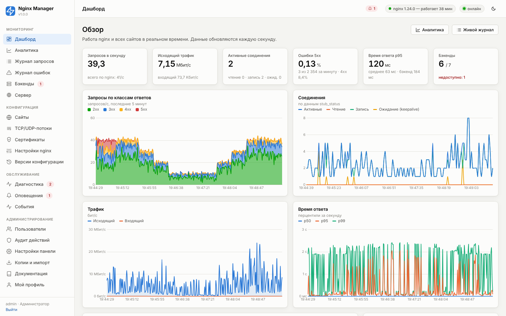

# Nginx Manager

Сервис и веб-панель для управления nginx в роли **обратного прокси** перед несколькими сайтами на одном внешнем IP:
графическая настройка всех параметров, статистика и аналитика в реальном времени, автоматическая диагностика,
оповещения, выпуск сертификатов по ACME (Let's Encrypt и другие центры, wildcard), история версий конфигурации с откатом.



## Возможности

**Конфигурация в графическом виде**
- Сайты: обратный прокси, перенаправление, статический сайт; несколько доменов, IDN (кириллические домены), wildcard и регулярные выражения; массовые действия.
- Бэкенды: несколько серверов, веса, резервные (backup), max_fails/fail_timeout, max_conns, keepalive; 6 методов балансировки.
- HTTPS: бесплатные сертификаты по ACME — Let's Encrypt, ZeroSSL, Google Trust Services или свой центр (автовыпуск и автопродление); wildcard `*.example.com` через DNS-проверку (Cloudflare, DigitalOcean, Linode, OVH, Route 53, Google Cloud DNS, свой DNS-сервер RFC 2136, свои скрипты); загрузка своих сертификатов, самоподписанные, файлы на диске; HTTP/2, HTTP/3, HSTS, OCSP, профили TLS Mozilla.
- Локации: разные пути → разные бэкенды, замена пути, статика, редиректы, ответы, запреты, свои лимиты и доступ; готовые шаблоны.
- Проксирование: заголовки, WebSocket, таймауты, буферы, повтор на другом сервере, скрытие заголовков, https-бэкенды.
- Кэширование: зоны кэша, время жизни по кодам, обход по cookie/заголовкам/шаблону, «устаревший кэш при падении бэкенда».
- Безопасность: белые/чёрные списки IP, Basic Auth, ограничение частоты и соединений, блокировка ботов и эксплойтов, скрытых файлов, методов, заголовки безопасности, CSP.
- Режим обслуживания с собственной страницей, красивые страницы ошибок 4xx/5xx.
- TCP/UDP-потоки (PostgreSQL, MySQL, Redis, DNS, SMTP…) с балансировкой и списками доступа.
- Глобальные настройки nginx: процессы, соединения, буферы, таймауты, gzip, TLS, реальный IP за CDN (Cloudflare в один клик), зоны кэша, сервер по умолчанию.
- Импорт существующих конфигураций nginx в панель.

**Статистика и аналитика**
- Встроенный анализ: оценка каждого показателя («норма / внимание / проблема») с подсказкой, что делать; автоматический поиск проблем по 93 сценариям (5xx с разбором 502/503/504/500, задержки, просадки и всплески трафика, 4xx по кодам, бэкенды, кэш, боты и сканеры, TLS, ёмкость nginx, ресурсы сервера, сертификаты, всплески атак и активные атакующие, попытки эксплуатации известных уязвимостей, все категории журнала ошибок nginx) с причинами, шагами и подтверждающими данными; свои пороги и история появления и устранения проблем.
- Реальное время (обновление каждую секунду по WebSocket): запросы по классам ответов, трафик, соединения, перцентили времени ответа, нагрузка по сайтам, ресурсы сервера.
- История: поминутно 14 дней, почасово 400 дней; коды ответов, методы, протоколы, TLS, кэш, гистограмма времени ответа, уникальные посетители, боты.
- Топы: URI, IP, источники, User-Agent, браузеры, ОС, устройства, страны (GeoIP), бэкенды, ошибки 4xx/5xx, медленные запросы.
- Доступность сайтов (SLA) за сутки, неделю и месяц с бюджетом ошибок; тепловая карта нагрузки по дням недели и часам.
- Журнал запросов: живой поток с фильтрами и поиск по истории с экспортом CSV; журнал ошибок nginx с автоматической классификацией и рекомендациями.

**Защита от атак** — отдельный раздел панели ([глава 19](docs/19-protection.md))
- Фильтр запросов (WAF) на картах nginx, без сторонних модулей: 98 сигнатур в 23 категориях по OWASP CRS и 7G/8G — SQL- и NoSQL-инъекции, XSS, обход каталогов, RFI, внедрение команд и PHP-кода, Log4Shell/OGNL/Spring4Shell, SSRF, SSTI, XXE, CRLF, загрязнение параметров, сканеры, служебные файлы, веб-шеллы, нарушения протокола; виртуальные патчи 40 эксплуатируемых уязвимостей (Next.js CVE-2025-29927, SharePoint ToolShell, SAP NetWeaver, PAN-OS, Ivanti, Fortinet, Citrix, F5, Check Point, CrushFTP, Confluence, MOVEit, PHP-CGI, Log4Shell…); боты ИИ, SEO-сканеры и библиотеки — по категориям. Режимы «блокировать / только запись / выключено» по категориям, для всех сайтов и для каждого сайта, исключения путей и правил, проверка строки.
- Глубокая проверка тела запроса — формы, JSON, XML, загрузка файлов — модулем ModSecurity v3 с OWASP Core Rule Set: уровень паранойи, порог аномальности, исключения для WordPress, Drupal, Nextcloud и других, режимы «запись / блокировка» для всех сайтов и для каждого, отключение правил CRS в один щелчок.
- База известных уязвимостей с автоматическим обновлением из открытых источников — CISA KEV, nuclei-templates, CVE Program, FIRST EPSS, Exploit-DB: CVSS, вероятность эксплуатации, затронутые версии, вымогатели и эксплойты; из шаблонов эксплойтов строится карта путей для фильтра запросов (отсев типовых и законных путей ваших сайтов), видно, какие уязвимости ищут на ваших сайтах; оповещение о новых эксплуатируемых уязвимостях в ваших продуктах; правила OWASP CRS — последний выпуск с GitHub. Все базы защиты (списки угроз, адреса роботов, уязвимости, CRS) — на одной вкладке с кнопкой «Обновить всё».
- Проверка браузера (proof-of-work, как Cloudflare «I'm Under Attack» и Anubis) с пропуском, который проверяет сам nginx (`secure_link`); режим «Под атакой» вручную (на срок или бессрочно, для сайта или всех сайтов) или автоматически при всплеске нагрузки.
- Списки угроз: Spamhaus DROP, FireHOL, IPsum, Tor, blocklist.de, CINS, Emerging Threats, DShield, сети дата-центров и VPN и свои — обновляются по расписанию, действие «блокировать / проверить браузер / записать».
- Проверка поисковых роботов и ботов ИИ по официальным диапазонам адресов (Google, Bing, Apple, DuckDuckGo, OpenAI, Perplexity): поддельный Googlebot блокируется, настоящий проходит без проверки браузера даже «Под атакой».
- Правила ограничения частоты для путей и методов (как Rate Limiting Rules в Cloudflare): поиск, API, оформление заказа — каждому свой лимит с адреса.
- Свои правила (поле, включая страну, условие, действие), ловушки для сканеров с немедленной блокировкой, автоблокировка за атаки, защита форм входа от перебора, хотлинкинга, удаление опасных заголовков (httpoxy, X-Original-URL, X-Middleware-Subrequest), проверка Host и SNI.
- Аналитика атак: сравнение с прошлым периодом, доля атак в трафике, ряды по механизмам, категориям, действиям и сайтам, атакующие адреса во времени, тепловая карта по дням и часам, инструменты атакующих (sqlmap, Nuclei, Nikto, скрипты…), страны, цели, эффективность правил и списков, воронка проверки браузера и время её прохождения, настоящие и поддельные роботы, история режима «Под атакой».
- Атакующие адреса с оценкой угрозы 0–100 и профилем адреса; карточка каждого правила; живая лента событий; журнал атак с номером запроса со страницы блокировки, исключением ложного срабатывания в один щелчок и выгрузкой в CSV.
- Самопроверка (по атаке на каждое правило и обычные запросы — нет ли ложных срабатываний), оценка защищённости сайта A–F по 24 пунктам, защита от медленных атак и SYN-флуда (параметры ядра Linux).

**Блокировки и доступ**
- Блокировки IP: вручную (адреса и подсети, на срок или бессрочно) и автоматически по журналу доступа — сканеры уязвимостей, подбор паролей, обращения по IP, массовые 4xx, флуд; повторным нарушителям — дольше.
- Доступ к сайтам по странам: запрет выбранных стран или «только выбранные страны», исключения по IP; сети стран берутся из базы GeoIP и подключаются в nginx без сторонних модулей.

**Надёжность и диагностика**
- Применение конфигурации: проверка `nginx -t` в изолированном каталоге → атомарное переключение → reload → контроль; при любой ошибке — откат.
- Версии конфигурации: сравнение (diff), просмотр, откат в один клик.
- Более 40 автоматических проверок (nginx, порты, DNS, бэкенды, сертификаты, firewall, SELinux, лимиты, диск, журналы, ошибки, безопасность, защита от атак) с объяснениями и исправлениями в один клик.
- Активные проверки бэкендов (HTTP/TCP) и автоматическое переключение при отказе: выключение упавшего сервера переживает любое применение конфигурации, а раз в минуту панель сверяет работающую конфигурацию с проверками.
- Сторож: автоматический запуск упавшего nginx.
- Оповещения: 22 метрики (включая отражённые атаки, попытки эксплуатации известных уязвимостей, режим «Под атакой», автоблокировки и проблемы по встроенному анализу), Telegram, Slack, Discord, e-mail, webhook.
- Регулярные отчёты за сутки или неделю в те же каналы: нагрузка, ошибки, время ответа, сайты, найденные проблемы, состояние.
- Уведомления о событиях: сбой продления сертификата, ошибка применения конфигурации, перезапуск nginx, перебор пароля, вход администратора с нового адреса — сразу в те же каналы.
- Тишина оповещений на время плановых работ — сразу или по расписанию.

**Администрирование**
- Пользователи и роли (администратор, оператор, наблюдатель), 2FA (TOTP, по желанию обязательная для администраторов), API-токены с ограниченными правами и сроком (например, «только чтение» для мониторинга), аудит действий, защита от перебора, доступ по IP; политика входа проверяется сервером.
- REST API (158 методов; справочник с ролями собирается из кода, есть OpenAPI/Swagger UI), консольная утилита `nmctl`, метрики Prometheus (`/metrics`) и готовый дашборд Grafana.
- Документация встроена в панель: поиск, оглавление, справка по текущей странице (кнопка «?» / F1) и по каждому полю (значок «i»).
- Быстрый поиск по панели (Ctrl+K): разделы, сайты, настройки, действия, документация, запросы по IP и коду ответа.
- Резервные копии (ежедневно и вручную) с выгрузкой в S3-совместимое хранилище — AWS, Yandex Object Storage, VK Cloud, Selectel, R2, MinIO — со сжатием и шифрованием; восстановление базы из копии в один клик (с проверкой копии и сохранением текущей базы) или `nmctl restore`; экспорт/импорт настроек, перенос на другой сервер.
- Доступность интерфейса: проверен axe-core по WCAG 2.1 AA на всех страницах и в окнах, в светлой и тёмной темах — контраст текста, подписи полей и кнопок для экранных дикторов, работа с клавиатуры.
- Скрипты полностью автоматической установки, обновления (с автоматическим откатом) и удаления.

## Быстрый старт

```bash
tar xzf nginx-manager-2.2.1.tar.gz && cd nginx-manager
sudo ./install.sh
```

Скрипт установит nginx, certbot, Python-окружение, сервис systemd, применит базовую конфигурацию и выведет адрес
панели и пароль администратора. Затем откройте `http://IP-сервера:8088/`.

Поддерживаются Debian 11–13, Ubuntu 20.04–24.04+, RHEL/Rocky/AlmaLinux/Oracle Linux 8–10, CentOS Stream, Fedora.

## Документация

| Раздел | Содержание |
|---|---|
| [01. Обзор](docs/01-overview.md) | Возможности, интерфейс, термины |
| [02. Архитектура и методология](docs/02-architecture.md) | Как устроен сервис, потоки данных, применение конфигурации, сбор статистики |
| [03. Установка, обновление, удаление](docs/03-installation.md) | Требования, параметры скриптов, офлайн-установка, firewall, SELinux |
| [04. Быстрый старт и сценарии](docs/04-quick-start.md) | Первый сайт пошагово, типовые конфигурации |
| [05. Сайты — справочник параметров](docs/05-sites.md) | Каждый параметр сайта, локации, рекомендации, примеры |
| [06. TCP/UDP-потоки](docs/06-streams.md) | Проксирование БД и других сервисов |
| [07. Сертификаты](docs/07-certificates.md) | ACME (Let's Encrypt и другие центры), HTTP- и DNS-проверка, wildcard, DNS-провайдеры, свои сертификаты |
| [08. Глобальные настройки nginx](docs/08-global-settings.md) | Каждый параметр, настройка под нагрузку |
| [09. Мониторинг и аналитика](docs/09-monitoring.md) | Метрики и как они считаются, журналы, GeoIP, Prometheus |
| [10. Диагностика](docs/10-diagnostics.md) | Все проверки, исправления, категории ошибок nginx |
| [11. Оповещения](docs/11-alerts.md) | Правила, метрики, каналы |
| [12. Безопасность](docs/12-security.md) | Пользователи и роли, политика входа, 2FA, токены, доступ к панели по HTTPS |
| [13. Настройки панели](docs/13-panel-settings.md) | Хранение данных, сеть, мониторинг |
| [14. nmctl и REST API](docs/14-cli-api.md) | Консоль, коды возврата, полный справочник методов API, примеры |
| [15. Версии и резервные копии](docs/15-backup-versions.md) | Откат, перенос, восстановление |
| [16. Решение проблем](docs/16-troubleshooting.md) | Частые ситуации и FAQ |
| [17. Блокировки IP](docs/17-bans.md) | Ручные и автоматические блокировки, пороги, исключения, доступ по странам |
| [18. Анализ и подсказки](docs/18-insights.md) | Как работает анализ, пороги показателей, справочник всех сценариев |
| [19. Защита от атак](docs/19-protection.md) | Методология, фильтр запросов, ModSecurity и OWASP CRS, база уязвимостей и обновление баз, проверка браузера, роботы, списки угроз, свои правила и правила частоты, аналитика, атакующие, журнал атак, самопроверка, каталог правил |
| [История версий](docs/99-changelog.md) | Что нового в каждой версии |

Документация также доступна в самой панели: раздел **«Документация»**. Одним автономным HTML-файлом
(все главы, схемы и скриншоты внутри; открывается без сети, печатается в PDF) её собирает
`python3 tools/build_docs_html.py --out nginx-manager-docs.html`.

## Разработка

```bash
python3 -m pytest -q tests/        # автотесты (нужны nginx, pytest, httpx и зависимости из requirements.txt;
                                   # для тестов S3 — botocore и moto[server], без них эти тесты пропускаются)
python3 tools/gen_reference.py     # обновить справочники параметров, метрик, сценариев и API в docs/
ruff check . && shellcheck -x *.sh packaging/*.sh
python3 tools/acme_e2e.py --help   # сквозной выпуск сертификатов на стенде (ACME-сервер Pebble + DNS-сервер BIND)
python3 tools/gen_grafana.py       # пересобрать дашборд Grafana (packaging/grafana/nginx-manager.json)
python3 tools/a11y_audit.py --password '…' --axe node_modules/axe-core/axe.min.js   # доступность (WCAG 2.1 AA)
```

Справочники в документации генерируются из кода; тест `test_docs_generated_blocks_up_to_date` не даст забыть их
обновить.

## Структура проекта

```
app/            серверная часть (Python): модели, генератор nginx, сбор статистики, сервисы, API
web/            веб-панель (HTML/CSS/JS без сборки), библиотеки Chart.js, marked, qrcode
docs/           документация (Markdown) и иллюстрации
packaging/      systemd-юнит, logrotate, nmctl, общие функции скриптов, дашборд Grafana (grafana/)
tools/          демо-бэкенд, генератор нагрузки, демо-данные и демо-база GeoIP, скриншоты, генератор справочника,
                сквозной тест выпуска сертификатов (acme_e2e.py: Pebble + BIND), генератор дашборда Grafana,
                проверка доступности (a11y_audit.py: axe-core)
tests/          автотесты: ядро, генератор (фаззинг с nginx -t), все маршруты API (права, фаззинг), импорт nginx,
                сборщик статистики, оповещения, сертификаты, восстановление копий, автопереключение, защита от
                атак (живой nginx: фильтр, проверка браузера, свои правила, списки угроз, карта путей эксплойтов), база
                уязвимостей (разбор источников, отсев путей, CRS с GitHub), дашборд Grafana,
                контраст и разметка доступности, nmctl, веб-панель (python3 -m pytest -q tests/)
install.sh      установка        update.sh   обновление        uninstall.sh   удаление
```

## Лицензия

MIT. Встроенные библиотеки: Chart.js (MIT), marked (MIT), qrcode-generator (MIT).
