# 01. Обзор

Nginx Manager превращает сервер с nginx в управляемый обратный прокси: вы описываете сайты в веб-панели, а сервис
сам генерирует конфигурацию nginx, проверяет её, безопасно применяет, собирает статистику и следит за здоровьем
всей цепочки «клиент → nginx → бэкенд».

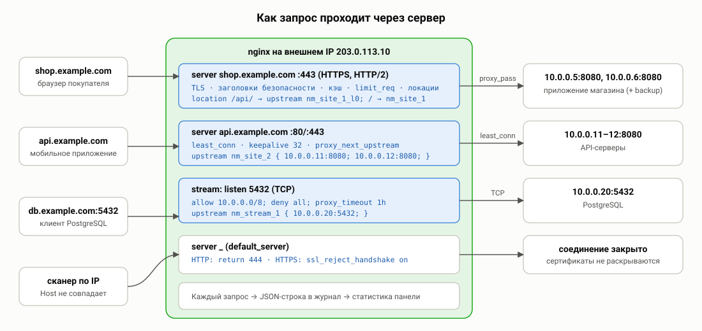

## Для кого

- Один сервер с внешним IP и несколько сайтов/приложений за ним (в той же машине, во внутренней сети, в контейнерах).
- Администраторы, которым нужна наглядность: что сейчас происходит, кто нагружает, почему 502, когда истекает сертификат.
- Команды, где правки делают разные люди: роли, аудит, история версий, откат.

## Основные понятия

| Термин | Что это |
|---|---|
| **Сайт** | Виртуальный хост nginx (`server { … }`): набор доменов и правил обработки. Типы: прокси, перенаправление, статика. |
| **Бэкенд** | Сервер приложения, на который nginx передаёт запросы (`upstream`). У сайта может быть несколько бэкендов. |
| **Локация** | Правило для части URL (`location /api/ { … }`): свои бэкенды, лимиты, доступ, кэш. |
| **Поток** | Проксирование TCP/UDP-порта (модуль `stream`): базы данных, почта, DNS, игровые серверы. |
| **Применение** | Генерация файлов конфигурации, проверка `nginx -t`, переключение и плавная перезагрузка nginx. |
| **Версия** | Снимок применённой конфигурации (все файлы + настройки панели) — для сравнения и отката. |
| **Проверка доступности** | Активный опрос бэкенда панелью (HTTP-запрос или TCP-подключение). |
| **Диагностика** | Набор автоматических проверок системы с объяснением и исправлением. |

## Интерфейс

Слева — навигация по разделам, сверху — состояние nginx, соединение реального времени и **плашка неприменённых
изменений**: правки сохраняются в базе панели сразу, но в nginx попадают только после нажатия «Применить». Это
позволяет подготовить несколько изменений и применить их одним действием, предварительно посмотрев разницу.

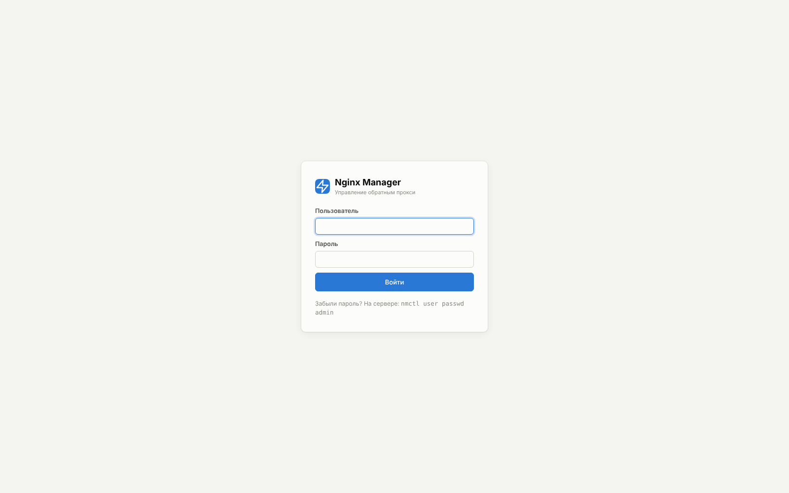

### Мониторинг

| Раздел | Что показывает |
|---|---|
| **Дашборд** | Ключевые показатели и графики реального времени, нагрузка по сайтам, ресурсы сервера, сертификаты, события. |
| **Аналитика** | История за любой период: динамика запросов, трафика, ошибок, задержек; распределения и топы. |
| **Журнал запросов** | Живой поток каждого запроса с фильтрами и поиск по истории. |
| **Журнал ошибок** | Ошибки nginx с автоматической классификацией и рекомендациями. |
| **Бэкенды** | Состояние каждого сервера: доступность, задержка, история проверок. |
| **Сервер** | CPU, память, диск, сеть, процессы nginx; управление службой; сведения о сборке. |

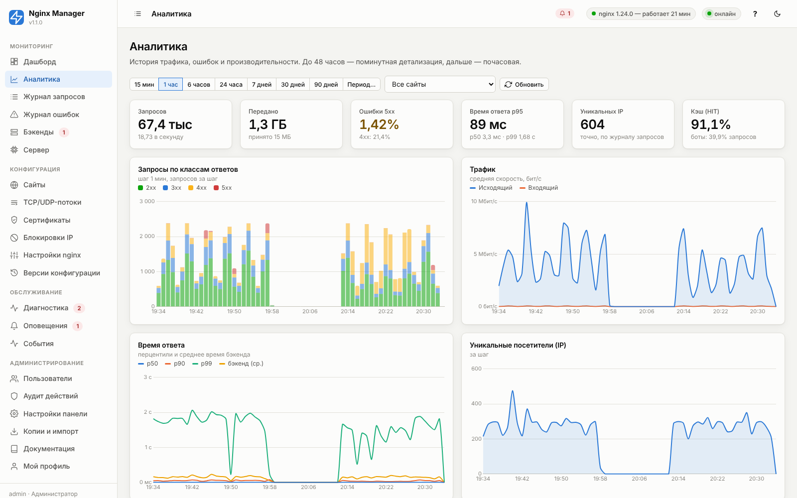

### Конфигурация

| Раздел | Что настраивается |
|---|---|
| **Сайты** | Список сайтов, мастер создания с шаблонами, подробный редактор с живым предпросмотром конфигурации. |
| **TCP/UDP-потоки** | Проксирование портов уровня L4. |
| **Сертификаты** | Выпуск Let's Encrypt, загрузка, самоподписанные, проверка домена. |
| **Настройки nginx** | Глобальные параметры nginx.conf и уровня http. |
| **Блокировки IP** | Ручная и автоматическая блокировка адресов: сканеры уязвимостей, подбор паролей, флуд ([17](17-bans.md)). |
| **Версии конфигурации** | История применений, сравнение, откат. |

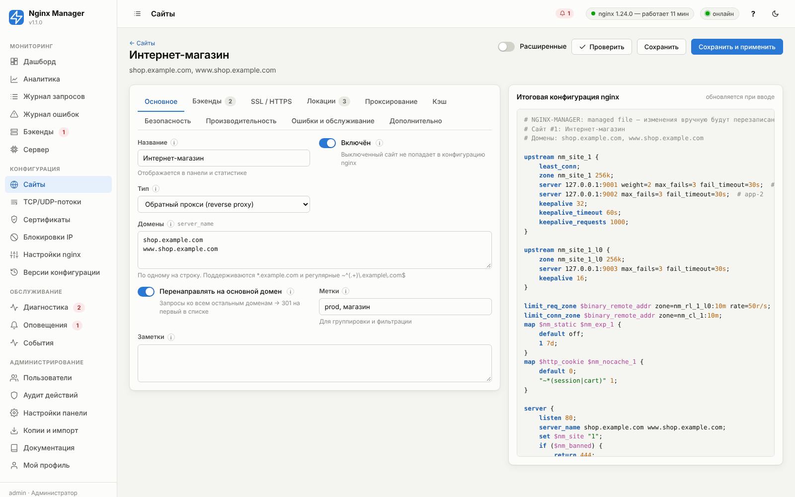

### Обслуживание и администрирование

| Раздел | Назначение |
|---|---|
| **Диагностика** | Автоматические проверки и исправления. |
| **Оповещения** | Правила, каналы уведомлений, история срабатываний. |
| **События** | Журнал событий сервиса (применения, сторож, бэкенды, сертификаты). |
| **Пользователи** | Учётные записи и роли. |
| **Аудит действий** | Кто, когда и что изменил. |
| **Настройки панели** | Хранение данных, сеть, безопасность доступа, Let's Encrypt, мониторинг, копии. |
| **Копии и импорт** | Экспорт/импорт настроек, резервные копии. |
| **Документация** | Этот справочник: оглавление, поиск, справка по странице (кнопка «?» / F1). |
| **Мой профиль** | Пароль, 2FA, сессии, API-токены. |

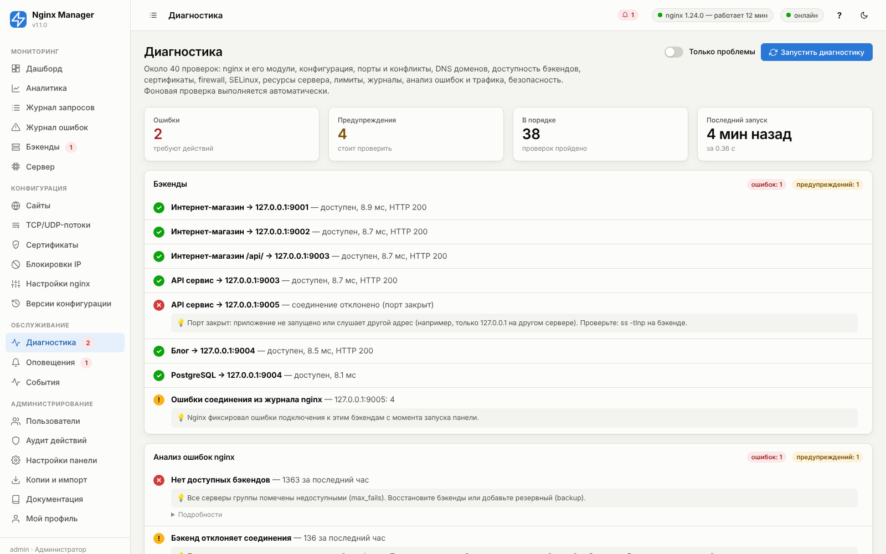

**События** — хронология работы сервиса: применения конфигурации, переходы бэкендов между UP и DOWN,
срабатывания оповещений, выпуск сертификатов, действия сторожа.

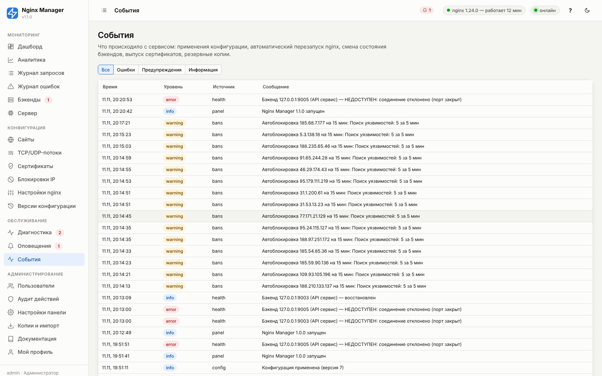

Вся документация встроена в панель (раздел **«Документация»**) и доступна без выхода в интернет:

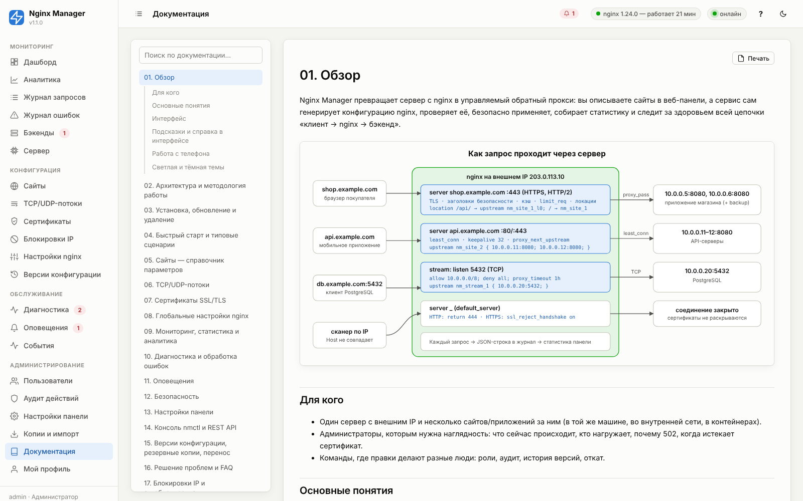

## Подсказки и справка в интерфейсе

- **Значок «i»** у поля: при наведении — краткое описание, рекомендация и пример; **по щелчку** открывается
  раздел справочника с полным описанием этого параметра.
- **Кнопка «?»** в верхней панели (или клавиша **F1**) открывает справку по текущей странице в боковой панели —
  форма остаётся на месте. В редакторе сайта открывается описание текущей вкладки.
- **Раздел «Документация»**: все главы с оглавлением, поиск по всему тексту с подсветкой совпадений, ссылки на
  отдельные разделы (значок `#` у заголовка), печать и сохранение в PDF. Щелчок по скриншоту увеличивает его.

Тексты подсказок и справочников документации (разделы 05, 06, 07, 08, 11, 13) генерируются из одного источника —
описания моделей в коде, поэтому всегда совпадают с панелью.

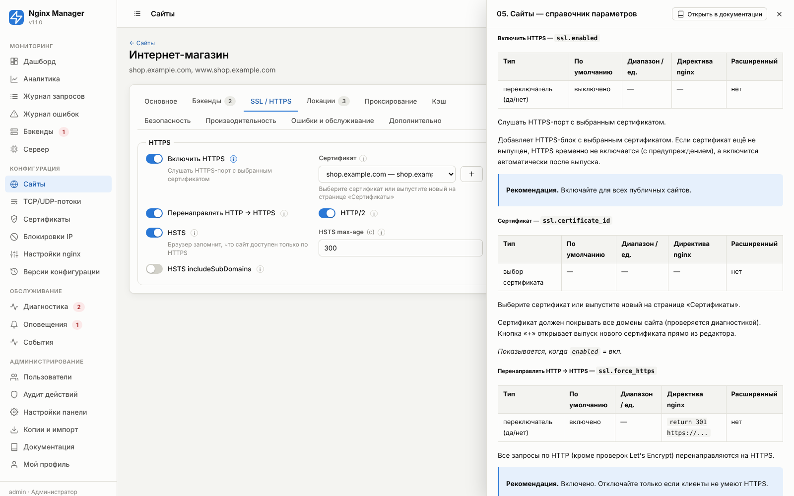

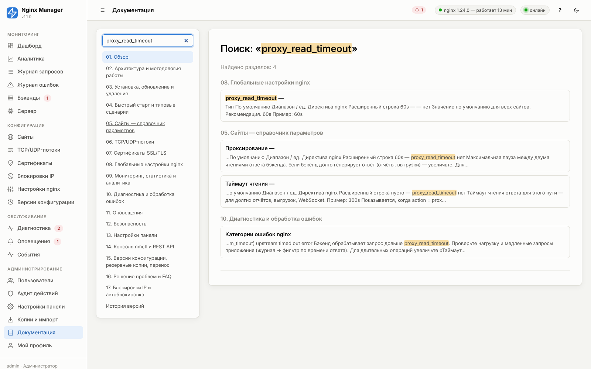

## Работа с телефона

На узком экране меню разделов прячется за кнопкой «☰» слева в верхней панели, формы и графики выстраиваются
в одну колонку, таблицы прокручиваются по горизонтали. В верхней панели остаются цветные индикаторы состояния
nginx и связи; кнопки «Изменения» и «Применить» доступны как на компьютере.

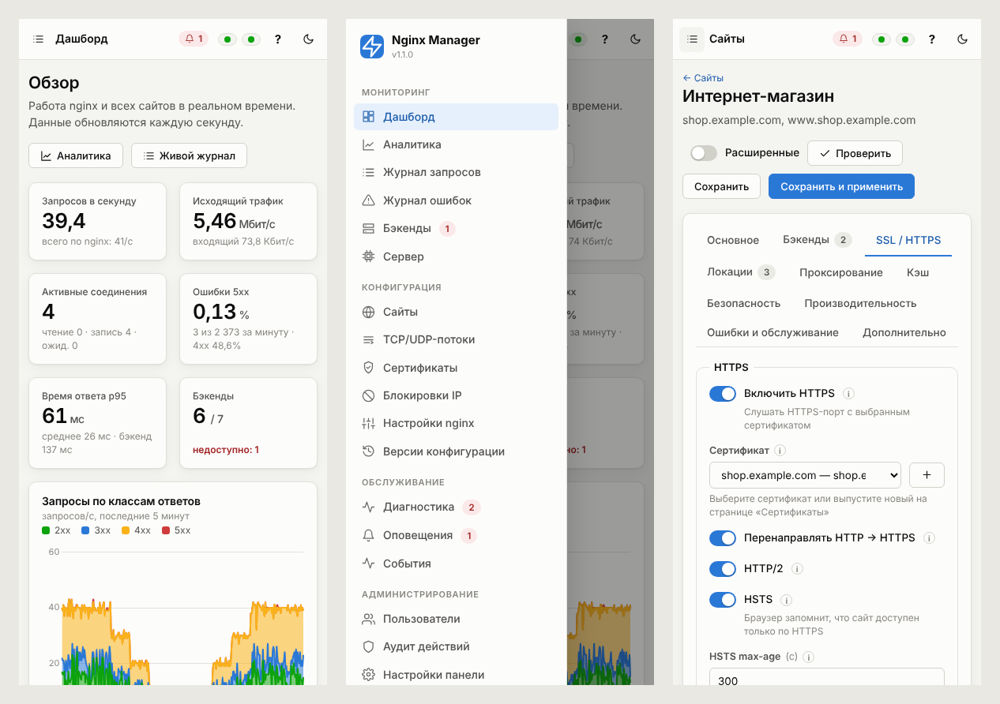

Переключатель **«Расширенные»** показывает редко используемые параметры (буферы, тонкая настройка TLS, keepalive и т. п.).
Значения по умолчанию безопасны и подходят для большинства случаев.

## Светлая и тёмная темы

Кнопка с луной в верхней панели переключает тему; выбор запоминается в браузере.

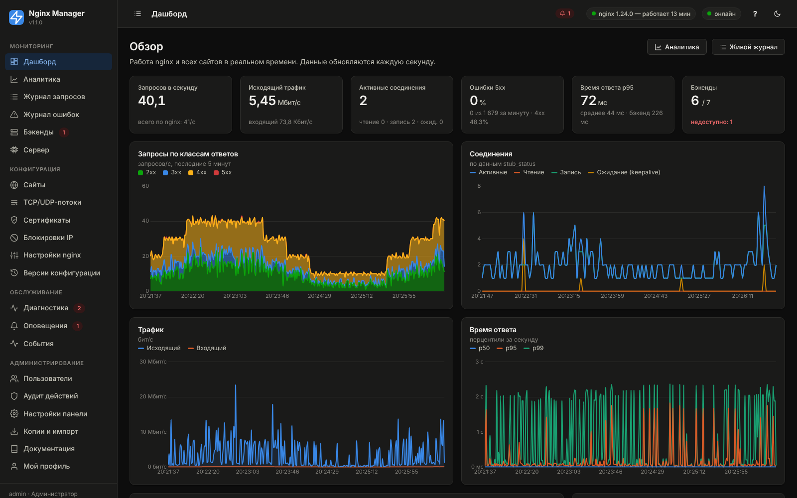
