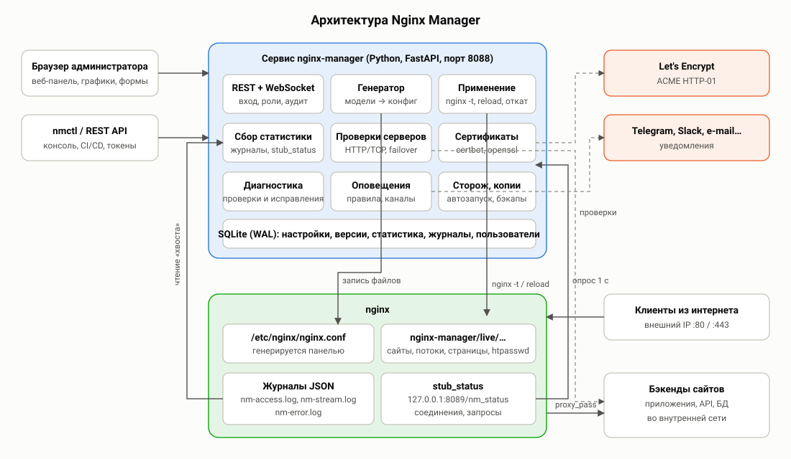
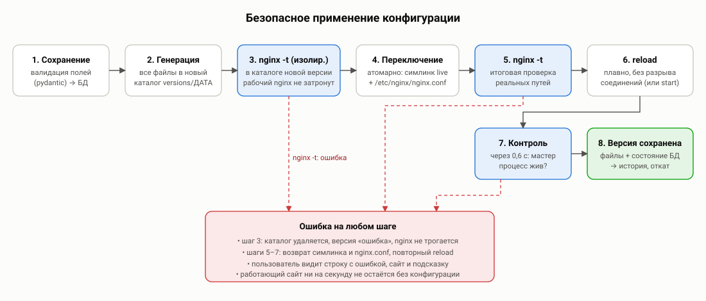
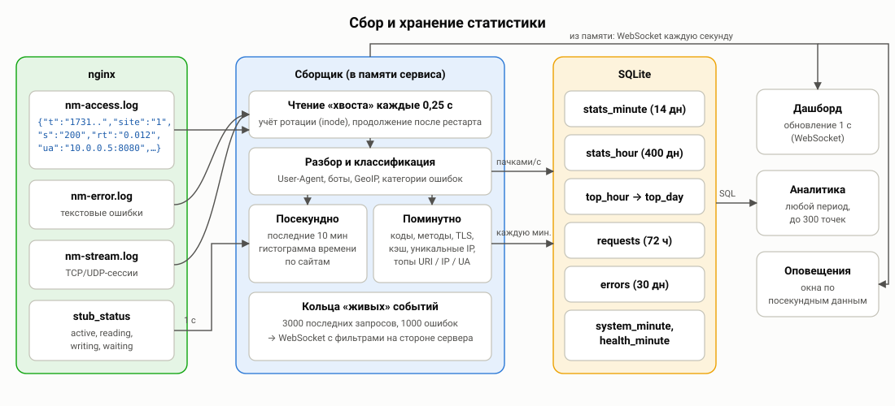

# 02. Архитектура и методология работы

## Компоненты

Nginx Manager — один процесс Python (FastAPI + uvicorn), работающий как служба systemd `nginx-manager` от root.
Права root необходимы: сервис пишет в `/etc/nginx`, вызывает `nginx -t` и `reload`, запускает certbot, читает журналы
nginx и процессы. Внутри процесса работают независимые асинхронные подсистемы:

| Подсистема | Файлы кода | Задача |
|---|---|---|
| REST API и WebSocket | `app/api/routes.py`, `app/main.py` | Веб-панель, nmctl, интеграции. Проверка прав, CSRF, аудит. |
| Модели и валидация | `app/models.py`, `app/validators.py` | Единое описание всех параметров: типы, значения по умолчанию, ограничения, тексты подсказок. |
| Генератор | `app/nginx/generator.py` | Превращает модели в файлы конфигурации nginx. |
| Применение | `app/nginx/manager.py` | Проверка, атомарное переключение, reload, контроль, откат, версии. |
| Сборщик статистики | `app/stats/*` | Чтение журналов, агрегация, хранение, аналитические запросы. |
| Проверки бэкендов | `app/services/health.py` | Активные HTTP/TCP-проверки, автопереключение. |
| Сертификаты | `app/services/certs.py` | certbot, openssl, разбор сертификатов, автопродление. |
| Диагностика | `app/services/diagnostics.py` | ~40 проверок системы и исправления. |
| Оповещения | `app/services/alerts.py` | Правила, состояния, отправка уведомлений. |
| Хранилище | `app/db.py` | SQLite в режиме WAL, миграции схемы. |

Веб-панель (`web/`) — одностраничное приложение на чистом JavaScript (ES-модули, без сборки). Графики — Chart.js,
справка — marked, QR-коды для 2FA — qrcode-generator; все библиотеки лежат локально, интернет браузеру не нужен.

## Где что хранится

| Путь | Содержимое |
|---|---|
| `/opt/nginx-manager/` | Программа, виртуальное окружение Python (`venv/`), документация. |
| `/etc/nginx-manager/panel.conf` | Параметры запуска сервиса (порт, адрес, пути). Всё остальное — в базе. |
| `/var/lib/nginx-manager/nginx-manager.db` | База SQLite: сайты, потоки, настройки, версии, статистика, пользователи, журналы. |
| `/var/lib/nginx-manager/certs/` | Загруженные и самоподписанные сертификаты (права 700). |
| `/var/lib/nginx-manager/acme/` | Каталог HTTP-проверок ACME (webroot). |
| `/var/lib/nginx-manager/dns-credentials/` | Учётные данные DNS-провайдеров для DNS-проверки (каталог 700, файлы 600). |
| `/var/lib/nginx-manager/backups/` | Резервные копии БД и настроек, копии кода при обновлении. |
| `/etc/nginx/nginx.conf` | Главный файл nginx — **генерируется панелью** (оригинал сохранён в `nginx.conf.nm-orig`). |
| `/etc/nginx/nginx-manager/versions/<дата>/` | Файлы каждой применённой версии (последние 10). |
| `/etc/nginx/nginx-manager/live` | Символическая ссылка на текущую версию. |
| `/var/log/nginx/nm-access.log` | Журнал запросов в JSON — источник статистики. |
| `/var/log/nginx/nm-error.log` | Журнал ошибок nginx. |
| `/var/log/nginx/nm-stream.log` | Журнал TCP/UDP-сессий в JSON. |
| `/var/cache/nginx/nginx-manager/<зона>/` | Кэш проксирования. |

## Методология: модели вместо текстовых файлов

Конфигурация хранится не как текст nginx, а как **структурированные модели** (сайт, поток, глобальные настройки).
Каждое поле модели имеет тип, диапазон, проверку формата и описание. Это даёт:

1. **Защиту от ошибок и инъекций.** Поля проверяются до генерации: домены (включая IDN → punycode), IP и подсети,
   форматы времени (`30s`, `5m`) и размеров (`10m`), регулярные выражения, имена заголовков. Символы `;`, `{`, `}` и
   переводы строк в значениях запрещены или экранируются — через поле формы нельзя «вставить» лишнюю директиву.
   Исключение — поля «Свои директивы», которые вставляются как есть (доступны операторам и администраторам) и всегда
   проходят `nginx -t`.
2. **Предсказуемый результат.** Генератор учитывает тонкости nginx, которые легко упустить вручную:
   - `add_header` и `proxy_set_header` не наследуются в `location`, если там есть свои — генератор повторяет полный
     набор в каждой локации;
   - общие для порта параметры `listen` (`http2` в nginx < 1.25.1, `reuseport` для QUIC) согласуются между сайтами;
   - страницы ошибок и режим обслуживания используют именованные локации, чтобы проверки уровня `server`
     (списки доступа, боты, обслуживание) не зацикливали обработку ошибок;
   - `limit_req` ставится в локации, а не в server, чтобы его можно было отключить или переопределить для отдельного пути;
   - `Connection ""` для keepalive к бэкендам и `$connection_upgrade` для WebSocket;
   - ACME-локация во всех HTTP-серверах и в сервере по умолчанию, чтобы Let's Encrypt мог проверить ещё не
     настроенный домен.
3. **Автоматическую адаптацию к установленному nginx.** По `nginx -V` определяются версия и модули: директива
   `http2 on` (≥ 1.25.1) или параметр `listen … http2`, `ssl_reject_handshake` (≥ 1.19.4), HTTP/3, модуль `stream`
   (встроенный или динамический), путь PID-файла, пользователь воркеров, наличие IPv6 в системе.
4. **Документацию из того же источника.** Подсказки формы и справочник параметров генерируются из описания моделей.

Каждый сайт — отдельный файл `sites/site-<id>-<имя>.conf`, каждый поток — `streams/stream-<id>-<имя>.conf`.
Глобальные параметры — `nginx.conf` и `http.d/00-base.conf`, сервер по умолчанию и внутренний `stub_status` —
`http.d/10-default.conf`. Кнопка «Конфигурация» у сайта и правая панель редактора показывают итоговый текст.

## Методология: безопасное применение

Изменения сохраняются в базе мгновенно, а в nginx попадают при **применении** («Применить» в верхней панели,
«Сохранить и применить» в редакторе, `nmctl apply`). Цикл применения:

1. **Генерация** всех файлов в новый каталог `versions/<дата-время>/`. Если модели противоречивы
   (например, выбран несуществующий сертификат) — понятная ошибка с указанием сайта, nginx не затрагивается.
2. **Изолированная проверка** `nginx -t -c versions/<дата>/nginx.conf`: проверяется полный набор новых файлов,
   а работающий nginx продолжает обслуживать запросы со старой конфигурацией. Ошибки разбираются: показывается
   файл, строка с подсветкой, сайт-источник и человеческое пояснение (например, «Порт уже занят другой программой»).
3. **Атомарное переключение**: символическая ссылка `live` переводится на новый каталог одной операцией
   `rename()`, затем записывается `/etc/nginx/nginx.conf`.
4. **Повторная проверка** `nginx -t` с реальными путями.
5. **Плавная перезагрузка** (`systemctl reload nginx` или `nginx -s reload`): новые воркеры получают новую
   конфигурацию, старые дообслуживают текущие соединения — разрывов нет. Если nginx не был запущен — запускается.
6. **Контроль**: через 0,6 с проверяется, что мастер-процесс жив.
7. **Сохранение версии**: все сгенерированные файлы и снимок настроек записываются в историю.

Если ошибка возникает на шагах 4–6, ссылка и `nginx.conf` возвращаются к предыдущей версии и выполняется повторная
перезагрузка. Так nginx ни на секунду не остаётся с неработающей конфигурацией.

**Откат** к любой версии восстанавливает в базе панели сайты, потоки и глобальные настройки этой версии и применяет их
тем же циклом — получается новая версия «Откат к версии N», историю можно продолжать.

**Автоматические применения** (переключение бэкендов при отказе, выпуск сертификата) строятся не из текущей базы,
а из **последней применённой версии** с обновлёнными сертификатами и состояниями бэкендов. Поэтому незавершённые
правки пользователя никогда не применяются «сами собой».

## Методология: сбор статистики

### Источники

1. **Журнал запросов в формате JSON** (`log_format nm_json escape=json`). Каждая строка содержит: время с
   миллисекундами, идентификатор сайта (переменная `$nm_site`, которую генератор задаёт в каждом server), Host, IP
   клиента, метод, URI, протокол, статус, размеры запроса и ответа, `$request_time`, адрес/статус/время бэкенда
   (`$upstream_*`), Referer, User-Agent, статус кэша, TLS-протокол, `$request_id`.
   Журнал пишется с буфером (по умолчанию 64 КБ, сброс раз в секунду) — это снижает нагрузку на диск.
2. **Журнал ошибок nginx** — текст; каждая строка разбирается регулярными выражениями (уровень, сообщение, клиент,
   server, запрос, upstream, host) и относится к одной из ~25 категорий с рекомендацией.
3. **Журнал TCP/UDP** (`nm_stream`) — сессии потоков: байты, длительность, статус.
4. **stub_status** на `127.0.0.1:8089` — опрос раз в секунду: активные соединения, чтение/запись/ожидание,
   общее число запросов (в том числе не попавших в журнал).
5. **psutil** — раз в 2 с: CPU, память, диски, сеть, процессы nginx (RSS, CPU, дескрипторы).

### Обработка

- **Чтение «хвоста»** журналов каждые 0,25 с. Ротация определяется по смене inode: старый файл дочитывается, затем
  открывается новый. Позиция чтения сохраняется — после перезапуска сервиса обработка продолжается с того же места
  (если отставание больше 200 МБ — с конца файла).
- **Посекундные корзины** за последние 10 минут — для графиков реального времени, WebSocket и оповещений.
- **Поминутные агрегаты** по каждому сайту и по всем вместе: число запросов, байты, классы и коды ответов,
  гистограмма времени ответа (12 корзин от 5 мс до >10 с), время бэкенда, методы, протоколы, TLS, кэш, ошибки
  nginx по категориям, боты, статика, уникальные IP, топы (URI, IP, Host, User-Agent, браузеры, ОС, устройства,
  страны, источники, бэкенды, ошибки 4xx/5xx, медленные URI).
- Минута «закрывается» через 10 с после окончания (запас на буферизацию журнала), записывается в `stats_minute` и
  сливается в `stats_hour`. Топы часа накапливаются в памяти и каждые 5 минут записываются в `top_hour`
  (топ-100 по каждому виду), в конце суток сворачиваются в `top_day`.
- **Журнал запросов** пишется в таблицу `requests` пачками раз в секунду (одна транзакция) — для поиска по истории.

### Перцентили

Время ответа хранится не списком значений, а гистограммой с границами 5, 10, 25, 50, 100, 250, 500 мс, 1, 2,5, 5,
10 с. Перцентиль p вычисляется линейной интерполяцией внутри корзины, в которую попадает p-я доля запросов.
Гистограммы складываются без потерь, поэтому p95 за час или неделю вычисляется так же корректно, как за минуту.
Погрешность — в пределах ширины корзины.

### Хранение и сроки

| Таблица | Детализация | Срок по умолчанию | Используется |
|---|---|---|---|
| `stats_minute` | 1 минута × сайт | 14 дней | Аналитика до 48 часов |
| `stats_hour` | 1 час × сайт | 400 дней | Аналитика за длинные периоды |
| `top_hour` / `top_day` | топ-100 за час / сутки | 31 / 400 дней | Топ-списки |
| `requests` | каждый запрос | 72 часа, не более 5 млн строк | Поиск, точные уникальные IP |
| `errors` | каждая ошибка nginx | 30 дней | Журнал ошибок, диагностика |
| `system_minute` | 1 минута | 30 дней | Графики ресурсов |
| `health_minute` | 1 минута × бэкенд | 14 дней | История проверок |

Очистка выполняется ежечасно. Сроки настраиваются в «Настройки панели → Статистика и хранение».

### Нагрузка

Разбор строки журнала, агрегация и детектор блокировок занимают десятки микросекунд: одно ядро обрабатывает около
30 тысяч строк в секунду. Журнал читается порциями до 1 МБ, между порциями сервис отвечает на запросы панели и
WebSocket, поэтому при всплесках трафика интерфейс не «замирает».

Нагрузочная проверка (журнал доступа дописывался с заданной скоростью, одновременно каждые 0,5 с запрашивался
`/api/overview`; 2 vCPU, SSD):

| Запросов в секунду | CPU процесса панели (среднее / пик) | Время ответа API (p50 / p95) | Отставание обработки журнала |
|---|---|---|---|
| 3 000 | 18% / 49% одного ядра | 30 / 78 мс | нет |
| 10 000 | 48% / 78% одного ядра | 36 / 340 мс | нет |

Запись журнала запросов в БД — основная нагрузка на диск; на очень нагруженных серверах уменьшите срок
хранения, включите сэмплирование («Сохранять каждый N-й запрос») или выключите журнал — агрегированная статистика
при этом остаётся точной.

## Методология: проверки бэкендов и автопереключение

Open-source nginx умеет только **пассивные** проверки: сервер исключается, если `max_fails` запросов подряд за
`fail_timeout` завершились ошибкой. Он не замечает «зависший» бэкенд, который принимает TCP-соединения, но не
отвечает, и проверяет сервер только реальными запросами пользователей.

Nginx Manager добавляет **активные** проверки: каждые N секунд на каждый сервер отправляется HTTP-запрос (`GET`/`HEAD`
на путь проверки, с нужным Host, проверкой кода и, при желании, текста ответа) или устанавливается TCP-соединение.
Состояние переключается в DOWN после `fall` неудач подряд и обратно в UP после `rise` успехов. Смена состояния:

- записывается в события и показывается в панели (уведомление в браузере);
- может вызвать оповещение (правило «Бэкенд недоступен»);
- при включённом **«Автоматическое переключение»** — сервер помечается `down` в конфигурации nginx (через
  переприменение последней версии) и возвращается после восстановления. Если недоступны все основные серверы группы,
  ни один не выключается — пусть nginx пробует.

Запросы проверок помечены User-Agent `NginxManager-HealthCheck` и (при соответствующей настройке) не учитываются в
статистике.

## Методология: диагностика

Диагностика — это набор независимых проверок (раздел [10](10-diagnostics.md)). Каждая возвращает статус
(в порядке / предупреждение / ошибка / информация), сообщение, подробности, **объяснение причины и рекомендацию**,
а для типовых проблем — **действие исправления** (запустить nginx, открыть порты в firewall, разрешить сетевые
подключения в SELinux, перевыпустить сертификат, применить конфигурацию и т. д.). Полная диагностика выполняется
автоматически каждые 10 минут (настраивается), вручную — кнопкой или `nmctl diag`.

## Сторож и фоновые задачи

| Задача | Период | Что делает |
|---|---|---|
| Сторож nginx | 10 с | Если мастер-процесс не найден — запускает nginx (не более 5 раз за 10 минут), пишет событие. |
| Проверка конфигурации | 5 мин | `nginx -t` для правила оповещения «Ошибка конфигурации». |
| Оповещения | 10 с | Вычисление правил, отправка уведомлений. |
| Диагностика | 10 мин | Полный набор проверок, счётчик проблем в меню. |
| Сертификаты | 1 ч | Перечитывание сроков, автопродление ACME-сертификатов за 30 дней (короткие — за треть срока). |
| Резервная копия | ежедневно | Копия БД и экспорт настроек (час настраивается), хранение 14 копий; выгрузка в S3-хранилище (gzip, шифрование, хранение N копий). |
| Уведомления о событиях | сразу | Записи журнала «События» выбранных источников и уровня — в каналы оповещений (с защитой от повторов и лимитом в час). |
| Очистка | 1 ч | Удаление устаревшей статистики и журналов. |

## Взаимодействие с другими конфигурациями

По умолчанию в `http {}` подключается `/etc/nginx/conf.d/*.conf` (для совместимости с пакетами, которые кладут туда
свои файлы), а `/etc/nginx/sites-enabled/*` — нет (файл `default` из Debian/Ubuntu конфликтует с сервером по
умолчанию панели). Оба включения настраиваются в «Настройки nginx → Дополнительно». Существующие сайты из исходной
конфигурации можно перенести в панель импортом (Сайты → «Импорт из nginx»).
