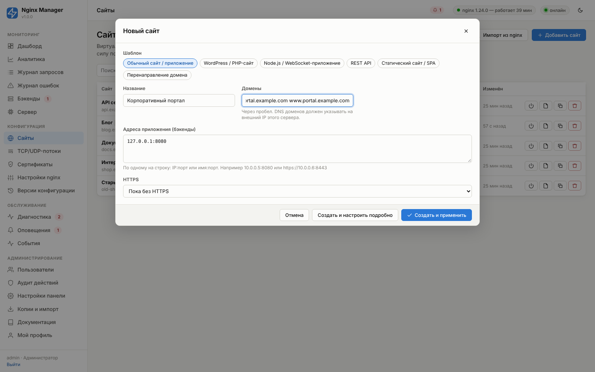
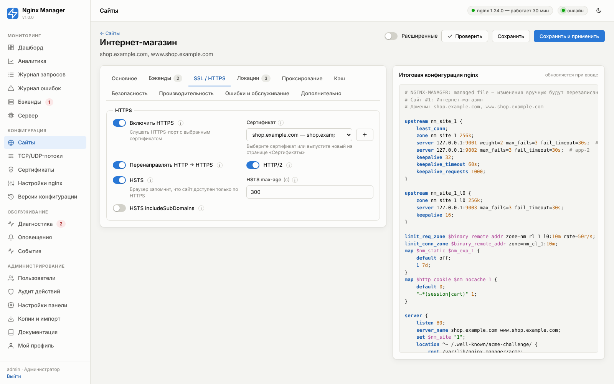
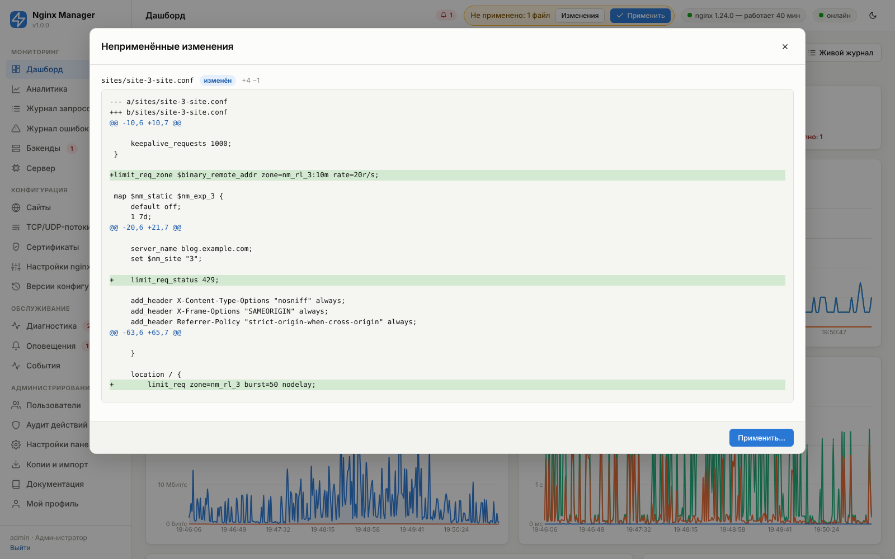
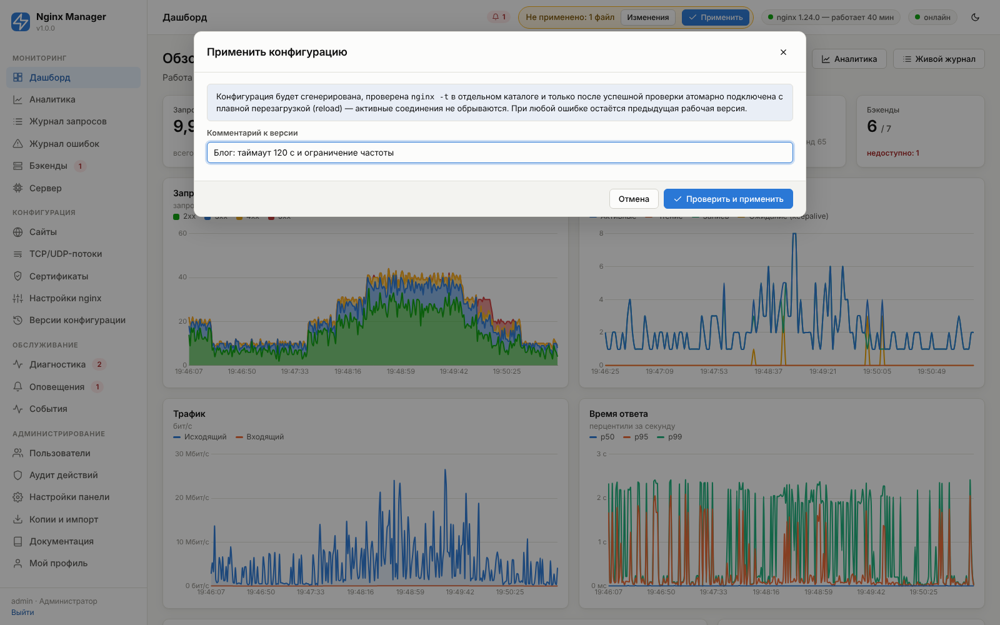
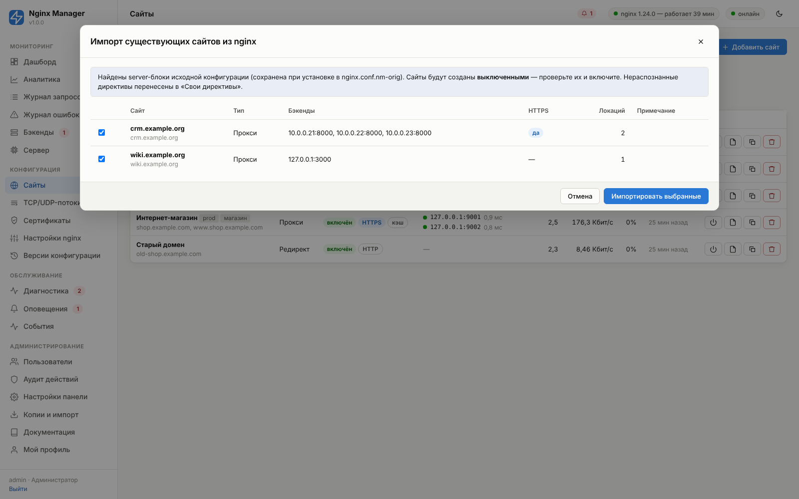

# 04. Быстрый старт и типовые сценарии

## Первый сайт за 5 минут

Задача: приложение работает на внутреннем сервере `10.0.0.5:8080`, его нужно опубликовать как
`https://shop.example.com` через внешний IP сервера с nginx.

### Шаг 1. DNS

У регистратора домена (или в DNS-панели провайдера) создайте A-запись `shop.example.com → внешний IP сервера`
(и `www.shop.example.com`, если нужен). Для IPv6 — AAAA-запись. Проверить можно в панели:
**Сертификаты → «Проверить домен»** или в **Диагностике** (группа DNS).

### Шаг 2. Создание сайта

**Сайты → «Добавить сайт»**. Откроется мастер:



- **Шаблон** — набор готовых настроек: обычный сайт, WordPress, Node.js/WebSocket, REST API, статический сайт/SPA,
  перенаправление. Всё можно поменять потом в редакторе.
- **Название** — для панели и статистики.
- **Домены** — через пробел: `shop.example.com www.shop.example.com`.
- **Адреса приложения** — по одному на строку: `10.0.0.5:8080`. Для https-бэкенда — `https://10.0.0.5:8443`.
- **HTTPS** — «Выпустить сертификат Let's Encrypt сейчас».

Нажмите **«Создать и применить»**. Сайт создаётся, конфигурация применяется (nginx начинает отвечать по HTTP),
запускается выпуск сертификата. Ход выпуска виден на странице **Сертификаты** (кнопка «Журнал»). После выпуска
HTTPS включается автоматически, а HTTP перенаправляется на HTTPS.

### Шаг 3. Проверка

- Откройте `https://shop.example.com` — должен открыться ваш сайт.
- **Дашборд** — запросы сайта появляются через 1–2 секунды.
- **Бэкенды** — сервер `10.0.0.5:8080` в состоянии «доступен».
- **Диагностика** — нет красных пунктов.

### Шаг 4. Тонкая настройка

Откройте сайт в списке — появится редактор с вкладками и **живым предпросмотром итоговой конфигурации nginx** справа:



Изменения применяются кнопкой **«Сохранить и применить»** (или «Сохранить», а применить позже вместе с другими
правками — плашкой в верхней панели). Кнопка **«Изменения»** на плашке показывает построчную разницу
между действующей и новой конфигурацией nginx:



Далее — диалог применения с комментарием к версии:



Кнопка **«Проверить»** выполняет `nginx -t` для черновика без сохранения и применения — удобно для экспериментов
со «Своими директивами».

## Типовые сценарии

Ниже — готовые рецепты. Названия полей соответствуют форме редактора сайта; рядом указан путь параметра
(для API и справочника [05](05-sites.md)).

### 1. Несколько сайтов на одном IP

Создайте по сайту на каждый домен — nginx выбирает сайт по заголовку `Host` (HTTP) или SNI (HTTPS). Один внешний IP
обслуживает любое количество доменов. Запросы с неизвестным доменом (сканеры, обращения по IP) по умолчанию
закрываются без ответа (код 444), а для HTTPS — отклоняются на этапе TLS без раскрытия сертификатов
(«Настройки nginx → Сервер по умолчанию»).

### 2. Балансировка на несколько серверов с резервным

- Вкладка **Бэкенды**: `10.0.0.5:8080` (вес 2), `10.0.0.6:8080` (вес 1), `10.0.0.7:8080` — **Резервный**.
- **Метод балансировки**: Least Connections (`balancing = least_conn`).
- **Проверка доступности**: путь `/health`, интервал 10 с, «Автоматическое переключение» — включить.
- Вкладка **Проксирование → Повтор на другом сервере при**: `error timeout http_502 http_503 http_504`.

Результат: нагрузка распределяется 2:1, при отказе обоих основных серверов работает резервный; зависший сервер
(принимает соединения, но не отвечает) исключается активной проверкой; неудачный запрос повторяется на другом сервере.

### 3. «Липкие» сессии

Если приложение хранит сессии в памяти процесса — **Метод балансировки**: IP Hash (`ip_hash`) или Hash с ключом
`$cookie_sessionid` и консистентным хешированием. Лучшее решение — вынести сессии в Redis/БД и использовать
`least_conn`.

### 4. WordPress / PHP-сайт

Шаблон «WordPress / PHP-сайт» включает:
- кэширование с обходом для авторизованных (шаблон cookie `wordpress_logged_in|wp-postpass|comment_author|woocommerce_items_in_cart`);
- `client_max_body_size = 64m` для загрузки медиа;
- кэш статики в браузере на 7 дней;
- запрет `/xmlrpc.php` (частая цель атак);
- ограничение `/wp-login.php` — 10 запросов в минуту с IP.

Проверить работу кэша: заголовок ответа `X-Cache-Status: HIT/MISS/BYPASS` и график «Кэш (HIT)» в Аналитике.

### 5. Node.js, WebSocket, Socket.IO

- **Проксирование → Поддержка WebSocket**: включено (по умолчанию).
- **Таймаут чтения**: `3600s` для долгоживущих соединений (иначе соединение без сообщений закроется через 60 с).
- Если путь WebSocket отдельный — локация `/ws` из шаблона «WebSocket» (таймаут 3600 с, буферизация выключена).
- Для нескольких экземпляров Socket.IO без адаптера Redis — `ip_hash`.

### 6. SPA (React/Vue) + API на разных серверах

- Тип сайта: **Статический сайт**, каталог `/var/www/app`, **Режим SPA** — включён (все неизвестные пути отдают
  `index.html` для клиентской маршрутизации).
- Локация `/api/` (шаблон «API на другой сервер»): бэкенд `10.0.0.10:8000`, **Заменить путь на** `/` — запрос
  `/api/users` уйдёт на бэкенд как `/users`. Оставьте поле пустым, чтобы путь передавался как есть.

### 7. REST API с ограничением частоты

- Шаблон «REST API».
- **Безопасность → Ограничение частоты**: 50r/s, burst 100, ключ — IP клиента (или заголовок `X-API-Key`).
- Для отдельного тяжёлого метода — локация с «Ограничение частоты: Своё», например `/api/export` — `2r/m`.
- CORS: **Доп. заголовки ответа**: `Access-Control-Allow-Origin: https://app.example.com`,
  `Access-Control-Allow-Credentials: true` (включите «always»). Для preflight-запросов — локация с `match = exact`
  нельзя по методу, поэтому используйте «Свои директивы в location /»:
  ```nginx
  if ($request_method = OPTIONS) { add_header Access-Control-Allow-Origin "https://app.example.com" always;
      add_header Access-Control-Allow-Methods "GET, POST, PUT, DELETE" always;
      add_header Access-Control-Allow-Headers "Authorization, Content-Type" always; return 204; }
  ```

### 8. Перенаправления: старый домен, www → без www

- Старый домен целиком: отдельный сайт типа **Перенаправление** на `https://new.example.com`, «Сохранять путь» —
  включено, код 301.
- `www.example.com → example.com`: в одном сайте укажите оба домена (основной — первым) и включите
  **«Перенаправлять на основной домен»**.
- Отдельный путь: локация `= /old-page` с действием «Перенаправить» на `/new-page`.

### 9. Админка только из офиса, staging под паролем

- Локация `/admin` → «Доступ только с IP»: `203.0.113.0/24` (остальным 403).
- Весь сайт под паролем: **Безопасность → Защита паролем (Basic Auth)**, добавьте пользователей. Чтобы офис входил
  без пароля: режим доступа «Только белый список», адреса офиса, и «IP из белого списка входят без пароля».
  Используйте только с HTTPS.

### 10. Режим обслуживания на время релиза

Вкладка **Ошибки и обслуживание → Режим обслуживания**: включить, добавить свой IP в «IP, которым сайт доступен»,
задать текст. Применить. Посетители видят страницу «Ведутся работы» с кодом 503 и заголовком `Retry-After` (поисковики
понимают, что это временно), а вы проверяете новую версию со своего IP. После релиза — выключить и применить.

Быстрее — через API: `POST /api/sites/{id}/maintenance {"enabled": true}` (применяется сразу).

### 11. Сайт за Cloudflare или балансировщиком

**Настройки nginx → Реальный IP клиента**: включить, заголовок `CF-Connecting-IP` (Cloudflare) или `X-Forwarded-For`,
нажать **«Добавить диапазоны Cloudflare»**. Без этого во всей статистике, лимитах и списках доступа будут IP
Cloudflare, а не посетителей. Для HAProxy/NLB с PROXY protocol — заголовок `proxy_protocol` и
«Принимать PROXY protocol» на вкладке «HTTP и соединения».

### 12. Проксирование на внешний HTTPS-сервис

- Бэкенд: `api.partner.com:443`, **Протокол бэкенда**: `https`.
- **Заголовок Host к бэкенду**: «Адрес бэкенда» — внешний сервис ожидает свой Host.
- **Передавать SNI бэкенду**: включено; при необходимости — проверка сертификата бэкенда.
- Если IP сервиса меняется — укажите DNS-резолверы в «Настройки nginx → SSL/TLS → DNS-резолверы».

### 13. Загрузка больших файлов

- **Производительность → Макс. размер тела запроса**: `2g` (иначе 413 Request Entity Too Large).
- **Проксирование → Буферизация запроса**: выключить — файл потоково передаётся бэкенду, а не сохраняется на диск nginx.
- **Таймаут отправки/чтения**: `600s`.
- Лучше вынести загрузку в отдельную локацию `/upload` с этими параметрами.

### 14. Server-Sent Events, потоковые ответы

Локация с путём потока (`/events`), **Буферизация ответа** — «Нет», **Таймаут чтения** — `3600s`. Альтернатива —
приложение отправляет заголовок `X-Accel-Buffering: no`.

### 15. База данных наружу с белым списком (TCP)

**TCP/UDP-потоки → Добавить**: порт `5432`, сервер `10.0.0.20:5432`, таймаут простоя `1h`, белый список —
адреса офиса и приложений. Подробнее: [06. TCP/UDP-потоки](06-streams.md).

### 16. Перенос существующих сайтов в панель

**Сайты → «Импорт из nginx»**: панель читает исходную конфигурацию (`nginx.conf.nm-orig`, сохранённую при установке)
через `nginx -T`, распознаёт server-блоки, upstream, proxy_pass, сертификаты, редиректы и статические локации и
создаёт **выключенные** сайты для проверки. Нераспознанные директивы переносятся в «Свои директивы». Проверьте каждый
сайт, включите его и примените конфигурацию.


