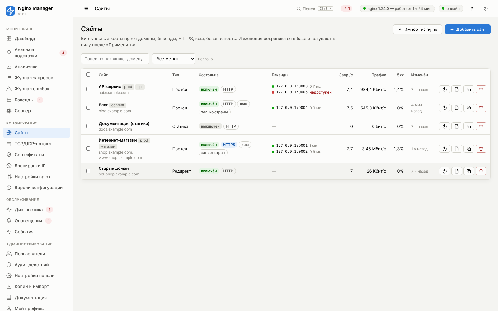
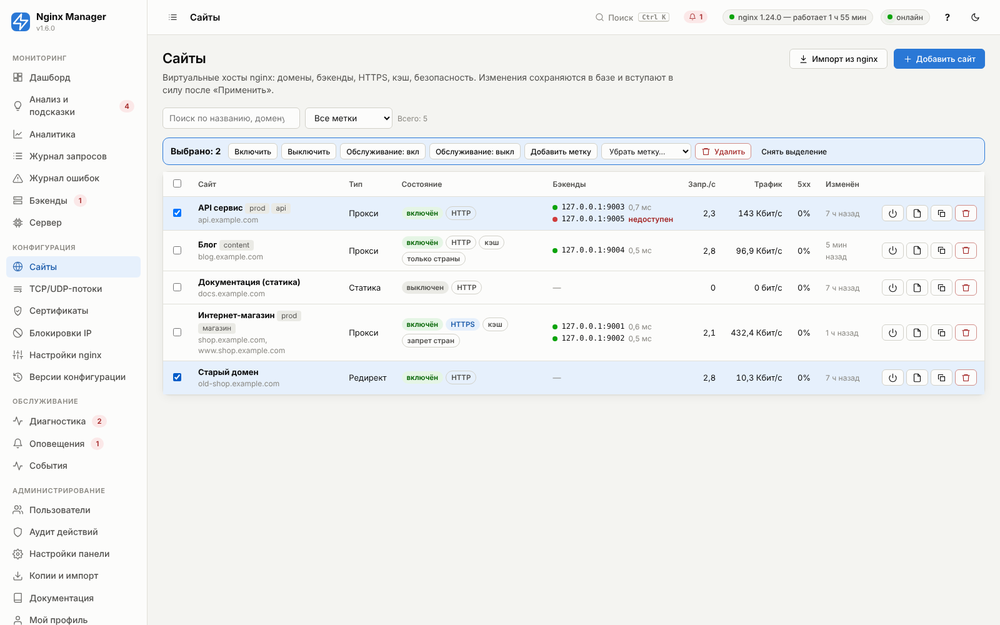
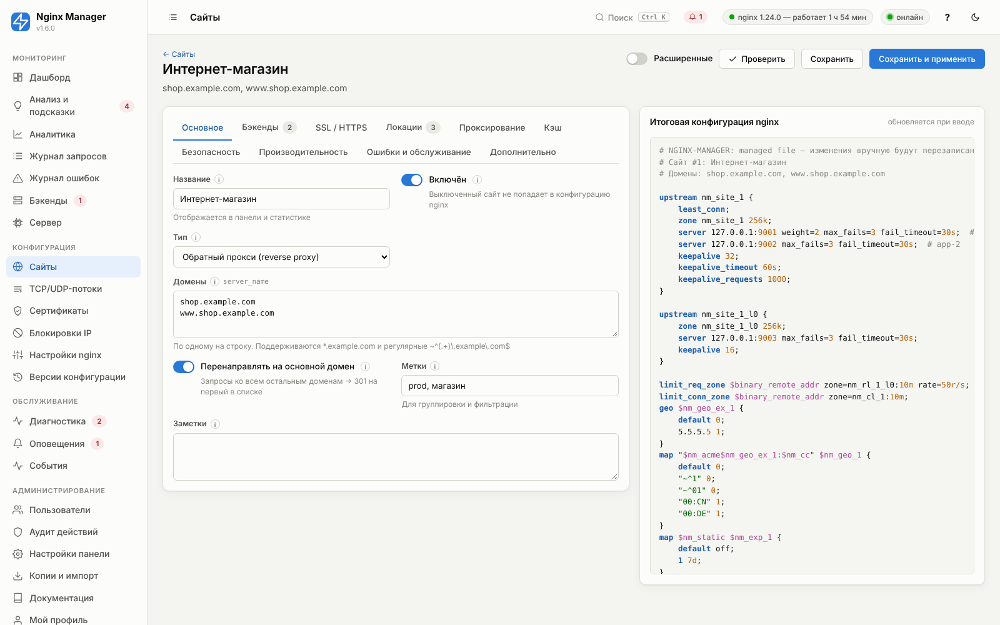
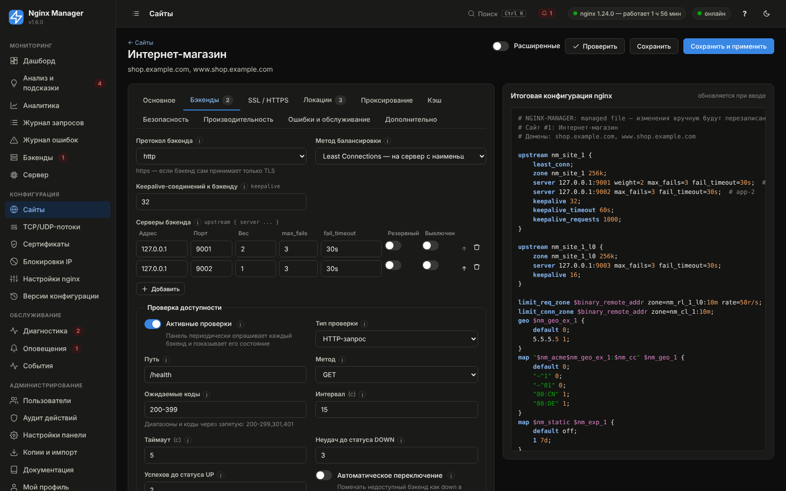
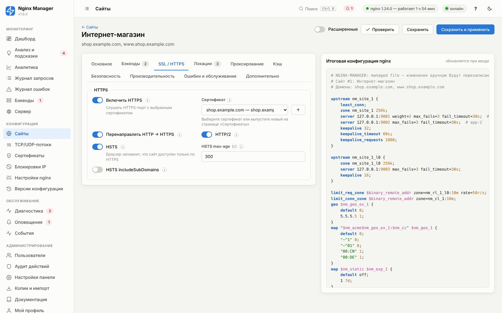
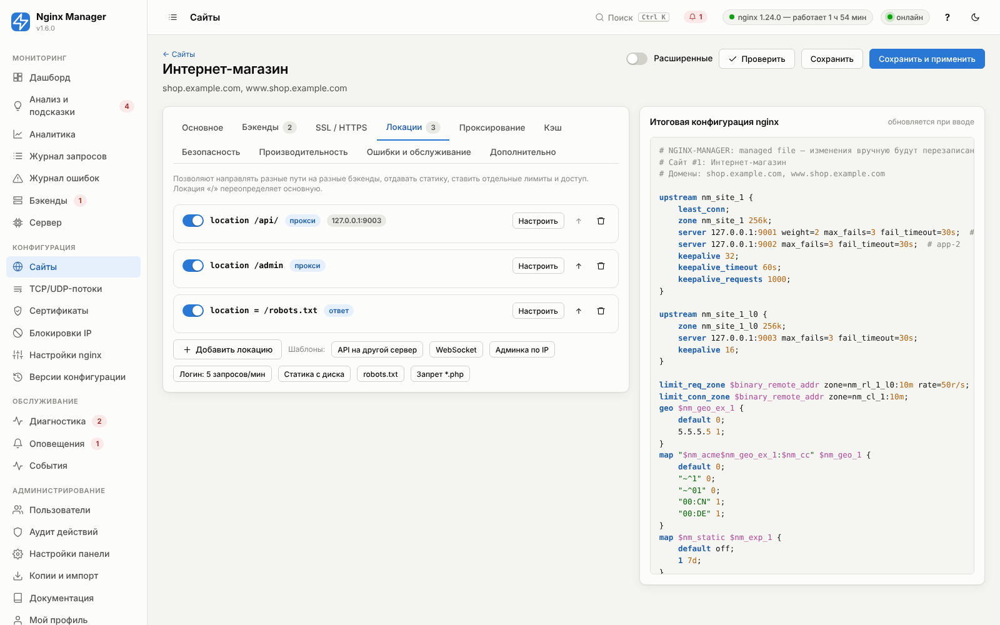
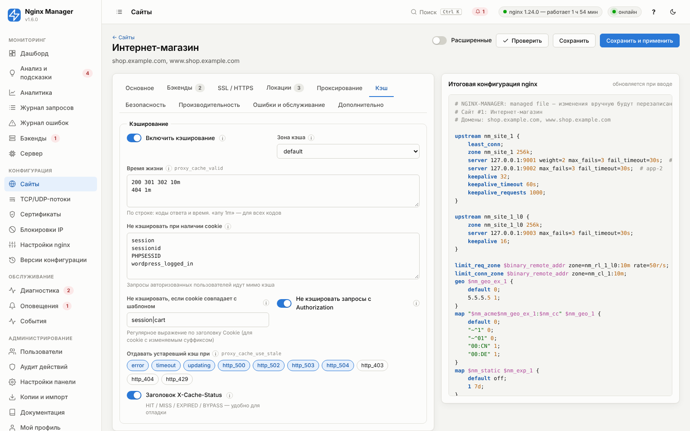
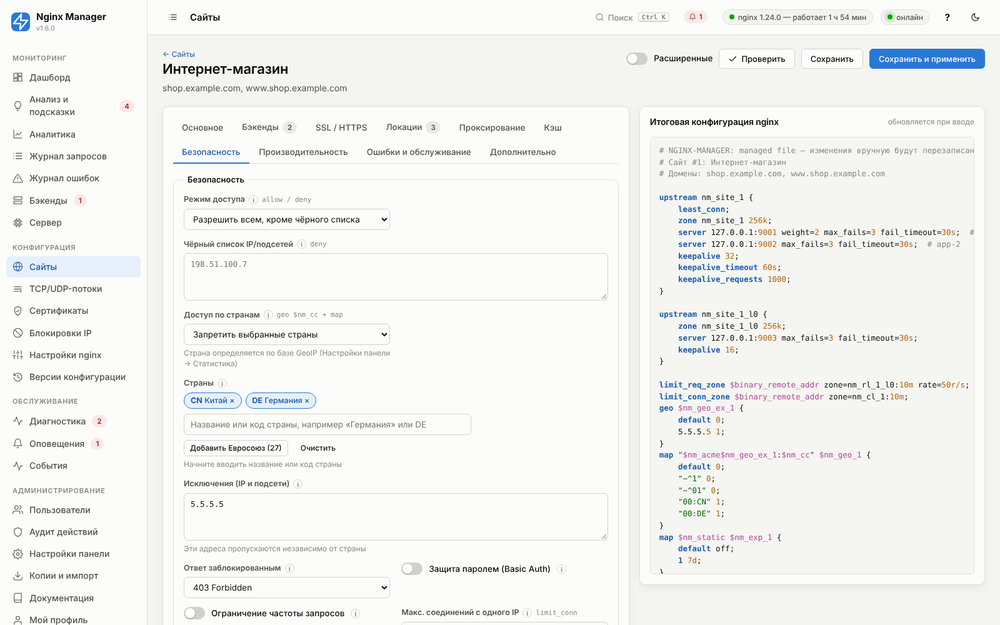

# 05. Сайты — справочник параметров

Сайт — это виртуальный хост nginx. Для каждого включённого сайта генерируется файл
`/etc/nginx/nginx-manager/live/sites/site-<id>-<имя>.conf`, который содержит:

1. группы бэкендов `upstream nm_site_<id>` (и `nm_site_<id>_l<N>` для локаций со своими бэкендами);
2. зоны ограничения частоты/соединений, `geo` режима обслуживания и исключений доступа по странам, `map` для кэша
   статики, обхода кэша и доступа по странам;
3. HTTP-сервер (только перенаправление на HTTPS и проверки Let's Encrypt — если HTTPS включён и выбрано
   перенаправление) и основной server-блок со всеми правилами.

Раздел **«Сайты»** — список всех сайтов с доменами, состоянием бэкендов, HTTPS и нагрузкой; отсюда же
запускается мастер создания сайта и импорт существующих конфигураций nginx.



### Массовые действия

Отметьте сайты флажками (флажок в заголовке выбирает все показанные — с учётом поиска и фильтра по меткам), и над
таблицей появится панель действий:

| Действие | Что происходит |
|---|---|
| Включить / Выключить | Меняется переключатель «Включён» у всех выбранных; вступает в силу после «Применить». |
| Обслуживание: вкл / выкл | Режим обслуживания включается или выключается и **конфигурация применяется сразу** (как и для одного сайта). |
| Добавить метку / Убрать метку | Метка добавляется всем выбранным или убирается у тех, у кого она есть. Удобно размечать «прод», «staging», клиентов. |
| Удалить | Сайты удаляются из панели после подтверждения со списком имён; конфигурация удаляется после «Применить». Вернуть можно откатом версии. |

Сайты, у которых действие ничего не меняет (например, уже выключенные), пропускаются. Каждое массовое действие
записывается в аудит одной строкой со списком сайтов. Через API: `POST /api/sites/bulk`
`{"ids": [1, 2], "action": "disable"}` ([14](14-cli-api.md)).



Ниже — описание **каждого параметра** редактора: тип, значение по умолчанию, директива nginx, подробное описание,
рекомендация и пример. Параметры, отмеченные «Расширенный: да», видны после включения переключателя «Расширенные».

## Как nginx выбирает сайт и локацию

**Сайт** выбирается по паре «адрес:порт» и затем по заголовку `Host` (для HTTPS — по SNI на этапе TLS):

1. точное имя (`shop.example.com`);
2. самое длинное имя с маской в начале (`*.example.com`);
3. самое длинное имя с маской в конце (`mail.*`);
4. первое совпавшее регулярное выражение (`~^(?<sub>.+)\.example\.com$`) в порядке файлов;
5. сервер по умолчанию для этого порта.

**Локация** внутри сайта:

1. точное совпадение (`= /path`) — сразу используется;
2. среди префиксов выбирается самый длинный; если это «приоритетный префикс» (`^~`), он используется сразу;
3. иначе регулярные выражения проверяются **по порядку** (порядок локаций в списке важен — кнопки ↑);
4. если ни одно регулярное не подошло — используется самый длинный префикс.

Служебные локации, которые генератор добавляет сам: `^~ /.well-known/acme-challenge/` (проверки Let's Encrypt,
приоритетна), `~ /\.(?!well-known)` (блокировка скрытых файлов, если включена) и именованные `@nm_err_<код>`
(страницы ошибок).

## Наследование параметров

| Параметр | Где задаётся | Как действует в локациях |
|---|---|---|
| Заголовки ответа (`add_header`) | Сайт + локация | Если у локации есть свои заголовки, генератор повторяет в ней все заголовки сайта (в nginx они не наследуются). |
| Заголовки к бэкенду (`proxy_set_header`) | Сайт + локация | Генерируются в каждой проксирующей локации полностью. |
| Ограничение частоты | Сайт / локация | «Как у сайта», «Выключить» или «Своё» для каждой локации. |
| Списки доступа | Сайт / локация | Если у локации задан «Доступ только с IP», правила сайта для неё заменяются. |
| Basic Auth | Сайт / локация | «Как у сайта», «Выключить» (например, для `/health`) или «Включить». |
| Кэш | Сайт / локация | «Как у сайта», «Включить» (со своим временем жизни), «Выключить». |
| Таймаут чтения, буферизация, WebSocket | Сайт / локация | Пустое значение у локации — как у сайта. |

<!-- GEN:site -->
<!-- Сгенерировано tools/gen_reference.py — не редактируйте вручную -->

### Вкладка «Основное»




<a id="f-site-name"></a>

#### Название — `name`

| Тип | По умолчанию | Диапазон / ед. | Директива nginx | Расширенный |
|---|---|---|---|---|
| строка | пусто | — | — | нет |

Отображается в панели и статистике.

Свободный текст для людей: используется в списках, статистике, уведомлениях и именах файлов конфигурации (в транслитерации не нуждается — в имени файла остаётся только латиница).

> **Рекомендация.** Называйте по смыслу: «Магазин (прод)», «API v2», «Staging».

**Пример:** `Интернет-магазин`


<a id="f-site-enabled"></a>

#### Включён — `enabled`

| Тип | По умолчанию | Диапазон / ед. | Директива nginx | Расширенный |
|---|---|---|---|---|
| переключатель (да/нет) | включено | — | — | нет |

Выключенный сайт не попадает в конфигурацию nginx.

Выключенный сайт остаётся в панели со всеми настройками, но его server-блок не генерируется: запросы к его доменам обработает сервер по умолчанию.

> **Рекомендация.** Выключайте вместо удаления, если сайт может понадобиться снова.


<a id="f-site-type"></a>

#### Тип — `type`

| Тип | По умолчанию | Диапазон / ед. | Директива nginx | Расширенный |
|---|---|---|---|---|
| выбор из списка | `proxy` (Обратный прокси (reverse proxy)) | — | — | нет |

«Обратный прокси» передаёт запросы на бэкенды; «Перенаправление» отвечает 301/302 на другой адрес (старые домены, склейка); «Статический сайт» отдаёт файлы из каталога сервера (лендинги, SPA, документация).

Варианты:

- `proxy` — Обратный прокси (reverse proxy)
- `redirect` — Перенаправление на другой адрес
- `static` — Статический сайт (файлы с диска)

> **Рекомендация.** Прокси — для любых приложений (PHP, Python, Node, Java, Go, контейнеры).

**Пример:** `proxy`


<a id="f-site-domains"></a>

#### Домены — `domains`

| Тип | По умолчанию | Диапазон / ед. | Директива nginx | Расширенный |
|---|---|---|---|---|
| список, по одному значению на строку | пусто | — | `server_name` | нет |

По одному на строку. Поддерживаются *.example.com и регулярные ~^(.+)\.example\.com$.

Первый домен считается основным (используется для Host в проверках и канонического перенаправления). Кириллические домены (IDN) автоматически переводятся в punycode.

**Пример:** `example.com, www.example.com`


<a id="f-site-canonical_redirect"></a>

#### Перенаправлять на основной домен — `canonical_redirect`

| Тип | По умолчанию | Диапазон / ед. | Директива nginx | Расширенный |
|---|---|---|---|---|
| переключатель (да/нет) | выключено | — | — | нет |

Запросы ко всем остальным доменам → 301 на первый в списке.

> **Рекомендация.** Включите, если в списке есть и example.com, и www.example.com.


<a id="f-site-listen_ip"></a>

#### IP для прослушивания — `listen_ip`

| Тип | По умолчанию | Диапазон / ед. | Директива nginx | Расширенный |
|---|---|---|---|---|
| IP-адрес | пусто | — | `listen <ip>:<port>` | да |

Пусто — все адреса сервера. Укажите внешний IP, если их несколько.

По умолчанию nginx слушает порт на всех адресах. Если у сервера несколько внешних IP и разные сайты должны отвечать на разных адресах (например, отдельный IP под сертификат или клиента), укажите адрес. Адрес должен быть назначен интерфейсу сервера.

> **Рекомендация.** Оставьте пустым, если внешний IP один.

**Пример:** `203.0.113.10`


<a id="f-site-http_port"></a>

#### HTTP-порт — `http_port`

| Тип | По умолчанию | Диапазон / ед. | Директива nginx | Расширенный |
|---|---|---|---|---|
| целое число | `80` | 1…65535 | — | да |

Порт для HTTP-запросов (и проверок Let's Encrypt — они всегда идут на 80). Нестандартный порт нужен для внутренних сервисов или когда 80 занят.

> **Рекомендация.** 80 для публичных сайтов.

**Пример:** `8080`


<a id="f-site-https_port"></a>

#### HTTPS-порт — `https_port`

| Тип | По умолчанию | Диапазон / ед. | Директива nginx | Расширенный |
|---|---|---|---|---|
| целое число | `443` | 1…65535 | — | да |

Порт для HTTPS. При нестандартном порте перенаправление с HTTP формируется с ним (https://host:8443/…).

> **Рекомендация.** 443 для публичных сайтов.

**Пример:** `8443`


<a id="f-site-default_server"></a>

#### Сервер по умолчанию — `default_server`

| Тип | По умолчанию | Диапазон / ед. | Директива nginx | Расширенный |
|---|---|---|---|---|
| переключатель (да/нет) | выключено | — | `default_server` | да |

Обрабатывать запросы с неизвестным Host этим сайтом.

Сайт будет отвечать на запросы с любым неизвестным Host на своих портах вместо встроенного сервера по умолчанию панели. На одном порту может быть только один такой сайт.

> **Рекомендация.** Обычно не нужно: безопаснее закрывать неизвестные домены (444).


<a id="f-site-tags"></a>

#### Метки — `tags`

| Тип | По умолчанию | Диапазон / ед. | Директива nginx | Расширенный |
|---|---|---|---|---|
| метки через запятую | пусто | — | — | нет |

Для группировки и фильтрации.

Метки для фильтрации списка сайтов и группировки (окружение, команда, клиент).

**Пример:** `prod, магазин, команда-А`


<a id="f-site-notes"></a>

#### Заметки — `notes`

| Тип | По умолчанию | Диапазон / ед. | Директива nginx | Расширенный |
|---|---|---|---|---|
| многострочный текст | пусто | — | — | нет |

Свободные заметки: кто отвечает за сайт, где репозиторий, особенности. В конфигурацию не попадают.

**Пример:** `Ответственный: Иван, бэкенд в k8s namespace shop`


<a id="f-site-redirect"></a>

#### Перенаправление — `redirect`


<a id="f-site-redirect-url"></a>

##### Куда перенаправлять — `redirect.url`

| Тип | По умолчанию | Диапазон / ед. | Директива nginx | Расширенный |
|---|---|---|---|---|
| строка | `https://example.com` | — | — | нет |

Целевой адрес. Можно $scheme://$host для смены только пути.

Адрес перенаправления. При «Сохранять путь» к нему добавляется путь и параметры запроса.

**Пример:** `https://new.example.com`


<a id="f-site-redirect-code"></a>

##### Код — `redirect.code`

| Тип | По умолчанию | Диапазон / ед. | Директива nginx | Расширенный |
|---|---|---|---|---|
| выбор из списка | `301` (301 — постоянный) | — | — | нет |

301/308 — постоянное (кэшируется браузерами, передаёт вес в поиске), 302/307 — временное. 307/308 сохраняют метод и тело POST.

Варианты:

- `301` — 301 — постоянный
- `302` — 302 — временный
- `307` — 307 — временный, метод сохраняется
- `308` — 308 — постоянный, метод сохраняется

> **Рекомендация.** 301 для смены домена.

**Пример:** `301`


<a id="f-site-redirect-preserve_path"></a>

##### Сохранять путь и параметры — `redirect.preserve_path`

| Тип | По умолчанию | Диапазон / ед. | Директива nginx | Расширенный |
|---|---|---|---|---|
| переключатель (да/нет) | включено | — | — | нет |

/page?x=1 → https://target/page?x=1.

/catalog?page=2 → https://new.example.com/catalog?page=2. Выключено — всегда на корень.

> **Рекомендация.** Включено при переезде.


<a id="f-site-static"></a>

#### Статика — `static`


<a id="f-site-static-root"></a>

##### Корневой каталог — `static.root`

| Тип | По умолчанию | Диапазон / ед. | Директива nginx | Расширенный |
|---|---|---|---|---|
| строка | `/var/www/html` | — | `root` | нет |

Каталог с файлами сайта. Должен быть доступен для чтения пользователю воркеров nginx (www-data / nginx), на RHEL — с меткой SELinux httpd_sys_content_t.

**Пример:** `/var/www/site`


<a id="f-site-static-index"></a>

##### Индексные файлы — `static.index`

| Тип | По умолчанию | Диапазон / ед. | Директива nginx | Расширенный |
|---|---|---|---|---|
| строка | `index.html index.htm` | — | `index` | нет |

Файлы, которые отдаются при запросе каталога.

**Пример:** `index.html`


<a id="f-site-static-spa"></a>

##### Режим SPA (try_files → /index.html) — `static.spa`

| Тип | По умолчанию | Диапазон / ед. | Директива nginx | Расширенный |
|---|---|---|---|---|
| переключатель (да/нет) | выключено | — | `try_files` | нет |

Для React/Vue/Angular-приложений с клиентской маршрутизацией.

Неизвестные пути отдают /index.html — клиентский роутер приложения сам покажет нужную страницу. Без этого обновление страницы /profile даст 404.


<a id="f-site-static-autoindex"></a>

##### Листинг каталогов — `static.autoindex`

| Тип | По умолчанию | Диапазон / ед. | Директива nginx | Расширенный |
|---|---|---|---|---|
| переключатель (да/нет) | выключено | — | `autoindex` | нет |

Показывать список файлов каталога, если нет индексного файла.

> **Рекомендация.** Выключено (раскрывает структуру файлов).


<a id="f-site-static-expires"></a>

##### Кэш в браузере — `static.expires`

| Тип | По умолчанию | Диапазон / ед. | Директива nginx | Расширенный |
|---|---|---|---|---|
| строка | пусто | — | `expires` | нет |

Время кэширования ответов в браузере (Cache-Control: max-age).

> **Рекомендация.** 1h для HTML; ассеты — через локацию со своим сроком.

**Пример:** `1h`


### Вкладка «Бэкенды»




<a id="f-site-backends"></a>

#### Серверы бэкенда — `backends`

| Тип | По умолчанию | Диапазон / ед. | Директива nginx | Расширенный |
|---|---|---|---|---|
| таблица элементов | пусто | — | `upstream { server ... }` | нет |

Серверы приложения, между которыми nginx распределяет запросы (группа upstream). Порядок важен только для метода hash. Для каждого — адрес, порт, вес и параметры отказоустойчивости.

> **Рекомендация.** Минимум два сервера для отказоустойчивости; при одном сервере max_fails не даёт эффекта.

**Пример:** `10.0.0.5:8080, 10.0.0.6:8080`

*Показывается, когда `type` = `proxy`.*

Поля элемента:

| Поле | Тип | По умолчанию | Описание |
|---|---|---|---|
| Адрес (`address`) | строка | `127.0.0.1` | IP-адрес, имя хоста или unix-сокет бэкенда. Рекомендация: IP-адреса во внутренней сети — быстрее и надёжнее имён. |
| Порт (`port`) | целое число | `80` | Игнорируется для unix-сокета |
| Вес (`weight`) | целое число | `1` | Доля запросов относительно других серверов группы. Рекомендация: Задавайте вес пропорционально производительности серверов. |
| max_fails (`max_fails`) | целое число | `3` | Число неудачных попыток за fail_timeout, после которых сервер считается недоступным. Рекомендация: 3 для большинства случаев; 1 — для быстрого переключения при наличии резерва. |
| fail_timeout (`fail_timeout`) | строка | `30s` | Окно подсчёта ошибок и время «выключения» сервера. Рекомендация: 10s–30s |
| Резервный (`backup`) | переключатель (да/нет) | выключено | Получает запросы, только когда все основные серверы недоступны |
| Выключен (`down`) | переключатель (да/нет) | выключено | Временно исключить сервер из балансировки (без удаления) |
| max_conns (`max_conns`) | целое число | `0` | Лимит одновременных соединений к серверу (0 — без лимита) Рекомендация: 0, или чуть меньше максимума воркеров/потоков приложения. |
| Комментарий (`comment`) | строка | пусто |  |


<a id="f-site-backend_scheme"></a>

#### Протокол бэкенда — `backend_scheme`

| Тип | По умолчанию | Диапазон / ед. | Директива nginx | Расширенный |
|---|---|---|---|---|
| выбор из списка | `http` | — | — | нет |

https — если бэкенд сам принимает только TLS.

Протокол между nginx и бэкендом. https нужен, если приложение принимает только TLS (внешние сервисы, IIS, Kubernetes Ingress). При https включаются SNI и, по желанию, проверка сертификата бэкенда.

Варианты:

- `http`
- `https`

> **Рекомендация.** http во внутренней доверенной сети — быстрее.

**Пример:** `http`

*Показывается, когда `type` = `proxy`.*


<a id="f-site-balancing"></a>

#### Метод балансировки — `balancing`

| Тип | По умолчанию | Диапазон / ед. | Директива nginx | Расширенный |
|---|---|---|---|---|
| выбор из списка | `round_robin` (Round Robin — по очереди с учётом весов) | — | — | нет |

round_robin — равномерно с учётом весов; least_conn — лучше при запросах разной длительности; ip_hash/hash — «липкие сессии», когда приложение хранит сессии в памяти; random_two — хорошо при нескольких балансировщиках перед одной группой.

Варианты:

- `round_robin` — Round Robin — по очереди с учётом весов
- `least_conn` — Least Connections — на сервер с наименьшим числом соединений
- `ip_hash` — IP Hash — клиент «прилипает» к серверу по IP
- `hash` — Hash — по произвольному ключу (URI, cookie...)
- `random` — Random — случайный выбор
- `random_two` — Random two least_conn — из двух случайных выбирается менее загруженный

> **Рекомендация.** least_conn для API и приложений; ip_hash, если сессии не вынесены в общее хранилище.

*Показывается, когда `type` = `proxy`.*


<a id="f-site-hash_key"></a>

#### Ключ hash — `hash_key`

| Тип | По умолчанию | Диапазон / ед. | Директива nginx | Расширенный |
|---|---|---|---|---|
| строка | `$request_uri` | — | — | нет |

Выражение из переменных nginx, по которому выбирается сервер: одинаковое значение → один и тот же сервер. $request_uri — для кэширующих бэкендов, $cookie_<имя> — липкие сессии по cookie, $remote_addr — по IP, $http_x_tenant — по заголовку.

**Пример:** `$cookie_sessionid`

*Показывается, когда `balancing` = `hash`.*


<a id="f-site-hash_consistent"></a>

#### Консистентное хеширование (ketama) — `hash_consistent`

| Тип | По умолчанию | Диапазон / ед. | Директива nginx | Расширенный |
|---|---|---|---|---|
| переключатель (да/нет) | включено | — | — | нет |

При изменении состава группы перераспределяется минимум ключей.

Ketama: при добавлении/удалении сервера перераспределяется только ~1/N ключей, а не все.

> **Рекомендация.** Включено (особенно для кэшей).

*Показывается, когда `balancing` = `hash`.*


<a id="f-site-keepalive"></a>

#### Keepalive-соединений к бэкенду — `keepalive`

| Тип | По умолчанию | Диапазон / ед. | Директива nginx | Расширенный |
|---|---|---|---|---|
| целое число | `32` | 0…10000 | `keepalive` | нет |

Число простаивающих соединений, которые каждый воркер держит открытыми. Сильно снижает задержку и нагрузку (нет TCP/TLS-рукопожатия на каждый запрос).

> **Рекомендация.** 16–64; 0 — выключить (если бэкенд некорректно работает с keepalive).

*Показывается, когда `type` = `proxy`.*


<a id="f-site-keepalive_timeout"></a>

#### Keepalive timeout — `keepalive_timeout`

| Тип | По умолчанию | Диапазон / ед. | Директива nginx | Расширенный |
|---|---|---|---|---|
| строка | `60s` | — | `keepalive_timeout (upstream)` | да |

Сколько простаивающее соединение к бэкенду остаётся открытым в пуле воркера.

> **Рекомендация.** Меньше, чем таймаут простоя у самого бэкенда (иначе бэкенд закроет первым, и запросы будут получать ошибки сброса).

**Пример:** `60s`

*Показывается, когда `type` = `proxy`.*


<a id="f-site-keepalive_requests"></a>

#### Keepalive requests — `keepalive_requests`

| Тип | По умолчанию | Диапазон / ед. | Директива nginx | Расширенный |
|---|---|---|---|---|
| целое число | `1000` | 1…1000000 | `keepalive_requests (upstream)` | да |

Сколько запросов можно выполнить через одно keepalive-соединение к бэкенду, после чего оно закрывается (защита от утечек памяти и неравномерности).

> **Рекомендация.** 1000

**Пример:** `1000`

*Показывается, когда `type` = `proxy`.*


<a id="f-site-health"></a>

#### Проверка доступности — `health`


<a id="f-site-health-enabled"></a>

##### Активные проверки — `health.enabled`

| Тип | По умолчанию | Диапазон / ед. | Директива nginx | Расширенный |
|---|---|---|---|---|
| переключатель (да/нет) | включено | — | — | нет |

Панель периодически опрашивает каждый бэкенд и показывает его состояние.

Open-source nginx не умеет активные проверки, поэтому их выполняет сервис Nginx Manager. Результат виден на странице «Бэкенды», используется в оповещениях и (при включённом автопереключении) в конфигурации.


<a id="f-site-health-type"></a>

##### Тип проверки — `health.type`

| Тип | По умолчанию | Диапазон / ед. | Директива nginx | Расширенный |
|---|---|---|---|---|
| выбор из списка | `http` (HTTP-запрос) | — | — | нет |

HTTP — запрос к пути с проверкой кода (и текста) ответа: обнаруживает «зависшие» приложения. TCP — только установка соединения: для бэкендов без HTTP-эндпоинта.

Варианты:

- `http` — HTTP-запрос
- `tcp` — TCP-подключение

> **Рекомендация.** HTTP.

**Пример:** `http`


<a id="f-site-health-path"></a>

##### Путь — `health.path`

| Тип | По умолчанию | Диапазон / ед. | Директива nginx | Расширенный |
|---|---|---|---|---|
| строка | `/` | — | — | нет |

> **Рекомендация.** Используйте лёгкий служебный эндпоинт (/health, /ping), не главную страницу.

**Пример:** `/health`

*Показывается, когда `type` = `http`.*


<a id="f-site-health-method"></a>

##### Метод — `health.method`

| Тип | По умолчанию | Диапазон / ед. | Директива nginx | Расширенный |
|---|---|---|---|---|
| выбор из списка | `GET` | — | — | нет |

HEAD не передаёт тело ответа — экономнее, но не все приложения его поддерживают.

Варианты:

- `GET`
- `HEAD`

> **Рекомендация.** GET, если нужна проверка текста ответа.

**Пример:** `GET`

*Показывается, когда `type` = `http`.*


<a id="f-site-health-expected_status"></a>

##### Ожидаемые коды — `health.expected_status`

| Тип | По умолчанию | Диапазон / ед. | Директива nginx | Расширенный |
|---|---|---|---|---|
| строка | `200-399` | — | — | нет |

Диапазоны и коды через запятую: 200-299,301,401.

Какие коды считаются успешными. 401/403 можно добавить, если путь закрыт авторизацией, — это всё равно доказывает, что приложение живо.

> **Рекомендация.** 200-399

**Пример:** `200-299,401`

*Показывается, когда `type` = `http`.*


<a id="f-site-health-expected_body"></a>

##### Ожидаемый текст в ответе — `health.expected_body`

| Тип | По умолчанию | Диапазон / ед. | Директива nginx | Расширенный |
|---|---|---|---|---|
| строка | пусто | — | — | да |

Если задан — ответ должен содержать эту строку.

Подстрока, которая должна быть в первых 64 КБ ответа. Позволяет отличить «живое» приложение от страницы ошибки с кодом 200.

**Пример:** `"status":"ok"`

*Показывается, когда `type` = `http`.*


<a id="f-site-health-host_header"></a>

##### Заголовок Host — `health.host_header`

| Тип | По умолчанию | Диапазон / ед. | Директива nginx | Расширенный |
|---|---|---|---|---|
| строка | пусто | — | — | да |

По умолчанию — первый домен сайта.

Заголовок Host запроса проверки. По умолчанию — первый домен сайта.

**Пример:** `health.internal`

*Показывается, когда `type` = `http`.*


<a id="f-site-health-interval"></a>

##### Интервал — `health.interval`

| Тип | По умолчанию | Диапазон / ед. | Директива nginx | Расширенный |
|---|---|---|---|---|
| целое число | `15` | 2…3600 с | — | нет |

> **Рекомендация.** 10–30 с


<a id="f-site-health-timeout"></a>

##### Таймаут — `health.timeout`

| Тип | По умолчанию | Диапазон / ед. | Директива nginx | Расширенный |
|---|---|---|---|---|
| целое число | `5` | 1…120 с | — | нет |

Время ожидания соединения и ответа. Превышение — неудачная проверка.

> **Рекомендация.** Меньше интервала; 2–5 с.

**Пример:** `5`


<a id="f-site-health-fall"></a>

##### Неудач до статуса DOWN — `health.fall`

| Тип | По умолчанию | Диапазон / ед. | Директива nginx | Расширенный |
|---|---|---|---|---|
| целое число | `3` | 1…20 | — | нет |

Столько неудач подряд переводят сервер в DOWN. Защищает от ложных срабатываний.

> **Рекомендация.** 2–3

**Пример:** `3`


<a id="f-site-health-rise"></a>

##### Успехов до статуса UP — `health.rise`

| Тип | По умолчанию | Диапазон / ед. | Директива nginx | Расширенный |
|---|---|---|---|---|
| целое число | `2` | 1…20 | — | нет |

Столько успехов подряд возвращают сервер в UP.

> **Рекомендация.** 2

**Пример:** `2`


<a id="f-site-health-auto_failover"></a>

##### Автоматическое переключение — `health.auto_failover`

| Тип | По умолчанию | Диапазон / ед. | Директива nginx | Расширенный |
|---|---|---|---|---|
| переключатель (да/нет) | выключено | — | — | нет |

Помечать недоступный бэкенд как down в конфигурации nginx и возвращать при восстановлении.

При смене состояния сервис перегенерирует конфигурацию на основе последней применённой версии (неприменённые правки не затрагиваются), проверяет её и делает reload. Если недоступны все серверы группы, ни один не выключается.

> **Рекомендация.** Включайте, если бэкенды «зависают» (принимают TCP, но не отвечают) — пассивная проверка nginx (max_fails) такие случаи распознаёт плохо.


### Вкладка «SSL / HTTPS»




<a id="f-site-ssl"></a>

#### HTTPS — `ssl`


<a id="f-site-ssl-enabled"></a>

##### Включить HTTPS — `ssl.enabled`

| Тип | По умолчанию | Диапазон / ед. | Директива nginx | Расширенный |
|---|---|---|---|---|
| переключатель (да/нет) | выключено | — | — | нет |

Слушать HTTPS-порт с выбранным сертификатом.

Добавляет HTTPS-блок с выбранным сертификатом. Если сертификат ещё не выпущен, HTTPS временно не включается (с предупреждением), а включится автоматически после выпуска.

> **Рекомендация.** Включайте для всех публичных сайтов.


<a id="f-site-ssl-certificate_id"></a>

##### Сертификат — `ssl.certificate_id`

| Тип | По умолчанию | Диапазон / ед. | Директива nginx | Расширенный |
|---|---|---|---|---|
| выбор сертификата | — | — | — | нет |

Выберите сертификат или выпустите новый на странице «Сертификаты».

Сертификат должен покрывать все домены сайта (проверяется диагностикой). Кнопка «+» открывает выпуск нового сертификата прямо из редактора.

*Показывается, когда `enabled` = вкл.*


<a id="f-site-ssl-force_https"></a>

##### Перенаправлять HTTP → HTTPS — `ssl.force_https`

| Тип | По умолчанию | Диапазон / ед. | Директива nginx | Расширенный |
|---|---|---|---|---|
| переключатель (да/нет) | включено | — | `return 301 https://...` | нет |

Все запросы по HTTP (кроме проверок Let's Encrypt) перенаправляются на HTTPS.

> **Рекомендация.** Включено. Отключайте только если клиенты не умеют HTTPS.

*Показывается, когда `enabled` = вкл.*


<a id="f-site-ssl-redirect_code"></a>

##### Код перенаправления — `ssl.redirect_code`

| Тип | По умолчанию | Диапазон / ед. | Директива nginx | Расширенный |
|---|---|---|---|---|
| выбор из списка | `301` (301 Moved Permanently) | — | — | да |

Варианты:

- `301` — 301 Moved Permanently
- `302` — 302 Found
- `307` — 307 Temporary Redirect
- `308` — 308 Permanent Redirect (сохраняет метод)

> **Рекомендация.** 301 для сайтов; 308 для API (POST не превратится в GET).

*Показывается, когда `enabled` = вкл.*


<a id="f-site-ssl-http2"></a>

##### HTTP/2 — `ssl.http2`

| Тип | По умолчанию | Диапазон / ед. | Директива nginx | Расширенный |
|---|---|---|---|---|
| переключатель (да/нет) | включено | — | `http2 on` | нет |

Мультиплексирование запросов в одном TCP-соединении, сжатие заголовков.

> **Рекомендация.** Включено.

*Показывается, когда `enabled` = вкл.*


<a id="f-site-ssl-http3"></a>

##### HTTP/3 (QUIC) — `ssl.http3`

| Тип | По умолчанию | Диапазон / ед. | Директива nginx | Расширенный |
|---|---|---|---|---|
| переключатель (да/нет) | выключено | — | `listen ... quic` | да |

Требуется nginx ≥ 1.25 с модулем http_v3 и открытый UDP-порт 443.

Доступно, только если ваш nginx собран с --with-http_v3_module. Сервис проверит это при применении.

*Показывается, когда `enabled` = вкл.*


<a id="f-site-ssl-hsts"></a>

##### HSTS — `ssl.hsts`

| Тип | По умолчанию | Диапазон / ед. | Директива nginx | Расширенный |
|---|---|---|---|---|
| переключатель (да/нет) | выключено | — | `Strict-Transport-Security` | нет |

Браузер запомнит, что сайт доступен только по HTTPS.

ВНИМАНИЕ: после включения браузеры не позволят зайти по HTTP в течение max-age. Включайте, когда HTTPS стабильно работает.

> **Рекомендация.** Начните с max-age=300, затем увеличьте до 31536000.

*Показывается, когда `enabled` = вкл.*


<a id="f-site-ssl-hsts_max_age"></a>

##### HSTS max-age — `ssl.hsts_max_age`

| Тип | По умолчанию | Диапазон / ед. | Директива nginx | Расширенный |
|---|---|---|---|---|
| целое число | `31536000` | 0…63072000 с | — | нет |

Сколько секунд браузер помнит, что сайт доступен только по HTTPS.

> **Рекомендация.** 300 на время проверки, затем 31536000 (год).

**Пример:** `31536000`

*Показывается, когда `enabled` = вкл и `hsts` = вкл.*


<a id="f-site-ssl-hsts_subdomains"></a>

##### HSTS includeSubDomains — `ssl.hsts_subdomains`

| Тип | По умолчанию | Диапазон / ед. | Директива nginx | Расширенный |
|---|---|---|---|---|
| переключатель (да/нет) | выключено | — | — | нет |

Распространяет HSTS на все поддомены. Включайте, только если все поддомены работают по HTTPS.

*Показывается, когда `enabled` = вкл и `hsts` = вкл.*


<a id="f-site-ssl-hsts_preload"></a>

##### HSTS preload — `ssl.hsts_preload`

| Тип | По умолчанию | Диапазон / ед. | Директива nginx | Расширенный |
|---|---|---|---|---|
| переключатель (да/нет) | выключено | — | — | да |

Разрешение включить домен в предзагружаемый список браузеров (hstspreload.org). Отменить включение очень трудно.

> **Рекомендация.** Только осознанно.

*Показывается, когда `enabled` = вкл и `hsts` = вкл.*


<a id="f-site-ssl-ocsp_stapling"></a>

##### OCSP stapling — `ssl.ocsp_stapling`

| Тип | По умолчанию | Диапазон / ед. | Директива nginx | Расширенный |
|---|---|---|---|---|
| переключатель (да/нет) | выключено | — | `ssl_stapling` | да |

Ускоряет проверку отзыва сертификата. Требует resolver в глобальных настройках.

Let's Encrypt прекратил поддержку OCSP в 2025 году — для его сертификатов оставьте выключенным.

*Показывается, когда `enabled` = вкл.*


<a id="f-site-ssl-protocols"></a>

##### Протоколы TLS (переопределить) — `ssl.protocols`

| Тип | По умолчанию | Диапазон / ед. | Директива nginx | Расширенный |
|---|---|---|---|---|
| строка | пусто | — | `ssl_protocols` | да |

Пусто — использовать глобальную настройку.

Переопределяет протоколы TLS для этого сайта (например, оставить TLS 1.2 для старого API-клиента при глобальном Modern).

> **Рекомендация.** Пусто.

**Пример:** `TLSv1.2 TLSv1.3`

*Показывается, когда `enabled` = вкл.*


### Вкладка «Локации»




<a id="f-site-locations"></a>

#### Локации — `locations`

| Тип | По умолчанию | Диапазон / ед. | Директива nginx | Расширенный |
|---|---|---|---|---|
| таблица элементов | пусто | — | — | нет |

Позволяют направлять разные пути на разные бэкенды, отдавать статику, ставить отдельные лимиты и доступ. Локация «/» переопределяет основную.

Поля элемента:

| Поле | Тип | По умолчанию | Описание |
|---|---|---|---|
| Включена (`enabled`) | переключатель (да/нет) | включено |  |
| Путь (`path`) | строка | `/api/` | Префикс URL или регулярное выражение (в зависимости от типа сопоставления) |
| Тип сопоставления (`match`) | выбор из списка | `prefix` (Префикс (/path)) |  |
| Действие (`action`) | выбор из списка | `proxy` (Проксировать) |  |
| Использовать бэкенды сайта (`use_site_backends`) | переключатель (да/нет) | включено | Выключите, чтобы направить эту локацию на другие серверы |
| Протокол бэкенда (`backend_scheme`) | выбор из списка | `http` |  |
| Балансировка (`balancing`) | выбор из списка | `round_robin` (Round Robin — по очереди с учётом весов) |  |
| Заменить путь на (`proxy_path`) | строка | пусто | Например: локация /api/ + замена «/» → /api/users уходит на бэкенд как /users |
| WebSocket (`websocket`) | переключатель (да/нет) | — | Пусто — как у сайта |
| Таймаут чтения (`read_timeout`) | строка | пусто |  |
| Буферизация ответа (`buffering`) | переключатель (да/нет) | — | Пусто — как у сайта. Выключите для SSE/стриминга |
| Кэш (`cache`) | выбор из списка | `inherit` (Как у сайта) | Рекомендация: Выключите для /api/, /cart, /admin. |
| Время жизни кэша (`cache_valid`) | строка | пусто |  |
| URL перенаправления (`redirect_url`) | строка | пусто |  |
| Код (`redirect_code`) | выбор из списка | `301` |  |
| Код ответа (`return_code`) | целое число | `200` |  |
| Тело ответа (`return_body`) | строка | пусто |  |
| Content-Type (`return_type`) | строка | `text/plain` |  |
| Каталог (`static_root`) | строка | пусто | Файлы ищутся как <каталог><путь запроса без префикса> |
| Кэш в браузере (`static_expires`) | строка | пусто |  |
| Ограничение частоты (`rate_limit`) | выбор из списка | `inherit` (Как у сайта) |  |
| Скорость (`rate`) | строка | `5r/m` |  |
| Burst (`burst`) | целое число | `5` |  |
| Доступ только с IP (`allow`) | список строк | пусто | Если задано — остальным 403 (например, /admin только из офиса) |
| Basic Auth (`basic_auth`) | выбор из списка | `inherit` (Как у сайта) |  |
| Макс. тело запроса (`client_max_body_size`) | строка | пусто |  |
| Свои директивы (`custom`) | строка | пусто | Вставляются внутрь location как есть. Проверяются через nginx -t |


### Вкладка «Проксирование»


<a id="f-site-proxy"></a>

#### Проксирование — `proxy`


<a id="f-site-proxy-host_header"></a>

##### Заголовок Host к бэкенду — `proxy.host_header`

| Тип | По умолчанию | Диапазон / ед. | Директива nginx | Расширенный |
|---|---|---|---|---|
| выбор из списка | `client` (Как у клиента ($host)) | — | `proxy_set_header Host` | нет |

«Как у клиента» нужно большинству приложений с виртуальными хостами. «Адрес бэкенда» — когда бэкенд — внешний сервис (например, S3 или другой сайт).

Варианты:

- `client` — Как у клиента ($host)
- `backend` — Адрес бэкенда
- `custom` — Задать вручную

> **Рекомендация.** Как у клиента.


<a id="f-site-proxy-custom_host"></a>

##### Свой Host — `proxy.custom_host`

| Тип | По умолчанию | Диапазон / ед. | Директива nginx | Расширенный |
|---|---|---|---|---|
| строка | пусто | — | — | нет |

Значение заголовка Host для бэкенда при режиме «Задать вручную».

**Пример:** `internal-app.local`

*Показывается, когда `host_header` = `custom`.*


<a id="f-site-proxy-websocket"></a>

##### Поддержка WebSocket — `proxy.websocket`

| Тип | По умолчанию | Диапазон / ед. | Директива nginx | Расширенный |
|---|---|---|---|---|
| переключатель (да/нет) | включено | — | `proxy_set_header Upgrade/Connection` | нет |

Пробрасывать заголовки Upgrade/Connection.

Безопасно оставлять включённым: для обычных запросов Connection остаётся пустым, что сохраняет keepalive до бэкенда.


<a id="f-site-proxy-connect_timeout"></a>

##### Таймаут подключения — `proxy.connect_timeout`

| Тип | По умолчанию | Диапазон / ед. | Директива nginx | Расширенный |
|---|---|---|---|---|
| строка | `5s` | — | `proxy_connect_timeout` | нет |

Сколько ждать установки TCP-соединения с бэкендом.

> **Рекомендация.** 2s–10s. Большие значения замедляют переключение на живой сервер.


<a id="f-site-proxy-read_timeout"></a>

##### Таймаут чтения — `proxy.read_timeout`

| Тип | По умолчанию | Диапазон / ед. | Директива nginx | Расширенный |
|---|---|---|---|---|
| строка | `60s` | — | `proxy_read_timeout` | нет |

Максимальная пауза между двумя чтениями ответа бэкенда.

Если бэкенд долго генерирует ответ (отчёты, выгрузки) — увеличьте. Для WebSocket/SSE это время простоя соединения.

> **Рекомендация.** 60s для сайтов, 300s–3600s для долгих API/WebSocket.


<a id="f-site-proxy-send_timeout"></a>

##### Таймаут отправки — `proxy.send_timeout`

| Тип | По умолчанию | Диапазон / ед. | Директива nginx | Расширенный |
|---|---|---|---|---|
| строка | `60s` | — | `proxy_send_timeout` | нет |

Максимальная пауза при передаче запроса бэкенду.

Если бэкенд не принимает данные запроса дольше этого времени — ошибка.

> **Рекомендация.** 60s; больше для загрузки больших файлов без буферизации.

**Пример:** `60s`


<a id="f-site-proxy-buffering"></a>

##### Буферизация ответа — `proxy.buffering`

| Тип | По умолчанию | Диапазон / ед. | Директива nginx | Расширенный |
|---|---|---|---|---|
| переключатель (да/нет) | включено | — | `proxy_buffering` | нет |

Включено: nginx быстро забирает ответ у бэкенда и сам отдаёт медленным клиентам. Выключите для SSE/стриминга (или отправляйте X-Accel-Buffering: no).

> **Рекомендация.** Включено.


<a id="f-site-proxy-request_buffering"></a>

##### Буферизация запроса — `proxy.request_buffering`

| Тип | По умолчанию | Диапазон / ед. | Директива nginx | Расширенный |
|---|---|---|---|---|
| переключатель (да/нет) | включено | — | `proxy_request_buffering` | нет |

Принимать тело запроса целиком перед отправкой бэкенду.

> **Рекомендация.** Выключите для потоковой загрузки больших файлов.


<a id="f-site-proxy-buffer_size"></a>

##### proxy_buffer_size — `proxy.buffer_size`

| Тип | По умолчанию | Диапазон / ед. | Директива nginx | Расширенный |
|---|---|---|---|---|
| строка | пусто | — | `proxy_buffer_size` | да |

Буфер для заголовков ответа. Увеличьте при ошибке «upstream sent too big header».

> **Рекомендация.** Пусто (глобальное) или 16k–32k для приложений с большими cookie.

**Пример:** `16k`


<a id="f-site-proxy-buffers"></a>

##### proxy_buffers — `proxy.buffers`

| Тип | По умолчанию | Диапазон / ед. | Директива nginx | Расширенный |
|---|---|---|---|---|
| строка | пусто | — | `proxy_buffers` | да |

Количество и размер буферов тела ответа.

Число и размер буферов для тела ответа на одно соединение. Если ответ не помещается — nginx пишет его во временный файл (в журнале «buffered to a temporary file»).

> **Рекомендация.** Глобальное значение; 32 16k для крупных HTML/JSON.

**Пример:** `16 16k`


<a id="f-site-proxy-busy_buffers_size"></a>

##### proxy_busy_buffers_size — `proxy.busy_buffers_size`

| Тип | По умолчанию | Диапазон / ед. | Директива nginx | Расширенный |
|---|---|---|---|---|
| строка | пусто | — | `proxy_busy_buffers_size` | да |

Сколько буферов может одновременно отправляться клиенту, пока ответ ещё читается у бэкенда. Должно быть ≥ proxy_buffer_size и меньше суммы буферов.

> **Рекомендация.** 2 × proxy_buffer_size.

**Пример:** `32k`


<a id="f-site-proxy-next_upstream"></a>

##### Повтор на другом сервере при — `proxy.next_upstream`

| Тип | По умолчанию | Диапазон / ед. | Директива nginx | Расширенный |
|---|---|---|---|---|
| несколько значений из списка | `error`, `timeout` | — | `proxy_next_upstream` | нет |

При каких ошибках nginx попробует следующий сервер группы. non_idempotent разрешает повторять POST/PATCH (опасно — возможны дубли).

Варианты:

- `error`
- `timeout`
- `invalid_header`
- `http_500`
- `http_502`
- `http_503`
- `http_504`
- `http_403`
- `http_404`
- `http_429`
- `non_idempotent`
- `off`

> **Рекомендация.** error timeout http_502 http_503 http_504


<a id="f-site-proxy-next_upstream_tries"></a>

##### Макс. попыток — `proxy.next_upstream_tries`

| Тип | По умолчанию | Диапазон / ед. | Директива nginx | Расширенный |
|---|---|---|---|---|
| целое число | `0` | 0…20 | `proxy_next_upstream_tries` | да |

0 — без ограничения.

Ограничивает число серверов, которые будут перепробованы для одного запроса.

> **Рекомендация.** 2–3 в больших группах, чтобы один запрос не обходил все серверы.

**Пример:** `2`


<a id="f-site-proxy-next_upstream_timeout"></a>

##### Общее время попыток — `proxy.next_upstream_timeout`

| Тип | По умолчанию | Диапазон / ед. | Директива nginx | Расширенный |
|---|---|---|---|---|
| строка | пусто | — | `proxy_next_upstream_timeout` | да |

Общее время на все повторы одного запроса.

> **Рекомендация.** Пусто или 10s–30s.

**Пример:** `15s`


<a id="f-site-proxy-pass_real_ip"></a>

##### Передавать IP клиента — `proxy.pass_real_ip`

| Тип | По умолчанию | Диапазон / ед. | Директива nginx | Расширенный |
|---|---|---|---|---|
| переключатель (да/нет) | включено | — | `X-Real-IP, X-Forwarded-For, X-Forwarded-Proto/Host/Port` | нет |

Заголовки X-Real-IP, X-Forwarded-For, X-Forwarded-Proto, X-Forwarded-Host.

Приложение узнаёт реальный IP клиента, схему (http/https), исходный Host и порт — нужно для логов, геолокации, формирования ссылок и редиректов.

> **Рекомендация.** Включено; в приложении настройте доверие к прокси.


<a id="f-site-proxy-pass_request_id"></a>

##### X-Request-ID — `proxy.pass_request_id`

| Тип | По умолчанию | Диапазон / ед. | Директива nginx | Расширенный |
|---|---|---|---|---|
| переключатель (да/нет) | включено | — | `proxy_set_header X-Request-ID` | нет |

Уникальный ID запроса для сквозной трассировки (виден в журнале запросов)

nginx генерирует 32-символьный ID ($request_id) и передаёт его бэкенду; тот же ID виден в журнале запросов панели — сквозная трассировка.

> **Рекомендация.** Включено.


<a id="f-site-proxy-hide_headers"></a>

##### Скрыть заголовки бэкенда — `proxy.hide_headers`

| Тип | По умолчанию | Диапазон / ед. | Директива nginx | Расширенный |
|---|---|---|---|---|
| список, по одному значению на строку | `X-Powered-By` | — | `proxy_hide_header` | нет |

По одному на строку. Например X-Powered-By, Server.

Заголовки ответа бэкенда, которые не будут переданы клиенту (скрытие технологий и версий).

> **Рекомендация.** X-Powered-By, X-AspNet-Version, X-Runtime.

**Пример:** `X-Powered-By`


<a id="f-site-proxy-ssl_verify"></a>

##### Проверять сертификат бэкенда — `proxy.ssl_verify`

| Тип | По умолчанию | Диапазон / ед. | Директива nginx | Расширенный |
|---|---|---|---|---|
| переключатель (да/нет) | выключено | — | `proxy_ssl_verify` | да |

Для https-бэкендов. Требует доверенный сертификат на бэкенде.

Проверка цепочки сертификата https-бэкенда по системному хранилищу УЦ. Защищает от подмены бэкенда в ненадёжной сети.

> **Рекомендация.** Включайте для бэкендов в интернете.

*Показывается, когда `backend_scheme` = `https`.*


<a id="f-site-proxy-ssl_server_name"></a>

##### Передавать SNI бэкенду — `proxy.ssl_server_name`

| Тип | По умолчанию | Диапазон / ед. | Директива nginx | Расширенный |
|---|---|---|---|---|
| переключатель (да/нет) | включено | — | `proxy_ssl_server_name` | да |

Передавать бэкенду имя (SNI) при TLS-рукопожатии — обязательно для бэкендов с несколькими сертификатами на одном IP (CDN, облачные сервисы).

> **Рекомендация.** Включено.

*Показывается, когда `backend_scheme` = `https`.*


<a id="f-site-proxy-intercept_errors"></a>

##### Перехватывать ошибки бэкенда — `proxy.intercept_errors`

| Тип | По умолчанию | Диапазон / ед. | Директива nginx | Расширенный |
|---|---|---|---|---|
| переключатель (да/нет) | выключено | — | `proxy_intercept_errors` | нет |

Показывать страницы ошибок панели вместо ошибок приложения (код ≥ 300)

Ответы бэкенда с кодом ≥ 300, для которых настроены страницы ошибок, заменяются страницами панели. Тело ответа приложения (например, JSON с описанием ошибки API) теряется.

> **Рекомендация.** Не включайте для API.


<a id="f-site-proxy-redirect"></a>

##### proxy_redirect — `proxy.redirect`

| Тип | По умолчанию | Диапазон / ед. | Директива nginx | Расширенный |
|---|---|---|---|---|
| выбор из списка | `default` | — | `proxy_redirect` | да |

Переписывать Location/Refresh от бэкенда.

default — nginx переписывает заголовки Location вида http://<адрес_бэкенда>/ в адрес сайта; off — передаёт как есть.

Варианты:

- `default`
- `off`

> **Рекомендация.** default.

**Пример:** `default`


<a id="f-site-proxy-http_version"></a>

##### Версия HTTP к бэкенду — `proxy.http_version`

| Тип | По умолчанию | Диапазон / ед. | Директива nginx | Расширенный |
|---|---|---|---|---|
| выбор из списка | `1.1` | — | `proxy_http_version` | да |

Варианты:

- `1.0`
- `1.1`

> **Рекомендация.** 1.1 (нужно для keepalive и WebSocket)


<a id="f-site-headers"></a>

#### Доп. заголовки ответа — `headers`

| Тип | По умолчанию | Диапазон / ед. | Директива nginx | Расширенный |
|---|---|---|---|---|
| таблица элементов | пусто | — | `add_header` | нет |

Заголовки, которые nginx добавит к ответам клиенту (add_header): CORS, Cache-Control, свои метки. Значения могут содержать переменные nginx. «always» — добавлять и к ошибкам.

> **Рекомендация.** Не дублируйте заголовки безопасности — они включаются на вкладке «Безопасность».

**Пример:** `Access-Control-Allow-Origin: https://app.example.com`

Поля элемента:

| Поле | Тип | По умолчанию | Описание |
|---|---|---|---|
| Заголовок (`name`) | строка | пусто |  |
| Значение (`value`) | строка | пусто | Можно использовать переменные nginx, например $host |
| always (`always`) | переключатель (да/нет) | включено | Добавлять и к ответам с ошибками (4xx/5xx) Рекомендация: Включено для CORS и HSTS. |


<a id="f-site-proxy_headers"></a>

#### Доп. заголовки к бэкенду — `proxy_headers`

| Тип | По умолчанию | Диапазон / ед. | Директива nginx | Расширенный |
|---|---|---|---|---|
| таблица элементов | пусто | — | `proxy_set_header` | нет |

Дополнительные заголовки, передаваемые бэкенду (proxy_set_header), сверх стандартных X-Real-IP / X-Forwarded-*.

**Пример:** `X-Tenant: shop`

*Показывается, когда `type` = `proxy`.*

Поля элемента:

| Поле | Тип | По умолчанию | Описание |
|---|---|---|---|
| Заголовок (`name`) | строка | пусто |  |
| Значение (`value`) | строка | пусто | Можно использовать переменные nginx, например $host |
| always (`always`) | переключатель (да/нет) | включено | Добавлять и к ответам с ошибками (4xx/5xx) Рекомендация: Включено для CORS и HSTS. |


### Вкладка «Кэш»




<a id="f-site-cache"></a>

#### Кэширование — `cache`


<a id="f-site-cache-enabled"></a>

##### Включить кэширование — `cache.enabled`

| Тип | По умолчанию | Диапазон / ед. | Директива nginx | Расширенный |
|---|---|---|---|---|
| переключатель (да/нет) | выключено | — | `proxy_cache` | нет |

Ответы бэкенда сохраняются на диск (зона кэша из глобальных настроек) и отдаются без обращения к бэкенду до истечения срока. Учитывает Cache-Control/Expires бэкенда, если не включено «Игнорировать заголовки».

> **Рекомендация.** Включайте для публичного контента; для личных кабинетов настройте обход по cookie.


<a id="f-site-cache-zone"></a>

##### Зона кэша — `cache.zone`

| Тип | По умолчанию | Диапазон / ед. | Директива nginx | Расширенный |
|---|---|---|---|---|
| выбор зоны кэша | `default` | — | — | нет |

Зона кэша из глобальных настроек (размер на диске, время неактивности). Разные сайты могут использовать общую зону — ключи различаются по Host.

> **Рекомендация.** default.

**Пример:** `default`

*Показывается, когда `enabled` = вкл.*


<a id="f-site-cache-valid"></a>

##### Время жизни — `cache.valid`

| Тип | По умолчанию | Диапазон / ед. | Директива nginx | Расширенный |
|---|---|---|---|---|
| список, по одному значению на строку | `200 301 302 10m`, `404 1m` | — | `proxy_cache_valid` | нет |

По строке: коды ответа и время. «any 1m» — для всех кодов.

Сколько хранить ответ в зависимости от кода, если бэкенд не прислал Cache-Control/Expires (они имеют приоритет).

> **Рекомендация.** 200 10m для страниц; 404 1m — защита от перебора несуществующих URL.

**Пример:** `200 301 302 10m`

*Показывается, когда `enabled` = вкл.*


<a id="f-site-cache-key"></a>

##### Ключ кэша — `cache.key`

| Тип | По умолчанию | Диапазон / ед. | Директива nginx | Расширенный |
|---|---|---|---|---|
| строка | `$scheme$request_method$host$request_uri` | — | `proxy_cache_key` | да |

Из чего строится ключ кэша. Добавьте $http_accept_language или $cookie_currency, если ответ зависит от них, иначе пользователи получат чужую версию страницы.

> **Рекомендация.** $scheme$request_method$host$request_uri

**Пример:** `$scheme$host$request_uri$cookie_lang`

*Показывается, когда `enabled` = вкл.*


<a id="f-site-cache-bypass_cookies"></a>

##### Не кэшировать при наличии cookie — `cache.bypass_cookies`

| Тип | По умолчанию | Диапазон / ед. | Директива nginx | Расширенный |
|---|---|---|---|---|
| список, по одному значению на строку | `session`, `sessionid`, `PHPSESSID`, `wordpress_logged_in` | — | `proxy_cache_bypass / proxy_no_cache` | нет |

Запросы авторизованных пользователей идут мимо кэша.

Если у запроса есть cookie с таким точным именем — ответ берётся с бэкенда и не сохраняется (личные данные авторизованных пользователей).

> **Рекомендация.** Имена cookie сессии вашего приложения.

**Пример:** `sessionid`

*Показывается, когда `enabled` = вкл.*


<a id="f-site-cache-bypass_cookie_pattern"></a>

##### Не кэшировать, если cookie совпадает с шаблоном — `cache.bypass_cookie_pattern`

| Тип | По умолчанию | Диапазон / ед. | Директива nginx | Расширенный |
|---|---|---|---|---|
| строка | пусто | — | — | нет |

Регулярное выражение по заголовку Cookie (для cookie с изменяемым суффиксом)

Поле выше сравнивает точные имена cookie. WordPress и многие CMS добавляют к имени хеш (wordpress_logged_in_a1b2…) — для них используйте шаблон.

**Пример:** `wordpress_logged_in|wp-postpass|comment_author`

*Показывается, когда `enabled` = вкл.*


<a id="f-site-cache-bypass_authorization"></a>

##### Не кэшировать запросы с Authorization — `cache.bypass_authorization`

| Тип | По умолчанию | Диапазон / ед. | Директива nginx | Расширенный |
|---|---|---|---|---|
| переключатель (да/нет) | включено | — | — | нет |

Запросы с заголовком Authorization (API-токены, Basic Auth) не кэшируются.

> **Рекомендация.** Включено.

*Показывается, когда `enabled` = вкл.*


<a id="f-site-cache-bypass_arg"></a>

##### Параметр обхода кэша — `cache.bypass_arg`

| Тип | По умолчанию | Диапазон / ед. | Директива nginx | Расширенный |
|---|---|---|---|---|
| строка | `nocache` | — | — | да |

?nocache=1 — запрос мимо кэша.

Имя параметра URL для принудительного обхода кэша при отладке.

**Пример:** `nocache`

*Показывается, когда `enabled` = вкл.*


<a id="f-site-cache-methods"></a>

##### Кэшируемые методы — `cache.methods`

| Тип | По умолчанию | Диапазон / ед. | Директива nginx | Расширенный |
|---|---|---|---|---|
| несколько значений из списка | `GET`, `HEAD` | — | `proxy_cache_methods` | да |

Какие методы кэшировать. POST кэшируется только при явной необходимости (GraphQL-запросы чтения), ключ при этом стоит дополнить телом — используйте свои директивы.

Варианты:

- `GET`
- `HEAD`
- `POST`

> **Рекомендация.** GET, HEAD.

*Показывается, когда `enabled` = вкл.*


<a id="f-site-cache-min_uses"></a>

##### Кэшировать после N запросов — `cache.min_uses`

| Тип | По умолчанию | Диапазон / ед. | Директива nginx | Расширенный |
|---|---|---|---|---|
| целое число | `1` | 1…100 | `proxy_cache_min_uses` | да |

Ответ сохраняется только после N обращений — редкие URL не засоряют кэш.

> **Рекомендация.** 1; 2–3 при огромном числе уникальных URL.

**Пример:** `2`

*Показывается, когда `enabled` = вкл.*


<a id="f-site-cache-use_stale"></a>

##### Отдавать устаревший кэш при — `cache.use_stale`

| Тип | По умолчанию | Диапазон / ед. | Директива nginx | Расширенный |
|---|---|---|---|---|
| несколько значений из списка | `error`, `timeout`, `updating`, `http_500`, `http_502`, `http_503`, `http_504` | — | `proxy_cache_use_stale` | нет |

Если бэкенд упал, посетители получат последнюю сохранённую версию страницы.

Варианты:

- `error`
- `timeout`
- `updating`
- `http_500`
- `http_502`
- `http_503`
- `http_504`
- `http_403`
- `http_404`
- `http_429`

*Показывается, когда `enabled` = вкл.*


<a id="f-site-cache-background_update"></a>

##### Фоновое обновление — `cache.background_update`

| Тип | По умолчанию | Диапазон / ед. | Директива nginx | Расширенный |
|---|---|---|---|---|
| переключатель (да/нет) | включено | — | `proxy_cache_background_update` | да |

Устаревший элемент отдаётся сразу, а обновляется фоновым запросом — посетитель не ждёт бэкенд.

> **Рекомендация.** Включено (требует «updating» в use_stale).

*Показывается, когда `enabled` = вкл.*


<a id="f-site-cache-lock"></a>

##### Блокировка (cache lock) — `cache.lock`

| Тип | По умолчанию | Диапазон / ед. | Директива nginx | Расширенный |
|---|---|---|---|---|
| переключатель (да/нет) | включено | — | `proxy_cache_lock` | да |

Только один запрос идёт к бэкенду за новым элементом, остальные ждут.

При одновременных запросах к отсутствующему в кэше URL к бэкенду идёт только один, остальные ждут — защита от лавины запросов при истечении популярной страницы.

> **Рекомендация.** Включено.

*Показывается, когда `enabled` = вкл.*


<a id="f-site-cache-ignore_headers"></a>

##### Игнорировать заголовки бэкенда — `cache.ignore_headers`

| Тип | По умолчанию | Диапазон / ед. | Директива nginx | Расширенный |
|---|---|---|---|---|
| несколько значений из списка | пусто | — | `proxy_ignore_headers` | да |

Игнорирование Set-Cookie может привести к кэшированию персональных данных — будьте осторожны.

Варианты:

- `Cache-Control`
- `Expires`
- `Set-Cookie`
- `Vary`
- `X-Accel-Expires`

*Показывается, когда `enabled` = вкл.*


<a id="f-site-cache-status_header"></a>

##### Заголовок X-Cache-Status — `cache.status_header`

| Тип | По умолчанию | Диапазон / ед. | Директива nginx | Расширенный |
|---|---|---|---|---|
| переключатель (да/нет) | включено | — | — | нет |

HIT / MISS / EXPIRED / BYPASS — удобно для отладки.

Добавляет X-Cache-Status: HIT, MISS, EXPIRED, STALE, UPDATING, BYPASS.

> **Рекомендация.** Включено; можно выключить, чтобы не раскрывать устройство кэша.

*Показывается, когда `enabled` = вкл.*


### Вкладка «Безопасность»




<a id="f-site-security"></a>

#### Безопасность — `security`


<a id="f-site-security-access_mode"></a>

##### Режим доступа — `security.access_mode`

| Тип | По умолчанию | Диапазон / ед. | Директива nginx | Расширенный |
|---|---|---|---|---|
| выбор из списка | `all` (Разрешить всем, кроме чёрного списка) | — | `allow / deny` | нет |

«Разрешить всем» — работает чёрный список. «Только белый список» — сайт доступен только с перечисленных адресов (внутренние сервисы, админки, staging).

Варианты:

- `all` — Разрешить всем, кроме чёрного списка
- `allowlist` — Только белый список IP

**Пример:** `all`


<a id="f-site-security-allow"></a>

##### Белый список IP/подсетей — `security.allow`

| Тип | По умолчанию | Диапазон / ед. | Директива nginx | Расширенный |
|---|---|---|---|---|
| список, по одному значению на строку | пусто | — | `allow` | нет |

Адреса и подсети в нотации CIDR. Учтите NAT и мобильные сети: IP пользователей меняются. За CDN настройте «Реальный IP клиента».

**Пример:** `203.0.113.0/24`

*Показывается, когда `access_mode` = `allowlist`.*


<a id="f-site-security-deny"></a>

##### Чёрный список IP/подсетей — `security.deny`

| Тип | По умолчанию | Диапазон / ед. | Директива nginx | Расширенный |
|---|---|---|---|---|
| список, по одному значению на строку | пусто | — | `deny` | нет |

Адреса, которым всегда отвечать 403. Подходит для точечной блокировки; массовые атаки лучше отсекать на firewall.

**Пример:** `198.51.100.7`


<a id="f-site-security-geo_mode"></a>

##### Доступ по странам — `security.geo_mode`

| Тип | По умолчанию | Диапазон / ед. | Директива nginx | Расширенный |
|---|---|---|---|---|
| выбор из списка | `off` (Без ограничений) | — | `geo $nm_cc + map` | нет |

Страна определяется по базе GeoIP (Настройки панели → Статистика)

Ограничение доступа по стране клиента. Страна определяется по базе GeoIP (GeoLite2-Country или DB-IP Country Lite в формате mmdb — та же база, что и для статистики). Панель выбирает из базы сети нужных стран и подключает их в nginx через geo, поэтому проверка выполняется самим nginx без задержки. «Запретить выбранные» — заблокированы только перечисленные страны; «Разрешить только выбранные» — все остальные получают отказ. Проверки Let's Encrypt (/.well-known/acme-challenge/) не ограничиваются никогда. Без базы GeoIP правило не действует — панель предупреждает об этом при применении и в диагностике. Подробно — глава 17, «Доступ по странам».

Варианты:

- `off` — Без ограничений
- `deny` — Запретить выбранные страны
- `allow` — Разрешить только выбранные страны

> **Рекомендация.** Используйте «Запретить выбранные», чтобы отсечь страны, откуда идут атаки, и «Разрешить только» — для сервисов с аудиторией в одной-двух странах. За CDN сначала настройте «Реальный IP клиента», иначе страной будет страна узла CDN.

**Пример:** `deny`


<a id="f-site-security-geo_countries"></a>

##### Страны — `security.geo_countries`

| Тип | По умолчанию | Диапазон / ед. | Директива nginx | Расширенный |
|---|---|---|---|---|
| список строк | пусто | — | — | нет |

Начните вводить название или код страны.

Коды стран ISO 3166-1 (RU, KZ, DE, US…). В поле можно искать по названию; кнопка «Евросоюз» добавляет все 27 стран ЕС.

**Пример:** `CN, KP`

*Показывается, когда `geo_mode` = `deny`, `allow`.*


<a id="f-site-security-geo_allow_private"></a>

##### Пускать локальные сети — `security.geo_allow_private`

| Тип | По умолчанию | Диапазон / ед. | Директива nginx | Расширенный |
|---|---|---|---|---|
| переключатель (да/нет) | включено | — | — | нет |

10.0.0.0/8, 172.16.0.0/12, 192.168.0.0/16, 127.0.0.0/8 и т.п. — у них нет страны.

У частных и локальных адресов (10.0.0.0/8, 172.16.0.0/12, 192.168.0.0/16, 127.0.0.0/8, 100.64.0.0/10, fc00::/7) нет страны. Включено — они всегда проходят в режиме «Разрешить только выбранные» (мониторинг, внутренние проверки, офис через VPN).

> **Рекомендация.** Включено.

*Показывается, когда `geo_mode` = `allow`.*


<a id="f-site-security-geo_exceptions"></a>

##### Исключения (IP и подсети) — `security.geo_exceptions`

| Тип | По умолчанию | Диапазон / ед. | Директива nginx | Расширенный |
|---|---|---|---|---|
| список, по одному значению на строку | пусто | — | — | нет |

Эти адреса пропускаются независимо от страны.

Адреса и подсети, которые пропускаются независимо от страны: офис за границей, внешний мониторинг, платёжные шлюзы, вебхуки партнёров.

**Пример:** `198.51.100.0/24`

*Показывается, когда `geo_mode` = `deny`, `allow`.*


<a id="f-site-security-geo_status"></a>

##### Ответ заблокированным — `security.geo_status`

| Тип | По умолчанию | Диапазон / ед. | Директива nginx | Расширенный |
|---|---|---|---|---|
| выбор из списка | `403` (403 Forbidden) | — | — | нет |

403 — обычный отказ (страница ошибки сайта). 444 — nginx молча закрывает соединение: меньше трафика, сканеры не видят сайт. 451 — «недоступно по юридическим причинам», если ограничение обязательно по закону.

Варианты:

- `403` — 403 Forbidden
- `444` — 444 — закрыть соединение
- `451` — 451 Unavailable For Legal Reasons

> **Рекомендация.** 403 для людей, 444 — когда блокируете источники атак.

**Пример:** `403`

*Показывается, когда `geo_mode` = `deny`, `allow`.*


<a id="f-site-security-basic_auth"></a>

##### Защита паролем (Basic Auth) — `security.basic_auth`

| Тип | По умолчанию | Диапазон / ед. | Директива nginx | Расширенный |
|---|---|---|---|---|
| переключатель (да/нет) | выключено | — | `auth_basic` | нет |

Браузер запросит логин и пароль. Пароли хранятся в виде APR1-MD5-хеша. Используйте только вместе с HTTPS — иначе пароль передаётся открыто.


<a id="f-site-security-basic_auth_realm"></a>

##### Текст приглашения — `security.basic_auth_realm`

| Тип | По умолчанию | Диапазон / ед. | Директива nginx | Расширенный |
|---|---|---|---|---|
| строка | `Restricted` | — | — | нет |

Текст в окне запроса пароля браузера.

**Пример:** `Staging`

*Показывается, когда `basic_auth` = вкл.*


<a id="f-site-security-basic_auth_users"></a>

##### Пользователи — `security.basic_auth_users`

| Тип | По умолчанию | Диапазон / ед. | Директива nginx | Расширенный |
|---|---|---|---|---|
| таблица элементов | пусто | — | — | нет |

Логины и пароли. Пароли хешируются (APR1-MD5) при сохранении и в панели не отображаются; оставьте поле пустым, чтобы не менять пароль.

*Показывается, когда `basic_auth` = вкл.*

Поля элемента:

| Поле | Тип | По умолчанию | Описание |
|---|---|---|---|
| Пользователь (`username`) | строка | пусто |  |
| Пароль (`password`) | строка | пусто | Хранится только хеш (APR1-MD5). Оставьте пустым, чтобы не менять. Рекомендация: Не менее 8 символов, уникальный. |


<a id="f-site-security-satisfy_any"></a>

##### IP из белого списка входят без пароля — `security.satisfy_any`

| Тип | По умолчанию | Диапазон / ед. | Директива nginx | Расширенный |
|---|---|---|---|---|
| переключатель (да/нет) | выключено | — | `satisfy any` | нет |

Доступ разрешается, если выполнено любое условие: IP в белом списке ИЛИ верный пароль. Удобно: офис без пароля, удалённые сотрудники — с паролем.

*Показывается, когда `basic_auth` = вкл.*


<a id="f-site-security-rate_limit"></a>

##### Ограничение частоты запросов — `security.rate_limit`

| Тип | По умолчанию | Диапазон / ед. | Директива nginx | Расширенный |
|---|---|---|---|---|
| переключатель (да/нет) | выключено | — | `limit_req` | нет |

Алгоритм «дырявое ведро»: с одного IP допускается rate запросов, кратковременные всплески до burst. Превышение — ответ с кодом limit_status.

> **Рекомендация.** Сайт: 10–30r/s, burst 50. API: по SLA. Логин-формы: 5r/m отдельной локацией.


<a id="f-site-security-rate"></a>

##### Скорость — `security.rate`

| Тип | По умолчанию | Диапазон / ед. | Директива nginx | Расширенный |
|---|---|---|---|---|
| строка | `20r/s` | — | `limit_req_zone rate=` | нет |

Средняя допустимая скорость: r/s — в секунду, r/m — в минуту. Учитывается каждый запрос, включая статику — для сайтов с большим числом ресурсов выбирайте с запасом или ограничивайте отдельные локации.

> **Рекомендация.** Сайт 20–50r/s; API по договору; логин 5–10r/m.

**Пример:** `30r/s`

*Показывается, когда `rate_limit` = вкл.*


<a id="f-site-security-burst"></a>

##### Всплеск (burst) — `security.burst`

| Тип | По умолчанию | Диапазон / ед. | Директива nginx | Расширенный |
|---|---|---|---|---|
| целое число | `50` | 0…100000 | — | нет |

Сколько запросов сверх скорости допускается «пачкой» (загрузка страницы с десятками ресурсов). Без nodelay лишние запросы ставятся в очередь и замедляются.

> **Рекомендация.** 2–5 × rate для сайтов.

**Пример:** `100`

*Показывается, когда `rate_limit` = вкл.*


<a id="f-site-security-nodelay"></a>

##### nodelay — `security.nodelay`

| Тип | По умолчанию | Диапазон / ед. | Директива nginx | Расширенный |
|---|---|---|---|---|
| переключатель (да/нет) | включено | — | — | нет |

Не задерживать запросы в пределах burst, а обслуживать сразу.

Запросы в пределах burst обслуживаются сразу (без искусственной задержки), лимит отражается только на превышающих.

> **Рекомендация.** Включено.

*Показывается, когда `rate_limit` = вкл.*


<a id="f-site-security-rate_key"></a>

##### Ключ ограничения — `security.rate_key`

| Тип | По умолчанию | Диапазон / ед. | Директива nginx | Расширенный |
|---|---|---|---|---|
| выбор из списка | `$binary_remote_addr` (IP клиента) | — | — | да |

По какому признаку считается лимит: IP (стандарт), весь сайт целиком (защита бэкенда), API-ключ, cookie сессии.

Варианты:

- `$binary_remote_addr` — IP клиента
- `$server_name` — Весь сайт целиком
- `$http_x_api_key` — Заголовок X-API-Key
- `$cookie_session` — Cookie session

> **Рекомендация.** IP клиента.

**Пример:** `$binary_remote_addr`

*Показывается, когда `rate_limit` = вкл.*


<a id="f-site-security-limit_status"></a>

##### Код ответа при превышении — `security.limit_status`

| Тип | По умолчанию | Диапазон / ед. | Директива nginx | Расширенный |
|---|---|---|---|---|
| целое число | `429` | 400…599 | `limit_req_status` | да |

Код ответа при превышении. 429 Too Many Requests понятен клиентам и поисковикам, 503 — устаревший вариант nginx.

> **Рекомендация.** 429

**Пример:** `429`

*Показывается, когда `rate_limit` = вкл.*


<a id="f-site-security-conn_limit"></a>

##### Макс. соединений с одного IP — `security.conn_limit`

| Тип | По умолчанию | Диапазон / ед. | Директива nginx | Расширенный |
|---|---|---|---|---|
| целое число | `0` | 0…100000 | `limit_conn` | нет |

0 — без ограничения.

> **Рекомендация.** 20–100 для сайтов


<a id="f-site-security-block_hidden_files"></a>

##### Блокировать скрытые файлы (.git, .env, .htaccess) — `security.block_hidden_files`

| Тип | По умолчанию | Диапазон / ед. | Директива nginx | Расширенный |
|---|---|---|---|---|
| переключатель (да/нет) | включено | — | `location ~ /\.(?!well-known)` | нет |

> **Рекомендация.** Включено — частая причина утечек исходников и паролей.


<a id="f-site-security-block_bad_bots"></a>

##### Блокировать нежелательных ботов и сканеры — `security.block_bad_bots`

| Тип | По умолчанию | Диапазон / ед. | Директива nginx | Расширенный |
|---|---|---|---|---|
| переключатель (да/нет) | выключено | — | `if ($http_user_agent ~* ...)` | нет |

Ответ 403 на запросы с User-Agent из списка (агрессивные SEO-краулеры, сканеры уязвимостей). Поисковики Google/Яндекс не входят в список по умолчанию.

> **Рекомендация.** Включайте при заметной нагрузке от ботов (см. Аналитика → браузеры).


<a id="f-site-security-bad_bots"></a>

##### Список User-Agent — `security.bad_bots`

| Тип | По умолчанию | Диапазон / ед. | Директива nginx | Расширенный |
|---|---|---|---|---|
| список, по одному значению на строку | `AhrefsBot`, `SemrushBot`, `MJ12bot`, `DotBot`, `PetalBot`, `BLEXBot`, `Bytespider`, `masscan`, `zgrab`, `nikto`, `sqlmap`, `nmap` … | — | — | нет |

Подстроки User-Agent, без учёта регистра.

Подстроки User-Agent (без учёта регистра).

**Пример:** `AhrefsBot`

*Показывается, когда `block_bad_bots` = вкл.*


<a id="f-site-security-block_exploits"></a>

##### Базовая защита от эксплойтов — `security.block_exploits`

| Тип | По умолчанию | Диапазон / ед. | Директива nginx | Расширенный |
|---|---|---|---|---|
| переключатель (да/нет) | выключено | — | — | нет |

Блокирует типовые SQL-инъекции, обход каталогов, вставку тега script в строку запроса.

Простой фильтр по регулярным выражениям, не заменяет полноценный WAF. Может давать ложные срабатывания на нестандартных приложениях — проверьте журнал запросов (ответы 403) после включения.


<a id="f-site-security-allowed_methods"></a>

##### Разрешённые HTTP-методы — `security.allowed_methods`

| Тип | По умолчанию | Диапазон / ед. | Директива nginx | Расширенный |
|---|---|---|---|---|
| несколько значений из списка | пусто | — | — | нет |

Пусто — разрешены все. Прочие получат 405.

Запросы с другими методами получают 405. HEAD разрешается автоматически вместе с GET.

Варианты:

- `GET`
- `HEAD`
- `POST`
- `PUT`
- `PATCH`
- `DELETE`
- `OPTIONS`

> **Рекомендация.** Для статических сайтов — GET; для сайтов с формами — GET и POST.

**Пример:** `GET, POST`


<a id="f-site-security-security_headers"></a>

##### Заголовки безопасности — `security.security_headers`

| Тип | По умолчанию | Диапазон / ед. | Директива nginx | Расширенный |
|---|---|---|---|---|
| переключатель (да/нет) | включено | — | — | нет |

X-Content-Type-Options, X-Frame-Options, Referrer-Policy и др.

X-Content-Type-Options: nosniff (запрет угадывания типа), X-Frame-Options (защита от кликджекинга), Referrer-Policy, а также Permissions-Policy и CSP, если заданы.

> **Рекомендация.** Включено.


<a id="f-site-security-x_frame_options"></a>

##### X-Frame-Options — `security.x_frame_options`

| Тип | По умолчанию | Диапазон / ед. | Директива nginx | Расширенный |
|---|---|---|---|---|
| выбор из списка | `SAMEORIGIN` | — | — | нет |

SAMEORIGIN — сайт можно встроить во фрейм только самого себя; DENY — нигде; off — не добавлять (если встраивание нужно — используйте CSP frame-ancestors).

Варианты:

- `SAMEORIGIN`
- `DENY`
- `off`

> **Рекомендация.** SAMEORIGIN; DENY для админок и API.

**Пример:** `SAMEORIGIN`

*Показывается, когда `security_headers` = вкл.*


<a id="f-site-security-referrer_policy"></a>

##### Referrer-Policy — `security.referrer_policy`

| Тип | По умолчанию | Диапазон / ед. | Директива nginx | Расширенный |
|---|---|---|---|---|
| выбор из списка | `strict-origin-when-cross-origin` | — | — | нет |

Сколько информации о текущей странице передаётся при переходе на другие сайты.

Варианты:

- `strict-origin-when-cross-origin`
- `no-referrer`
- `same-origin`
- `origin`
- `no-referrer-when-downgrade`
- `off`

> **Рекомендация.** strict-origin-when-cross-origin.

*Показывается, когда `security_headers` = вкл.*


<a id="f-site-security-permissions_policy"></a>

##### Permissions-Policy — `security.permissions_policy`

| Тип | По умолчанию | Диапазон / ед. | Директива nginx | Расширенный |
|---|---|---|---|---|
| строка | пусто | — | — | да |

Запрет доступа страниц к возможностям браузера (камера, микрофон, геолокация, платежи).

**Пример:** `camera=(), microphone=(), geolocation=()`

*Показывается, когда `security_headers` = вкл.*


<a id="f-site-security-csp"></a>

##### Content-Security-Policy — `security.csp`

| Тип | По умолчанию | Диапазон / ед. | Директива nginx | Расширенный |
|---|---|---|---|---|
| строка | пусто | — | — | да |

Пусто — не добавлять. Сначала тестируйте в Report-Only.

Content-Security-Policy — откуда браузеру разрешено загружать скрипты, стили, картинки, фреймы. Сильная защита от XSS, но легко сломать сайт.

> **Рекомендация.** Начните с режима Report-Only и консоли браузера.

**Пример:** `default-src 'self'; img-src 'self' data:`

*Показывается, когда `security_headers` = вкл.*


<a id="f-site-security-csp_report_only"></a>

##### CSP только отчёт (Report-Only) — `security.csp_report_only`

| Тип | По умолчанию | Диапазон / ед. | Директива nginx | Расширенный |
|---|---|---|---|---|
| переключатель (да/нет) | выключено | — | — | да |

Браузер только сообщает о нарушениях в консоль, но ничего не блокирует.

*Показывается, когда `security_headers` = вкл.*


### Вкладка «Производительность»


<a id="f-site-performance"></a>

#### Производительность — `performance`


<a id="f-site-performance-gzip"></a>

##### Сжатие gzip — `performance.gzip`

| Тип | По умолчанию | Диапазон / ед. | Директива nginx | Расширенный |
|---|---|---|---|---|
| выбор из списка | `inherit` (Как в глобальных настройках) | — | `gzip` | нет |

Переопределение глобального сжатия для сайта (например, выключить для бэкенда, который уже сжимает ответы, или для BREACH-чувствительных страниц).

Варианты:

- `inherit` — Как в глобальных настройках
- `on` — Включено
- `off` — Выключено

**Пример:** `inherit`


<a id="f-site-performance-client_max_body_size"></a>

##### Макс. размер тела запроса — `performance.client_max_body_size`

| Тип | По умолчанию | Диапазон / ед. | Директива nginx | Расширенный |
|---|---|---|---|---|
| строка | пусто | — | `client_max_body_size` | нет |

Пусто — глобальное значение. 0 — без ограничения.

> **Рекомендация.** Под размер загружаемых файлов; ошибка 413 — признак слишком малого значения.

**Пример:** `100m`


<a id="f-site-performance-limit_rate"></a>

##### Ограничение скорости отдачи на соединение — `performance.limit_rate`

| Тип | По умолчанию | Диапазон / ед. | Директива nginx | Расширенный |
|---|---|---|---|---|
| строка | пусто | — | `limit_rate` | да |

Байт/с, например 500k или 1m. Пусто — без ограничения.

Ограничивает скорость отдачи одному соединению (байт/с) — для файловых хранилищ и видео, чтобы один клиент не забирал весь канал.

**Пример:** `2m`


<a id="f-site-performance-limit_rate_after"></a>

##### Ограничивать после — `performance.limit_rate_after`

| Тип | По умолчанию | Диапазон / ед. | Директива nginx | Расширенный |
|---|---|---|---|---|
| строка | пусто | — | `limit_rate_after` | да |

Первые N байт ответа отдаются без ограничения (быстрый старт видео).

**Пример:** `10m`


<a id="f-site-performance-keepalive_timeout"></a>

##### keepalive_timeout клиентов — `performance.keepalive_timeout`

| Тип | По умолчанию | Диапазон / ед. | Директива nginx | Расширенный |
|---|---|---|---|---|
| строка | пусто | — | `keepalive_timeout` | да |

Время простоя клиентского keepalive-соединения для этого сайта.

**Пример:** `30s`


<a id="f-site-performance-access_log"></a>

##### Журнал запросов и статистика — `performance.access_log`

| Тип | По умолчанию | Диапазон / ед. | Директива nginx | Расширенный |
|---|---|---|---|---|
| переключатель (да/нет) | включено | — | `access_log` | нет |

Выключение отключит статистику этого сайта.

Каждый запрос пишется в журнал и учитывается в статистике. Выключение экономит диск на очень нагруженных служебных сайтах, но лишает аналитики.

> **Рекомендация.** Включено.


<a id="f-site-performance-log_static"></a>

##### Учитывать статику (css/js/картинки) — `performance.log_static`

| Тип | По умолчанию | Диапазон / ед. | Директива nginx | Расширенный |
|---|---|---|---|---|
| переключатель (да/нет) | включено | — | — | да |

Выключите, чтобы статика не засоряла журнал и топы.

Запросы css/js/картинок/шрифтов учитываются в журнале и топах.

> **Рекомендация.** Выключите для сайтов, где статика составляет большинство запросов и не интересна.


<a id="f-site-performance-static_expires"></a>

##### Кэш статики в браузере (expires) — `performance.static_expires`

| Тип | По умолчанию | Диапазон / ед. | Директива nginx | Расширенный |
|---|---|---|---|---|
| строка | пусто | — | `expires` | да |

Для css/js/картинок/шрифтов. Пусто — не задавать.

Для ответов с расширениями статики (css, js, картинки, шрифты, видео) добавляется Cache-Control: max-age — браузер не перезапрашивает их.

> **Рекомендация.** 7d–30d при версионированных именах файлов (app.3f2a.js).

**Пример:** `7d`


### Вкладка «Ошибки и обслуживание»


<a id="f-site-error_pages"></a>

#### Страницы ошибок — `error_pages`


<a id="f-site-error_pages-enabled"></a>

##### Собственные страницы ошибок — `error_pages.enabled`

| Тип | По умолчанию | Диапазон / ед. | Директива nginx | Расширенный |
|---|---|---|---|---|
| переключатель (да/нет) | включено | — | `error_page` | нет |

Аккуратные страницы для 502/503/504 вместо стандартных страниц nginx.

Страницы панели (светлая/тёмная тема, русский текст) вместо стандартных страниц nginx «502 Bad Gateway». Отдаются с исходным кодом ответа.

> **Рекомендация.** Включено.


<a id="f-site-error_pages-codes"></a>

##### Коды — `error_pages.codes`

| Тип | По умолчанию | Диапазон / ед. | Директива nginx | Расширенный |
|---|---|---|---|---|
| несколько значений из списка | `502`, `503`, `504` | — | — | нет |

Для кодов, которые отдаёт само приложение (404, 500), страницы панели будут показаны только при включённом «Перехватывать ошибки бэкенда».

Варианты:

- `400`
- `401`
- `403`
- `404`
- `405`
- `429`
- `500`
- `502`
- `503`
- `504`

*Показывается, когда `enabled` = вкл.*


<a id="f-site-maintenance"></a>

#### Обслуживание — `maintenance`


<a id="f-site-maintenance-enabled"></a>

##### Режим обслуживания — `maintenance.enabled`

| Тип | По умолчанию | Диапазон / ед. | Директива nginx | Расширенный |
|---|---|---|---|---|
| переключатель (да/нет) | выключено | — | — | нет |

Все посетители (кроме белого списка) увидят страницу «Ведутся работы» с кодом 503.

Удобно на время обновления приложения: включили → применили → обновили бэкенд → выключили. Код 503 и заголовок Retry-After сообщают поисковикам, что это временно.


<a id="f-site-maintenance-allow"></a>

##### IP, которым сайт доступен — `maintenance.allow`

| Тип | По умолчанию | Диапазон / ед. | Директива nginx | Расширенный |
|---|---|---|---|---|
| список, по одному значению на строку | пусто | — | — | нет |

С этих адресов сайт работает как обычно — для проверки перед открытием.

**Пример:** `203.0.113.10`

*Показывается, когда `enabled` = вкл.*


<a id="f-site-maintenance-title"></a>

##### Заголовок страницы — `maintenance.title`

| Тип | По умолчанию | Диапазон / ед. | Директива nginx | Расширенный |
|---|---|---|---|---|
| строка | `Ведутся технические работы` | — | — | нет |

Заголовок страницы обслуживания.

**Пример:** `Обновляемся`

*Показывается, когда `enabled` = вкл.*


<a id="f-site-maintenance-message"></a>

##### Текст — `maintenance.message`

| Тип | По умолчанию | Диапазон / ед. | Директива nginx | Расширенный |
|---|---|---|---|---|
| многострочный текст | `Сайт временно недоступен. Пожалуйста, зайдите позже.` | — | — | нет |

Текст страницы обслуживания (переводы строк сохраняются).

**Пример:** `Вернёмся к 03:00 МСК`

*Показывается, когда `enabled` = вкл.*


<a id="f-site-maintenance-retry_after"></a>

##### Retry-After — `maintenance.retry_after`

| Тип | По умолчанию | Диапазон / ед. | Директива nginx | Расширенный |
|---|---|---|---|---|
| целое число | `3600` | 0…604800 с | — | нет |

Значение заголовка Retry-After: через сколько секунд повторить запрос (используется поисковыми роботами).

> **Рекомендация.** Ожидаемая длительность работ.

**Пример:** `1800`

*Показывается, когда `enabled` = вкл.*


### Вкладка «Дополнительно»


<a id="f-site-custom_server"></a>

#### Свои директивы в server { } — `custom_server`

| Тип | По умолчанию | Диапазон / ед. | Директива nginx | Расширенный |
|---|---|---|---|---|
| фрагмент конфигурации nginx | пусто | — | — | нет |

Вставляются в HTTPS-блок server (или HTTP, если HTTPS выключен)

Для возможностей, которых нет в форме. Конфигурация всегда проверяется nginx -t перед применением — ошибка не сломает работающий nginx. Оператор не может добавить сюда директивы, которые читают или создают файлы от имени root или выполняют код: include (кроме mime.types, *_params, fastcgi.conf и snippets/), журналы вне /var/log/nginx, *_temp_path, *_cache_path, Lua, Perl, njs — это может только администратор.


<a id="f-site-custom_location"></a>

#### Свои директивы в location / { } — `custom_location`

| Тип | По умолчанию | Диапазон / ед. | Директива nginx | Расширенный |
|---|---|---|---|---|
| фрагмент конфигурации nginx | пусто | — | — | нет |

Директивы, вставляемые в основную location / (после всех сгенерированных). Используются для возможностей, которых нет в форме (sub_filter, mirror, auth_request…). Оператор не может добавить сюда директивы, которые читают или создают файлы от имени root или выполняют код: include (кроме mime.types, *_params, fastcgi.conf и snippets/), журналы вне /var/log/nginx, *_temp_path, *_cache_path, Lua, Perl, njs — это может только администратор.

**Пример:** `sub_filter 'http://' 'https://';`


<a id="f-site-custom_http"></a>

#### Свои директивы на уровне http (map, geo...) — `custom_http`

| Тип | По умолчанию | Диапазон / ед. | Директива nginx | Расширенный |
|---|---|---|---|---|
| фрагмент конфигурации nginx | пусто | — | — | да |

Директивы уровня http, которые нужны этому сайту: map, geo, limit_req_zone, split_clients. Имена переменных и зон должны быть уникальны среди всех сайтов. Оператор не может добавить сюда директивы, которые читают или создают файлы от имени root или выполняют код: include (кроме mime.types, *_params, fastcgi.conf и snippets/), журналы вне /var/log/nginx, *_temp_path, *_cache_path, Lua, Perl, njs — это может только администратор.

**Пример:** `map $http_accept_language $lang { default en; ~ru ru; }`

<!-- /GEN:site -->

## Параметры локации

Локации редактируются на вкладке «Локации» (кнопка «Настроить» раскрывает форму). Готовые шаблоны: API на другой
сервер, WebSocket, админка по IP, ограничение логина, статика с диска, robots.txt, запрет `*.php`.

<!-- GEN:location -->
<!-- Сгенерировано tools/gen_reference.py — не редактируйте вручную -->

<a id="f-location-enabled"></a>

#### Включена — `enabled`

| Тип | По умолчанию | Диапазон / ед. | Директива nginx | Расширенный |
|---|---|---|---|---|
| переключатель (да/нет) | включено | — | — | нет |

Выключенная локация не генерируется, но сохраняется.


<a id="f-location-path"></a>

#### Путь — `path`

| Тип | По умолчанию | Диапазон / ед. | Директива nginx | Расширенный |
|---|---|---|---|---|
| строка | `/api/` | — | — | нет |

Префикс URL или регулярное выражение (в зависимости от типа сопоставления)

Для префикса — начало пути (/api/), для точного совпадения — путь целиком (/login), для регулярных — выражение PCRE (\.php$, ^/user/\d+). Префикс /api/ не совпадает с /api (без слэша) — добавьте отдельную точную локацию при необходимости.

**Пример:** `/api/`


<a id="f-location-match"></a>

#### Тип сопоставления — `match`

| Тип | По умолчанию | Диапазон / ед. | Директива nginx | Расширенный |
|---|---|---|---|---|
| выбор из списка | `prefix` (Префикс (/path)) | — | `location [=|^~|~|~*]` | нет |

Порядок выбора nginx: точное совпадение → самый длинный префикс; если это ^~ — он; иначе регулярные выражения по порядку; если ни одно не подошло — самый длинный префикс.

Варианты:

- `prefix` — Префикс (/path)
- `exact` — Точное совпадение (= /path)
- `prefix_priority` — Приоритетный префикс (^~ /path)
- `regex` — Регулярное выражение (~)
- `regex_ci` — Регулярное без учёта регистра (~*)


<a id="f-location-action"></a>

#### Действие — `action`

| Тип | По умолчанию | Диапазон / ед. | Директива nginx | Расширенный |
|---|---|---|---|---|
| выбор из списка | `proxy` (Проксировать) | — | — | нет |

Проксировать на бэкенды сайта или свои; перенаправить; вернуть фиксированный ответ (health-эндпоинт, robots.txt); отдать файлы с диска; запретить (403).

Варианты:

- `proxy` — Проксировать
- `redirect` — Перенаправить
- `return` — Вернуть ответ
- `static` — Отдать файлы с диска
- `deny` — Запретить (403)

**Пример:** `proxy`


<a id="f-location-use_site_backends"></a>

#### Использовать бэкенды сайта — `use_site_backends`

| Тип | По умолчанию | Диапазон / ед. | Директива nginx | Расширенный |
|---|---|---|---|---|
| переключатель (да/нет) | включено | — | — | нет |

Выключите, чтобы направить эту локацию на другие серверы.

Выключите, чтобы направить путь на отдельную группу серверов (микросервисы, отдельный API, старое приложение).

*Показывается, когда `action` = `proxy`.*


<a id="f-location-backends"></a>

#### Бэкенды локации — `backends`

| Тип | По умолчанию | Диапазон / ед. | Директива nginx | Расширенный |
|---|---|---|---|---|
| таблица элементов | пусто | — | — | нет |

Отдельная группа upstream для этой локации, проверяется активными проверками так же, как бэкенды сайта.

**Пример:** `10.0.0.10:8000`

*Показывается, когда `action` = `proxy` и `use_site_backends` = выкл.*

Поля элемента:

| Поле | Тип | По умолчанию | Описание |
|---|---|---|---|
| Адрес (`address`) | строка | `127.0.0.1` | IP-адрес, имя хоста или unix-сокет бэкенда. Рекомендация: IP-адреса во внутренней сети — быстрее и надёжнее имён. |
| Порт (`port`) | целое число | `80` | Игнорируется для unix-сокета |
| Вес (`weight`) | целое число | `1` | Доля запросов относительно других серверов группы. Рекомендация: Задавайте вес пропорционально производительности серверов. |
| max_fails (`max_fails`) | целое число | `3` | Число неудачных попыток за fail_timeout, после которых сервер считается недоступным. Рекомендация: 3 для большинства случаев; 1 — для быстрого переключения при наличии резерва. |
| fail_timeout (`fail_timeout`) | строка | `30s` | Окно подсчёта ошибок и время «выключения» сервера. Рекомендация: 10s–30s |
| Резервный (`backup`) | переключатель (да/нет) | выключено | Получает запросы, только когда все основные серверы недоступны |
| Выключен (`down`) | переключатель (да/нет) | выключено | Временно исключить сервер из балансировки (без удаления) |
| max_conns (`max_conns`) | целое число | `0` | Лимит одновременных соединений к серверу (0 — без лимита) Рекомендация: 0, или чуть меньше максимума воркеров/потоков приложения. |
| Комментарий (`comment`) | строка | пусто |  |


<a id="f-location-backend_scheme"></a>

#### Протокол бэкенда — `backend_scheme`

| Тип | По умолчанию | Диапазон / ед. | Директива nginx | Расширенный |
|---|---|---|---|---|
| выбор из списка | `http` | — | — | нет |

Протокол к серверам локации.

Варианты:

- `http`
- `https`

**Пример:** `http`

*Показывается, когда `action` = `proxy` и `use_site_backends` = выкл.*


<a id="f-location-balancing"></a>

#### Балансировка — `balancing`

| Тип | По умолчанию | Диапазон / ед. | Директива nginx | Расширенный |
|---|---|---|---|---|
| выбор из списка | `round_robin` (Round Robin — по очереди с учётом весов) | — | — | нет |

Метод балансировки для серверов локации.

Варианты:

- `round_robin` — Round Robin — по очереди с учётом весов
- `least_conn` — Least Connections — на сервер с наименьшим числом соединений
- `ip_hash` — IP Hash — клиент «прилипает» к серверу по IP
- `random` — Random — случайный выбор

**Пример:** `round_robin`

*Показывается, когда `action` = `proxy` и `use_site_backends` = выкл.*


<a id="f-location-proxy_path"></a>

#### Заменить путь на — `proxy_path`

| Тип | По умолчанию | Диапазон / ед. | Директива nginx | Расширенный |
|---|---|---|---|---|
| строка | пусто | — | `proxy_pass http://upstream/<путь>` | нет |

Например: локация /api/ + замена «/» → /api/users уходит на бэкенд как /users.

Часть пути, совпавшая с префиксом локации, заменяется этим значением: /api/ + «/» → бэкенд получает /users вместо /api/users. Пусто — путь передаётся без изменений.

**Пример:** `/v2/`

*Показывается, когда `action` = `proxy`.*


<a id="f-location-websocket"></a>

#### WebSocket — `websocket`

| Тип | По умолчанию | Диапазон / ед. | Директива nginx | Расширенный |
|---|---|---|---|---|
| наследовать / да / нет | — | — | — | нет |

Пусто — как у сайта.

Переопределение поддержки WebSocket для пути.

*Показывается, когда `action` = `proxy`.*


<a id="f-location-read_timeout"></a>

#### Таймаут чтения — `read_timeout`

| Тип | По умолчанию | Диапазон / ед. | Директива nginx | Расширенный |
|---|---|---|---|---|
| строка | пусто | — | `proxy_read_timeout` | нет |

Таймаут чтения ответа для этого пути — для долгих отчётов, выгрузок, WebSocket.

**Пример:** `300s`

*Показывается, когда `action` = `proxy`.*


<a id="f-location-buffering"></a>

#### Буферизация ответа — `buffering`

| Тип | По умолчанию | Диапазон / ед. | Директива nginx | Расширенный |
|---|---|---|---|---|
| наследовать / да / нет | — | — | — | нет |

Пусто — как у сайта. Выключите для SSE/стриминга.

Переопределение буферизации ответа — выключите для SSE и потоковой отдачи.

*Показывается, когда `action` = `proxy`.*


<a id="f-location-cache"></a>

#### Кэш — `cache`

| Тип | По умолчанию | Диапазон / ед. | Директива nginx | Расширенный |
|---|---|---|---|---|
| выбор из списка | `inherit` (Как у сайта) | — | — | нет |

Включить/выключить кэш для пути независимо от сайта.

Варианты:

- `inherit` — Как у сайта
- `on` — Включить
- `off` — Выключить

> **Рекомендация.** Выключите для /api/, /cart, /admin.

*Показывается, когда `action` = `proxy`.*


<a id="f-location-cache_valid"></a>

#### Время жизни кэша — `cache_valid`

| Тип | По умолчанию | Диапазон / ед. | Директива nginx | Расширенный |
|---|---|---|---|---|
| строка | пусто | — | — | нет |

Время жизни кэша для этого пути (одна строка: коды и время).

**Пример:** `200 1m`

*Показывается, когда `action` = `proxy` и `cache` = `on`.*


<a id="f-location-redirect_url"></a>

#### URL перенаправления — `redirect_url`

| Тип | По умолчанию | Диапазон / ед. | Директива nginx | Расширенный |
|---|---|---|---|---|
| строка | пусто | — | — | нет |

Куда перенаправлять запросы этой локации. Можно использовать переменные nginx.

**Пример:** `https://example.com/new$is_args$args`

*Показывается, когда `action` = `redirect`.*


<a id="f-location-redirect_code"></a>

#### Код — `redirect_code`

| Тип | По умолчанию | Диапазон / ед. | Директива nginx | Расширенный |
|---|---|---|---|---|
| выбор из списка | `301` | — | — | нет |

Код перенаправления.

Варианты:

- `301`
- `302`
- `307`
- `308`

**Пример:** `301`

*Показывается, когда `action` = `redirect`.*


<a id="f-location-return_code"></a>

#### Код ответа — `return_code`

| Тип | По умолчанию | Диапазон / ед. | Директива nginx | Расширенный |
|---|---|---|---|---|
| целое число | `200` | 100…599 | — | нет |

HTTP-код фиксированного ответа.

**Пример:** `200`

*Показывается, когда `action` = `return`.*


<a id="f-location-return_body"></a>

#### Тело ответа — `return_body`

| Тип | По умолчанию | Диапазон / ед. | Директива nginx | Расширенный |
|---|---|---|---|---|
| строка | пусто | — | — | нет |

Текст ответа (переводы строк сохраняются).

**Пример:** `OK`

*Показывается, когда `action` = `return`.*


<a id="f-location-return_type"></a>

#### Content-Type — `return_type`

| Тип | По умолчанию | Диапазон / ед. | Директива nginx | Расширенный |
|---|---|---|---|---|
| строка | `text/plain` | — | — | нет |

Content-Type фиксированного ответа.

**Пример:** `application/json`

*Показывается, когда `action` = `return`.*


<a id="f-location-static_root"></a>

#### Каталог — `static_root`

| Тип | По умолчанию | Диапазон / ед. | Директива nginx | Расширенный |
|---|---|---|---|---|
| строка | пусто | — | — | нет |

Файлы ищутся как <каталог><путь запроса без префикса>.

Каталог на сервере. Для префиксной локации /static/ файл /static/a.css ищется как <каталог>/a.css (alias).

**Пример:** `/var/www/static`

*Показывается, когда `action` = `static`.*


<a id="f-location-static_expires"></a>

#### Кэш в браузере — `static_expires`

| Тип | По умолчанию | Диапазон / ед. | Директива nginx | Расширенный |
|---|---|---|---|---|
| строка | пусто | — | — | нет |

Время кэширования файлов локации в браузере.

**Пример:** `30d`

*Показывается, когда `action` = `static`.*


<a id="f-location-rate_limit"></a>

#### Ограничение частоты — `rate_limit`

| Тип | По умолчанию | Диапазон / ед. | Директива nginx | Расширенный |
|---|---|---|---|---|
| выбор из списка | `inherit` (Как у сайта) | — | — | нет |

«Своё» создаёт отдельную зону лимита для пути (например, 5 запросов в минуту на /login), «Выключить» — снимает лимит сайта для пути (health-проверки, вебхуки).

Варианты:

- `inherit` — Как у сайта
- `off` — Выключить
- `custom` — Своё


<a id="f-location-rate"></a>

#### Скорость — `rate`

| Тип | По умолчанию | Диапазон / ед. | Директива nginx | Расширенный |
|---|---|---|---|---|
| строка | `5r/m` | — | — | нет |

Скорость для собственного лимита локации.

**Пример:** `5r/m`

*Показывается, когда `rate_limit` = `custom`.*


<a id="f-location-burst"></a>

#### Burst — `burst`

| Тип | По умолчанию | Диапазон / ед. | Директива nginx | Расширенный |
|---|---|---|---|---|
| целое число | `5` | 0…100000 | — | нет |

Всплеск для собственного лимита локации.

**Пример:** `5`

*Показывается, когда `rate_limit` = `custom`.*


<a id="f-location-allow"></a>

#### Доступ только с IP — `allow`

| Тип | По умолчанию | Диапазон / ед. | Директива nginx | Расширенный |
|---|---|---|---|---|
| список, по одному значению на строку | пусто | — | — | да |

Если задано — остальным 403 (например, /admin только из офиса)

Если задано — только эти адреса получают доступ к пути (остальным 403). Правила сайта для пути заменяются.

**Пример:** `10.0.0.0/8`


<a id="f-location-basic_auth"></a>

#### Basic Auth — `basic_auth`

| Тип | По умолчанию | Диапазон / ед. | Директива nginx | Расширенный |
|---|---|---|---|---|
| выбор из списка | `inherit` (Как у сайта) | — | — | да |

Пароль только на часть сайта (включить, пользователи — из настроек сайта) или исключение пути из защиты (выключить — например, /health или вебхуки).

Варианты:

- `inherit` — Как у сайта
- `off` — Выключить
- `on` — Включить (пользователи сайта)


<a id="f-location-client_max_body_size"></a>

#### Макс. тело запроса — `client_max_body_size`

| Тип | По умолчанию | Диапазон / ед. | Директива nginx | Расширенный |
|---|---|---|---|---|
| строка | пусто | — | — | да |

Отдельный лимит тела запроса для пути (загрузка файлов).

**Пример:** `1g`


<a id="f-location-headers"></a>

#### Доп. заголовки ответа — `headers`

| Тип | По умолчанию | Диапазон / ед. | Директива nginx | Расширенный |
|---|---|---|---|---|
| таблица элементов | пусто | — | — | да |

Дополнительные заголовки ответа для пути (заголовки сайта при этом повторяются автоматически).

**Пример:** `Cache-Control: no-store`

Поля элемента:

| Поле | Тип | По умолчанию | Описание |
|---|---|---|---|
| Заголовок (`name`) | строка | пусто |  |
| Значение (`value`) | строка | пусто | Можно использовать переменные nginx, например $host |
| always (`always`) | переключатель (да/нет) | включено | Добавлять и к ответам с ошибками (4xx/5xx) Рекомендация: Включено для CORS и HSTS. |


<a id="f-location-proxy_headers"></a>

#### Доп. заголовки к бэкенду — `proxy_headers`

| Тип | По умолчанию | Диапазон / ед. | Директива nginx | Расширенный |
|---|---|---|---|---|
| таблица элементов | пусто | — | — | да |

Дополнительные заголовки к бэкенду для пути.

**Пример:** `X-Service: billing`

*Показывается, когда `action` = `proxy`.*

Поля элемента:

| Поле | Тип | По умолчанию | Описание |
|---|---|---|---|
| Заголовок (`name`) | строка | пусто |  |
| Значение (`value`) | строка | пусто | Можно использовать переменные nginx, например $host |
| always (`always`) | переключатель (да/нет) | включено | Добавлять и к ответам с ошибками (4xx/5xx) Рекомендация: Включено для CORS и HSTS. |


<a id="f-location-custom"></a>

#### Свои директивы — `custom`

| Тип | По умолчанию | Диапазон / ед. | Директива nginx | Расширенный |
|---|---|---|---|---|
| фрагмент конфигурации nginx | пусто | — | — | да |

Вставляются внутрь location как есть. Проверяются через nginx -t.

Произвольные директивы внутри location. Оператор не может добавить сюда директивы, которые читают или создают файлы от имени root или выполняют код: include (кроме mime.types, *_params, fastcgi.conf и snippets/), журналы вне /var/log/nginx, *_temp_path, *_cache_path, Lua, Perl, njs — это может только администратор.

**Пример:** `proxy_cache_bypass $http_pragma;`

<!-- /GEN:location -->

## Параметры сервера бэкенда

<!-- GEN:backend -->
<!-- Сгенерировано tools/gen_reference.py — не редактируйте вручную -->

<a id="f-backend-address"></a>

#### Адрес — `address`

| Тип | По умолчанию | Диапазон / ед. | Директива nginx | Расширенный |
|---|---|---|---|---|
| строка | `127.0.0.1` | — | — | нет |

IP-адрес, имя хоста или unix-сокет бэкенда.

IP-адрес (IPv4 или IPv6), DNS-имя или unix-сокет (unix:/путь). DNS-имя разрешается при запуске/перезагрузке nginx — если IP бэкенда меняется, нужен reload (или используйте IP).

> **Рекомендация.** IP-адреса во внутренней сети — быстрее и надёжнее имён.

**Пример:** `10.0.0.5`


<a id="f-backend-port"></a>

#### Порт — `port`

| Тип | По умолчанию | Диапазон / ед. | Директива nginx | Расширенный |
|---|---|---|---|---|
| целое число | `80` | 1…65535 | — | нет |

Игнорируется для unix-сокета.

TCP-порт приложения на бэкенде.

**Пример:** `8080`


<a id="f-backend-weight"></a>

#### Вес — `weight`

| Тип | По умолчанию | Диапазон / ед. | Директива nginx | Расширенный |
|---|---|---|---|---|
| целое число | `1` | 1…1000 | `server ... weight=` | нет |

Доля запросов относительно других серверов группы.

Сервер с весом 3 получает в 3 раза больше запросов, чем сервер с весом 1 (для round_robin и least_conn).

> **Рекомендация.** Задавайте вес пропорционально производительности серверов.


<a id="f-backend-max_fails"></a>

#### max_fails — `max_fails`

| Тип | По умолчанию | Диапазон / ед. | Директива nginx | Расширенный |
|---|---|---|---|---|
| целое число | `3` | 0…100 | `server ... max_fails=` | нет |

Число неудачных попыток за fail_timeout, после которых сервер считается недоступным.

0 — отключить учёт ошибок. Неудачными считаются попытки, подпадающие под proxy_next_upstream (error, timeout и т.д.).

> **Рекомендация.** 3 для большинства случаев; 1 — для быстрого переключения при наличии резерва.


<a id="f-backend-fail_timeout"></a>

#### fail_timeout — `fail_timeout`

| Тип | По умолчанию | Диапазон / ед. | Директива nginx | Расширенный |
|---|---|---|---|---|
| строка | `30s` | — | `server ... fail_timeout=` | нет |

Окно подсчёта ошибок и время «выключения» сервера.

> **Рекомендация.** 10s–30s


<a id="f-backend-backup"></a>

#### Резервный — `backup`

| Тип | По умолчанию | Диапазон / ед. | Директива nginx | Расширенный |
|---|---|---|---|---|
| переключатель (да/нет) | выключено | — | `server ... backup` | нет |

Получает запросы, только когда все основные серверы недоступны.

Не совместим с методами балансировки hash, ip_hash и random.


<a id="f-backend-down"></a>

#### Выключен — `down`

| Тип | По умолчанию | Диапазон / ед. | Директива nginx | Расширенный |
|---|---|---|---|---|
| переключатель (да/нет) | выключено | — | `server ... down` | нет |

Временно исключить сервер из балансировки (без удаления)

Сервер остаётся в списке, но nginx не отправляет на него запросы — удобно на время обслуживания конкретного сервера (вывести из балансировки → обновить → вернуть).


<a id="f-backend-max_conns"></a>

#### max_conns — `max_conns`

| Тип | По умолчанию | Диапазон / ед. | Директива nginx | Расширенный |
|---|---|---|---|---|
| целое число | `0` | 0…100000 | `server ... max_conns=` | да |

Лимит одновременных соединений к серверу (0 — без лимита)

Предел одновременных соединений nginx к этому серверу (на все воркеры благодаря зоне upstream). Защищает слабый бэкенд от перегрузки.

> **Рекомендация.** 0, или чуть меньше максимума воркеров/потоков приложения.

**Пример:** `100`


<a id="f-backend-comment"></a>

#### Комментарий — `comment`

| Тип | По умолчанию | Диапазон / ед. | Директива nginx | Расширенный |
|---|---|---|---|---|
| строка | пусто | — | — | да |

Пояснение в конфигурации и панели.

**Пример:** `app-1, стойка А`

<!-- /GEN:backend -->

## Пример сгенерированной конфигурации

Сайт «Интернет-магазин»: два бэкенда с балансировкой least_conn, HTTPS с HSTS, кэш, локация `/api/` на отдельный
сервер с ограничением частоты, блокировка ботов.

```nginx
upstream nm_site_1 {
    least_conn;
    zone nm_site_1 256k;
    server 10.0.0.5:8080 weight=2 max_fails=3 fail_timeout=30s;
    server 10.0.0.6:8080 max_fails=3 fail_timeout=30s;
    keepalive 32;
    keepalive_timeout 60s;
    keepalive_requests 1000;
}
upstream nm_site_1_l0 {
    zone nm_site_1_l0 256k;
    server 10.0.0.10:8000 max_fails=3 fail_timeout=30s;
    keepalive 16;
}
limit_req_zone $binary_remote_addr zone=nm_rl_1_l0:10m rate=50r/s;

server {
    listen 80;
    server_name shop.example.com www.shop.example.com;
    set $nm_site "1";
    location ^~ /.well-known/acme-challenge/ { root /var/lib/nginx-manager/acme; … }
    location / { return 301 https://$host$request_uri; }
}

server {
    listen 443 ssl;
    http2 on;
    server_name shop.example.com www.shop.example.com;
    set $nm_site "1";
    ssl_certificate /etc/letsencrypt/live/nm-3fa2c1/fullchain.pem;
    ssl_certificate_key /etc/letsencrypt/live/nm-3fa2c1/privkey.pem;
    if ($http_user_agent ~* "(AhrefsBot|SemrushBot|MJ12bot|…)") { return 403; }
    if ($host != "shop.example.com") { return 301 $scheme://shop.example.com$request_uri; }
    add_header X-Content-Type-Options "nosniff" always;
    add_header X-Frame-Options "SAMEORIGIN" always;
    add_header Referrer-Policy "strict-origin-when-cross-origin" always;
    add_header Strict-Transport-Security "max-age=31536000" always;
    add_header X-Cache-Status "$upstream_cache_status" always;
    proxy_hide_header X-Powered-By;
    error_page 502 @nm_err_502; …
    location ~ /\.(?!well-known) { return 404; }
    location /api/ {
        limit_req zone=nm_rl_1_l0 burst=100 nodelay;
        proxy_pass http://nm_site_1_l0/api/;
        proxy_http_version 1.1;
        proxy_set_header Host $host;
        proxy_set_header X-Real-IP $remote_addr;
        proxy_set_header X-Forwarded-For $proxy_add_x_forwarded_for;
        proxy_set_header X-Forwarded-Proto $scheme;
        proxy_set_header X-Request-ID $request_id;
        proxy_set_header Upgrade $http_upgrade;
        proxy_set_header Connection $connection_upgrade;
        proxy_next_upstream error timeout;
    }
    location / {
        expires $nm_exp_1;
        proxy_pass http://nm_site_1;
        … (те же заголовки)
        proxy_cache nm_default;
        proxy_cache_valid 200 301 302 10m;
        proxy_cache_valid 404 1m;
        proxy_cache_bypass $cookie_session $http_authorization $arg_nocache $nm_nocache_1;
        proxy_cache_use_stale error timeout updating http_500 http_502 http_503 http_504;
        proxy_cache_background_update on;
        proxy_cache_lock on;
    }
}
```

Полную конфигурацию любого сайта можно посмотреть в панели: кнопка «Конфигурация» в списке сайтов, правая часть
редактора или «Версии конфигурации → Файлы».
