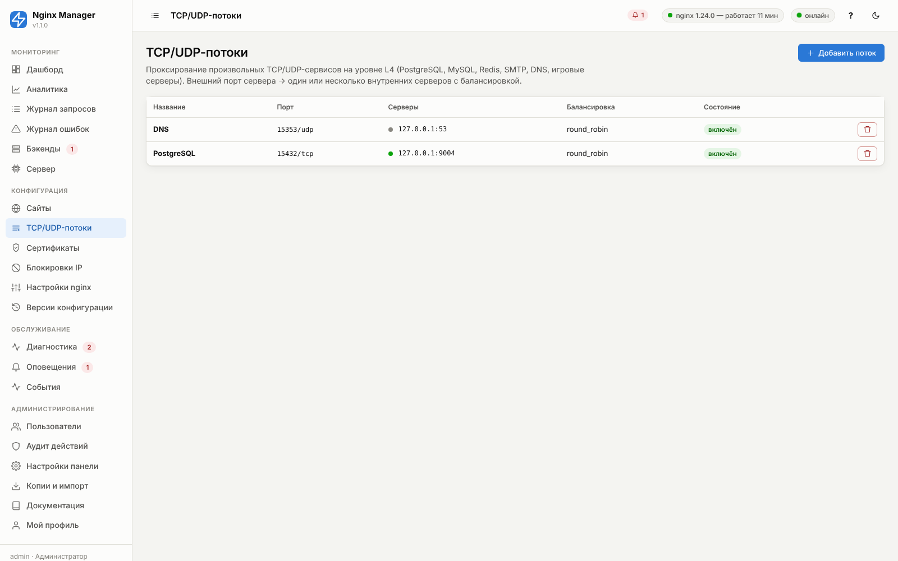

# 06. TCP/UDP-потоки

Потоки — проксирование на транспортном уровне (L4) средствами модуля nginx `stream`: nginx принимает соединение на
внешнем порту и передаёт поток байтов на один из серверов группы, не разбирая протокол. Подходит для PostgreSQL,
MySQL, Redis, MongoDB, RabbitMQ, SMTP/IMAP, SSH, MQTT, игровых серверов, DNS (UDP), syslog (UDP) и т. п.



## Требования

Модуль `stream` должен быть в составе nginx:

- Debian/Ubuntu: пакет `libnginx-mod-stream` (ставится установщиком);
- RHEL/Rocky/Alma: `nginx-mod-stream`;
- пакеты nginx.org: модуль встроен.

Панель определяет наличие модуля по `nginx -V` и каталогам `modules-enabled`; если модуль есть только как файл
`.so`, добавляет `load_module` в nginx.conf. Если модуля нет, раздел предупреждает об этом, а «Диагностика»
предлагает установку в один клик.

## Как это выглядит в конфигурации

```nginx
stream {
    log_format nm_stream escape=json '{"t":"$msec","ip":"$remote_addr","proto":"$protocol", …}';
    upstream nm_stream_1 {
        zone nm_stream_1 64k;
        server 10.0.0.20:5432 max_fails=3 fail_timeout=30s;
    }
    server {
        listen 5432;
        proxy_pass nm_stream_1;
        proxy_connect_timeout 5s;
        proxy_timeout 1h;
        allow 203.0.113.0/24;
        deny all;
        access_log /var/log/nginx/nm-stream.log nm_stream;
    }
}
```

## Статистика и проверки

- Каждая сессия пишется в `nm-stream.log`: байты в обе стороны, длительность, статус, бэкенд. В «Аналитике» есть
  таблица потоков: сессии, трафик, средняя длительность, ошибки.
- Для TCP-потоков работает активная проверка доступности (TCP-подключение к каждому серверу каждые 15 с) —
  результат на странице «Бэкенды». Для UDP проверка не выполняется (протокол без соединений).

## Безопасность

Открывая базу данных в интернет, **обязательно** задайте белый список IP и используйте шифрование на уровне протокола
(TLS у PostgreSQL/MySQL). Не забудьте открыть порт в firewall (`ufw allow 5432/tcp`) — «Диагностика» покажет,
если порт закрыт.

## Справочник параметров

<!-- GEN:stream -->
<!-- Сгенерировано tools/gen_reference.py из app/models.py -->

<a id="f-stream-name"></a>

### Название — `name`

| Тип | По умолчанию | Диапазон / ед. | Директива nginx | Расширенный |
|---|---|---|---|---|
| строка | пусто | — | — | нет |

Название для панели, статистики и уведомлений.

**Пример:** `PostgreSQL`


<a id="f-stream-enabled"></a>

### Включён — `enabled`

| Тип | По умолчанию | Диапазон / ед. | Директива nginx | Расширенный |
|---|---|---|---|---|
| переключатель (да/нет) | включено | — | — | нет |

Выключенный поток не генерируется.


<a id="f-stream-protocol"></a>

### Протокол — `protocol`

| Тип | По умолчанию | Диапазон / ед. | Директива nginx | Расширенный |
|---|---|---|---|---|
| выбор из списка | `tcp` (TCP) | — | — | нет |

TCP — базы данных, почта, SSH; UDP — DNS, syslog, игры, VoIP; TCP+UDP — DNS (ответы > 512 байт идут по TCP).

Варианты:

- `tcp` — TCP
- `udp` — UDP
- `both` — TCP + UDP

**Пример:** `tcp`


<a id="f-stream-listen_port"></a>

### Внешний порт — `listen_port`

| Тип | По умолчанию | Диапазон / ед. | Директива nginx | Расширенный |
|---|---|---|---|---|
| целое число | `5432` | 1…65535 | `listen` | нет |

Порт, открытый на внешнем адресе. Не должен пересекаться с портами сайтов, панели и stub_status (проверяется при сохранении). Откройте его в firewall.

**Пример:** `5432`


<a id="f-stream-listen_ip"></a>

### IP для прослушивания — `listen_ip`

| Тип | По умолчанию | Диапазон / ед. | Директива nginx | Расширенный |
|---|---|---|---|---|
| строка | пусто | — | — | да |

Конкретный адрес сервера для прослушивания (пусто — все).

**Пример:** `203.0.113.10`


<a id="f-stream-ipv6"></a>

### Слушать IPv6 — `ipv6`

| Тип | По умолчанию | Диапазон / ед. | Директива nginx | Расширенный |
|---|---|---|---|---|
| переключатель (да/нет) | включено | — | — | да |

Слушать также IPv6 (если включён в системе и в глобальных настройках).


<a id="f-stream-backends"></a>

### Серверы — `backends`

| Тип | По умолчанию | Диапазон / ед. | Директива nginx | Расширенный |
|---|---|---|---|---|
| таблица элементов | пусто | — | — | нет |

Серверы, на которые передаются соединения.

**Пример:** `10.0.0.20:5432`

Поля элемента:

| Поле | Тип | По умолчанию | Описание |
|---|---|---|---|
| Адрес (`address`) | строка | `127.0.0.1` | IP-адрес, имя хоста или unix-сокет бэкенда. Рекомендация: IP-адреса во внутренней сети — быстрее и надёжнее имён. |
| Порт (`port`) | целое число | `80` | Игнорируется для unix-сокета |
| Вес (`weight`) | целое число | `1` | Доля запросов относительно других серверов группы. Рекомендация: Задавайте вес пропорционально производительности серверов. |
| max_fails (`max_fails`) | целое число | `3` | Число неудачных попыток за fail_timeout, после которых сервер считается недоступным. Рекомендация: 3 для большинства случаев; 1 — для быстрого переключения при наличии резерва. |
| fail_timeout (`fail_timeout`) | строка | `30s` | Окно подсчёта ошибок и время «выключения» сервера. Рекомендация: 10s–30s |
| Резервный (`backup`) | переключатель (да/нет) | выключено | Получает запросы, только когда все основные серверы недоступны |
| Выключен (`down`) | переключатель (да/нет) | выключено | Временно исключить сервер из балансировки (без удаления) |
| max_conns (`max_conns`) | целое число | `0` | Лимит одновременных соединений к серверу (0 — без лимита) Рекомендация: 0, или чуть меньше максимума воркеров/потоков приложения. |
| Комментарий (`comment`) | строка | пусто |  |


<a id="f-stream-balancing"></a>

### Балансировка — `balancing`

| Тип | По умолчанию | Диапазон / ед. | Директива nginx | Расширенный |
|---|---|---|---|---|
| выбор из списка | `round_robin` (Round Robin — по очереди с учётом весов) | — | — | нет |

Round Robin, Least Connections (для долгих соединений — лучше), Hash по ключу (липкость по IP), Random.

Варианты:

- `round_robin` — Round Robin — по очереди с учётом весов
- `least_conn` — Least Connections — на сервер с наименьшим числом соединений
- `hash` — Hash — по произвольному ключу (URI, cookie...)
- `random` — Random — случайный выбор

> **Рекомендация.** least_conn для БД и долгих сессий.

**Пример:** `least_conn`


<a id="f-stream-hash_key"></a>

### Ключ hash — `hash_key`

| Тип | По умолчанию | Диапазон / ед. | Директива nginx | Расширенный |
|---|---|---|---|---|
| строка | `$remote_addr` | — | — | нет |

Ключ для метода hash.

**Пример:** `$remote_addr`

*Показывается, когда `balancing` = `hash`.*


<a id="f-stream-connect_timeout"></a>

### Таймаут подключения — `connect_timeout`

| Тип | По умолчанию | Диапазон / ед. | Директива nginx | Расширенный |
|---|---|---|---|---|
| строка | `5s` | — | `proxy_connect_timeout` | нет |

Таймаут установки соединения с сервером потока.

> **Рекомендация.** 1s–5s.

**Пример:** `5s`


<a id="f-stream-timeout"></a>

### Таймаут простоя — `timeout`

| Тип | По умолчанию | Диапазон / ед. | Директива nginx | Расширенный |
|---|---|---|---|---|
| строка | `10m` | — | `proxy_timeout` | нет |

Соединение закрывается, если данных нет дольше этого времени.

> **Рекомендация.** Для БД и SSH — 1h и более; для DNS (UDP) — 10s.


<a id="f-stream-proxy_protocol"></a>

### Отправлять PROXY protocol бэкенду — `proxy_protocol`

| Тип | По умолчанию | Диапазон / ед. | Директива nginx | Расширенный |
|---|---|---|---|---|
| переключатель (да/нет) | выключено | — | `proxy_protocol` | да |

Бэкенд узнает реальный IP клиента (бэкенд должен поддерживать PROXY protocol)


<a id="f-stream-udp_responses"></a>

### Ожидаемых UDP-ответов — `udp_responses`

| Тип | По умолчанию | Диапазон / ед. | Директива nginx | Расширенный |
|---|---|---|---|---|
| целое число | `0` | 0…100 | `proxy_responses` | да |

0 — не ограничивать. Для DNS — 1.

Сколько UDP-ответов ожидать на один запрос, после чего сессия закрывается (экономия памяти для DNS).

> **Рекомендация.** 1 для DNS.

**Пример:** `1`

*Показывается, когда `protocol` = `udp`, `both`.*


<a id="f-stream-allow"></a>

### Белый список IP — `allow`

| Тип | По умолчанию | Диапазон / ед. | Директива nginx | Расширенный |
|---|---|---|---|---|
| список, по одному значению на строку | пусто | — | — | нет |

Если задан — остальным доступ закрыт.

Если задан — подключаться могут только эти адреса.

> **Рекомендация.** Обязательно для баз данных.

**Пример:** `203.0.113.0/24`


<a id="f-stream-deny"></a>

### Чёрный список IP — `deny`

| Тип | По умолчанию | Диапазон / ед. | Директива nginx | Расширенный |
|---|---|---|---|---|
| список, по одному значению на строку | пусто | — | — | нет |

Адреса, которым подключение запрещено.

**Пример:** `198.51.100.0/24`


<a id="f-stream-conn_limit"></a>

### Макс. соединений с IP — `conn_limit`

| Тип | По умолчанию | Диапазон / ед. | Директива nginx | Расширенный |
|---|---|---|---|---|
| целое число | `0` | 0…100000 | — | да |

Одновременных соединений с одного IP (0 — без ограничения).

**Пример:** `20`


<a id="f-stream-health_check"></a>

### Проверять доступность (TCP) — `health_check`

| Тип | По умолчанию | Диапазон / ед. | Директива nginx | Расширенный |
|---|---|---|---|---|
| переключатель (да/нет) | включено | — | — | нет |

Активная TCP-проверка серверов потока каждые 15 с (для UDP не выполняется).


<a id="f-stream-notes"></a>

### Заметки — `notes`

| Тип | По умолчанию | Диапазон / ед. | Директива nginx | Расширенный |
|---|---|---|---|---|
| многострочный текст | пусто | — | — | нет |

Свободные заметки.

<!-- /GEN:stream -->

## Примеры

| Сервис | Протокол | Порт | Таймаут простоя | Особенности |
|---|---|---|---|---|
| PostgreSQL / MySQL | TCP | 5432 / 3306 | `1h` | белый список IP; несколько серверов — только для реплик чтения |
| Redis | TCP | 6379 | `10m` | обязательно белый список и пароль Redis |
| SMTP | TCP | 25/587 | `5m` | PROXY protocol к Postfix, чтобы видеть IP отправителя |
| DNS | UDP (+TCP) | 53 | `10s` | «Ожидаемых UDP-ответов» = 1, протокол «TCP + UDP» |
| Игровой сервер | UDP | 27015 | `1m` | балансировка hash по `$remote_addr` |
| SSH-бастион | TCP | 2222 | `12h` | белый список, длинный таймаут |
