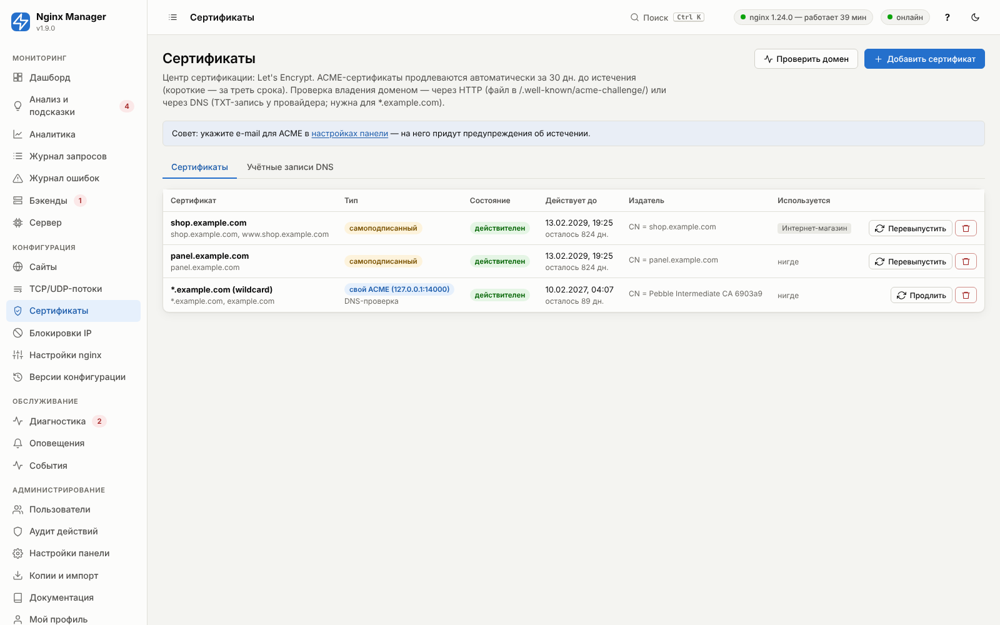
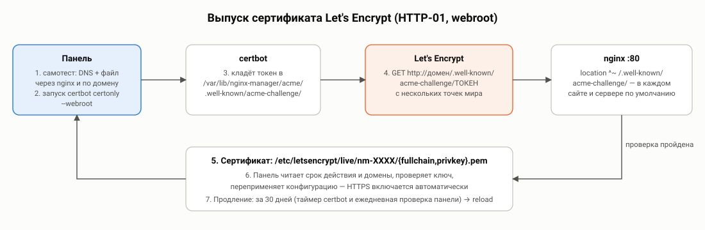
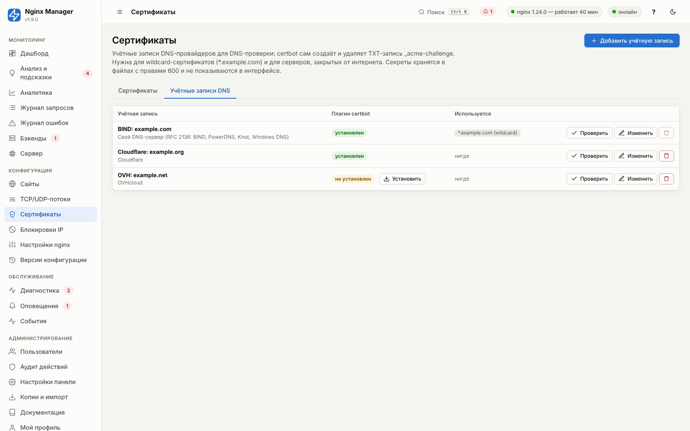
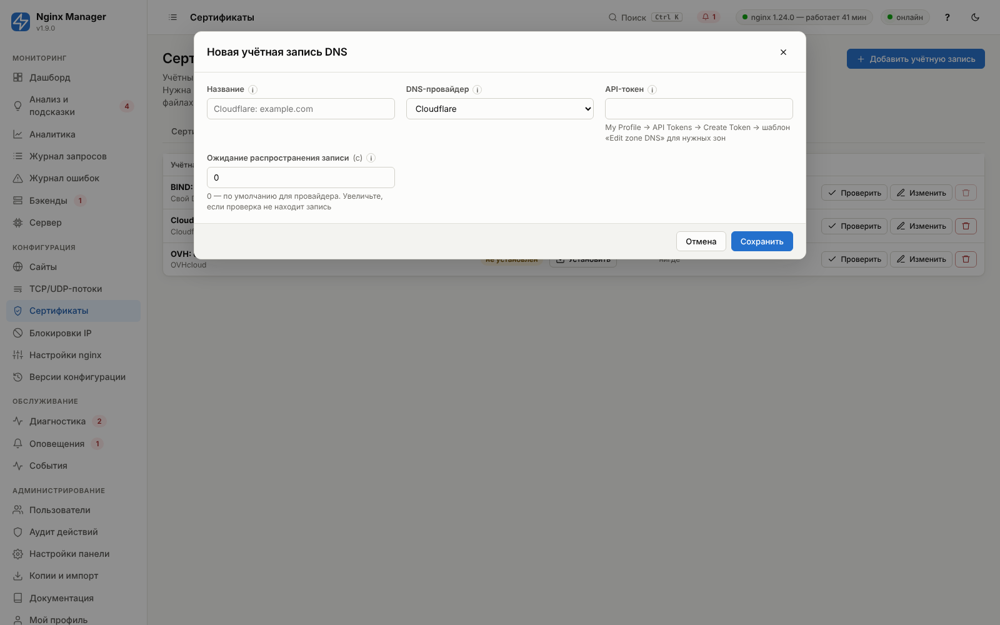
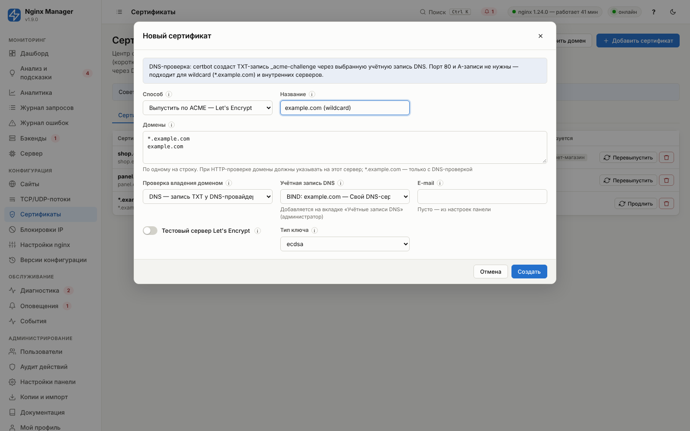

# 07. Сертификаты SSL/TLS



Панель поддерживает четыре способа получить сертификат:

| Способ | Когда использовать | Продление |
|---|---|---|
| **ACME** — Let's Encrypt, ZeroSSL, Google Trust Services или свой центр | Публичные сайты (бесплатно, доверяется всеми браузерами), wildcard через DNS-проверку, внутренние домены через корпоративный ACME-сервер. | Автоматически: за 30 дней до истечения, короткие — за треть срока. |
| **Загрузка своего (PEM)** | Коммерческие сертификаты (EV/OV), корпоративный УЦ без ACME. | Вручную: загрузить новый и выбрать его в сайтах. |
| **Самоподписанный** | Тесты, внутренние сервисы, заглушка до выпуска настоящего. | Кнопка «Перевыпустить». |
| **Файлы уже на сервере** | Сертификаты, которые выпускает другая система (свой ACME-клиент, Vault, Ansible). | Внешней системой; панель перечитывает сроки ежечасно. |

## ACME: как это работает



Сертификат выпускает certbot. Центр сертификации должен убедиться, что домен ваш, — для этого есть два способа
проверки, они выбираются в окне выпуска («Проверка владения доменом»):

| Свойство | HTTP-проверка (HTTP-01) | DNS-проверка (DNS-01) |
|---|---|---|
| Как | certbot кладёт файл в `/.well-known/acme-challenge/`, центр скачивает его по `http://домен/` | certbot создаёт TXT-запись `_acme-challenge.домен` через API DNS-провайдера, центр читает её из DNS |
| Нужно | A/AAAA-записи на этот сервер, открытый порт 80 | Учётная запись DNS-провайдера (токен или ключ TSIG) и плагин certbot |
| Wildcard `*.example.com` | нельзя | можно |
| Сервер закрыт от интернета, домен ещё не переключён | нельзя | можно |
| Скорость | секунды | 10–120 с (ожидание распространения записи) |

**HTTP-проверка** (certbot в режиме webroot):

1. Панель выполняет **самотест** для каждого домена: разрешается ли он в DNS, отдаёт ли nginx проверочный файл
   (запрос к 127.0.0.1 с нужным Host) и доступен ли файл по доменному имени. Результаты — в журнале выпуска.
2. certbot кладёт токен в `/var/lib/nginx-manager/acme/.well-known/acme-challenge/`.
3. Центр сертификации запрашивает `http://<домен>/.well-known/acme-challenge/<токен>` с нескольких точек мира.
   Nginx отдаёт файл из любого сайта или из сервера по умолчанию — локация ACME есть везде (и не попадает под
   перенаправление на HTTPS, ограничения по IP и странам), поэтому сертификат можно выпустить **до** создания сайта.

**DNS-проверка**: certbot через плагин провайдера создаёт TXT-запись, ждёт её распространения («Ожидание
распространения записи» в учётной записи DNS), центр сертификации проверяет запись, certbot её удаляет. Учётные данные
лежат в файле `/var/lib/nginx-manager/dns-credentials/<номер>.ini` с правами 600 — на него ссылается
конфигурация продления certbot.

Дальше одинаково:

4. Сертификат сохраняется в `/etc/letsencrypt/live/nm-XXXXXX/` (имя с префиксом `nm-` — признак выпуска панелью).
5. Панель читает срок и домены, проверяет соответствие ключа и **автоматически переприменяет** последнюю версию
   конфигурации, если сертификат уже выбран в каком-либо сайте — HTTPS включается без вашего участия.

При выпуске используется `--deploy-hook "nginx -s reload"`, поэтому продление системным таймером certbot тоже
подхватывается. Панель дополнительно проверяет сроки ежечасно и продлевает сама: за «Продлевать за» дней
(по умолчанию 30) до истечения, но не позже, чем за треть срока действия — шестидневный сертификат продлевается
за 2 дня, 45-дневный — за 15. Неудачное продление не трогает действующий сертификат: ошибка видна в списке и в
журнале выпуска, попытка повторится через час.

Весь путь — выпуск через HTTP и DNS, wildcard в сайте, продление с перезагрузкой nginx — проверяется сквозным тестом
`tools/acme_e2e.py` против тестового ACME-сервера Pebble и DNS-сервера BIND.

### Требования для успешного выпуска

HTTP-проверка:

- DNS-записи A/AAAA всех доменов указывают на **внешний IP этого сервера** (если указана AAAA — IPv6 тоже должен
  работать, иначе центр может проверять по IPv6 и получить ошибку).
- Порт **80** открыт из интернета (firewall сервера, security group облака, проброс на роутере).

DNS-проверка:

- Домен обслуживается выбранным провайдером (его серверы указаны в NS-записях домена).
- У токена есть право изменять DNS-записи зоны; плагин certbot установлен (страница «Сертификаты» → «Учётные
  записи DNS» покажет и установит его кнопкой).

Всегда:

- Нет CAA-записи, запрещающей выбранный центр (`0 issue "letsencrypt.org"`, `"sectigo.com"` для ZeroSSL, `"pki.goog"`).
- Лимиты Let's Encrypt: 50 сертификатов на домен в неделю, 5 неудачных проверок в час. Для отладки включите
  «Тестовый сервер» — сертификат будет недоверенным, но лимиты значительно выше.

### Частые ошибки

Журнал выпуска (кнопка «Журнал» у сертификата) показывает вывод certbot и подсказку панели.

| Сообщение | Причина | Решение |
|---|---|---|
| DNS problem: NXDOMAIN | Домен не существует или нет A-записи | Создайте запись, подождите распространения (до TTL). |
| Timeout during connect | Порт 80 недоступен снаружи | Откройте 80/tcp в firewall и у провайдера/облака. |
| Invalid response … 404 | Домен указывает на другой сервер | Проверьте A/AAAA-записи, отключите проксирование CDN на время выпуска. |
| unauthorized | Проверочный файл не совпал | Домен ведёт на другой сервер или CDN отдаёт кэш. |
| No TXT record found / Incorrect TXT record | Центр не увидел TXT-запись | Увеличьте «Ожидание распространения записи»; проверьте, что NS домена — у этого провайдера. |
| Invalid access token, Authentication error | Провайдер отклонил токен | Проверьте токен и его права на зону. |
| Unable to determine zone | Зона не найдена у провайдера | Домен обслуживается другим провайдером или токен ограничен другими зонами. |
| REFUSED / NOTAUTH / BADKEY / BADSIG / BADTIME | DNS-сервер отклонил обновление (RFC 2136) | Имя, секрет и алгоритм ключа TSIG, `update-policy` зоны, время на серверах. |
| externalAccountRequired | Центру нужна привязка EAB | Укажите Key ID и HMAC-ключ в настройках панели. |
| Requesting …: Connection refused / timed out | Нет связи с самим ACME-сервером | Проверьте адрес каталога, DNS и выход сервера в интернет (прокси, firewall исходящих). |
| Account … not found | Центр удалил аккаунт | Панель регистрирует новый аккаунт и повторяет выпуск автоматически. |
| The DNS operation timed out | DNS-сервер RFC 2136 не отвечает | IP и порт в учётной записи DNS, порт 53 по UDP и TCP; «Проверить» у учётной записи проверяет доступность. |
| CERTIFICATE_VERIFY_FAILED | TLS ACME-сервера подписан внутренним центром | Укажите его корневой сертификат в настройках панели. |
| too many certificates / rateLimited | Превышен лимит | Подождите неделю или используйте тестовый сервер для отладки. |
| CAA record | CAA-запись запрещает выпуск | Добавьте `0 issue "letsencrypt.org"` (или запись вашего центра). |

Кнопка **«Проверить домен»** на странице сертификатов выполняет самотест HTTP-проверки для любого домена без выпуска.

## Центр сертификации

**Настройки панели → «Сертификаты (ACME)» → «Центр сертификации»**:

| Центр | Адрес каталога | Регистрация |
|---|---|---|
| Let's Encrypt (по умолчанию) | `https://acme-v02.api.letsencrypt.org/directory` | не нужна; e-mail — по желанию |
| ZeroSSL | `https://acme.zerossl.com/v2/DV90` | ключ EAB: личный кабинет → Developer → EAB Credentials |
| Google Trust Services | `https://dv.acme-v02.api.pki.goog/directory` | ключ EAB: `gcloud publicca external-account-keys create` |
| Свой ACME-сервер | адрес каталога вашего сервера (step-ca, Smallstep, Vault PKI, EJBCA) | EAB — если сервер требует |

- **Новые** сертификаты выпускаются в выбранном центре; **выпущенные** продлеваются там же, где выпущены (центр
  виден в списке сертификатов). Чтобы перевести сертификат в другой центр, выпустите новый и выберите его в сайтах.
- Второй бесплатный центр полезен как запасной: если Let's Encrypt недоступен или упёрлись в лимит, переключите
  центр и выпустите сертификат там.
- HMAC-ключ EAB нужен только при регистрации аккаунта; в интерфейсе и API он не показывается, в журнале выпуска
  скрыт.
- Если TLS вашего ACME-сервера подписан внутренним центром, укажите его корневой сертификат
  («Доверенный корневой сертификат ACME-сервера»): certbot получит его в `REQUESTS_CA_BUNDLE`. Путь запоминается
  в сертификате — продление работает и после того, как в настройках выбран другой центр. Системный таймер
  certbot этой настройки не знает — либо добавьте корневой сертификат в системное хранилище
  (`update-ca-certificates` / `update-ca-trust`), либо положитесь на продление панелью (оно работает и без этого).

## Wildcard-сертификаты (*.example.com)

Wildcard выпускается только с **DNS-проверкой**:

1. Администратор: **Сертификаты → «Учётные записи DNS» → «Добавить учётную запись»** — провайдер и токен (или ключ
   TSIG своего DNS-сервера). Если плагин certbot для провайдера не установлен, нажмите «Установить» — панель
   поставит пакет `python3-certbot-dns-<провайдер>` (на RHEL — из EPEL).

   

   
2. **«Проверить»** у учётной записи — плагин на месте, скрипты существуют.
3. **«Добавить сертификат»** → домены `*.example.com` и `example.com` (wildcard не покрывает сам домен) →
   «Проверка владения доменом: DNS» → учётная запись → «Создать».
4. Выберите сертификат в сайтах — один сертификат подойдёт всем поддоменам.



### DNS-провайдеры

| Провайдер | Плагин certbot (пакет) | Что нужно |
|---|---|---|
| Cloudflare | `python3-certbot-dns-cloudflare` | API-токен с правами Zone → DNS → Edit (не глобальный ключ) |
| DigitalOcean | `python3-certbot-dns-digitalocean` | Personal access token с правом записи |
| Linode / Akamai | `python3-certbot-dns-linode` | Personal Access Token, Domains: Read/Write |
| OVHcloud | `python3-certbot-dns-ovh` | Application Key/Secret и Consumer Key с правами на `/domain/zone/*` |
| Amazon Route 53 | `python3-certbot-dns-route53` | Ключи IAM с правами `route53:ListHostedZones`, `GetChange`, `ChangeResourceRecordSets` |
| Google Cloud DNS | `python3-certbot-dns-google` | JSON-ключ сервисного аккаунта с ролью DNS Administrator |
| Свой DNS-сервер (RFC 2136) | `python3-certbot-dns-rfc2136` | IP первичного сервера и ключ TSIG — BIND, PowerDNS, Knot, Windows DNS |
| Свои скрипты | не нужен | Два исполняемых файла: создать и удалить TXT-запись — для любого провайдера с API |

Секреты хранятся в базе панели и в файле учётных данных с правами 600 (каталог 700); в интерфейсе и API вместо
них маска. Изменения учётной записи сразу переписывают файл — продление подхватит новый токен. Удалить учётную
запись нельзя, пока по ней продлеваются сертификаты. Route 53 получает ключи через `AWS_SHARED_CREDENTIALS_FILE`:
продлевает такие сертификаты панель, системный таймер certbot этих ключей не видит.

**Свой DNS-сервер (BIND).** Создайте ключ и разрешите им обновлять только записи проверки:

```bash
tsig-keygen -a hmac-sha512 acme-key > /etc/bind/acme-key.conf     # секрет — строка secret "…"
```

```
include "/etc/bind/acme-key.conf";
zone "example.com" {
    type master;
    file "/var/lib/bind/db.example.com";
    update-policy { grant acme-key name _acme-challenge.example.com. TXT; };
};
```

В учётной записи: сервер — IP первичного сервера, имя ключа `acme-key`, секрет, алгоритм HMAC-SHA512.

**Свои скрипты.** certbot вызывает скрипт создания для каждого домена с переменными `CERTBOT_DOMAIN` и
`CERTBOT_VALIDATION`, затем — скрипт удаления. Пример с [lexicon](https://github.com/dns-lexicon/dns-lexicon)
(универсальный клиент API десятков DNS-провайдеров; список — `lexicon --help`):

```bash
#!/bin/sh
# /usr/local/bin/dns-add.sh — учётные данные провайдера lexicon берёт из переменных LEXICON_<ПРОВАЙДЕР>_*
PROVIDER=cloudflare
lexicon "$PROVIDER" create "$CERTBOT_DOMAIN" TXT --name "_acme-challenge.$CERTBOT_DOMAIN" --content "$CERTBOT_VALIDATION"
sleep 60
```

Скрипты запускаются от root — учётные записи DNS меняет только администратор.

## Справочник: учётная запись DNS

<!-- GEN:dns_account -->
<!-- Сгенерировано tools/gen_reference.py — не редактируйте вручную -->

<a id="f-dns_account-name"></a>

### Название — `name`

| Тип | По умолчанию | Диапазон / ед. | Директива nginx | Расширенный |
|---|---|---|---|---|
| строка | пусто | — | — | нет |

**Пример:** `Cloudflare: example.com`


<a id="f-dns_account-provider"></a>

### DNS-провайдер — `provider`

| Тип | По умолчанию | Диапазон / ед. | Директива nginx | Расширенный |
|---|---|---|---|---|
| выбор из списка | `cloudflare` (Cloudflare) | — | — | нет |

Варианты:

- `cloudflare` — Cloudflare
- `digitalocean` — DigitalOcean
- `linode` — Linode / Akamai
- `ovh` — OVHcloud
- `route53` — Amazon Route 53
- `google` — Google Cloud DNS
- `rfc2136` — Свой DNS-сервер (RFC 2136: BIND, PowerDNS, Knot, Windows DNS)
- `hook` — Свои скрипты (любой провайдер с API)


<a id="f-dns_account-cf_api_token"></a>

### API-токен — `cf_api_token`

| Тип | По умолчанию | Диапазон / ед. | Директива nginx | Расширенный |
|---|---|---|---|---|
| пароль (скрытый ввод) | пусто | — | — | нет |

My Profile → API Tokens → Create Token → шаблон «Edit zone DNS» для нужных зон.

*Показывается, когда `provider` = `cloudflare`.*


<a id="f-dns_account-do_token"></a>

### Персональный токен — `do_token`

| Тип | По умолчанию | Диапазон / ед. | Директива nginx | Расширенный |
|---|---|---|---|---|
| пароль (скрытый ввод) | пусто | — | — | нет |

API → Tokens → Generate New Token, права записи (Write)

*Показывается, когда `provider` = `digitalocean`.*


<a id="f-dns_account-linode_key"></a>

### Personal Access Token — `linode_key`

| Тип | По умолчанию | Диапазон / ед. | Директива nginx | Расширенный |
|---|---|---|---|---|
| пароль (скрытый ввод) | пусто | — | — | нет |

Права Domains: Read/Write.

*Показывается, когда `provider` = `linode`.*


<a id="f-dns_account-ovh_endpoint"></a>

### Регион API — `ovh_endpoint`

| Тип | По умолчанию | Диапазон / ед. | Директива nginx | Расширенный |
|---|---|---|---|---|
| выбор из списка | `ovh-eu` | — | — | нет |

Варианты:

- `ovh-eu`
- `ovh-ca`
- `ovh-us`
- `kimsufi-eu`
- `soyoustart-eu`

*Показывается, когда `provider` = `ovh`.*


<a id="f-dns_account-ovh_application_key"></a>

### Application Key — `ovh_application_key`

| Тип | По умолчанию | Диапазон / ед. | Директива nginx | Расширенный |
|---|---|---|---|---|
| строка | пусто | — | — | нет |

*Показывается, когда `provider` = `ovh`.*


<a id="f-dns_account-ovh_application_secret"></a>

### Application Secret — `ovh_application_secret`

| Тип | По умолчанию | Диапазон / ед. | Директива nginx | Расширенный |
|---|---|---|---|---|
| пароль (скрытый ввод) | пусто | — | — | нет |

*Показывается, когда `provider` = `ovh`.*


<a id="f-dns_account-ovh_consumer_key"></a>

### Consumer Key — `ovh_consumer_key`

| Тип | По умолчанию | Диапазон / ед. | Директива nginx | Расширенный |
|---|---|---|---|---|
| пароль (скрытый ввод) | пусто | — | — | нет |

Права: GET/PUT/POST/DELETE /domain/zone/*.

*Показывается, когда `provider` = `ovh`.*


<a id="f-dns_account-aws_access_key_id"></a>

### Access Key ID — `aws_access_key_id`

| Тип | По умолчанию | Диапазон / ед. | Директива nginx | Расширенный |
|---|---|---|---|---|
| строка | пусто | — | — | нет |

Пользователь IAM с правами route53:ListHostedZones, GetChange, ChangeResourceRecordSets.

*Показывается, когда `provider` = `route53`.*


<a id="f-dns_account-aws_secret_access_key"></a>

### Secret Access Key — `aws_secret_access_key`

| Тип | По умолчанию | Диапазон / ед. | Директива nginx | Расширенный |
|---|---|---|---|---|
| пароль (скрытый ввод) | пусто | — | — | нет |

*Показывается, когда `provider` = `route53`.*


<a id="f-dns_account-google_json"></a>

### Ключ сервисного аккаунта (JSON) — `google_json`

| Тип | По умолчанию | Диапазон / ед. | Директива nginx | Расширенный |
|---|---|---|---|---|
| пароль (скрытый ввод) | пусто | — | — | нет |

IAM → Service Accounts → Keys → Add key (JSON), роль DNS Administrator. Вставьте содержимое файла.

*Показывается, когда `provider` = `google`.*


<a id="f-dns_account-rfc_server"></a>

### DNS-сервер (IP) — `rfc_server`

| Тип | По умолчанию | Диапазон / ед. | Директива nginx | Расширенный |
|---|---|---|---|---|
| строка | пусто | — | — | нет |

Первичный (master) сервер зоны, принимающий динамические обновления.

**Пример:** `192.0.2.53`

*Показывается, когда `provider` = `rfc2136`.*


<a id="f-dns_account-rfc_port"></a>

### Порт — `rfc_port`

| Тип | По умолчанию | Диапазон / ед. | Директива nginx | Расширенный |
|---|---|---|---|---|
| целое число | `53` | 1…65535 | — | нет |

*Показывается, когда `provider` = `rfc2136`.*


<a id="f-dns_account-rfc_key_name"></a>

### Имя ключа TSIG — `rfc_key_name`

| Тип | По умолчанию | Диапазон / ед. | Директива nginx | Расширенный |
|---|---|---|---|---|
| строка | пусто | — | — | нет |

**Пример:** `acme-key`

*Показывается, когда `provider` = `rfc2136`.*


<a id="f-dns_account-rfc_key_secret"></a>

### Секрет ключа TSIG (base64) — `rfc_key_secret`

| Тип | По умолчанию | Диапазон / ед. | Директива nginx | Расширенный |
|---|---|---|---|---|
| пароль (скрытый ввод) | пусто | — | — | нет |

Создаётся: tsig-keygen -a hmac-sha512 acme-key.

*Показывается, когда `provider` = `rfc2136`.*


<a id="f-dns_account-rfc_algorithm"></a>

### Алгоритм TSIG — `rfc_algorithm`

| Тип | По умолчанию | Диапазон / ед. | Директива nginx | Расширенный |
|---|---|---|---|---|
| выбор из списка | `HMAC-SHA512` | — | — | нет |

Варианты:

- `HMAC-SHA512`
- `HMAC-SHA384`
- `HMAC-SHA256`
- `HMAC-SHA224`
- `HMAC-SHA1`
- `HMAC-MD5`

*Показывается, когда `provider` = `rfc2136`.*


<a id="f-dns_account-hook_auth"></a>

### Скрипт создания записи — `hook_auth`

| Тип | По умолчанию | Диапазон / ед. | Директива nginx | Расширенный |
|---|---|---|---|---|
| строка | пусто | — | — | нет |

certbot передаёт CERTBOT_DOMAIN и CERTBOT_VALIDATION: создайте TXT _acme-challenge.$CERTBOT_DOMAIN.

**Пример:** `/usr/local/bin/dns-add.sh`

*Показывается, когда `provider` = `hook`.*


<a id="f-dns_account-hook_cleanup"></a>

### Скрипт удаления записи — `hook_cleanup`

| Тип | По умолчанию | Диапазон / ед. | Директива nginx | Расширенный |
|---|---|---|---|---|
| строка | пусто | — | — | нет |

**Пример:** `/usr/local/bin/dns-del.sh`

*Показывается, когда `provider` = `hook`.*


<a id="f-dns_account-propagation_seconds"></a>

### Ожидание распространения записи — `propagation_seconds`

| Тип | По умолчанию | Диапазон / ед. | Директива nginx | Расширенный |
|---|---|---|---|---|
| целое число | `0` | 0…3600 с | — | нет |

0 — по умолчанию для провайдера. Увеличьте, если проверка не находит запись.

<!-- /GEN:dns_account -->

## Свой сертификат

Вставьте или загрузите файлом:

- **Сертификат + цепочка** — сначала сертификат сайта, затем промежуточные сертификаты УЦ (без корневого);
- **Закрытый ключ** — в PEM без пароля. Если ключ зашифрован:
  `openssl pkey -in encrypted.key -out plain.key`.

Панель проверяет формат и соответствие ключа сертификату и хранит файлы в `/var/lib/nginx-manager/certs/<id>/`
(каталог доступен только root).

## Справочник параметров формы

Форма открывается кнопкой **«Добавить сертификат»**; набор полей зависит от выбранного способа.


<!-- GEN:certificate -->
<!-- Сгенерировано tools/gen_reference.py — не редактируйте вручную -->

<a id="f-certificate-type"></a>

### Способ — `type`

| Тип | По умолчанию | Диапазон / ед. | Директива nginx | Расширенный |
|---|---|---|---|---|
| выбор из списка | `letsencrypt` (Выпустить по ACME — Let's Encrypt или другой центр (автопродление)) | — | — | нет |

Способ получения сертификата.

Варианты:

- `letsencrypt` — Выпустить по ACME — Let's Encrypt или другой центр (автопродление)
- `upload` — Загрузить свой (PEM)
- `selfsigned` — Самоподписанный (для тестов)
- `path` — Файлы уже на сервере

> **Рекомендация.** Let's Encrypt для публичных доменов.

**Пример:** `letsencrypt`


<a id="f-certificate-name"></a>

### Название — `name`

| Тип | По умолчанию | Диапазон / ед. | Директива nginx | Расширенный |
|---|---|---|---|---|
| строка | пусто | — | — | нет |

Название в списке; по умолчанию — первый домен.

**Пример:** `shop.example.com`


<a id="f-certificate-domains"></a>

### Домены — `domains`

| Тип | По умолчанию | Диапазон / ед. | Директива nginx | Расширенный |
|---|---|---|---|---|
| список, по одному значению на строку | пусто | — | — | нет |

По одному на строку. При HTTP-проверке домены должны указывать на этот сервер; *.example.com — только с DNS-проверкой.

Все имена, которые должен покрывать сертификат (до 100). Wildcard через HTTP-01 невозможен.

> **Рекомендация.** Включите и www, и основной домен.

**Пример:** `example.com www.example.com`

*Показывается, когда `type` = `letsencrypt`, `selfsigned`.*


<a id="f-certificate-challenge"></a>

### Проверка владения доменом — `challenge`

| Тип | По умолчанию | Диапазон / ед. | Директива nginx | Расширенный |
|---|---|---|---|---|
| выбор из списка | `http` (HTTP — файл на этом сервере (порт 80 должен быть открыт)) | — | — | нет |

Как центр сертификации проверяет, что домен ваш. HTTP: certbot кладёт файл в /.well-known/acme-challenge/, центр скачивает его по http://домен/ — нужны A/AAAA на этот сервер и открытый порт 80. DNS: certbot создаёт TXT-запись _acme-challenge.домен через API DNS-провайдера — работает для wildcard (*.example.com), закрытых серверов и доменов, ещё не переключённых на сервер.

Варианты:

- `http` — HTTP — файл на этом сервере (порт 80 должен быть открыт)
- `dns` — DNS — запись TXT у DNS-провайдера (wildcard, закрытые серверы)

> **Рекомендация.** HTTP для обычных сайтов; DNS — для wildcard и внутренних сервисов.

**Пример:** `http`

*Показывается, когда `type` = `letsencrypt`.*


<a id="f-certificate-dns_account_id"></a>

### Учётная запись DNS — `dns_account_id`

| Тип | По умолчанию | Диапазон / ед. | Директива nginx | Расширенный |
|---|---|---|---|---|
| целое число | `0` | — | — | нет |

Добавляется на вкладке «Учётные записи DNS» (администратор)

Учётная запись DNS-провайдера, через которую создаётся TXT-запись. Одна запись может обслуживать много сертификатов и зон.

*Показывается, когда `type` = `letsencrypt` и `challenge` = `dns`.*


<a id="f-certificate-email"></a>

### E-mail — `email`

| Тип | По умолчанию | Диапазон / ед. | Директива nginx | Расширенный |
|---|---|---|---|---|
| строка | пусто | — | — | нет |

Пусто — из настроек панели.

E-mail аккаунта ACME (если отличается от общего в настройках).

**Пример:** `ops@example.com`

*Показывается, когда `type` = `letsencrypt`.*


<a id="f-certificate-staging"></a>

### Тестовый сервер Let's Encrypt — `staging`

| Тип | По умолчанию | Диапазон / ед. | Директива nginx | Расширенный |
|---|---|---|---|---|
| переключатель (да/нет) | выключено | — | — | нет |

Тестовый сервер Let's Encrypt — для отладки без риска упереться в лимиты.

*Показывается, когда `type` = `letsencrypt`.*


<a id="f-certificate-key_type"></a>

### Тип ключа — `key_type`

| Тип | По умолчанию | Диапазон / ед. | Директива nginx | Расширенный |
|---|---|---|---|---|
| выбор из списка | `ecdsa` | — | — | нет |

Тип ключа.

Варианты:

- `ecdsa`
- `rsa`

> **Рекомендация.** ECDSA.

**Пример:** `ecdsa`

*Показывается, когда `type` = `letsencrypt`, `selfsigned`.*


<a id="f-certificate-cert_pem"></a>

### Сертификат + цепочка (PEM) — `cert_pem`

| Тип | По умолчанию | Диапазон / ед. | Директива nginx | Расширенный |
|---|---|---|---|---|
| PEM-текст или файл | пусто | — | — | нет |

Сертификат сайта и промежуточные сертификаты в PEM, по порядку.

*Показывается, когда `type` = `upload`.*


<a id="f-certificate-key_pem"></a>

### Закрытый ключ (PEM) — `key_pem`

| Тип | По умолчанию | Диапазон / ед. | Директива nginx | Расширенный |
|---|---|---|---|---|
| PEM-текст или файл | пусто | — | — | нет |

Незашифрованный закрытый ключ PEM (RSA или EC).

*Показывается, когда `type` = `upload`.*


<a id="f-certificate-cert_path"></a>

### Путь к fullchain.pem — `cert_path`

| Тип | По умолчанию | Диапазон / ед. | Директива nginx | Расширенный |
|---|---|---|---|---|
| строка | пусто | — | — | нет |

Полный путь к fullchain.pem на сервере.

**Пример:** `/etc/letsencrypt/live/example.com/fullchain.pem`

*Показывается, когда `type` = `path`.*


<a id="f-certificate-key_path"></a>

### Путь к privkey.pem — `key_path`

| Тип | По умолчанию | Диапазон / ед. | Директива nginx | Расширенный |
|---|---|---|---|---|
| строка | пусто | — | — | нет |

Полный путь к privkey.pem на сервере.

**Пример:** `/etc/letsencrypt/live/example.com/privkey.pem`

*Показывается, когда `type` = `path`.*


<a id="f-certificate-days"></a>

### Срок, дней — `days`

| Тип | По умолчанию | Диапазон / ед. | Директива nginx | Расширенный |
|---|---|---|---|---|
| целое число | `825` | 1…3650 | — | нет |

Срок действия самоподписанного сертификата.

> **Рекомендация.** 825 (максимум, который принимают браузеры Apple).

**Пример:** `365`

*Показывается, когда `type` = `selfsigned`.*

<!-- /GEN:certificate -->

## Настройки HTTPS сайта

Параметры вкладки «SSL / HTTPS» сайта (HTTP/2, HTTP/3, HSTS, перенаправление, OCSP) описаны в
[05. Сайты](05-sites.md), глобальные (профиль TLS Mozilla, кэш сессий, DH-параметры, резолверы) — в
[08. Глобальные настройки](08-global-settings.md).

### Рекомендуемая последовательность включения HSTS

1. Убедитесь, что сайт стабильно работает по HTTPS, все ресурсы загружаются по HTTPS.
2. Включите HSTS с `max-age = 300` (5 минут) на несколько дней.
3. Увеличьте до `31536000` (год).
4. Только если все поддомены тоже на HTTPS — `includeSubDomains`; `preload` — после регистрации на hstspreload.org.

Отменить HSTS быстро нельзя: браузеры помнят его max-age секунд.
