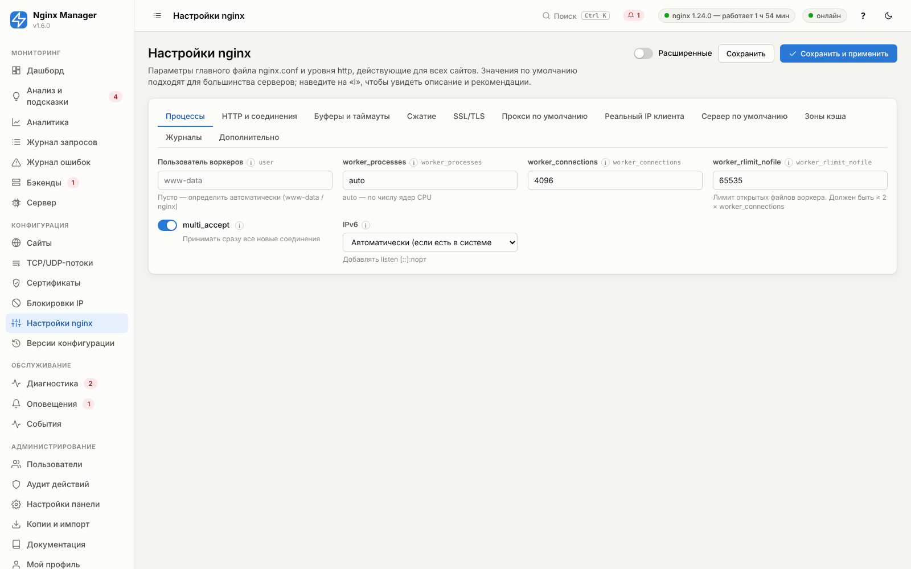
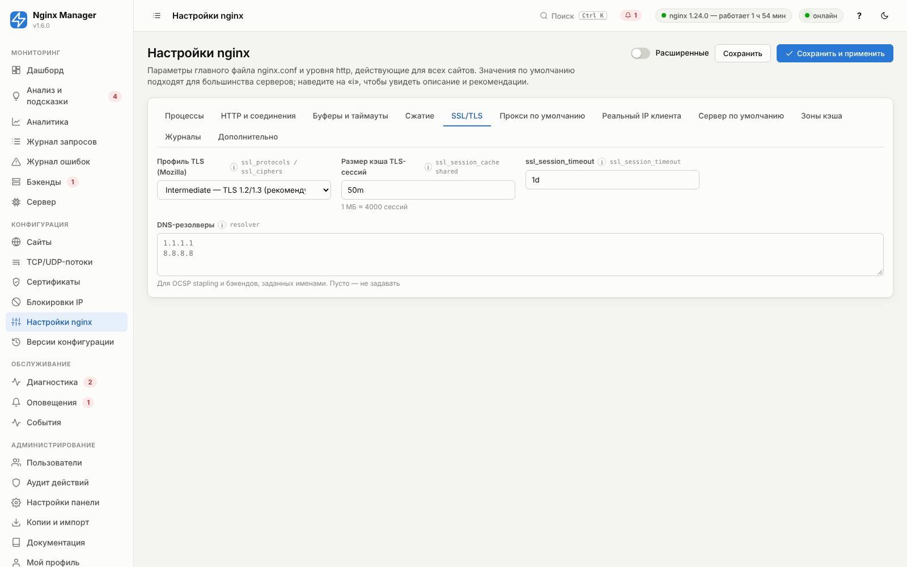

# 08. Глобальные настройки nginx

Раздел **«Настройки nginx»** управляет главным файлом `/etc/nginx/nginx.conf` и общими параметрами уровня `http`
(файл `http.d/00-base.conf`). Изменять их может только администратор. Значения по умолчанию рассчитаны на типичный
сервер (2–8 ядер, до нескольких тысяч одновременных соединений) и безопасны.



## Настройка под нагрузку

Ёмкость сервера по соединениям ≈ `worker_processes × worker_connections / 2` (при проксировании каждый клиент
занимает соединение к клиенту и к бэкенду). Лимит открытых файлов воркера должен быть не меньше
`2 × worker_connections`.

| Профиль | worker_connections | worker_rlimit_nofile | keepalive_timeout | client_header_timeout | Прочее |
|---|---|---|---|---|---|
| Небольшой (1–2 ядра, < 500 соединений) | 2048 | 8192 | 65s | 60s | значения по умолчанию |
| Средний (по умолчанию) | 4096 | 65535 | 65s | 60s | — |
| Высокая нагрузка (8+ ядер, > 10 000 соединений) | 16384 | 131072 | 30s | 15s | буфер журнала 128k; `net.core.somaxconn=4096`; сэмплирование журнала запросов |
| Много медленных клиентов (мобильные, загрузки) | 8192 | 65535 | 75s | 20s | `send_timeout 120s`, буферизация ответа включена |

Связанные системные параметры (вне панели):

```bash
# /etc/sysctl.d/90-nginx.conf
net.core.somaxconn = 4096
net.ipv4.tcp_max_syn_backlog = 8192
net.ipv4.ip_local_port_range = 10240 65535
fs.file-max = 2000000
```

Установщик добавляет `LimitNOFILE=65535` для службы nginx (`/etc/systemd/system/nginx.service.d/nginx-manager.conf`).
Если вы задаёте `worker_rlimit_nofile` больше, увеличьте и этот лимит.

«Диагностика» проверяет лимит файлов воркера, загрузку соединений, `somaxconn` и ошибки
«worker_connections are not enough» / «Too many open files» в журнале.

## Профили TLS

| Профиль | Протоколы | Совместимость | Когда выбирать |
|---|---|---|---|
| Modern | TLS 1.3 | Firefox 63+, Chrome 70+, Safari 12.1+, Android 10+ | Только современные клиенты, API для своих приложений |
| **Intermediate** (по умолчанию) | TLS 1.2, 1.3 | Практически все клиенты за последние 10 лет | Рекомендуется для публичных сайтов |
| Old | TLS 1.0–1.3 | Windows XP, Android 2.3, Java 6 | Только при требовании совместимости со старьём (небезопасно) |
| Свой | задаётся вручную | — | Требования регулятора/аудита |

Наборы шифров соответствуют рекомендациям Mozilla Server Side TLS.

## Справочник параметров

<!-- GEN:global -->
<!-- Сгенерировано tools/gen_reference.py — не редактируйте вручную -->

### Процессы


<a id="f-global-user"></a>

#### Пользователь воркеров — `user`

| Тип | По умолчанию | Диапазон / ед. | Директива nginx | Расширенный |
|---|---|---|---|---|
| строка | пусто | — | `user` | нет |

Пусто — определить автоматически (www-data / nginx)

Системный пользователь рабочих процессов nginx. По умолчанию определяется автоматически (www-data в Debian/Ubuntu, nginx в RHEL).

> **Рекомендация.** Пусто.

**Пример:** `www-data`


<a id="f-global-worker_processes"></a>

#### worker_processes — `worker_processes`

| Тип | По умолчанию | Диапазон / ед. | Директива nginx | Расширенный |
|---|---|---|---|---|
| строка | `auto` | — | `worker_processes` | нет |

auto — по числу ядер CPU.

> **Рекомендация.** auto


<a id="f-global-worker_connections"></a>

#### worker_connections — `worker_connections`

| Тип | По умолчанию | Диапазон / ед. | Директива nginx | Расширенный |
|---|---|---|---|---|
| целое число | `4096` | 256…1048576 | `worker_connections` | нет |

Максимум соединений на воркер, включая соединения к бэкендам. При проксировании каждый клиент занимает ~2 соединения. Ёмкость сервера ≈ worker_processes × worker_connections / 2.

> **Рекомендация.** 4096–16384. Ошибка «worker_connections are not enough» — повод увеличить.


<a id="f-global-worker_rlimit_nofile"></a>

#### worker_rlimit_nofile — `worker_rlimit_nofile`

| Тип | По умолчанию | Диапазон / ед. | Директива nginx | Расширенный |
|---|---|---|---|---|
| целое число | `65535` | 1024…4194304 | `worker_rlimit_nofile` | нет |

Лимит открытых файлов воркера. Должен быть ≥ 2 × worker_connections.

Максимум открытых файлов (сокеты, файлы кэша, журналы) на воркер. Не должен превышать LimitNOFILE службы nginx (65535 после установки).

> **Рекомендация.** ≥ 2 × worker_connections.

**Пример:** `65535`


<a id="f-global-multi_accept"></a>

#### multi_accept — `multi_accept`

| Тип | По умолчанию | Диапазон / ед. | Директива nginx | Расширенный |
|---|---|---|---|---|
| переключатель (да/нет) | включено | — | `multi_accept` | нет |

Принимать сразу все новые соединения.

Воркер принимает все ожидающие соединения за один раз, а не по одному.

> **Рекомендация.** Включено.


<a id="f-global-ipv6"></a>

#### IPv6 — `ipv6`

| Тип | По умолчанию | Диапазон / ед. | Директива nginx | Расширенный |
|---|---|---|---|---|
| выбор из списка | `auto` (Автоматически (если есть в системе)) | — | — | нет |

Добавлять listen [::]:порт.

Добавлять ли listen [::]:порт. «Авто» — если IPv6 включён в ядре (иначе nginx не запустится с ошибкой Address family not supported).

Варианты:

- `auto` — Автоматически (если есть в системе)
- `on` — Включить
- `off` — Выключить

> **Рекомендация.** Авто.

**Пример:** `auto`


### HTTP и соединения


<a id="f-global-sendfile"></a>

#### sendfile — `sendfile`

| Тип | По умолчанию | Диапазон / ед. | Директива nginx | Расширенный |
|---|---|---|---|---|
| переключатель (да/нет) | включено | — | `sendfile` | нет |

Отдача файлов средствами ядра без копирования в память процесса.

> **Рекомендация.** Включено.


<a id="f-global-tcp_nopush"></a>

#### tcp_nopush — `tcp_nopush`

| Тип | По умолчанию | Диапазон / ед. | Директива nginx | Расширенный |
|---|---|---|---|---|
| переключатель (да/нет) | включено | — | `tcp_nopush` | нет |

Отправка заголовка ответа и начала файла одним пакетом (вместе с sendfile).

> **Рекомендация.** Включено.


<a id="f-global-tcp_nodelay"></a>

#### tcp_nodelay — `tcp_nodelay`

| Тип | По умолчанию | Диапазон / ед. | Директива nginx | Расширенный |
|---|---|---|---|---|
| переключатель (да/нет) | включено | — | `tcp_nodelay` | нет |

Отключение алгоритма Нейгла для keepalive-соединений — меньше задержка мелких ответов.

> **Рекомендация.** Включено.


<a id="f-global-keepalive_timeout"></a>

#### keepalive_timeout — `keepalive_timeout`

| Тип | По умолчанию | Диапазон / ед. | Директива nginx | Расширенный |
|---|---|---|---|---|
| строка | `65s` | — | `keepalive_timeout` | нет |

Сколько держать простаивающее соединение с клиентом.

> **Рекомендация.** 30s–75s


<a id="f-global-keepalive_requests"></a>

#### keepalive_requests — `keepalive_requests`

| Тип | По умолчанию | Диапазон / ед. | Директива nginx | Расширенный |
|---|---|---|---|---|
| целое число | `1000` | 1…1000000 | `keepalive_requests` | нет |

Сколько запросов клиент может выполнить через одно соединение.

> **Рекомендация.** 1000 (больше для HTTP/2-клиентов с длинными сессиями).

**Пример:** `1000`


<a id="f-global-server_tokens"></a>

#### Показывать версию nginx — `server_tokens`

| Тип | По умолчанию | Диапазон / ед. | Директива nginx | Расширенный |
|---|---|---|---|---|
| переключатель (да/нет) | выключено | — | `server_tokens` | нет |

> **Рекомендация.** Выключено — не раскрывать версию атакующим.


<a id="f-global-server_names_hash_bucket_size"></a>

#### server_names_hash_bucket_size — `server_names_hash_bucket_size`

| Тип | По умолчанию | Диапазон / ед. | Директива nginx | Расширенный |
|---|---|---|---|---|
| целое число | `128` | 32…1024 | `server_names_hash_bucket_size` | да |

Увеличьте при ошибке «could not build server_names_hash».

Размер ячейки хеш-таблицы имён серверов (кратен размеру строки кэша CPU). Длинные домены требуют большего значения.

> **Рекомендация.** 128; 256 при доменах длиннее 100 символов.

**Пример:** `128`


<a id="f-global-server_names_hash_max_size"></a>

#### server_names_hash_max_size — `server_names_hash_max_size`

| Тип | По умолчанию | Диапазон / ед. | Директива nginx | Расширенный |
|---|---|---|---|---|
| целое число | `1024` | 512…65536 | `server_names_hash_max_size` | да |

Максимальный размер таблицы имён — увеличьте при сотнях сайтов.

> **Рекомендация.** 1024; 4096 при > 500 доменов.

**Пример:** `1024`


<a id="f-global-types_hash_max_size"></a>

#### types_hash_max_size — `types_hash_max_size`

| Тип | По умолчанию | Диапазон / ед. | Директива nginx | Расширенный |
|---|---|---|---|---|
| целое число | `2048` | 1024…65536 | `types_hash_max_size` | да |

Размер таблицы MIME-типов.

> **Рекомендация.** 2048

**Пример:** `2048`


<a id="f-global-http2_global"></a>

#### Разрешить HTTP/2 — `http2_global`

| Тип | По умолчанию | Диапазон / ед. | Директива nginx | Расширенный |
|---|---|---|---|---|
| переключатель (да/нет) | включено | — | — | нет |

Глобальный выключатель HTTP/2.

Общий выключатель HTTP/2 для всех сайтов (например, при проблемах с клиентами).

> **Рекомендация.** Включено.


<a id="f-global-proxy_protocol"></a>

#### Принимать PROXY protocol на HTTP-портах — `proxy_protocol`

| Тип | По умолчанию | Диапазон / ед. | Директива nginx | Расширенный |
|---|---|---|---|---|
| переключатель (да/нет) | выключено | — | `listen ... proxy_protocol` | да |

Включайте, только если перед nginx стоит балансировщик (HAProxy, AWS NLB), отправляющий PROXY protocol. Иначе все запросы будут отклоняться.


### Буферы и таймауты


<a id="f-global-client_max_body_size"></a>

#### client_max_body_size — `client_max_body_size`

| Тип | По умолчанию | Диапазон / ед. | Директива nginx | Расширенный |
|---|---|---|---|---|
| строка | `50m` | — | `client_max_body_size` | нет |

> **Рекомендация.** 10m–100m; 0 — без ограничения


<a id="f-global-client_body_buffer_size"></a>

#### client_body_buffer_size — `client_body_buffer_size`

| Тип | По умолчанию | Диапазон / ед. | Директива nginx | Расширенный |
|---|---|---|---|---|
| строка | `128k` | — | `client_body_buffer_size` | нет |

Тело запроса меньше этого размера держится в памяти, больше — пишется во временный файл.

> **Рекомендация.** 128k; 1m для API с крупными JSON.

**Пример:** `128k`


<a id="f-global-client_header_buffer_size"></a>

#### client_header_buffer_size — `client_header_buffer_size`

| Тип | По умолчанию | Диапазон / ед. | Директива nginx | Расширенный |
|---|---|---|---|---|
| строка | `1k` | — | `client_header_buffer_size` | да |

Буфер для заголовков запроса; большие заголовки используют large_client_header_buffers.

> **Рекомендация.** 1k

**Пример:** `1k`


<a id="f-global-large_client_header_buffers"></a>

#### large_client_header_buffers — `large_client_header_buffers`

| Тип | По умолчанию | Диапазон / ед. | Директива nginx | Расширенный |
|---|---|---|---|---|
| строка | `4 16k` | — | `large_client_header_buffers` | нет |

Увеличьте при ошибке 400 «Request Header Or Cookie Too Large».

Количество и размер буферов для длинных заголовков и URL. Ошибка 400 «Request Header Or Cookie Too Large» — повод увеличить.

> **Рекомендация.** 4 16k; 8 32k для приложений с большими cookie/JWT.

**Пример:** `8 32k`


<a id="f-global-client_body_timeout"></a>

#### client_body_timeout — `client_body_timeout`

| Тип | По умолчанию | Диапазон / ед. | Директива nginx | Расширенный |
|---|---|---|---|---|
| строка | `60s` | — | `client_body_timeout` | нет |

Пауза между чтениями тела запроса.

> **Рекомендация.** 60s; 20s для защиты от медленных атак.

**Пример:** `60s`


<a id="f-global-client_header_timeout"></a>

#### client_header_timeout — `client_header_timeout`

| Тип | По умолчанию | Диапазон / ед. | Директива nginx | Расширенный |
|---|---|---|---|---|
| строка | `60s` | — | `client_header_timeout` | нет |

> **Рекомендация.** 10s–20s для защиты от медленных атак (slowloris).


<a id="f-global-send_timeout"></a>

#### send_timeout — `send_timeout`

| Тип | По умолчанию | Диапазон / ед. | Директива nginx | Расширенный |
|---|---|---|---|---|
| строка | `60s` | — | `send_timeout` | нет |

Пауза между двумя записями ответа клиенту — при превышении соединение закрывается.

> **Рекомендация.** 60s; больше для медленных мобильных клиентов и больших файлов.

**Пример:** `60s`


<a id="f-global-reset_timedout_connection"></a>

#### reset_timedout_connection — `reset_timedout_connection`

| Тип | По умолчанию | Диапазон / ед. | Директива nginx | Расширенный |
|---|---|---|---|---|
| переключатель (да/нет) | включено | — | `reset_timedout_connection` | да |

Закрывать соединения по таймауту с RST — быстрее освобождается память.

> **Рекомендация.** Включено.


<a id="f-global-open_file_cache"></a>

#### open_file_cache — `open_file_cache`

| Тип | По умолчанию | Диапазон / ед. | Директива nginx | Расширенный |
|---|---|---|---|---|
| переключатель (да/нет) | включено | — | `open_file_cache` | да |

Кэш дескрипторов файлов (для статики)

Кэширует дескрипторы и метаданные часто запрашиваемых файлов (статика).

> **Рекомендация.** Включено для статических сайтов.


### Сжатие


<a id="f-global-gzip"></a>

#### Включить gzip — `gzip`

| Тип | По умолчанию | Диапазон / ед. | Директива nginx | Расширенный |
|---|---|---|---|---|
| переключатель (да/нет) | включено | — | `gzip` | нет |

Сжимает текстовые ответы (HTML, CSS, JS, JSON) в 3–10 раз. Изображения и видео не сжимаются — они уже сжаты.


<a id="f-global-gzip_level"></a>

#### Уровень сжатия — `gzip_level`

| Тип | По умолчанию | Диапазон / ед. | Директива nginx | Расширенный |
|---|---|---|---|---|
| целое число | `5` | 1…9 | `gzip_comp_level` | нет |

> **Рекомендация.** 4–6: дальше рост CPU не окупается.

*Показывается, когда `gzip` = вкл.*


<a id="f-global-gzip_min_length"></a>

#### Мин. размер ответа — `gzip_min_length`

| Тип | По умолчанию | Диапазон / ед. | Директива nginx | Расширенный |
|---|---|---|---|---|
| целое число | `1024` | 0…10485760 байт | `gzip_min_length` | нет |

Ответы меньше этого размера не сжимаются (выигрыш меньше накладных расходов).

> **Рекомендация.** 1024

**Пример:** `1024`

*Показывается, когда `gzip` = вкл.*


<a id="f-global-gzip_proxied"></a>

#### Сжимать ответы бэкенда — `gzip_proxied`

| Тип | По умолчанию | Диапазон / ед. | Директива nginx | Расширенный |
|---|---|---|---|---|
| переключатель (да/нет) | включено | — | `gzip_proxied any` | нет |

Сжимать ли ответы, полученные от бэкенда (gzip_proxied any).

> **Рекомендация.** Включено.

*Показывается, когда `gzip` = вкл.*


<a id="f-global-gzip_types"></a>

#### MIME-типы — `gzip_types`

| Тип | По умолчанию | Диапазон / ед. | Директива nginx | Расширенный |
|---|---|---|---|---|
| список, по одному значению на строку | `text/plain`, `text/css`, `text/xml`, `text/javascript`, `application/javascript`, `application/json`, `application/xml`, `application/rss+xml`, `application/atom+xml`, `application/xhtml+xml`, `application/wasm`, `image/svg+xml` … | — | `gzip_types` | нет |

Какие типы ответов сжимать (text/html сжимается всегда). Изображения, видео, архивы не добавляйте — они уже сжаты.

**Пример:** `application/json`

*Показывается, когда `gzip` = вкл.*


### SSL/TLS




<a id="f-global-ssl_preset"></a>

#### Профиль TLS (Mozilla) — `ssl_preset`

| Тип | По умолчанию | Диапазон / ед. | Директива nginx | Расширенный |
|---|---|---|---|---|
| выбор из списка | `intermediate` (Intermediate — TLS 1.2/1.3 (рекомендуется)) | — | `ssl_protocols / ssl_ciphers` | нет |

Варианты:

- `modern` — Modern — только TLS 1.3
- `intermediate` — Intermediate — TLS 1.2/1.3 (рекомендуется)
- `old` — Old — совместимость со старыми клиентами (небезопасно)
- `custom` — Свой

> **Рекомендация.** Intermediate


<a id="f-global-ssl_protocols"></a>

#### ssl_protocols — `ssl_protocols`

| Тип | По умолчанию | Диапазон / ед. | Директива nginx | Расширенный |
|---|---|---|---|---|
| строка | `TLSv1.2 TLSv1.3` | — | — | нет |

Протоколы для профиля «Свой».

**Пример:** `TLSv1.2 TLSv1.3`

*Показывается, когда `ssl_preset` = `custom`.*


<a id="f-global-ssl_ciphers"></a>

#### ssl_ciphers — `ssl_ciphers`

| Тип | По умолчанию | Диапазон / ед. | Директива nginx | Расширенный |
|---|---|---|---|---|
| многострочный текст | пусто | — | — | нет |

Список шифров OpenSSL для профиля «Свой» (через двоеточие).

**Пример:** `ECDHE-ECDSA-AES128-GCM-SHA256:ECDHE-RSA-AES128-GCM-SHA256`

*Показывается, когда `ssl_preset` = `custom`.*


<a id="f-global-ssl_prefer_server_ciphers"></a>

#### ssl_prefer_server_ciphers — `ssl_prefer_server_ciphers`

| Тип | По умолчанию | Диапазон / ед. | Директива nginx | Расширенный |
|---|---|---|---|---|
| переключатель (да/нет) | выключено | — | `ssl_prefer_server_ciphers` | да |

Порядок шифров выбирает сервер, а не клиент. Для профилей Mozilla с только стойкими шифрами не нужно.

> **Рекомендация.** Выключено.


<a id="f-global-ssl_session_cache"></a>

#### Размер кэша TLS-сессий — `ssl_session_cache`

| Тип | По умолчанию | Диапазон / ед. | Директива nginx | Расширенный |
|---|---|---|---|---|
| строка | `50m` | — | `ssl_session_cache shared` | нет |

1 МБ ≈ 4000 сессий.

Общий кэш TLS-сессий: повторные подключения клиента без полного рукопожатия.

> **Рекомендация.** 50m (~200 000 сессий).

**Пример:** `50m`


<a id="f-global-ssl_session_timeout"></a>

#### ssl_session_timeout — `ssl_session_timeout`

| Тип | По умолчанию | Диапазон / ед. | Директива nginx | Расширенный |
|---|---|---|---|---|
| строка | `1d` | — | `ssl_session_timeout` | нет |

Время жизни TLS-сессии в кэше.

> **Рекомендация.** 1d

**Пример:** `1d`


<a id="f-global-ssl_session_tickets"></a>

#### ssl_session_tickets — `ssl_session_tickets`

| Тип | По умолчанию | Диапазон / ед. | Директива nginx | Расширенный |
|---|---|---|---|---|
| переключатель (да/нет) | выключено | — | `ssl_session_tickets` | да |

> **Рекомендация.** Выключено (forward secrecy)


<a id="f-global-ssl_dhparam"></a>

#### Использовать DH-параметры (ffdhe2048) — `ssl_dhparam`

| Тип | По умолчанию | Диапазон / ед. | Директива nginx | Расширенный |
|---|---|---|---|---|
| переключатель (да/нет) | выключено | — | `ssl_dhparam` | да |

Нужно только для DHE-шифров профиля intermediate/old.

Встроенные DH-параметры ffdhe2048 (RFC 7919) для шифров DHE.

> **Рекомендация.** Только при профиле Intermediate/Old и клиентах без ECDHE.


<a id="f-global-resolver"></a>

#### DNS-резолверы — `resolver`

| Тип | По умолчанию | Диапазон / ед. | Директива nginx | Расширенный |
|---|---|---|---|---|
| список, по одному значению на строку | пусто | — | `resolver` | нет |

Для OCSP stapling и бэкендов, заданных именами. Пусто — не задавать.

DNS-серверы для nginx во время работы: OCSP stapling, бэкенды по именам в переменных.

> **Рекомендация.** Локальный резолвер (127.0.0.53 в systemd-resolved) или 1.1.1.1, 8.8.8.8.

**Пример:** `1.1.1.1`


<a id="f-global-resolver_valid"></a>

#### Кэш DNS — `resolver_valid`

| Тип | По умолчанию | Диапазон / ед. | Директива nginx | Расширенный |
|---|---|---|---|---|
| строка | `300s` | — | `resolver ... valid=` | да |

Сколько кэшировать ответы DNS.

> **Рекомендация.** 300s

**Пример:** `300s`


### Прокси по умолчанию


<a id="f-global-proxy_connect_timeout"></a>

#### proxy_connect_timeout — `proxy_connect_timeout`

| Тип | По умолчанию | Диапазон / ед. | Директива nginx | Расширенный |
|---|---|---|---|---|
| строка | `5s` | — | — | нет |

Значение по умолчанию для всех сайтов (сайт может переопределить).

> **Рекомендация.** 5s

**Пример:** `5s`


<a id="f-global-proxy_read_timeout"></a>

#### proxy_read_timeout — `proxy_read_timeout`

| Тип | По умолчанию | Диапазон / ед. | Директива nginx | Расширенный |
|---|---|---|---|---|
| строка | `60s` | — | — | нет |

Значение по умолчанию для всех сайтов.

> **Рекомендация.** 60s

**Пример:** `60s`


<a id="f-global-proxy_send_timeout"></a>

#### proxy_send_timeout — `proxy_send_timeout`

| Тип | По умолчанию | Диапазон / ед. | Директива nginx | Расширенный |
|---|---|---|---|---|
| строка | `60s` | — | — | нет |

Значение по умолчанию для всех сайтов.

> **Рекомендация.** 60s

**Пример:** `60s`


<a id="f-global-proxy_buffer_size"></a>

#### proxy_buffer_size — `proxy_buffer_size`

| Тип | По умолчанию | Диапазон / ед. | Директива nginx | Расширенный |
|---|---|---|---|---|
| строка | `16k` | — | — | нет |

16k решает большинство ошибок «upstream sent too big header».

Буфер первой части ответа бэкенда (заголовки). Значение по умолчанию для всех сайтов.

> **Рекомендация.** 16k; 32k при больших cookie/заголовках.

**Пример:** `16k`


<a id="f-global-proxy_buffers"></a>

#### proxy_buffers — `proxy_buffers`

| Тип | По умолчанию | Диапазон / ед. | Директива nginx | Расширенный |
|---|---|---|---|---|
| строка | `16 16k` | — | — | нет |

Буферы тела ответа по умолчанию.

> **Рекомендация.** 16 16k

**Пример:** `16 16k`


<a id="f-global-proxy_busy_buffers_size"></a>

#### proxy_busy_buffers_size — `proxy_busy_buffers_size`

| Тип | По умолчанию | Диапазон / ед. | Директива nginx | Расширенный |
|---|---|---|---|---|
| строка | `32k` | — | — | да |

Буферы, занятые отправкой клиенту, по умолчанию.

> **Рекомендация.** 32k

**Пример:** `32k`


### Реальный IP клиента


<a id="f-global-real_ip_enabled"></a>

#### Определять реальный IP за CDN/балансировщиком — `real_ip_enabled`

| Тип | По умолчанию | Диапазон / ед. | Директива nginx | Расширенный |
|---|---|---|---|---|
| переключатель (да/нет) | выключено | — | `set_real_ip_from / real_ip_header` | нет |

Если перед nginx стоит Cloudflare, другой CDN или балансировщик, $remote_addr будет их адресом. Модуль realip подставляет IP клиента из заголовка — для статистики, ограничений и списков доступа.

> **Рекомендация.** Указывайте только реально доверенные адреса: иначе клиент сможет подделать IP.


<a id="f-global-real_ip_header"></a>

#### Заголовок — `real_ip_header`

| Тип | По умолчанию | Диапазон / ед. | Директива nginx | Расширенный |
|---|---|---|---|---|
| выбор из списка | `X-Forwarded-For` | — | — | нет |

Откуда брать IP клиента: X-Forwarded-For (большинство балансировщиков), CF-Connecting-IP (Cloudflare), True-Client-IP (Akamai), proxy_protocol (HAProxy, AWS NLB при включённом PROXY protocol).

Варианты:

- `X-Forwarded-For`
- `X-Real-IP`
- `CF-Connecting-IP`
- `True-Client-IP`
- `proxy_protocol`

**Пример:** `CF-Connecting-IP`

*Показывается, когда `real_ip_enabled` = вкл.*


<a id="f-global-real_ip_from"></a>

#### Доверенные адреса — `real_ip_from`

| Тип | По умолчанию | Диапазон / ед. | Директива nginx | Расширенный |
|---|---|---|---|---|
| список, по одному значению на строку | пусто | — | — | нет |

Есть кнопка «Добавить диапазоны Cloudflare».

Адреса доверенных прокси/CDN. Только от них заголовок принимается — иначе клиент мог бы подставить любой IP.

**Пример:** `173.245.48.0/20`

*Показывается, когда `real_ip_enabled` = вкл.*


<a id="f-global-real_ip_recursive"></a>

#### real_ip_recursive — `real_ip_recursive`

| Тип | По умолчанию | Диапазон / ед. | Директива nginx | Расширенный |
|---|---|---|---|---|
| переключатель (да/нет) | включено | — | — | нет |

Из цепочки X-Forwarded-For берётся последний недоверенный адрес — корректно при нескольких прокси подряд.

> **Рекомендация.** Включено.

*Показывается, когда `real_ip_enabled` = вкл.*


### Сервер по умолчанию


<a id="f-global-default_action"></a>

#### Ответ на неизвестный домен — `default_action`

| Тип | По умолчанию | Диапазон / ед. | Директива nginx | Расширенный |
|---|---|---|---|---|
| выбор из списка | `close` (Закрыть соединение (444) — рекомендуется) | — | — | нет |

Что получит запрос с Host, не совпадающим ни с одним сайтом (сканеры, обращения по IP). Для HTTPS неизвестные имена отклоняются на этапе TLS (ssl_reject_handshake), чтобы не раскрывать сертификаты.

Варианты:

- `close` — Закрыть соединение (444) — рекомендуется
- `404` — Ошибка 404
- `page` — Страница-заглушка
- `redirect` — Перенаправить на URL


<a id="f-global-default_redirect"></a>

#### URL — `default_redirect`

| Тип | По умолчанию | Диапазон / ед. | Директива nginx | Расширенный |
|---|---|---|---|---|
| строка | `https://example.com` | — | — | нет |

Куда перенаправлять запросы с неизвестным доменом.

**Пример:** `https://example.com`

*Показывается, когда `default_action` = `redirect`.*


<a id="f-global-default_page_title"></a>

#### Заголовок заглушки — `default_page_title`

| Тип | По умолчанию | Диапазон / ед. | Директива nginx | Расширенный |
|---|---|---|---|---|
| строка | `Сервер работает` | — | — | нет |

Текст страницы-заглушки для неизвестных доменов.

**Пример:** `Сервер работает`

*Показывается, когда `default_action` = `page`.*


### Зоны кэша


<a id="f-global-cache_zones"></a>

#### Зоны кэша — `cache_zones`

| Тип | По умолчанию | Диапазон / ед. | Директива nginx | Расширенный |
|---|---|---|---|---|
| таблица элементов | 1 элемент(ов) | — | `proxy_cache_path` | нет |

Именованные зоны дискового кэша. Ключи хранятся в общей памяти (1 МБ ≈ 8000 ключей), данные — в /var/cache/nginx/nginx-manager/<имя>; при превышении max_size удаляются давно не использованные элементы.

> **Рекомендация.** Одна зона default 1g на сервер; отдельная — для сайта с большим объёмом.

**Пример:** `default, 10m, 1g, 7d`

Поля элемента:

| Поле | Тип | По умолчанию | Описание |
|---|---|---|---|
| Имя (`name`) | строка | `default` | Латиница, цифры, _ |
| Макс. размер на диске (`max_size`) | строка | `1g` | Рекомендация: Не более 50–70% свободного места. |
| Память под ключи (`keys_zone_size`) | строка | `10m` | 1 МБ ≈ 8000 ключей. Рекомендация: 10m на каждые ~80 000 кэшируемых URL. |
| Удалять неиспользуемое через (`inactive`) | строка | `7d` | Рекомендация: 7d |
| Уровни каталогов (`levels`) | выбор из списка | `1:2` | Рекомендация: 1:2 |


### Журналы


<a id="f-global-access_log_buffer"></a>

#### Буфер журнала запросов — `access_log_buffer`

| Тип | По умолчанию | Диапазон / ед. | Директива nginx | Расширенный |
|---|---|---|---|---|
| строка | `64k` | — | `access_log ... buffer=` | нет |

Пусто — писать сразу. Буфер снижает нагрузку на диск.

> **Рекомендация.** 32k–64k; статистика при этом запаздывает до flush-интервала.


<a id="f-global-access_log_flush"></a>

#### Интервал сброса буфера — `access_log_flush`

| Тип | По умолчанию | Диапазон / ед. | Директива nginx | Расширенный |
|---|---|---|---|---|
| строка | `1s` | — | `access_log ... flush=` | нет |

Как часто nginx сбрасывает буфер журнала на диск — определяет задержку статистики реального времени.

> **Рекомендация.** 1s

**Пример:** `1s`


<a id="f-global-error_log_level"></a>

#### Уровень журнала ошибок — `error_log_level`

| Тип | По умолчанию | Диапазон / ед. | Директива nginx | Расширенный |
|---|---|---|---|---|
| выбор из списка | `warn` | — | `error_log` | нет |

Варианты:

- `debug`
- `info`
- `notice`
- `warn`
- `error`
- `crit`

> **Рекомендация.** warn


<a id="f-global-log_ignore_status"></a>

#### Не писать в журнал health-check запросы — `log_ignore_status`

| Тип | По умолчанию | Диапазон / ед. | Директива nginx | Расширенный |
|---|---|---|---|---|
| переключатель (да/нет) | выключено | — | — | да |

Запросы User-Agent «NginxManager-HealthCheck» не учитываются.

Запросы проверок доступности панели (User-Agent NginxManager-HealthCheck) не попадают в журнал и статистику.


### Дополнительно


<a id="f-global-include_conf_d"></a>

#### Подключать /etc/nginx/conf.d/*.conf — `include_conf_d`

| Тип | По умолчанию | Диапазон / ед. | Директива nginx | Расширенный |
|---|---|---|---|---|
| переключатель (да/нет) | включено | — | — | нет |

Для совместимости с конфигурациями других пакетов.

Подключать файлы других пакетов и ваши ручные конфигурации из conf.d.

> **Рекомендация.** Включено; следите, чтобы там не было server с default_server на 80/443.


<a id="f-global-include_sites_enabled"></a>

#### Подключать /etc/nginx/sites-enabled/* — `include_sites_enabled`

| Тип | По умолчанию | Диапазон / ед. | Директива nginx | Расширенный |
|---|---|---|---|---|
| переключатель (да/нет) | выключено | — | — | нет |

Осторожно: файл default конфликтует с сервером по умолчанию панели.

Подключать Debian-каталог sites-enabled (там обычно лежит default с default_server — удалите его, иначе конфликт).

> **Рекомендация.** Выключено.


<a id="f-global-custom_main"></a>

#### Свои директивы (main) — `custom_main`

| Тип | По умолчанию | Диапазон / ед. | Директива nginx | Расширенный |
|---|---|---|---|---|
| фрагмент конфигурации nginx | пусто | — | — | нет |

Директивы главного контекста (вне events/http): load_module, env, worker_cpu_affinity, thread_pool.

**Пример:** `worker_cpu_affinity auto;`


<a id="f-global-custom_events"></a>

#### Свои директивы (events) — `custom_events`

| Тип | По умолчанию | Диапазон / ед. | Директива nginx | Расширенный |
|---|---|---|---|---|
| фрагмент конфигурации nginx | пусто | — | — | да |

Директивы блока events.

**Пример:** `use epoll;`


<a id="f-global-custom_http"></a>

#### Свои директивы (http) — `custom_http`

| Тип | По умолчанию | Диапазон / ед. | Директива nginx | Расширенный |
|---|---|---|---|---|
| фрагмент конфигурации nginx | пусто | — | — | нет |

Директивы уровня http для всех сайтов: свои map, log_format, limit_req_zone.

**Пример:** `map $http_user_agent $is_mobile { default 0; ~*mobile 1; }`


<a id="f-global-custom_stream"></a>

#### Свои директивы (stream) — `custom_stream`

| Тип | По умолчанию | Диапазон / ед. | Директива nginx | Расширенный |
|---|---|---|---|---|
| фрагмент конфигурации nginx | пусто | — | — | да |

Директивы уровня stream: свои upstream, map, ssl_preread-маршрутизация.

<!-- /GEN:global -->
