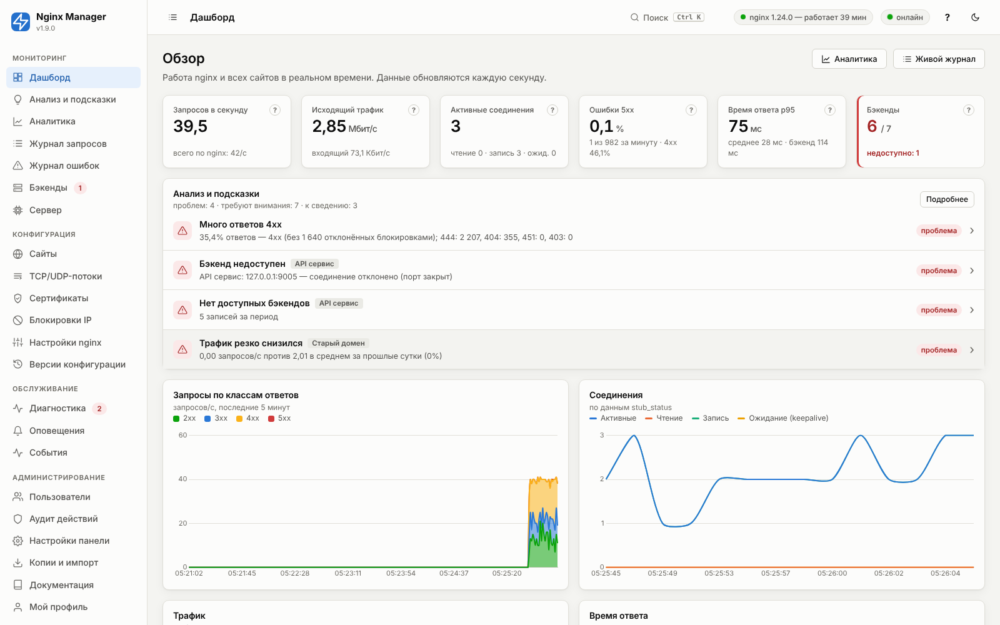
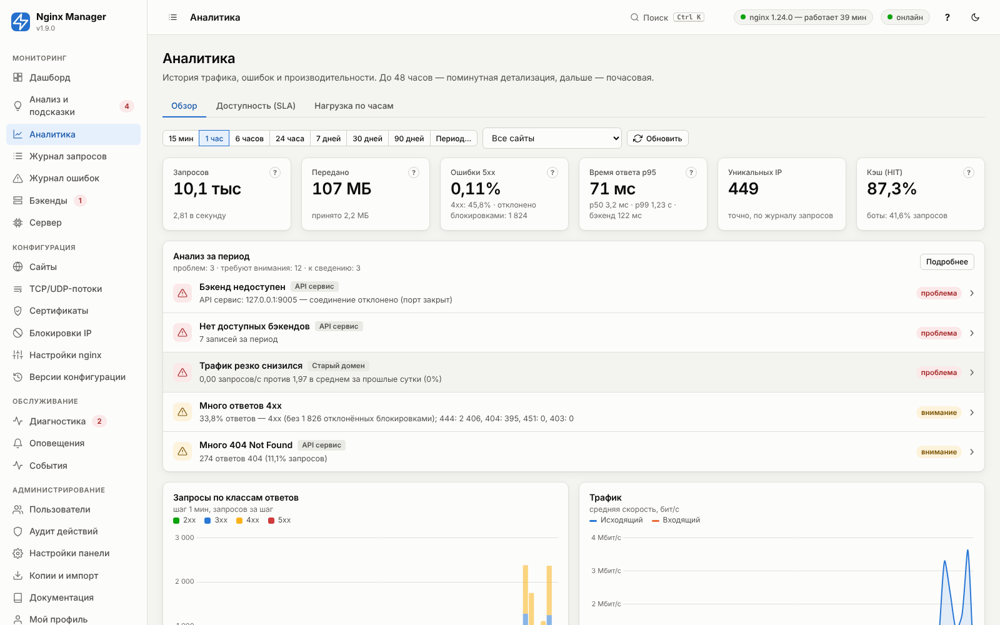
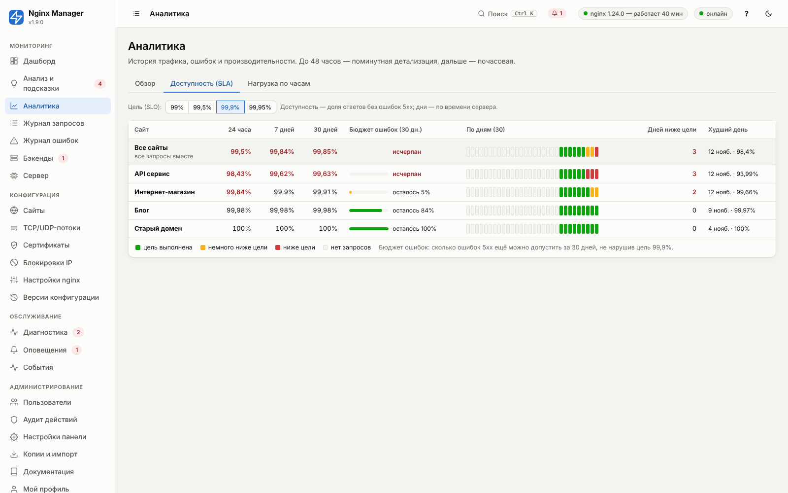
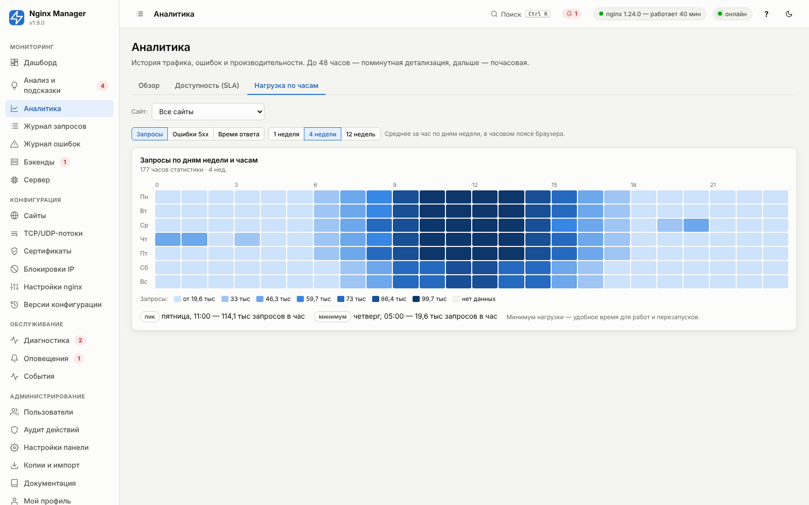
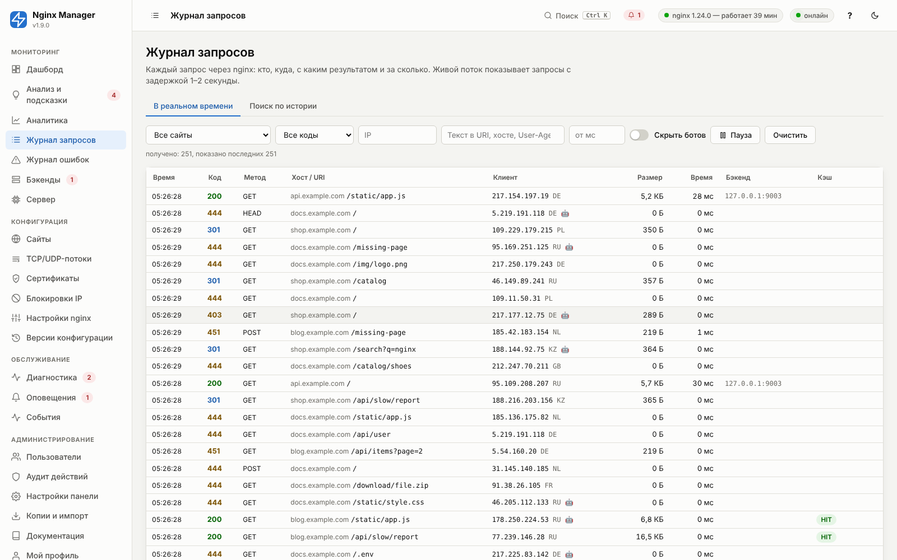
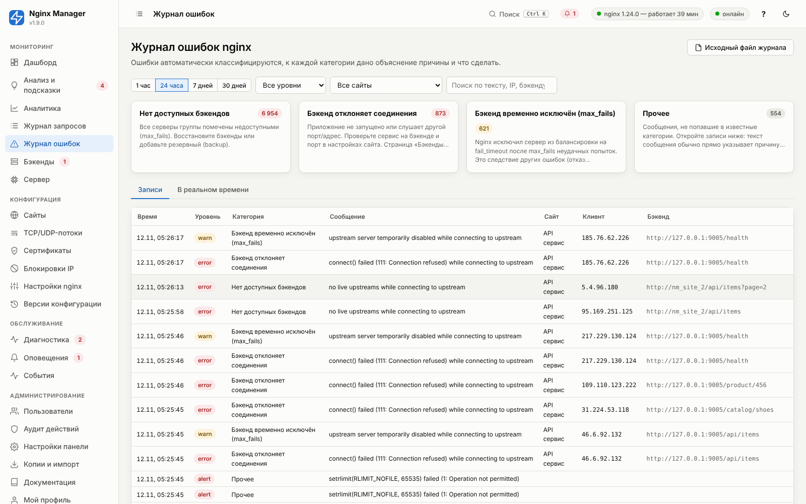
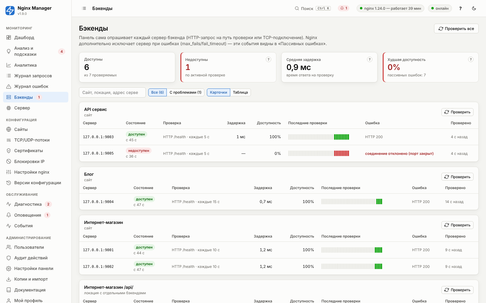
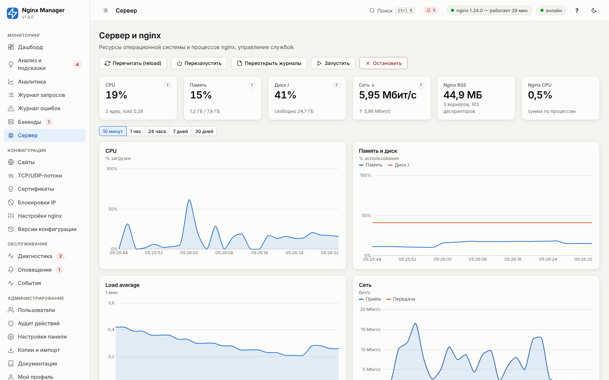

# 09. Мониторинг, статистика и аналитика

Методология сбора описана в [02. Архитектура](02-architecture.md#методология-сбор-статистики). Здесь — что
показывает каждый экран и как вычисляется каждая метрика.

## Дашборд (реальное время)



Данные приходят по WebSocket раз в секунду. Значения за «последнюю полную секунду» берутся с задержкой 2–3 секунды —
это время, за которое nginx сбрасывает буфер журнала (настройка «Интервал сброса буфера», по умолчанию 1 с).

| Показатель | Как вычисляется |
|---|---|
| **Запросов в секунду** | Число строк журнала за последние 10 с / 10. Ниже — «всего по nginx» из stub_status (включает запросы, не попадающие в журнал: служебные, health-check, сайты с выключенным журналом). |
| **Исходящий трафик** | Сумма `$bytes_sent` (ответ с заголовками) за 10 с × 8 / 10, бит/с. Входящий — сумма `$request_length`. |
| **Активные соединения** | `Active connections` из stub_status: все открытые клиентские соединения, включая простаивающие keepalive. Ниже — чтение заголовков (`Reading`), отправка ответа (`Writing`), простаивающие (`Waiting`). |
| **Ошибки 5xx** | Доля ответов 500–599 за последние 60 с, %. Цвет: ≥ 1% — предупреждение, ≥ 5% (при ≥ 20 запросах) — ошибка. |
| **Время ответа p95** | 95-й перцентиль `$request_time` за 60 с. Ниже — среднее и среднее время бэкенда (`$upstream_response_time`). |
| **Бэкенды** | Доступно / всего проверяемых по активным проверкам. |

Графики (последние 5 минут, по секундам):

- **Запросы по классам ответов** — накопленные области 2xx/3xx/4xx/5xx. Цвета классов: 2xx — зелёный, 3xx — синий,
  4xx — жёлтый, 5xx — красный (одинаково во всех разделах).
- **Соединения** — Active/Reading/Writing/Waiting из stub_status.
- **Трафик** — исходящий и входящий.
- **Время ответа** — p50, p95, p99 за каждую секунду.

Таблица **«Сайты»** — нагрузка каждого сайта за последние 10 с, мини-график за 10 минут, состояние бэкендов (точки),
доля 5xx, среднее время ответа.

## Аналитика (история)



Фильтры в одну строку над всеми графиками: период (15 мин … 90 дней или произвольный), сайт. Все графики, показатели
и таблицы ниже относятся к одному и тому же срезу.

- До 48 часов используется поминутная таблица, дальше — почасовая. Точки объединяются в шаги так, чтобы на графике
  было не больше ~200 точек (шаг показан в подписи графика).
- **Время ответа (перцентили)** за шаг вычисляются по суммарной гистограмме шага — корректно для любого периода.
- **Уникальные IP**: точное значение — подсчётом `COUNT(DISTINCT ip)` по журналу запросов, если журнал хранится за
  весь период и сэмплирование выключено; иначе — оценка (сумма почасовых уникальных, завышена для длинных периодов).
- **Кэш (HIT)** — доля `HIT` среди запросов, прошедших через кэш (`$upstream_cache_status` не пустой).
- **Боты** — по User-Agent (поисковые роботы, curl, библиотеки, сканеры).

Распределения: коды ответов, методы, протоколы (HTTP/1.1, HTTP/2.0, HTTP/3.0), версии TLS, статусы кэша,
браузеры, ОС, устройства, страны; гистограмма времени ответа.

**Топ-списки**: URI (без параметров запроса), IP-адреса, источники (домен Referer, кроме самого сайта),
User-Agent, хосты, бэкенды, ошибки 4xx и 5xx (код + URI), медленные URI (дольше порога «Медленный запрос», по
умолчанию 1000 мс, со средним временем). Щелчок по IP или URI открывает журнал запросов с фильтром. Для последнего
часа топы точные (из памяти, поминутно); для более длинных периодов — сумма почасовых топ-100, поэтому редкие
значения в «хвосте» могут не учитываться.

**Сравнение сайтов** (при выборе «Все сайты») — доля трафика, ошибки, среднее время по каждому сайту.

Вкладки над фильтрами: **«Обзор»** (всё описанное выше), **«Доступность (SLA)»** и **«Нагрузка по часам»**.

### Доступность сайтов (SLA)



Для каждого сайта и для всех вместе — **доля ответов без ошибок 5xx** за последние 24 часа, 7 и 30 дней, полоса
доступности по дням (30 дней по времени сервера), число дней ниже цели и худший день. Цель (SLO) выбирается
над таблицей: 99%, 99,5%, 99,9% или 99,95% (запоминается в браузере).

| Показатель | Как считается |
|---|---|
| Доступность | (запросы − ответы 5xx) / запросы × 100, по почасовой статистике. Текущий час обновляется каждую минуту |
| Цвет дня | зелёный — цель выполнена; жёлтый — ниже цели, но не больше чем на четыре «допуска» (для 99,9% — до 99,5%); красный — ниже; серый — запросов не было. Значение и число запросов — во всплывающей подсказке |
| Бюджет ошибок (30 дн.) | сколько ошибок 5xx ещё можно допустить: допустимо = запросы за 30 дней × (100% − цель); остаток = 1 − (было 5xx / допустимо). «Исчерпан» — цель за 30 дней уже нарушена |

Это доступность **с точки зрения nginx**: ответы 5xx от бэкендов и самого nginx (502/503/504, ограничения).
Полную недоступность сервера (nginx не запущен, сеть) так не увидеть — для неё нужны внешние проверки
(UptimeRobot, Prometheus blackbox_exporter); их удобно сочетать с этой таблицей. Через API:
`GET /api/stats/sla?days=30&slo=99.9`.

### Нагрузка по дням недели и часам



Тепловая карта 7 × 24: среднее значение за час для каждого дня недели за 1, 4 или 12 недель (в часовом поясе
браузера), для всех сайтов или одного. Показатели: **запросы в час**, **доля ответов 5xx**, **среднее время
ответа**. Шкала — один синий тон из 7 ступеней с легендой; верхняя граница — 97-й перцентиль, чтобы единичный
всплеск (атака, нагрузочный тест) не «гасил» остальную карту: такие значения попадают в верхнюю ступень «≥».
Под картой — час пика и час минимума: минимум нагрузки удобен для плановых работ и перезапусков, а совпадение
пика запросов и пика ошибок подсказывает, что сайту не хватает ресурсов. Наведите курсор на клетку, чтобы
увидеть точное значение. Через API: `GET /api/stats/heatmap?weeks=4&site=*`.

## Журнал запросов



- **В реальном времени** — поток запросов по WebSocket с фильтрами на стороне сервера (сайт, код или класс,
  IP, текст в URI/хосте/User-Agent, минимальное время, скрыть ботов); пауза; до 300 последних строк.
- **Поиск по истории** — по таблице `requests` (по умолчанию 72 часа): сайт, код, метод, IP, URI, хост, User-Agent,
  бэкенд, минимальное время, X-Request-ID, период; сортировка по времени, длительности, размеру; экспорт CSV
  (в кодировке UTF-8 с BOM; значения из запросов, начинающиеся с `=`, `+`, `-`, `@`, экранируются апострофом,
  чтобы Excel не выполнил подставленную посетителем формулу).

Щелчок по строке — все поля запроса. **X-Request-ID** передаётся бэкенду в одноимённом заголовке: по нему запрос
находится в журналах приложения (сквозная трассировка).

## Журнал ошибок nginx



Каждая строка `nm-error.log` относится к категории (таблица в [10. Диагностика](10-diagnostics.md#категории-ошибок-nginx))
с объяснением и рекомендацией. Карточки категорий вверху — количество за период; щелчок фильтрует список.
Сайт определяется по полям `server`/`host` сообщения.

## Бэкенды



Для каждого сервера: состояние, способ проверки, задержка ответа на проверку, доступность (%) с момента запуска
сервиса, полоса последних 40 проверок, последняя ошибка. «Пассивные ошибки» — ошибки соединения к бэкендам из
журнала nginx (отказ, таймаут, сброс), которые видит сам nginx на реальных запросах.

Над списком — поиск по сайту, локации и адресу сервера и фильтр **«С проблемами»** (недоступен или доступность
ниже 99%). Группы с проблемами всегда показываются первыми. Вид **«Карточки»** (по группе на сайт) или
**«Таблица»** (все серверы в одной таблице, проблемные строки подсвечены) — при больше чем 20 группах по
умолчанию включается таблица; выбор запоминается в браузере.

Первые проверки новых серверов разносятся по первым 5 секундам, а не выполняются одновременно: при сотнях
сайтов с общим бэкендом это убирает залпы запросов и ложные таймауты.

## Сервер



CPU, память, диск, сеть, дисковый ввод-вывод, соединения nginx, память и CPU процессов nginx — за 10 минут
(по 2 секунды из памяти), сутки, неделю, месяц (поминутные средние из БД). Кнопки управления nginx (reload,
restart, start, stop, переоткрыть журналы), сведения о сборке (модули, параметры configure), полный вывод `nginx -T`,
состояние сборщика (размер и отставание обработки журналов, ошибки разбора).

## GeoIP (страны)

Определение страны по IP требует базы в формате MaxMind DB и пакета `maxminddb`:

1. Установите пакет: `/opt/nginx-manager/venv/bin/pip install maxminddb` (или `install.sh --with-geoip`).
2. Скачайте базу одним из способов и положите в `/var/lib/nginx-manager/geoip/`:
   - **DB-IP Country Lite** (бесплатно, без регистрации, CC BY 4.0): `dbip-country-lite-ГГГГ-ММ.mmdb.gz` с
     db-ip.com → распаковать как `dbip-country-lite.mmdb`;
   - **MaxMind GeoLite2-Country** (бесплатно, нужна регистрация и лицензионный ключ): `GeoLite2-Country.mmdb`.
3. Перезапустите сервис или сохраните «Настройки панели» — база подхватится. Состояние — в «Сервер → Сборщик
   статистики» и в Диагностике.

Обновляйте базу ежемесячно (например, cron + `geoipupdate` для MaxMind). Панель сама замечает новую версию
файла в течение 10 минут.

Эта же база используется для **ограничения доступа к сайтам по странам** ([17](17-bans.md#доступ-по-странам)).

## Метрики Prometheus

Панель отдаёт метрики в формате Prometheus по адресу `http://сервер:8088/metrics` (порт панели). Их можно
собирать Prometheus, VictoriaMetrics, Grafana Agent, Zabbix (HTTP-агент с препроцессингом Prometheus) и строить
дашборды Grafana рядом с остальной инфраструктурой.

**Доступ** («Настройки панели → Мониторинг»):

- по API-токену: в «Моём профиле» создайте токен с правами «Наблюдатель» — только чтение, даже если ваша роль
  выше (утечка такого токена не даст ничего изменить); заголовок `Authorization: Bearer nm_…`;
- без токена — только с адресов из «Читать /metrics без токена с IP» (например, адрес сервера Prometheus);
- переключатель «Метрики Prometheus» полностью выключает адрес (ответ 404).

Пример конфигурации Prometheus:

```yaml
scrape_configs:
  - job_name: nginx-manager
    scrape_interval: 15s
    metrics_path: /metrics
    authorization:
      type: Bearer
      credentials: nm_xxxxxxxxxxxxxxxx      # API-токен наблюдателя
    static_configs:
      - targets: ["203.0.113.10:8088"]
```

| Метрика | Тип | Метки | Что означает |
|---|---|---|---|
| `nginx_up` | gauge | — | 1 — мастер-процесс nginx запущен |
| `nginx_connections` | gauge | `state` (active, reading, writing, waiting) | Соединения по данным stub_status |
| `nginx_connections_accepted_total`, `nginx_connections_handled_total`, `nginx_http_requests_total` | counter | — | Счётчики stub_status |
| `nm_http_requests_total` | counter | `site_id`, `site` | Запросы по сайтам по журналу доступа |
| `nm_http_responses_total` | counter | `site_id`, `site`, `code` (2xx…5xx) | Ответы по классам кодов |
| `nm_http_request_duration_seconds` | histogram | `site_id`, `site`, `le` | Время обработки `$request_time`; корзины совпадают с графиками панели |
| `nm_http_received_bytes_total`, `nm_http_sent_bytes_total` | counter | `site_id`, `site` | Трафик |
| `nm_http_cache_responses_total` | counter | `site_id`, `site`, `cache_status` | HIT, MISS, EXPIRED, STALE… |
| `nm_http_banned_requests_total` | counter | `site_id`, `site` | Отклонено запросов с заблокированных IP |
| `nm_http_geo_blocked_requests_total` | counter | `site_id`, `site` | Отклонено запросов правилами доступа по странам ([17](17-bans.md#доступ-по-странам)) |
| `nm_backend_up` | gauge | `owner`, `name`, `backend`, `backup` | 1/0 по активной проверке бэкенда, NaN — ещё не проверялся |
| `nm_backend_check_latency_seconds` | gauge | то же | Время ответа на последнюю проверку |
| `nm_certificate_expiry_days` | gauge | `id`, `name`, `domain`, `used` | Дней до истечения сертификата |
| `nm_bans_active` | gauge | `source` (auto, manual) | Активные блокировки IP ([17](17-bans.md)) |
| `nm_bans_suspicious` | gauge | — | Подозрительные IP за последнее время |
| `nm_alerts_firing` | gauge | — | Сработавшие оповещения |
| `nm_system_cpu_percent`, `nm_system_memory_percent`, `nm_system_disk_percent`, `nm_system_load1` | gauge | — | Ресурсы сервера |
| `nm_log_lines_parsed_total`, `nm_log_parse_errors_total` | counter | — | Работа сборщика статистики |
| `nginx_manager_info`, `nginx_manager_uptime_seconds` | gauge | `version` | Версия и время работы панели |

Счётчики `…_total` растут с момента запуска панели; после её перезапуска они начинаются с нуля, и функции
`rate()` / `increase()` учитывают это автоматически. Сайт `-` — сервер по умолчанию (неизвестные домены).

Полезные запросы PromQL:

```promql
# запросов в секунду по сайтам
sum by (site) (rate(nm_http_requests_total[5m]))

# доля ответов 5xx, %
100 * sum by (site) (rate(nm_http_responses_total{code="5xx"}[5m]))
    / sum by (site) (rate(nm_http_requests_total[5m]))

# 95-й перцентиль времени ответа
histogram_quantile(0.95, sum by (site, le) (rate(nm_http_request_duration_seconds_bucket[5m])))

# сертификаты, истекающие менее чем через 14 дней
nm_certificate_expiry_days{used="1"} < 14

# недоступные основные бэкенды
nm_backend_up{backup="0"} == 0
```

### Дашборд Grafana

Готовый дашборд: «Настройки панели → Мониторинг → **Скачать дашборд Grafana**» (или файл
`/opt/nginx-manager/packaging/grafana/nginx-manager.json`, или `GET /api/metrics/grafana-dashboard`). Импорт:
Grafana 9 и новее → «Dashboards → New → Import» → загрузить файл → выбрать источник данных Prometheus, который
собирает `/metrics` панели (пример `scrape_configs` выше).

Вверху дашборда — переменные: **источник данных**, **сервер** (метка `instance`; можно выбрать несколько панелей
или «All») и **сайт** (названия сайтов из метрик; влияет на графики трафика, ошибок и времени ответа).

| Блок | Панели |
|---|---|
| Обзор | nginx работает/остановлен, запросов в секунду, доля ответов 5xx (жёлтый от 1 %, красный от 5 %), время ответа p95 (жёлтый от 0,5 с, красный от 2 с), недоступные основные бэкенды, дней до истечения ближайшего используемого сертификата (красный меньше 7, жёлтый меньше 14), сработавшие оповещения |
| Трафик | запросы по сайтам; ответы по классам кодов (2xx зелёный, 3xx синий, 4xx жёлтый, 5xx красный); медиана, p95 и p99 времени ответа; исходящий и входящий трафик по сайтам; ответы кэша по статусу |
| Бэкенды | шкала доступности каждого сервера по активным проверкам; время ответа на проверку |
| Безопасность | отклонённые запросы (заблокированные IP, доступ по странам); активные блокировки и подозрительные IP |
| Сервер и nginx | соединения nginx по состояниям; CPU, память, диск (0–100 %); load average; таблица сертификатов с днями до истечения; работа сборщика статистики (строк в секунду и нераспознанных строк); версия и время работы панели, запросы и соединения по данным `stub_status` |

Каждый запрос дашборда проверен на Prometheus 2.55 против работающей панели (все возвращают данные), а автотест
сверяет, что каждая метрика в запросах действительно отдаётся панелью. Дашборд собирается скриптом
`tools/gen_grafana.py` — правьте его, а не JSON, если добавляете панели.

Правила оповещений Prometheus (Alertmanager) на тех же метриках, если оповещения панели вам не подходят:

```yaml
groups:
  - name: nginx-manager
    rules:
      - alert: NginxDown
        expr: nginx_up == 0
        for: 1m
      - alert: Http5xxHigh
        expr: sum by (instance, site) (rate(nm_http_responses_total{code="5xx"}[5m]))
              / sum by (instance, site) (rate(nm_http_requests_total[5m])) > 0.05
        for: 10m
      - alert: BackendDown
        expr: nm_backend_up{backup="0"} == 0
        for: 2m
      - alert: CertificateExpiresSoon
        expr: nm_certificate_expiry_days{used="1"} < 14
        for: 1h
```

## Хранение и объём данных

| Нагрузка | Журнал запросов за 72 ч | Поминутная статистика за 14 дней | Рекомендация |
|---|---|---|---|
| 10 запросов/с | ~2,6 млн строк, ~1 ГБ | ~20 МБ на сайт | по умолчанию |
| 100 запросов/с | ~26 млн строк — ограничится 5 млн, ~2 ГБ | ~20 МБ на сайт | срок 24 ч или сэмплирование 1/5 |
| 1000+ запросов/с | — | ~20 МБ на сайт | выключить журнал запросов или сэмплирование 1/50 |

Агрегированная статистика (графики, топы, перцентили) не зависит от журнала запросов и всегда точна.
Сроки и лимиты — «Настройки панели → Статистика и хранение» ([13](13-panel-settings.md)).
