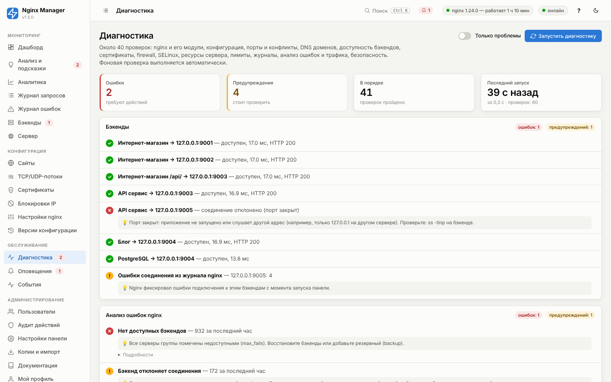

# 10. Диагностика и обработка ошибок

Диагностика выполняется:

- автоматически каждые 10 минут (настройка «Фоновая диагностика каждые» в «Настройки панели → Мониторинг»);
  число ошибок и предупреждений показывается значком у пункта меню;
- вручную — кнопка «Запустить диагностику» (страница также запускает проверку сама, если последней больше 5 минут);
- в консоли — `nmctl diag` (все проверки) или `nmctl diag -p` (только проблемы); код возврата 1, если есть ошибки
  (удобно для мониторинга).

Каждая проверка имеет статус: ✓ **в порядке**, ! **предупреждение** (стоит проверить), ✕ **ошибка** (требует действий),
i **информация**, – **пропущено**. Для проблем показывается объяснение и рекомендация, для типовых — кнопка
**исправления** (выполняется после подтверждения, результат и вывод команды показываются, затем диагностика
повторяется автоматически). Исправления доступны ролям «Оператор» и «Администратор» и записываются в аудит.

**Много однотипных проверок.** Если в группе больше 12 одинаковых проверок с одним статусом (DNS сотен доменов,
серверы бэкендов сотен сайтов), исправные сворачиваются в одну строку «N проверок — в порядке», а у проблемных
первые 11 показываются по отдельности (с подсказками и кнопками), остальные — строкой «Ещё N проверок» со списком
в «Подробностях». Счётчики вверху и значок в меню считают все проверки, а не строки.

## Перечень проверок

### Nginx

| Проверка | Что проверяется | Ошибка / предупреждение | Исправление |
|---|---|---|---|
| Nginx установлен | Наличие исполняемого файла, версия, OpenSSL | Нет nginx | — (install.sh) |
| Версия nginx | Версия ≥ 1.18 | Устаревшая версия | — (`--nginx-repo stable`) |
| Необходимые модули | ssl, http_v2, stub_status, realip | Нет модуля — нет HTTPS/HTTP2/статистики соединений/реального IP | — |
| Модуль stream | Доступность для TCP/UDP | Ошибка, если потоки настроены, а модуля нет | «Установить модуль» |
| Nginx запущен | Мастер-процесс, число воркеров, время работы | Не запущен | «Запустить nginx» |
| Рабочие процессы | Есть ли воркеры у мастера | Нет воркеров | «Перезапустить nginx» |
| Автозапуск nginx | `systemctl is-enabled nginx` | Не в автозагрузке | «Включить автозапуск» |

### Конфигурация

| Проверка | Что проверяется | Исправление |
|---|---|---|
| Проверка nginx -t | Корректность текущей конфигурации, предупреждения с пояснениями | «Применить последнюю рабочую версию» |
| nginx.conf под управлением панели | Метка в `/etc/nginx/nginx.conf` (её нет, если файл перезаписал пакетный менеджер или администратор) | «Применить конфигурацию» |
| Неприменённые изменения | Разница между настройками в панели и применённой версией; ошибки в настройках | «Применить» |
| Каталог конфигурации | Наличие `/etc/nginx/nginx-manager/live` | «Применить конфигурацию» |
| Права доступа воркеров nginx | Может ли пользователь воркеров (www-data/nginx) пройти по каталогам и прочитать страницы ошибок, файлы Basic Auth, каталог ACME (иначе «Permission denied» в журнале ошибок) | «Исправить права» |
| Список блокировок IP | Принял ли nginx файл блокировок (`bans.conf`) и подключён ли он в действующей конфигурации ([17](17-bans.md)) | «Повторить», «Применить конфигурацию» |
| Уникальность доменов | Один домен на одном порту в нескольких сайтах (nginx использует только первый) | — |
| server_names_hash_bucket_size | Длинные доменные имена при малом bucket_size | «Увеличить до 256» |

### Сеть и DNS

| Проверка | Что проверяется | Исправление |
|---|---|---|
| Порт N/tcp, N/udp | Для каждого нужного порта (80, 443, порты сайтов и потоков, stub_status): слушает ли nginx, не занят ли другим процессом (с именем процесса) | «Применить», если никто не слушает |
| Порт панели | Доступна ли панель на всех интерфейсах | — |
| Внешний IP-адрес | Глобальные адреса интерфейсов + внешний сервис; признак NAT | — (указать вручную) |
| IPv6 | Есть ли IPv6 в системе (иначе `listen [::]` не добавляется) | — |
| DNS: домен | Разрешается ли каждый домен сайтов (до 2000 доменов, 32 запроса параллельно, общий лимит 40 с — не успевшие перечисляются отдельной строкой); совпадает ли с внешним IP; распознаётся Cloudflare и локальные адреса | — |

### Бэкенды

| Проверка | Что проверяется |
|---|---|
| Сайт → адрес:порт | Немедленная активная проверка каждого сервера: доступность, задержка, код ответа; объяснение причины (порт закрыт, таймаут, нет маршрута, неверный код, DNS). Резервные серверы дают предупреждение, а не ошибку. |
| Ошибки соединения из журнала nginx | Бэкенды, к которым nginx не смог подключиться на реальных запросах (с момента запуска панели). |

### SSL

| Проверка | Что проверяется | Исправление |
|---|---|---|
| Сертификат «имя» | Наличие файлов, соответствие ключа, срок: < 7 дней — ошибка, < 21 — предупреждение; самоподписанный — информация | «Продлить» / «Выпустить заново» |
| HTTPS сайта | Покрывает ли выбранный сертификат все домены сайта (с учётом wildcard) | — |
| certbot | Установлен ли; активен ли системный таймер продления | «Установить certbot» |
| Каталог ACME | Существует ли, доступен ли nginx для чтения | «Создать» / «Исправить права» |

### Firewall и SELinux

| Проверка | Что проверяется | Исправление |
|---|---|---|
| UFW / firewalld | Открыты ли 80, 443 и порты потоков | «Открыть порты» |
| iptables | Политика INPUT DROP (подсказка проверить правила) | — |
| SELinux httpd_can_network_connect | Без него nginx не может подключаться к бэкендам (502, Permission denied) | «Разрешить (setsebool -P)» |

### Система и производительность

| Проверка | Что проверяется | Исправление |
|---|---|---|
| Нагрузка CPU | load average относительно числа ядер | — |
| Память | > 85% — предупреждение, > 95% — ошибка | — |
| Диск /, диск журналов | > 85% — предупреждение, > 95% — ошибка; рекомендации по очистке | — |
| Inode | < 5% свободных | — |
| База данных панели | Размер (> 5 ГБ — предупреждение) | — |
| Синхронизация времени | NTP (неверное время ломает TLS и статистику) | «Включить NTP» |
| Лимит открытых файлов воркера | `/proc/<pid>/limits` ≥ 2 × worker_connections | — |
| Использование соединений | Active / (воркеры × worker_connections) > 70% | — |
| Отброшенные соединения | accepts − handled > 0 | — |
| stub_status | Доступность внутреннего статуса | «Применить» |
| net.core.somaxconn | < 1024 — рекомендация | — |

### Журналы, ошибки, трафик, безопасность

| Проверка | Что проверяется | Исправление |
|---|---|---|
| Журнал запросов / ошибок / TCP-UDP | Файл существует, читается, отставание обработки < 50 МБ | — |
| Разбор журнала | Доля строк неверного формата | — |
| Ротация журналов | Наличие `/etc/logrotate.d/nginx-manager` | «Создать» |
| GeoIP | Загружена ли база стран | — |
| Анализ ошибок nginx | Категории ошибок за последний час с рекомендациями | — |
| Ошибки 5xx: сайт | > 5% ответов 5xx за 15 минут (при ≥ 30 запросах) с топом URI | — |
| Медленные ответы: сайт | Среднее время > 2 с за 15 минут | — |
| Пароли по умолчанию | Пользователи с временным паролем | — |
| Двухфакторная аутентификация | Администраторы без 2FA | — |
| Доступ к панели | Панель по HTTP на всех интерфейсах без ограничения IP | — |
| Профиль TLS, server_tokens | Устаревшие протоколы, раскрытие версии | — |
| Сайты без HTTPS; Basic Auth без HTTPS | Передача паролей открытым текстом | — |

## Ошибки при применении конфигурации

Если `nginx -t` находит ошибку, панель показывает:

- текст ошибки nginx и **человеческое пояснение** (например, «Неизвестная директива … — опечатка или модуль не
  установлен», «Порт уже занят другой программой», «Закрытый ключ не соответствует сертификату»);
- файл и номер строки, **фрагмент конфигурации с подсвеченной строкой**;
- сайт или поток, к которому относится ошибка, со ссылкой на редактор.

Работающий nginx при этом не изменяется. Неудачная попытка сохраняется в истории версий со статусом «ошибка»
и выводом nginx.

## Категории ошибок nginx

Журнал ошибок (`nm-error.log`) разбирается автоматически. Категории, признаки и рекомендации:

<!-- GEN:errors -->
<!-- Сгенерировано tools/gen_reference.py из app/models.py -->
| Категория | Признак в журнале nginx | Уровень | Что означает и что делать |
|---|---|---|---|
| **Бэкенд не ответил вовремя** (`upstream_timeout`) | `upstream timed out` | error | Бэкенд обрабатывает запрос дольше proxy_read_timeout. Проверьте нагрузку и медленные запросы приложения (журнал → фильтр по времени ответа). Для длительных операций увеличьте «Таймаут чтения» сайта или локации. |
| **Бэкенд отклоняет соединения** (`upstream_refused`) | `Connection refused) while connecting to upstream / connect() failed (111` | error | Приложение не запущено или слушает другой порт/адрес. Проверьте сервис на бэкенде и порт в настройках сайта. Страница «Бэкенды» покажет, какой именно сервер недоступен. |
| **Бэкенд недоступен по сети** (`upstream_unreachable`) | `No route to host / Network is unreachable / Host is unreachable` | error | Нет маршрута до сервера бэкенда: проверьте сеть, VPN, firewall на бэкенде и правильность IP. |
| **Бэкенд сбросил соединение** (`upstream_reset`) | `Connection reset by peer) while (reading response header from / sending reque…` | error | Приложение аварийно закрыло соединение (падение воркера, лимиты, keepalive-несовместимость). Если ошибка массовая — попробуйте уменьшить keepalive до 0 и проверьте журналы приложения. |
| **Бэкенд закрыл соединение до ответа** (`upstream_closed`) | `upstream prematurely closed connection` | error | Приложение завершило соединение раньше времени — смотрите его журналы (часто это падение/таймаут PHP-FPM, gunicorn, node). |
| **Бэкенд временно исключён (max_fails)** (`upstream_disabled`) | `upstream server temporarily disabled` | warn | Nginx исключил сервер из балансировки на fail_timeout после max_fails неудачных попыток. Это следствие других ошибок (отказ соединения, таймаут) — устраните их причину. |
| **Нет доступных бэкендов** (`no_live_upstreams`) | `no live upstreams` | crit | Все серверы группы помечены недоступными (max_fails). Восстановите бэкенды или добавьте резервный (backup). |
| **Ошибка DNS** (`host_not_found`) | `could not be resolved / host not found` | error | Не удаётся разрешить имя. Укажите resolver в глобальных настройках или используйте IP-адреса. |
| **Слишком большой заголовок ответа бэкенда** (`upstream_big_header`) | `upstream sent too big header` | error | Увеличьте proxy_buffer_size (например, 32k) в настройках сайта (Проксирование → дополнительно) или глобально. Причина — большие cookie или заголовки приложения. |
| **Слишком большое тело запроса (413)** (`body_too_large`) | `client intended to send too large body` | warn | Клиент загружает файл больше client_max_body_size. Увеличьте «Макс. размер тела запроса» сайта, если это легитимная загрузка. |
| **Ответ буферизуется на диск** (`buffered_to_file`) | `buffered to a temporary file` | warn | Ответы бэкенда не помещаются в proxy_buffers. Это работает, но медленнее. Увеличьте proxy_buffers (например, 32 16k) или выключите буферизацию для крупных скачиваний. |
| **Сработал лимит частоты запросов** (`limit_req`) | `limiting requests` | warn | Клиент превысил rate limit. Если это легитимные пользователи — увеличьте rate/burst в разделе «Безопасность». |
| **Сработал лимит соединений** (`limit_conn`) | `limiting connections` | warn | Клиент превысил лимит одновременных соединений. Увеличьте значение, если это прокси/NAT многих пользователей. |
| **Ошибка TLS-рукопожатия клиента** (`ssl_handshake`) | `SSL_do_handshake() failed.*while SSL handshaking(?! to upstream) / SSL_read()…` | info | Обычно это сканеры или устаревшие клиенты. Массовые ошибки после смены профиля TLS — признак слишком строгих настроек (профиль Modern). |
| **Ошибка TLS к бэкенду** (`upstream_ssl`) | `while SSL handshaking to upstream / upstream SSL certificate` | error | Не удаётся установить TLS с https-бэкендом. Проверьте протокол бэкенда, SNI и проверку сертификата. |
| **Не хватает worker_connections** (`worker_connections`) | `worker_connections are not enough` | crit | Увеличьте worker_connections в глобальных настройках (и worker_rlimit_nofile ≥ 2× значения). |
| **Исчерпан лимит открытых файлов** (`too_many_files`) | `Too many open files` | crit | Увеличьте worker_rlimit_nofile в глобальных настройках и LimitNOFILE в systemd-юните nginx. |
| **Нет прав доступа** (`permission_denied`) | `(13: Permission denied)` | error | Процесс nginx не может открыть файл или подключиться. Проверьте права на каталоги, а на RHEL — SELinux (setsebool -P httpd_can_network_connect 1). Диагностика предложит исправление. |
| **Файл не найден** (`file_not_found`) | `(2: No such file or directory)` | info | Запрошен несуществующий файл (статика, favicon.ico и т.п.). Обычно не требует действий. |
| **Доступ запрещён правилом** (`access_forbidden`) | `access forbidden by rule` | info | Сработали списки доступа allow/deny. Если блокируются нужные клиенты — проверьте «Безопасность». |
| **Ошибка Basic Auth** (`auth_failed`) | `was not found in / password mismatch / no user/password` | warn | Неверный логин/пароль. Много ошибок с одного IP — возможный перебор паролей: добавьте IP в чёрный список или ограничьте частоту. |
| **Клиент закрыл соединение** (`client_closed`) | `client prematurely closed / client closed connection / epoll_wait() reported …` | info | Пользователь закрыл страницу до ответа (код 499 в журнале). Массово — признак медленного бэкенда. |
| **Порт занят** (`bind_failed`) | `bind() to .* failed` | crit | Другой процесс занимает порт. Диагностика → «Порты» покажет, какой. |
| **Ошибка конфигурации** (`config`) | `[emerg] / emerg` | crit | Проверьте последнюю применённую версию конфигурации. |
<!-- /GEN:errors -->

## Автоматическое восстановление

| Ситуация | Реакция |
|---|---|
| Процесс nginx завершился | Сторож запускает его в течение 10 с (не более 5 раз за 10 минут, затем пауза и событие). |
| Бэкенд перестал отвечать | Активная проверка → состояние DOWN → событие, оповещение; при автопереключении — исключение из группы. |
| Ошибка в новой конфигурации | Применение не выполняется, работает предыдущая версия. |
| nginx не перезагрузился с новой конфигурацией | Автоматический возврат предыдущей версии. |
| Сертификат скоро истекает | Автопродление Let's Encrypt, оповещение. |
| Сбой обновления панели | Автоматический откат к предыдущей версии программы. |
| Ротация журналов | Сборщик дочитывает старый файл и переходит на новый без потери строк. |
| Перезапуск сервиса | Обработка журналов продолжается с сохранённой позиции; топы текущего часа восстанавливаются из БД. |
