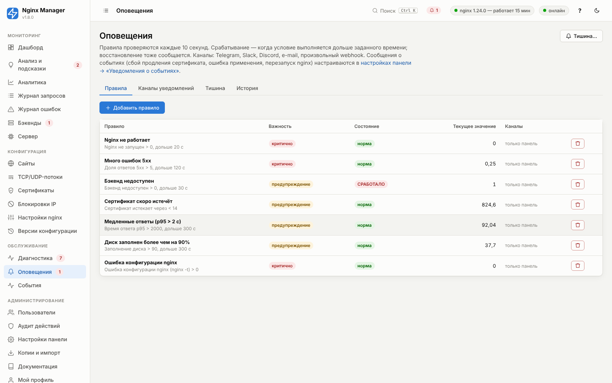
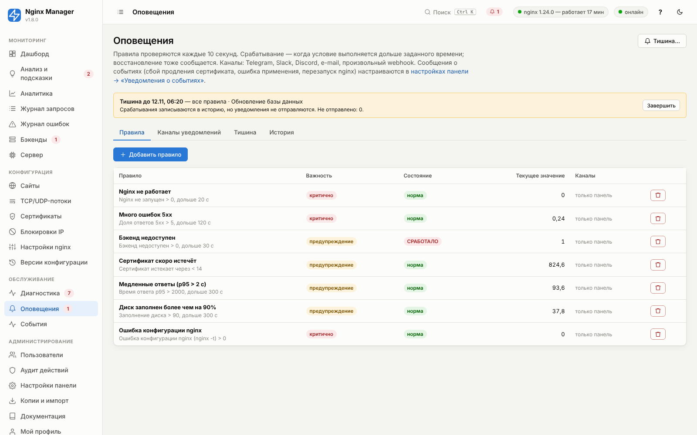
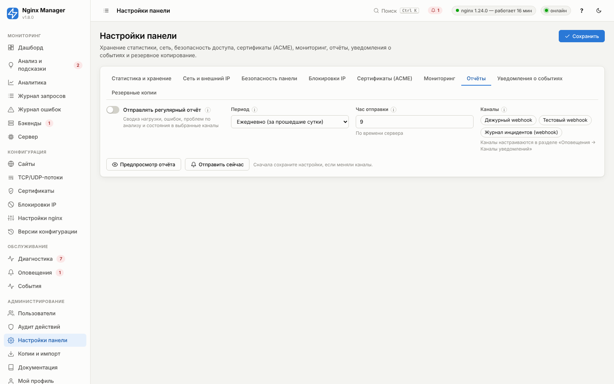
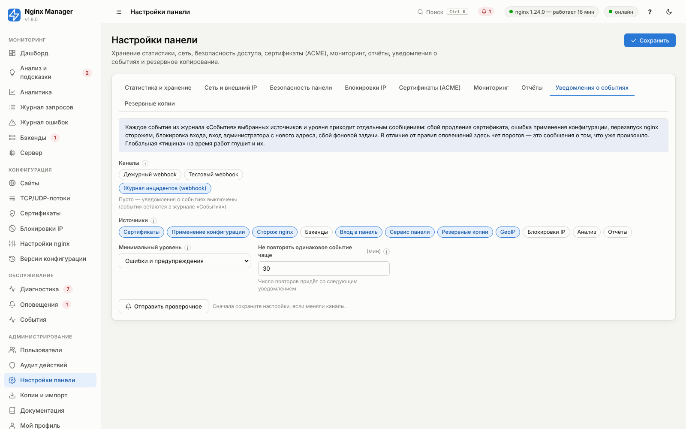

# 11. Оповещения



Правило описывает условие («метрика > порог в течение N секунд»), важность и каналы уведомлений. Правила
вычисляются каждые 10 секунд.

## Жизненный цикл правила

1. **Норма** — условие не выполняется.
2. **Ожидание** — условие выполнилось, но ещё не продержалось «Держится не менее» секунд. Кратковременные всплески
   не вызывают уведомлений.
3. **Сработало** — отправляется уведомление во все выбранные каналы (3 попытки с паузой при сбоях доставки),
   событие появляется в «Истории» и всплывающим сообщением в открытых панелях. Пока условие выполняется,
   уведомление повторяется раз в «Повторять уведомление каждые» минут (0 — не повторять).
4. **Восстановлено** — условие перестало выполняться: уведомление «Восстановлено» с длительностью инцидента
   (если включено «Сообщать о восстановлении»).

Для метрик-долей и времени ответа задаётся **«Мин. запросов в окне»**: при малом трафике (ночью) одна ошибка из пяти
запросов — это 20%, но не инцидент.

Особые случаи:

- **Нет данных** (сайт выключен, за окно нет ни одного запроса, сборщик статистики остановлен, датчик недоступен) —
  правило сохраняет текущее состояние: сработавшее не считается восстановленным, ожидающее не превращается в
  инцидент. Иначе пропуск данных выглядел бы как «Восстановлено», а затем снова «Сработало».
- **Каналы не выбраны** — уведомление видно только в панели (история, всплывающее сообщение, значок в шапке)
  и никуда не отправляется. Чтобы правило уведомляло во все каналы, выберите их явно.
- В тексте уведомления сайт называется по имени из панели, а не по внутреннему номеру.

## Правила по умолчанию

| Правило | Условие |
|---|---|
| Nginx не работает | процесс nginx не найден дольше 20 с |
| Много ошибок 5xx | доля 5xx > 5% за 2 минуты при ≥ 30 запросах, держится 2 минуты |
| Бэкенд недоступен | хотя бы один основной бэкенд в состоянии DOWN дольше 30 с |
| Сертификат скоро истечёт | используемый сертификат истекает менее чем через 14 дней (повтор раз в сутки) |
| Медленные ответы (p95 > 2 с) | p95 за 5 минут > 2000 мс при ≥ 50 запросах, держится 5 минут |
| Диск заполнен более чем на 90% | держится 5 минут, повтор каждые 12 ч |
| Ошибка конфигурации nginx | `nginx -t` не проходит |

## Метрики

<!-- GEN:alert_metrics -->
<!-- Сгенерировано tools/gen_reference.py — не редактируйте вручную -->
| Метрика (`metric`) | Описание | Единица | Как вычисляется |
|---|---|---|---|
| `nginx_down` | Nginx не запущен | — | 1, если мастер-процесс nginx не найден, иначе 0 |
| `config_error` | Ошибка конфигурации nginx (nginx -t) | — | 1, если последняя проверка `nginx -t` (выполняется каждые 5 минут) неуспешна |
| `backend_down` | Бэкенд недоступен | — | число основных (не backup) серверов в состоянии DOWN по активной проверке |
| `error_5xx_rate` | Доля ответов 5xx | % | доля ответов 5xx среди всех запросов за окно, % |
| `error_4xx_rate` | Доля ответов 4xx | % | доля ответов 4xx за окно, % |
| `latency_p95` | Время ответа p95 | мс | 95-й перцентиль `$request_time` по гистограмме за окно |
| `latency_avg` | Среднее время ответа | мс | среднее `$request_time` за окно |
| `rps_high` | Запросов в секунду (выше) | rps | запросов в секунду за окно (условие «>») |
| `rps_low` | Запросов в секунду (ниже — пропал трафик) | rps | запросов в секунду за окно (условие «<», для обнаружения пропажи трафика) |
| `bandwidth_out` | Исходящий трафик | Мбит/с | исходящий трафик (байты ответов × 8 / окно), Мбит/с |
| `active_connections` | Активных соединений | — | Active connections из stub_status |
| `cert_expiry` | Сертификат истекает через | дн | минимальное число дней до истечения среди используемых сертификатов; короткие (срок меньше 30 дней) учитываются, только когда осталось меньше шестой части срока — то есть продление не случилось |
| `cpu` | Загрузка CPU | % | загрузка CPU сервера (psutil), % |
| `memory` | Использование памяти | % | используемая память, % |
| `disk` | Заполнение диска | % | максимум заполнения корневого раздела и раздела журналов, % |
| `error_log_rate` | Ошибок nginx в минуту | /мин | записей уровня error/crit/alert/emerg в журнале nginx за окно, пересчитано в минуту |
| `rate_limited` | Отклонено лимитами (429/503 limit_req) | /мин | срабатываний limit_req/limit_conn в журнале ошибок за окно, в минуту |
| `autobans` | Автоблокировок IP за окно | шт. | число автоматических блокировок IP за окно (раздел «Блокировки») |
| `insights_crit` | Проблем по встроенному анализу (последние 15 минут) | шт. | число находок уровня «проблема» во встроенном анализе за последние 15 минут (обновляется раз в минуту) |
<!-- /GEN:alert_metrics -->

Поле **«Сайт»** ограничивает метрики трафика и бэкендов одним сайтом; `*` — все сайты вместе.

## Параметры правила

<!-- GEN:alert_rule -->
<!-- Сгенерировано tools/gen_reference.py — не редактируйте вручную -->

<a id="f-alert_rule-name"></a>

### Название — `name`

| Тип | По умолчанию | Диапазон / ед. | Директива nginx | Расширенный |
|---|---|---|---|---|
| строка | пусто | — | — | нет |

Заголовок уведомления.

**Пример:** `Много ошибок 5xx на магазине`


<a id="f-alert_rule-enabled"></a>

### Включено — `enabled`

| Тип | По умолчанию | Диапазон / ед. | Директива nginx | Расширенный |
|---|---|---|---|---|
| переключатель (да/нет) | включено | — | — | нет |

Выключенное правило не вычисляется.


<a id="f-alert_rule-metric"></a>

### Метрика — `metric`

| Тип | По умолчанию | Диапазон / ед. | Директива nginx | Расширенный |
|---|---|---|---|---|
| выбор из списка | `error_5xx_rate` (Доля ответов 5xx) | — | — | нет |

Что измеряется (таблица метрик выше).

Варианты:

- `nginx_down` — Nginx не запущен
- `config_error` — Ошибка конфигурации nginx (nginx -t)
- `backend_down` — Бэкенд недоступен
- `error_5xx_rate` — Доля ответов 5xx
- `error_4xx_rate` — Доля ответов 4xx
- `latency_p95` — Время ответа p95
- `latency_avg` — Среднее время ответа
- `rps_high` — Запросов в секунду (выше)
- `rps_low` — Запросов в секунду (ниже — пропал трафик)
- `bandwidth_out` — Исходящий трафик
- `active_connections` — Активных соединений
- `cert_expiry` — Сертификат истекает через
- `cpu` — Загрузка CPU
- `memory` — Использование памяти
- `disk` — Заполнение диска
- `error_log_rate` — Ошибок nginx в минуту
- `rate_limited` — Отклонено лимитами (429/503 limit_req)
- `autobans` — Автоблокировок IP за окно
- `insights_crit` — Проблем по встроенному анализу (последние 15 минут)

**Пример:** `error_5xx_rate`


<a id="f-alert_rule-site"></a>

### Сайт — `site`

| Тип | По умолчанию | Диапазон / ед. | Директива nginx | Расширенный |
|---|---|---|---|---|
| выбор сайта | `*` | — | — | нет |

* — все сайты вместе.

Ограничить метрику одним сайтом.

**Пример:** `*`


<a id="f-alert_rule-operator"></a>

### Условие — `operator`

| Тип | По умолчанию | Диапазон / ед. | Директива nginx | Расширенный |
|---|---|---|---|---|
| выбор из списка | `>` | — | — | нет |

Срабатывание при значении больше или меньше порога.

Варианты:

- `>`
- `<`

**Пример:** `>`


<a id="f-alert_rule-threshold"></a>

### Порог — `threshold`

| Тип | По умолчанию | Диапазон / ед. | Директива nginx | Расширенный |
|---|---|---|---|---|
| число | `5.0` | — | — | нет |

Пороговое значение в единицах метрики.

**Пример:** `5`


<a id="f-alert_rule-window"></a>

### Окно усреднения — `window`

| Тип | По умолчанию | Диапазон / ед. | Директива nginx | Расширенный |
|---|---|---|---|---|
| целое число | `60` | 10…3600 с | — | нет |

За какой период считается значение.

Период усреднения для метрик трафика (доли, задержки, скорость).

> **Рекомендация.** 60–300 с.

**Пример:** `120`


<a id="f-alert_rule-duration"></a>

### Держится не менее — `duration`

| Тип | По умолчанию | Диапазон / ед. | Директива nginx | Расширенный |
|---|---|---|---|---|
| целое число | `60` | 0…86400 с | — | нет |

Защита от ложных срабатываний на кратковременных всплесках.

Сколько секунд условие должно непрерывно выполняться до срабатывания.

> **Рекомендация.** 60–300 с для трафика, 0 для сертификатов.

**Пример:** `120`


<a id="f-alert_rule-min_requests"></a>

### Мин. запросов в окне — `min_requests`

| Тип | По умолчанию | Диапазон / ед. | Директива nginx | Расширенный |
|---|---|---|---|---|
| целое число | `20` | 0…1000000 | — | нет |

Для долей (%) — не срабатывать при малом трафике.

Минимум запросов в окне для метрик-долей и задержек.

> **Рекомендация.** 20–50.

**Пример:** `30`


<a id="f-alert_rule-severity"></a>

### Важность — `severity`

| Тип | По умолчанию | Диапазон / ед. | Директива nginx | Расширенный |
|---|---|---|---|---|
| выбор из списка | `warning` (Предупреждение) | — | — | нет |

Отображается в уведомлении (значок) и в журнале.

Варианты:

- `info` — Информация
- `warning` — Предупреждение
- `critical` — Критично

**Пример:** `critical`


<a id="f-alert_rule-channels"></a>

### Каналы уведомлений — `channels`

| Тип | По умолчанию | Диапазон / ед. | Директива nginx | Расширенный |
|---|---|---|---|---|
| выбор каналов | пусто | — | — | нет |

Куда отправлять. Пусто — только в панели.


<a id="f-alert_rule-repeat_minutes"></a>

### Повторять уведомление каждые — `repeat_minutes`

| Тип | По умолчанию | Диапазон / ед. | Директива nginx | Расширенный |
|---|---|---|---|---|
| целое число | `60` | 0…10080 мин | — | нет |

0 — не повторять, пока не восстановится.

Напоминание, пока проблема не устранена.

> **Рекомендация.** 60; 0 — не повторять.

**Пример:** `60`


<a id="f-alert_rule-notify_resolved"></a>

### Сообщать о восстановлении — `notify_resolved`

| Тип | По умолчанию | Диапазон / ед. | Директива nginx | Расширенный |
|---|---|---|---|---|
| переключатель (да/нет) | включено | — | — | нет |

Отдельное уведомление о восстановлении с длительностью инцидента.

> **Рекомендация.** Включено.

<!-- /GEN:alert_rule -->

## Каналы уведомлений

### Telegram

1. Напишите [@BotFather](https://t.me/BotFather) команду `/newbot`, получите **токен** вида `123456:ABC-DEF…`.
2. Напишите своему боту любое сообщение (или добавьте бота в группу и напишите там).
3. Узнайте **chat id**: откройте `https://api.telegram.org/bot<токен>/getUpdates` — поле `chat.id`
   (для групп — отрицательное число), либо спросите у @userinfobot.
4. В панели: «Каналы уведомлений → Добавить», тип Telegram, токен и chat id → «Отправить тест».

Если Telegram заблокирован у провайдера сервера — укажите «API URL» прокси-сервера Bot API.

### Slack, Discord

Создайте Incoming Webhook (Slack: *Apps → Incoming Webhooks*; Discord: *Настройки канала → Интеграции → Вебхуки*)
и вставьте URL.

### E-mail

SMTP-сервер, порт и шифрование: 587 + STARTTLS (большинство), 465 + SSL, 25 без шифрования (только локальный
relay). Для Gmail/Яндекса используйте пароль приложения.

### Webhook (JSON)

`POST` на указанный URL с телом:

```json
{"title": "Много ошибок 5xx", "text": "Доля ответов 5xx: 12.4 % (порог > 5 %)…",
 "severity": "critical", "host": "proxy-01", "ts": 1767225600.5,
 "metric": "error_5xx_rate", "value": 12.4, "state": "firing"}
```

`state`: `firing` (сработало), `repeat` (повтор), `resolved` (восстановлено). Можно добавить свои заголовки
(например, `Authorization`) — подходит для PagerDuty-подобных систем, n8n, своих ботов.

### Параметры канала

<!-- GEN:alert_channel -->
<!-- Сгенерировано tools/gen_reference.py — не редактируйте вручную -->

<a id="f-alert_channel-name"></a>

### Название — `name`

| Тип | По умолчанию | Диапазон / ед. | Директива nginx | Расширенный |
|---|---|---|---|---|
| строка | пусто | — | — | нет |

Название канала в списке.

**Пример:** `Дежурные (Telegram)`


<a id="f-alert_channel-type"></a>

### Тип — `type`

| Тип | По умолчанию | Диапазон / ед. | Директива nginx | Расширенный |
|---|---|---|---|---|
| выбор из списка | `telegram` (Telegram) | — | — | нет |

Способ доставки.

Варианты:

- `telegram` — Telegram
- `webhook` — Webhook (JSON)
- `slack` — Slack (Incoming Webhook)
- `discord` — Discord
- `email` — E-mail (SMTP)

**Пример:** `telegram`


<a id="f-alert_channel-enabled"></a>

### Включён — `enabled`

| Тип | По умолчанию | Диапазон / ед. | Директива nginx | Расширенный |
|---|---|---|---|---|
| переключатель (да/нет) | включено | — | — | нет |

Выключенный канал пропускается.


<a id="f-alert_channel-telegram_token"></a>

### Токен бота — `telegram_token`

| Тип | По умолчанию | Диапазон / ед. | Директива nginx | Расширенный |
|---|---|---|---|---|
| пароль (скрытый ввод) | пусто | — | — | нет |

Получите у @BotFather.

Токен бота от @BotFather.

**Пример:** `123456789:AAH…`

*Показывается, когда `type` = `telegram`.*


<a id="f-alert_channel-telegram_chat_id"></a>

### Chat ID — `telegram_chat_id`

| Тип | По умолчанию | Диапазон / ед. | Директива nginx | Расширенный |
|---|---|---|---|---|
| строка | пусто | — | — | нет |

ID пользователя/группы. Узнать: @userinfobot или getUpdates.

ID чата, группы (отрицательный) или канала (@имя).

**Пример:** `-1001234567890`

*Показывается, когда `type` = `telegram`.*


<a id="f-alert_channel-telegram_api"></a>

### API URL — `telegram_api`

| Тип | По умолчанию | Диапазон / ед. | Директива nginx | Расширенный |
|---|---|---|---|---|
| строка | `https://api.telegram.org` | — | — | да |

Адрес Bot API (для собственного сервера Bot API или прокси).

**Пример:** `https://api.telegram.org`

*Показывается, когда `type` = `telegram`.*


<a id="f-alert_channel-url"></a>

### URL — `url`

| Тип | По умолчанию | Диапазон / ед. | Директива nginx | Расширенный |
|---|---|---|---|---|
| строка | пусто | — | — | нет |

URL вебхука Slack/Discord или вашего сервиса.

**Пример:** `https://hooks.slack.com/services/…`

*Показывается, когда `type` = `webhook`, `slack`, `discord`.*


<a id="f-alert_channel-webhook_headers"></a>

### Заголовки — `webhook_headers`

| Тип | По умолчанию | Диапазон / ед. | Директива nginx | Расширенный |
|---|---|---|---|---|
| таблица элементов | пусто | — | — | да |

Дополнительные HTTP-заголовки запроса (авторизация).

**Пример:** `Authorization: Bearer …`

*Показывается, когда `type` = `webhook`.*

Поля элемента:

| Поле | Тип | По умолчанию | Описание |
|---|---|---|---|
| Заголовок (`name`) | строка | пусто |  |
| Значение (`value`) | строка | пусто | Можно использовать переменные nginx, например $host |
| always (`always`) | переключатель (да/нет) | включено | Добавлять и к ответам с ошибками (4xx/5xx) Рекомендация: Включено для CORS и HSTS. |


<a id="f-alert_channel-smtp_host"></a>

### SMTP-сервер — `smtp_host`

| Тип | По умолчанию | Диапазон / ед. | Директива nginx | Расширенный |
|---|---|---|---|---|
| строка | пусто | — | — | нет |

SMTP-сервер.

**Пример:** `smtp.yandex.ru`

*Показывается, когда `type` = `email`.*


<a id="f-alert_channel-smtp_port"></a>

### Порт — `smtp_port`

| Тип | По умолчанию | Диапазон / ед. | Директива nginx | Расширенный |
|---|---|---|---|---|
| целое число | `587` | 1…65535 | — | нет |

587 (STARTTLS), 465 (SSL), 25.

**Пример:** `587`

*Показывается, когда `type` = `email`.*


<a id="f-alert_channel-smtp_security"></a>

### Шифрование — `smtp_security`

| Тип | По умолчанию | Диапазон / ед. | Директива nginx | Расширенный |
|---|---|---|---|---|
| выбор из списка | `starttls` | — | — | нет |

Способ шифрования соединения с SMTP.

Варианты:

- `starttls`
- `ssl`
- `none`

> **Рекомендация.** starttls

**Пример:** `starttls`

*Показывается, когда `type` = `email`.*


<a id="f-alert_channel-smtp_user"></a>

### Логин — `smtp_user`

| Тип | По умолчанию | Диапазон / ед. | Директива nginx | Расширенный |
|---|---|---|---|---|
| строка | пусто | — | — | нет |

Логин SMTP.

**Пример:** `alerts@example.com`

*Показывается, когда `type` = `email`.*


<a id="f-alert_channel-smtp_password"></a>

### Пароль — `smtp_password`

| Тип | По умолчанию | Диапазон / ед. | Директива nginx | Расширенный |
|---|---|---|---|---|
| пароль (скрытый ввод) | пусто | — | — | нет |

Пароль SMTP (для Gmail/Яндекса — пароль приложения).

*Показывается, когда `type` = `email`.*


<a id="f-alert_channel-email_from"></a>

### От кого — `email_from`

| Тип | По умолчанию | Диапазон / ед. | Директива nginx | Расширенный |
|---|---|---|---|---|
| строка | пусто | — | — | нет |

Адрес отправителя (должен быть разрешён SMTP-сервером).

**Пример:** `alerts@example.com`

*Показывается, когда `type` = `email`.*


<a id="f-alert_channel-email_to"></a>

### Кому — `email_to`

| Тип | По умолчанию | Диапазон / ед. | Директива nginx | Расширенный |
|---|---|---|---|---|
| список, по одному значению на строку | пусто | — | — | нет |

Получатели, по одному на строку.

**Пример:** `admin@example.com`

*Показывается, когда `type` = `email`.*

<!-- /GEN:alert_channel -->

Секреты каналов (токен Telegram, пароль SMTP) не возвращаются в браузер: в форме показываются точки, и значение не
меняется, пока вы не введёте новое. Создавать и изменять каналы может только администратор.

## Тишина на время работ

Кнопка **«Тишина…»** на странице «Оповещения» отключает отправку уведомлений на время плановых работ: обновления
приложения, перезагрузки серверов, миграции базы данных. Тишину можно включить сразу или **запланировать** на
будущее время (до 90 дней вперёд), для всех правил или только для выбранных.



Как это работает:

- правила продолжают проверяться, срабатывания и восстановления записываются в «Историю» (в колонке
  «Уведомления» — «не отправлено: тишина до …»), поэтому после работ видно, что происходило;
- в верхней панели горит жёлтый значок **«тишина»**, на странице «Оповещения» — плашка со сроком, причиной и
  числом неотправленных уведомлений;
- тишину можно завершить досрочно, запланированную — отменить (вкладка «Тишина»);
- тестовые сообщения каналов и регулярные отчёты тишиной не блокируются;
- включение и завершение попадают в «События» и аудит; включать могут оператор и администратор.

Через API: `POST /api/alerts/silences` `{"minutes": 120, "reason": "миграция", "rule_ids": []}` — удобно вызывать из
скрипта выкладки приложения в начале работ, а в конце — `DELETE /api/alerts/silences/{id}`.

## Регулярные отчёты

Кроме оповещений о проблемах, панель может присылать в те же каналы **сводку за сутки или неделю**.
Настройка — «Настройки панели → Отчёты».



Что входит в отчёт:

- число запросов и средняя нагрузка — с изменением к предыдущему такому же периоду;
- доля ошибок 5xx и 4xx, время ответа p95 и время бэкенда (с прошлым значением для сравнения);
- трафик и доля попаданий в кэш;
- сайты по числу запросов с долей 5xx и средним временем ответа;
- проблемы встроенного анализа за период ([18](18-insights.md)) — уровни «проблема» и «внимание»;
- текущее состояние: работает ли nginx, недоступные бэкенды, истекающие сертификаты, блокировки IP,
  самые частые записи журнала ошибок nginx.

Пример (Telegram):

```
Отчёт за 10.11.2026
Запросов: 1,3 млн (−4% к прошлому периоду), в среднем 14,9 в секунду
Ошибки 5xx: 0,21% (было 0,06%) · 4xx: 7,2%
Время ответа p95: 197 мс (было 194 мс) · среднее бэкенда 43 мс
Трафик: 15 ГБ (без изменений) · кэш HIT 61%

Сайты:
 • Интернет-магазин — 606,7 тыс. запросов, 5xx 0,09%, среднее 50 мс
 • API сервис — 363,7 тыс. запросов, 5xx 0,60%, среднее 53 мс

Проблемы по анализу (0 серьёзных, 2 требуют внимания):
 🟡 API сервис: Бэкенд не ответил вовремя — 40 записей за период
 🟡 Блог: Сайт работает без HTTPS — 211 878 запросов по незащищённому HTTP за период

Сейчас:
 • nginx работает; бэкендов недоступно: 0
 • блокировок IP активно: 3; автоматических за период: 12
```

| Параметр | Значение |
|---|---|
| Период | «Ежедневно» — за вчерашние сутки (00:00–24:00); «Еженедельно» — за 7 суток до сегодняшней полуночи |
| Час отправки и день недели | По часовому поясу сервера; рекомендуется 9:00 и понедельник |
| Каналы | Любые каналы уведомлений (можно отдельный чат или список рассылки для отчётов) |

Кнопки под формой: **«Предпросмотр отчёта»** — сформировать отчёт за последний период и показать в панели;
**«Отправить сейчас»** — сразу отправить в выбранные каналы (удобно проверить канал). Отправки и ошибки видны
в «Событиях». Через API: `GET /api/reports/preview?period=day|week`, `POST /api/reports/send`.

Для каналов типа «Webhook» отчёт приходит JSON-объектом с полями `title`, `text`, `report: true`, `period`,
`from`, `to`, `counts` (число находок анализа по уровням).

## Уведомления о событиях

Правила оповещений следят за **состоянием** (метрика выше порога дольше N секунд). Но часть важного — это
**события**: продление сертификата не удалось, конфигурация не применилась, nginx упал и сторож его перезапустил,
перебор пароля заблокирован. Они пишутся в журнал «События», а рассылку в каналы включают в **Настройки панели →
«Уведомления о событиях»**.



| Источник | Примеры событий | Уровень |
|---|---|---|
| Сертификаты | Ошибка выпуска или продления (с подсказкой причины); выпущен, продлён | ошибка; событие |
| Применение конфигурации | Конфигурация не применена — вручную, при откате, автопереключении бэкендов или после выпуска сертификата (работающий nginx не изменён); применена | ошибка; событие |
| Сторож nginx | Nginx был остановлен — запущен автоматически / запустить не удалось; падает повторно, автоперезапуск приостановлен | предупреждение; ошибка |
| Вход в панель | Вход с IP заблокирован после N неудачных попыток; вход администратора с нового адреса | предупреждение |
| Сервис панели | Фоновая задача (диагностика, продление, отчёт, копирование) завершилась ошибкой | ошибка |
| Резервные копии | Не удалось выгрузить копию в хранилище; копия создана и выгружена | ошибка; событие |
| GeoIP | Не удалось обновить сети стран в nginx | ошибка |
| Бэкенды, блокировки IP, анализ, отчёты | Бэкенд недоступен/восстановлен, автоблокировка, новые находки анализа, отчёт не отправлен | по умолчанию не рассылаются |

- **Минимальный уровень** — «ошибки», «ошибки и предупреждения» (по умолчанию) или «все события».
- **Одинаковые события** (отличаются только числами — номером версии, временем) не отправляются чаще, чем раз в
  «Не повторять … чаще» (30 мин): следующее уведомление сообщит, сколько раз событие повторилось.
- **Лимит** — 30 уведомлений в час: при превышении придёт одно сообщение о паузе, остальное останется в журнале.
- **Тишина** на время работ, действующая для всех правил, глушит и уведомления о событиях.
- Кнопка **«Отправить проверочное»** — в выбранные каналы придёт пример сообщения.

В webhook событие приходит с полем `event`:

```json
{"title": "Ошибка: сертификаты", "text": "Ошибка выпуска сертификата «shop»: …", "severity": "critical",
 "host": "proxy-01", "ts": 1794470400.5,
 "event": {"level": "error", "source": "certs", "message": "…", "details": null, "repeats": 0}}
```

