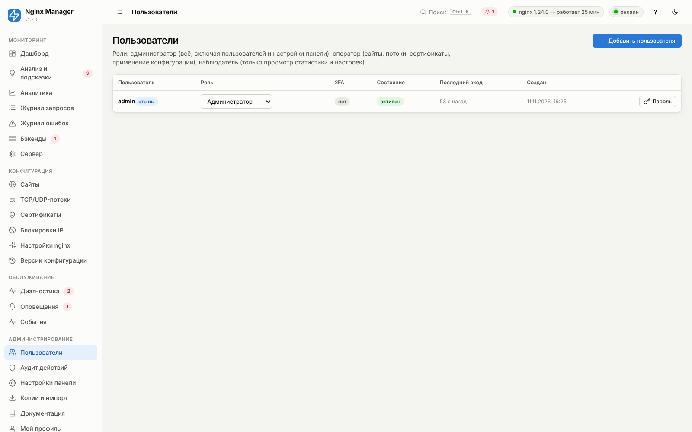
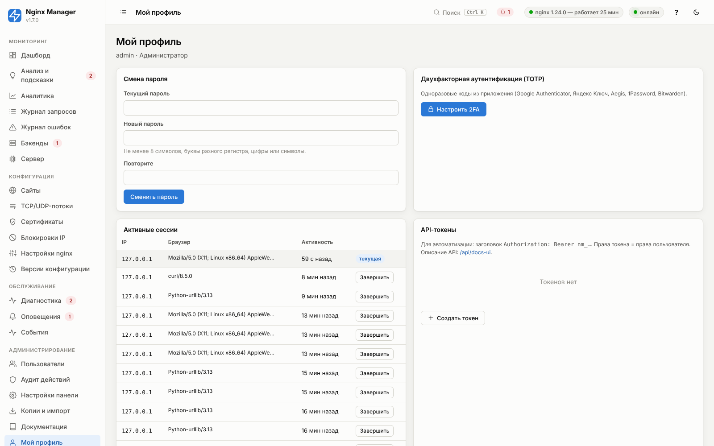
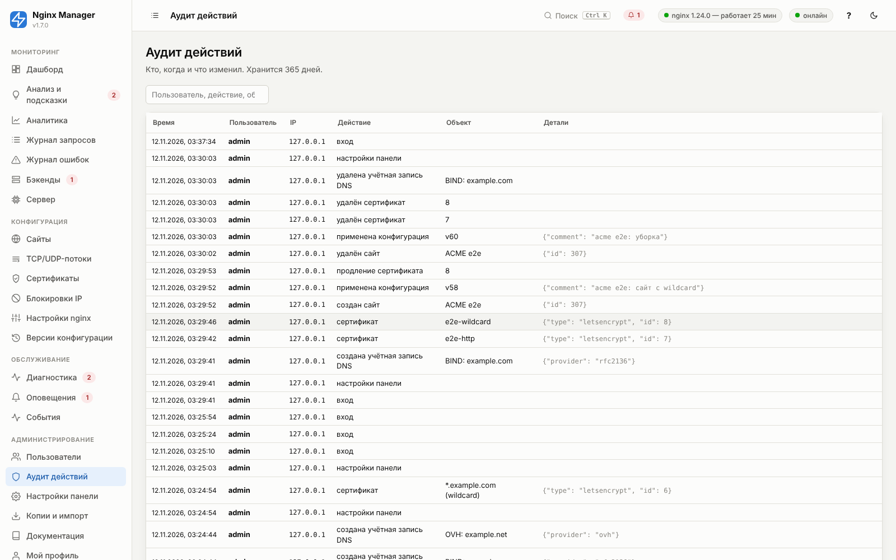

# 12. Безопасность

## Пользователи и роли

| Возможность | Наблюдатель | Оператор | Администратор |
|---|:-:|:-:|:-:|
| Просмотр дашборда, аналитики, журналов, настроек, диагностики | ✓ | ✓ | ✓ |
| Создание и изменение сайтов, потоков, сертификатов | | ✓ | ✓ |
| Применение конфигурации, откат версий, reload/restart nginx | | ✓ | ✓ |
| Исправления из диагностики, правила оповещений, тест каналов | | ✓ | ✓ |
| Остановка nginx | | | ✓ |
| Глобальные настройки nginx, настройки панели | | | ✓ |
| Каналы уведомлений (секреты) | | | ✓ |
| Пользователи, аудит, резервные копии, импорт | | | ✓ |
| `nginx -T` (полная конфигурация, включая пути к ключам) | | | ✓ |

Нельзя удалить или понизить последнего администратора. Новый пользователь получает временный пароль и должен
сменить его при входе. Это требование проверяет сервер, а не только интерфейс: пока временный пароль не сменён,
пользователь может смотреть, но любые изменения (в том числе через API с cookie-сессией и создание API-токена)
отклоняются с кодом 403 и подсказкой «Сначала смените временный пароль».

## Пароли и вход

- Пароли хранятся в виде хеша **scrypt** (N=16384, r=8, p=1, соль 16 байт). Сравнение — за постоянное время.
- Требования: ≥ 8 символов, буквы разного регистра, цифры или символы.
- **Защита от перебора**: после 5 неудачных попыток с одного IP вход блокируется на 15 минут (настраивается).
  Каждая попытка записывается в аудит. Ответ на несуществующее имя и на неверный пароль одинаков и по тексту,
  и по времени (для неизвестного имени тоже вычисляется хеш), поэтому подобрать список пользователей нельзя.
- **Сессии** — случайный токен в cookie `nm_session` (HttpOnly, SameSite=Strict, Secure при HTTPS); в базе хранится
  только хеш токена. Время жизни продлевается при активности (по умолчанию 12 ч). Активные сессии видны и
  завершаются в профиле. Смена пароля завершает все сессии пользователя.
- **CSRF**: изменяющие запросы с cookie-сессией требуют заголовок `X-NM-CSRF`, который браузер не отправит со
  стороннего сайта без разрешения CORS (а CORS панелью не разрешается). WebSocket проверяет совпадение Origin и Host.
- Заголовки безопасности панели: `Content-Security-Policy` (только свои скрипты), `X-Frame-Options: DENY`,
  `X-Content-Type-Options: nosniff`, `Referrer-Policy: same-origin`.

## Двухфакторная аутентификация (TOTP)

**Мой профиль → Настроить 2FA**: отсканируйте QR-код в приложении-аутентификаторе (Google Authenticator,
Яндекс Ключ, Aegis, 1Password, Bitwarden) и введите код. При входе после пароля будет запрошен шестизначный код.
Допускается отклонение часов ±30 секунд. Каждый код принимается один раз: подсмотренный или перехваченный код
нельзя использовать повторно даже в течение его 30 секунд («Этот код уже использован — дождитесь следующего кода в приложении»).

**Требовать 2FA для администраторов** (настройки панели → «Безопасность»): администратор без 2FA после входа
направляется на её настройку, а сервер до этого разрешает ему только просмотр и свой профиль — изменения и создание
API-токенов отклоняются с кодом 403. Включить параметр можно, только настроив 2FA себе (иначе политика сразу
ограничила бы ваши права). Ранее созданные токены продолжают работать — это отдельные учётные данные; при
необходимости отзовите их в профиле или удалите пользователя.

Потеря телефона: другой администратор сбрасывает 2FA в разделе «Пользователи» или в консоли
`nmctl user reset-2fa <имя>`.

## API-токены

Для скриптов и CI/CD: **Мой профиль → API-токены → Создать**. Токен (`nm_…`) показывается один раз, в базе хранится
его хеш. Права токена равны правам пользователя. Передаётся заголовком `Authorization: Bearer nm_…`; CSRF-заголовок
для токенов не нужен. Отзыв — кнопкой в профиле.

## Доступ к панели

Рекомендуемая схема для рабочего сервера:

1. Панель слушает только `127.0.0.1` (`NM_BIND_HOST=127.0.0.1` в `/etc/nginx-manager/panel.conf`).
2. Доступ — через **домен панели** с HTTPS (Настройки панели → Сеть), nginx проксирует его на 127.0.0.1:8088
   с WebSocket.
3. **Доступ к панели только с IP** — адреса офиса/VPN (проверяется и в nginx для домена панели, и в самой панели).
   Если вы заблокировали себя: `nmctl allowlist clear`.
4. 2FA для всех администраторов.

Альтернатива без домена — SSH-туннель: `ssh -L 8088:127.0.0.1:8088 root@сервер`, затем `http://localhost:8088`.

Для определения IP пользователя за обратным прокси панель доверяет `X-Forwarded-For` только от адресов из
`NM_TRUST_PROXY` (по умолчанию localhost).

## Аудит

**Аудит действий** — кто, когда, с какого IP и что сделал: входы (в том числе неудачные), изменения сайтов, потоков,
сертификатов, настроек, применения и откаты, исправления из диагностики, управление пользователями и токенами,
экспорт/импорт. Хранится 365 дней. Применения конфигурации дополнительно видны в «Версиях» с автором и
комментарием.

## Безопасность сервиса в системе

- Служба работает от root (необходимо для управления nginx и certbot) с ограничениями systemd: `PrivateTmp`,
  `ProtectHome=read-only`, `ProtectKernelTunables`, `ProtectKernelModules`, `ProtectControlGroups`,
  `ProtectClock`, `RestrictSUIDSGID`, `LockPersonality`. `ProtectSystem` не используется: исправления диагностики
  устанавливают пакеты.
- Права файлов: `/etc/nginx-manager` — 700, БД — 600, загруженные ключи — 600 в каталоге 700, файлы Basic Auth —
  640 (root:группа nginx), резервные копии — 600.
- Секреты каналов уведомлений, учётных записей DNS и HMAC-ключ EAB не отдаются в браузер и API (вместо них маска;
  маска при сохранении оставляет прежнее значение). Учётные записи DNS создаёт и меняет только администратор: в них
  токены, способные менять DNS-зоны, а «Свои скрипты» запускаются от root. Для продления certbot учётные данные
  лежат в `/var/lib/nginx-manager/dns-credentials/` (каталог 700, файлы 600) и удаляются вместе с учётной записью.
- Непредвиденная ошибка сервера возвращает HTTP 500 только с типом ошибки и подсказкой, где искать подробности
  (`journalctl -u nginx-manager`); трассировка и внутренние пути в ответ не попадают.
- Все маршруты API, кроме входа, выхода и `/api/version`, требуют аутентификации — это проверяется автотестом,
  как и то, что ни один маршрут не отвечает ошибкой 500 на случайные данные.
- Поля форм проверяются и экранируются перед генерацией конфигурации; произвольные директивы возможны только в полях
  «Свои директивы» (роли оператор/администратор) и всегда проверяются `nginx -t`.
- nginx читает конфигурацию и открывает журналы от root, поэтому часть директив в «Своих директивах» даёт больше,
  чем настройку сайта. Их может добавить **только администратор**; оператору сервер отвечает 403 с перечнем:

  | Директивы | Почему опасны |
  |---|---|
  | `include` (кроме `mime.types`, `*_params`, `fastcgi.conf`, `snippets/…`) | `nginx -t` показывает в ошибке строку любого файла, например `/etc/shadow` |
  | `access_log`, `error_log` с путём вне `/var/log/nginx/` (кроме `off`, `syslog:`, `stderr`) | файл создаётся от root — например, задание в `/etc/cron.d` |
  | `*_temp_path`, `*_cache_path` | каталоги создаются от root в любом месте |
  | Lua (`*_by_lua*`, `lua_*`), Perl (`perl*`), njs (`js_*`), `load_module`, `env`, `ssl_engine`, `xslt_stylesheet` | выполнение кода или чтение файлов при загрузке конфигурации |

  Директивы, уже добавленные администратором, не мешают оператору менять остальные настройки сайта. Проверка
  черновика через `nginx -t` (кнопка «Проверить» в редакторе) доступна оператору и администратору, наблюдателю — нет.

## Защита сайтов

Возможности сайта (раздел [05](05-sites.md), вкладка «Безопасность»):

| Угроза | Средство |
|---|---|
| Перебор паролей, парсинг, лёгкий DDoS L7 | Ограничение частоты (`limit_req`), лимит соединений с IP (`limit_conn`), отдельные лимиты для `/login` |
| Утечка исходников и секретов | Блокировка скрытых файлов (`.git`, `.env`, `.htaccess`) — включена по умолчанию |
| Сканеры и агрессивные боты | Блокировка по User-Agent, базовый фильтр эксплойтов в query string |
| Доступ к служебным разделам | Белые списки IP на сайт или локацию, Basic Auth |
| Кликджекинг, MIME-sniffing, утечка Referer | Заголовки безопасности, CSP |
| Перехват трафика | HTTPS, HSTS, профиль TLS Intermediate/Modern |
| Раскрытие сертификатов при сканировании по IP | `ssl_reject_handshake` в сервере по умолчанию |
| Сканеры уязвимостей, подбор паролей, флуд с отдельных адресов | Блокировки IP и автоблокировка по журналу доступа ([17](17-bans.md)) |
| Раскрытие версии | `server_tokens off`, скрытие `X-Powered-By` |

Базовый фильтр эксплойтов не заменяет полноценный WAF (ModSecurity, облачный WAF). После включения проверьте
журнал запросов на ложные 403.
