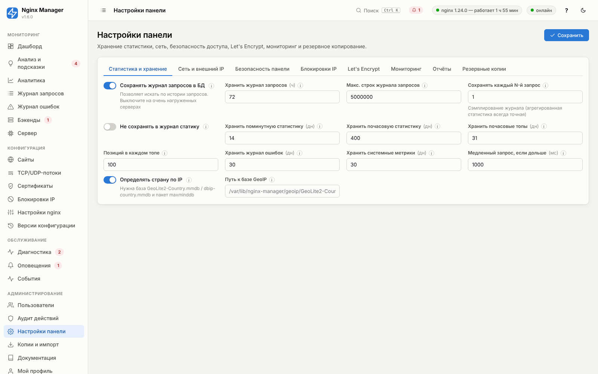
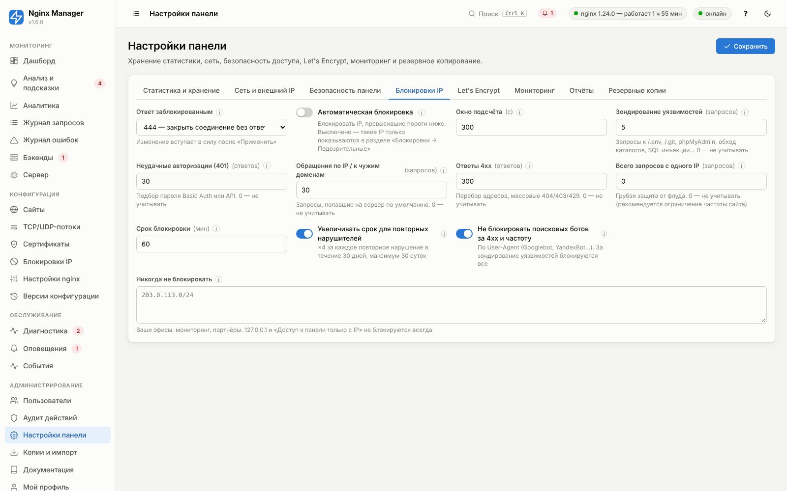

# 13. Настройки панели

Раздел **«Настройки панели»** (только администратор) управляет хранением статистики, сетевыми параметрами панели,
безопасностью доступа, параметрами Let's Encrypt, фоновым мониторингом и резервным копированием. Параметры запуска
сервиса (порт, адрес, пути) задаются в файле `/etc/nginx-manager/panel.conf` — см. [03. Установка](03-installation.md#файл-etcnginx-managerpanelconf).

<!-- GEN:panel -->
<!-- Сгенерировано tools/gen_reference.py — не редактируйте вручную -->

### Статистика и хранение

#### Сохранять журнал запросов в БД — `store_requests`

| Тип | По умолчанию | Диапазон / ед. | Директива nginx | Расширенный |
|---|---|---|---|---|
| переключатель (да/нет) | включено | — | — | нет |

Позволяет искать по истории запросов. Выключите на очень нагруженных серверах.

> **Рекомендация.** Включено; при > 2000 запросов/с — выключите или уменьшите срок хранения.

#### Хранить журнал запросов — `requests_retention_hours`

| Тип | По умолчанию | Диапазон / ед. | Директива nginx | Расширенный |
|---|---|---|---|---|
| целое число | `72` | 1…8760 ч | — | нет |

Сколько часов хранить каждый запрос для поиска и точного подсчёта уникальных IP.

> **Рекомендация.** 72 ч; 24 ч при > 100 запросов/с.

**Пример:** `72`

#### Макс. строк журнала запросов — `requests_max_rows`

| Тип | По умолчанию | Диапазон / ед. | Директива nginx | Расширенный |
|---|---|---|---|---|
| целое число | `5000000` | 10000…500000000 | — | нет |

Жёсткий предел числа строк журнала запросов — старые удаляются ежечасно.

> **Рекомендация.** 5 млн ≈ 2 ГБ.

**Пример:** `5000000`

#### Сохранять каждый N-й запрос — `requests_sample`

| Тип | По умолчанию | Диапазон / ед. | Директива nginx | Расширенный |
|---|---|---|---|---|
| целое число | `1` | 1…1000 | — | да |

Сэмплирование журнала (агрегированная статистика всегда точная)

Сохраняется каждый N-й запрос (агрегированная статистика остаётся точной).

> **Рекомендация.** 1; 5–50 для нагруженных серверов.

**Пример:** `10`

#### Не сохранять в журнал статику — `skip_static_in_log`

| Тип | По умолчанию | Диапазон / ед. | Директива nginx | Расширенный |
|---|---|---|---|---|
| переключатель (да/нет) | выключено | — | — | да |

Запросы к css/js/картинкам не сохраняются в журнал запросов (в статистике учитываются).

#### Хранить поминутную статистику — `minute_retention_days`

| Тип | По умолчанию | Диапазон / ед. | Директива nginx | Расширенный |
|---|---|---|---|---|
| целое число | `14` | 1…365 дн | — | нет |

Поминутная статистика — для графиков до 48 часов.

> **Рекомендация.** 14

**Пример:** `14`

#### Хранить почасовую статистику — `hour_retention_days`

| Тип | По умолчанию | Диапазон / ед. | Директива nginx | Расширенный |
|---|---|---|---|---|
| целое число | `400` | 7…3650 дн | — | нет |

Почасовая статистика — для отчётов за месяцы.

> **Рекомендация.** 400

**Пример:** `400`

#### Хранить почасовые топы — `top_retention_days`

| Тип | По умолчанию | Диапазон / ед. | Директива nginx | Расширенный |
|---|---|---|---|---|
| целое число | `31` | 1…365 дн | — | нет |

Почасовые топы (URI, IP…); дальше — суточные.

> **Рекомендация.** 31

**Пример:** `31`

#### Позиций в каждом топе — `top_keep`

| Тип | По умолчанию | Диапазон / ед. | Директива nginx | Расширенный |
|---|---|---|---|---|
| целое число | `100` | 10…1000 | — | да |

Сколько позиций каждого топа сохранять за час и сутки.

> **Рекомендация.** 100

**Пример:** `100`

#### Хранить журнал ошибок — `errors_retention_days`

| Тип | По умолчанию | Диапазон / ед. | Директива nginx | Расширенный |
|---|---|---|---|---|
| целое число | `30` | 1…365 дн | — | нет |

Срок хранения записей журнала ошибок nginx.

> **Рекомендация.** 30

**Пример:** `30`

#### Хранить системные метрики — `system_retention_days`

| Тип | По умолчанию | Диапазон / ед. | Директива nginx | Расширенный |
|---|---|---|---|---|
| целое число | `30` | 1…365 дн | — | нет |

Срок хранения поминутных метрик сервера.

> **Рекомендация.** 30

**Пример:** `30`

#### Медленный запрос, если дольше — `slow_request_ms`

| Тип | По умолчанию | Диапазон / ед. | Директива nginx | Расширенный |
|---|---|---|---|---|
| целое число | `1000` | 10…600000 мс | — | нет |

Порог для топа «Медленные» и счётчика медленных запросов.

> **Рекомендация.** 1000 мс; 300 мс для API.

**Пример:** `500`

#### Определять страну по IP — `geoip_enabled`

| Тип | По умолчанию | Диапазон / ед. | Директива nginx | Расширенный |
|---|---|---|---|---|
| переключатель (да/нет) | включено | — | — | нет |

Нужна база GeoLite2-Country.mmdb / dbip-country.mmdb и пакет maxminddb.

Определять страну клиента по IP (нужны база mmdb и пакет maxminddb, см. 09).

#### Путь к базе GeoIP — `geoip_path`

| Тип | По умолчанию | Диапазон / ед. | Директива nginx | Расширенный |
|---|---|---|---|---|
| строка | пусто | — | — | да |

Путь к базе .mmdb. Пусто — поиск в /var/lib/nginx-manager/geoip и /usr/share/GeoIP.

**Пример:** `/var/lib/nginx-manager/geoip/dbip-country-lite.mmdb`

### Сеть и внешний IP

#### Внешний IP сервера — `external_ip`

| Тип | По умолчанию | Диапазон / ед. | Директива nginx | Расширенный |
|---|---|---|---|---|
| строка | пусто | — | — | нет |

Пусто — определить автоматически (интерфейсы + внешний сервис)

Используется диагностикой для сверки DNS-записей доменов. Обязательно укажите, если сервер за NAT, а внешний сервис определения IP недоступен.

**Пример:** `203.0.113.10`

#### Сервис определения внешнего IP — `ip_detect_url`

| Тип | По умолчанию | Диапазон / ед. | Директива nginx | Расширенный |
|---|---|---|---|---|
| строка | `https://api.ipify.org` | — | — | нет |

Пусто — не обращаться к внешним сервисам.

Сервис, возвращающий внешний IP текстом. Пусто — не обращаться к внешним сервисам.

**Пример:** `https://api.ipify.org`

#### Домен панели — `panel_domain`

| Тип | По умолчанию | Диапазон / ед. | Директива nginx | Расширенный |
|---|---|---|---|---|
| строка | пусто | — | — | нет |

Если задан — nginx будет проксировать этот домен на панель (удобно с HTTPS)

nginx будет проксировать этот домен на панель (с WebSocket и ограничением по IP). После настройки можно закрыть прямой порт панели.

**Пример:** `panel.example.com`

#### Сертификат для домена панели — `panel_certificate_id`

| Тип | По умолчанию | Диапазон / ед. | Директива nginx | Расширенный |
|---|---|---|---|---|
| выбор сертификата | — | — | — | нет |

Сертификат для домена панели. Без сертификата домен панели работает по HTTP.

### Безопасность панели

#### Доступ к панели только с IP — `panel_allow`

| Тип | По умолчанию | Диапазон / ед. | Директива nginx | Расширенный |
|---|---|---|---|---|
| список, по одному значению на строку | пусто | — | — | нет |

Пусто — с любых. Сброс: nmctl allowlist clear.

> **Рекомендация.** Укажите IP офиса/VPN.

#### Время жизни сессии — `session_hours`

| Тип | По умолчанию | Диапазон / ед. | Директива nginx | Расширенный |
|---|---|---|---|---|
| целое число | `12` | 1…720 ч | — | нет |

Через сколько часов бездействия сессия завершается (продлевается при активности).

> **Рекомендация.** 8–12.

**Пример:** `12`

#### Неудачных входов до блокировки — `login_max_attempts`

| Тип | По умолчанию | Диапазон / ед. | Директива nginx | Расширенный |
|---|---|---|---|---|
| целое число | `5` | 3…100 | — | нет |

Неудачных попыток входа с одного IP до временной блокировки.

> **Рекомендация.** 5

**Пример:** `5`

#### Блокировка на — `login_lock_minutes`

| Тип | По умолчанию | Диапазон / ед. | Директива nginx | Расширенный |
|---|---|---|---|---|
| целое число | `15` | 1…1440 мин | — | нет |

Длительность блокировки входа.

> **Рекомендация.** 15

**Пример:** `15`

#### Требовать 2FA для администраторов — `require_2fa_admin`

| Тип | По умолчанию | Диапазон / ед. | Директива nginx | Расширенный |
|---|---|---|---|---|
| переключатель (да/нет) | выключено | — | — | нет |

Администраторы без 2FA после входа направляются на её настройку; пока она не включена, сервер разрешает им только просмотр и свой профиль (создать API-токен тоже нельзя). Включить параметр можно, только настроив 2FA себе.

> **Рекомендация.** Включите после того, как все администраторы настроят 2FA.

### Блокировки IP

#### Ответ заблокированным — `ban_response`

| Тип | По умолчанию | Диапазон / ед. | Директива nginx | Расширенный |
|---|---|---|---|---|
| выбор из списка | `444` (444 — закрыть соединение без ответа) | — | — | нет |

Изменение вступает в силу после «Применить».

Как nginx отвечает адресам из списка блокировок. 444 закрывает соединение без ответа и не тратит трафик; 403 и 429 показывают страницу ошибки.

Варианты:

- `444` — 444 — закрыть соединение без ответа
- `403` — 403 Forbidden (страница ошибки)
- `429` — 429 Too Many Requests

> **Рекомендация.** 444 для сканеров и ботов; 403, если среди заблокированных могут быть люди.

**Пример:** `444`

#### Автоматическая блокировка — `autoban_enabled`

| Тип | По умолчанию | Диапазон / ед. | Директива nginx | Расширенный |
|---|---|---|---|---|
| переключатель (да/нет) | выключено | — | — | нет |

Блокировать IP, превысившие пороги ниже. Выключено — такие IP только показываются в разделе «Блокировки → Подозрительные».

Детектор работает всегда; переключатель определяет, блокировать ли адреса автоматически или только показывать во вкладке «Подозрительные».

> **Рекомендация.** Сначала понаблюдайте неделю, затем включите.

#### Окно подсчёта — `autoban_window`

| Тип | По умолчанию | Диапазон / ед. | Директива nginx | Расширенный |
|---|---|---|---|---|
| целое число | `300` | 30…3600 с | — | нет |

Длительность окна, в котором считаются запросы каждого IP. Окно начинается с первого запроса адреса.

> **Рекомендация.** 300 с.

**Пример:** `300`

#### Зондирование уязвимостей — `autoban_scan`

| Тип | По умолчанию | Диапазон / ед. | Директива nginx | Расширенный |
|---|---|---|---|---|
| целое число | `5` | 0…100000 запросов | — | нет |

Запросы к /.env, /.git, phpMyAdmin, обход каталогов, SQL-инъекции… 0 — не учитывать.

Запросы к служебным файлам и известным путям сканеров (.env, .git, phpMyAdmin), обход каталогов, SQL-инъекции, XSS, Log4Shell. Полный список — глава 17.

> **Рекомендация.** 3–5: обычные посетители таких запросов не делают.

**Пример:** `5`

#### Неудачные авторизации (401) — `autoban_auth`

| Тип | По умолчанию | Диапазон / ед. | Директива nginx | Расширенный |
|---|---|---|---|---|
| целое число | `30` | 0…100000 ответов | — | нет |

Подбор пароля Basic Auth или API. 0 — не учитывать.

Ответы 401 одному адресу за окно — признак подбора пароля.

> **Рекомендация.** 20–30; для API с частыми истечениями токенов — выше.

**Пример:** `30`

#### Обращения по IP / к чужим доменам — `autoban_default_host`

| Тип | По умолчанию | Диапазон / ед. | Директива nginx | Расширенный |
|---|---|---|---|---|
| целое число | `30` | 0…100000 запросов | — | нет |

Запросы, попавшие на сервер по умолчанию. 0 — не учитывать.

Запросы, попавшие на сервер по умолчанию: обращение по IP-адресу или к домену, которого нет в панели.

> **Рекомендация.** 30.

**Пример:** `30`

#### Ответы 4xx — `autoban_4xx`

| Тип | По умолчанию | Диапазон / ед. | Директива nginx | Расширенный |
|---|---|---|---|---|
| целое число | `300` | 0…1000000 ответов | — | нет |

Перебор адресов, массовые 404/403/429. 0 — не учитывать.

Любые ответы 4xx и 444 одному адресу за окно.

> **Рекомендация.** 300; для мобильных API за NAT — 1000 и выше.

**Пример:** `300`

#### Всего запросов с одного IP — `autoban_requests`

| Тип | По умолчанию | Диапазон / ед. | Директива nginx | Расширенный |
|---|---|---|---|---|
| целое число | `0` | 0…10000000 запросов | — | нет |

Грубая защита от флуда. 0 — не учитывать (рекомендуется ограничение частоты сайта)

Все запросы одного адреса за окно — грубая защита от флуда.

> **Рекомендация.** 0 (выключено): для защиты от флуда лучше подходит ограничение частоты сайта.

**Пример:** `6000`

#### Срок блокировки — `autoban_minutes`

| Тип | По умолчанию | Диапазон / ед. | Директива nginx | Расширенный |
|---|---|---|---|---|
| целое число | `60` | 1…525600 мин | — | нет |

Срок первой автоматической блокировки.

> **Рекомендация.** 60 минут.

**Пример:** `60`

#### Увеличивать срок для повторных нарушителей — `autoban_escalate`

| Тип | По умолчанию | Диапазон / ед. | Директива nginx | Расширенный |
|---|---|---|---|---|
| переключатель (да/нет) | включено | — | — | нет |

×4 за каждое повторное нарушение в течение 30 дней, максимум 30 суток.

Повторное нарушение в течение 30 дней умножает срок на 4 (до 30 суток).

> **Рекомендация.** Включено.

#### Не блокировать поисковых ботов за 4xx и частоту — `autoban_ignore_bots`

| Тип | По умолчанию | Диапазон / ед. | Директива nginx | Расширенный |
|---|---|---|---|---|
| переключатель (да/нет) | включено | — | — | нет |

По User-Agent (Googlebot, YandexBot…). За зондирование уязвимостей блокируются все.

Поисковые роботы (по User-Agent) не блокируются за 4xx и частоту; за зондирование уязвимостей блокируются все.

> **Рекомендация.** Включено.

#### Никогда не блокировать — `autoban_whitelist`

| Тип | По умолчанию | Диапазон / ед. | Директива nginx | Расширенный |
|---|---|---|---|---|
| список, по одному значению на строку | пусто | — | — | нет |

Ваши офисы, мониторинг, партнёры. 127.0.0.1 и «Доступ к панели только с IP» не блокируются всегда.

Адреса и подсети, которые никогда не блокируются автоматически.

> **Рекомендация.** Офисы, мониторинг, собственные серверы, партнёры.

**Пример:** `203.0.113.0/24`

### Let's Encrypt

#### E-mail для Let's Encrypt — `letsencrypt_email`

| Тип | По умолчанию | Диапазон / ед. | Директива nginx | Расширенный |
|---|---|---|---|---|
| строка | пусто | — | — | нет |

Уведомления об истечении и восстановлении аккаунта.

Используется при регистрации аккаунта ACME — на него приходят уведомления о проблемах с продлением.

> **Рекомендация.** Общий адрес администраторов.

**Пример:** `ops@example.com`

#### Тестовый сервер (staging) — `letsencrypt_staging`

| Тип | По умолчанию | Диапазон / ед. | Директива nginx | Расширенный |
|---|---|---|---|---|
| переключатель (да/нет) | выключено | — | — | нет |

Для отладки: лимиты выше, но сертификаты недоверенные.

Все новые сертификаты выпускаются на тестовом сервере (недоверенные).

> **Рекомендация.** Только для отладки.

#### Тип ключа — `letsencrypt_key_type`

| Тип | По умолчанию | Диапазон / ед. | Директива nginx | Расширенный |
|---|---|---|---|---|
| выбор из списка | `ecdsa` | — | — | нет |

ECDSA (P-256) — короче и быстрее рукопожатие; RSA 2048 — для очень старых клиентов.

Варианты:

- `ecdsa`
- `rsa`

> **Рекомендация.** ECDSA.

**Пример:** `ecdsa`

#### Продлевать за — `renew_days_before`

| Тип | По умолчанию | Диапазон / ед. | Директива nginx | Расширенный |
|---|---|---|---|---|
| целое число | `30` | 5…60 дн | — | нет |

За сколько дней до истечения продлевать сертификаты Let's Encrypt.

> **Рекомендация.** 30

**Пример:** `30`

### Мониторинг

#### Автоматически запускать упавший nginx — `auto_restart_nginx`

| Тип | По умолчанию | Диапазон / ед. | Директива nginx | Расширенный |
|---|---|---|---|---|
| переключатель (да/нет) | включено | — | — | нет |

Сторож проверяет процесс каждые 10 секунд.

Сторож проверяет процесс каждые 10 с и запускает nginx (не более 5 раз за 10 минут).

> **Рекомендация.** Включено.

#### Разрешить автопереключение бэкендов — `auto_apply_failover`

| Тип | По умолчанию | Диапазон / ед. | Директива nginx | Расширенный |
|---|---|---|---|---|
| переключатель (да/нет) | включено | — | — | нет |

Глобальный выключатель для опции «Автоматическое переключение» сайтов.

Глобальное разрешение автопереключения бэкендов (включается ещё и в каждом сайте).

> **Рекомендация.** Включено.

#### Фоновая диагностика каждые — `diagnostics_interval`

| Тип | По умолчанию | Диапазон / ед. | Директива nginx | Расширенный |
|---|---|---|---|---|
| целое число | `600` | 60…86400 с | — | нет |

Период фоновой диагностики.

> **Рекомендация.** 600 с.

**Пример:** `600`

#### Метрики Prometheus (/metrics) — `metrics_enabled`

| Тип | По умолчанию | Диапазон / ед. | Директива nginx | Расширенный |
|---|---|---|---|---|
| переключатель (да/нет) | включено | — | — | нет |

Адрес http://сервер:порт-панели/metrics; доступ по API-токену или с IP из списка ниже.

Адрес /metrics в формате Prometheus. Без токена доступен только с адресов из списка ниже.

> **Рекомендация.** Включено.

#### Читать /metrics без токена с IP — `metrics_allow`

| Тип | По умолчанию | Диапазон / ед. | Директива nginx | Расширенный |
|---|---|---|---|---|
| список, по одному значению на строку | пусто | — | — | нет |

Адреса, с которых /metrics читается без API-токена (сервер Prometheus).

> **Рекомендация.** Только адрес системы мониторинга.

**Пример:** `10.0.0.5`

*Показывается, когда `metrics_enabled` = вкл.*

### Отчёты

#### Отправлять регулярный отчёт — `report_enabled`

| Тип | По умолчанию | Диапазон / ед. | Директива nginx | Расширенный |
|---|---|---|---|---|
| переключатель (да/нет) | выключено | — | — | нет |

Сводка нагрузки, ошибок, проблем по анализу и состояния в выбранные каналы.

Регулярная сводка: запросы и их изменение к прошлому периоду, ошибки, время ответа, трафик, сайты, проблемы по встроенному анализу, недоступные бэкенды, сертификаты, блокировки, журнал ошибок nginx.

> **Рекомендация.** Ежедневно — для активно развиваемых проектов, еженедельно — для стабильных.

#### Период — `report_period`

| Тип | По умолчанию | Диапазон / ед. | Директива nginx | Расширенный |
|---|---|---|---|---|
| выбор из списка | `day` (Ежедневно (за прошедшие сутки)) | — | — | нет |

Сутки — с 00:00 до 00:00 вчерашнего дня; неделя — 7 суток до сегодняшней полуночи. Сравнение — с предыдущим таким же периодом.

Варианты:

- `day` — Ежедневно (за прошедшие сутки)
- `week` — Еженедельно (за прошедшие 7 суток)

**Пример:** `day`

#### Час отправки — `report_hour`

| Тип | По умолчанию | Диапазон / ед. | Директива nginx | Расширенный |
|---|---|---|---|---|
| целое число | `9` | 0…23 | — | нет |

По времени сервера.

Час отправки по часовому поясу сервера.

> **Рекомендация.** 9 — к началу рабочего дня.

**Пример:** `9`

#### День недели — `report_weekday`

| Тип | По умолчанию | Диапазон / ед. | Директива nginx | Расширенный |
|---|---|---|---|---|
| выбор из списка | `0` (Понедельник) | — | — | нет |

День отправки еженедельного отчёта.

Варианты:

- `0` — Понедельник
- `1` — Вторник
- `2` — Среда
- `3` — Четверг
- `4` — Пятница
- `5` — Суббота
- `6` — Воскресенье

> **Рекомендация.** Понедельник.

**Пример:** `0`

*Показывается, когда `report_period` = `week`.*

#### Каналы — `report_channels`

| Тип | По умолчанию | Диапазон / ед. | Директива nginx | Расширенный |
|---|---|---|---|---|
| выбор каналов | пусто | — | — | нет |

Каналы настраиваются в разделе «Оповещения → Каналы уведомлений».

Каналы из раздела «Оповещения → Каналы уведомлений». Отчёт можно посмотреть и отправить сразу кнопками под формой.

### Резервные копии

#### Хранить автоматических копий — `backup_keep`

| Тип | По умолчанию | Диапазон / ед. | Директива nginx | Расширенный |
|---|---|---|---|---|
| целое число | `14` | 1…365 | — | нет |

Сколько автоматических копий хранить.

> **Рекомендация.** 14

**Пример:** `14`

#### Час ежедневного резервного копирования — `backup_hour`

| Тип | По умолчанию | Диапазон / ед. | Директива nginx | Расширенный |
|---|---|---|---|---|
| целое число | `3` | 0…23 | — | нет |

В какой час (по времени сервера) делать ежедневную копию.

> **Рекомендация.** Час минимальной нагрузки.

**Пример:** `3`

#### Хранить копий перед обновлениями — `backup_keep_update`

| Тип | По умолчанию | Диапазон / ед. | Директива nginx | Расширенный |
|---|---|---|---|---|
| целое число | `5` | 1…100 | — | нет |

Копии базы, кода прежней версии и nginx.conf, которые делает update.sh и nmctl backup. Ручные копии из панели не удаляются.

update.sh и «nmctl backup» сохраняют базу, код прежней версии и nginx.conf. Старше этого числа копии каждого вида удаляются (при каждом обновлении и ежедневном копировании).

> **Рекомендация.** 5.

**Пример:** `5`

<!-- /GEN:panel -->
