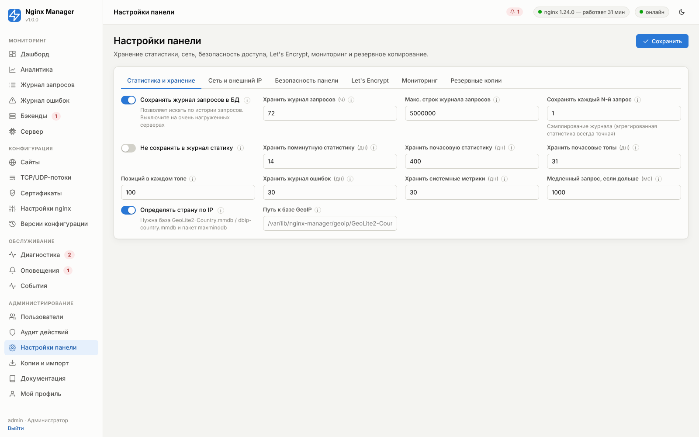
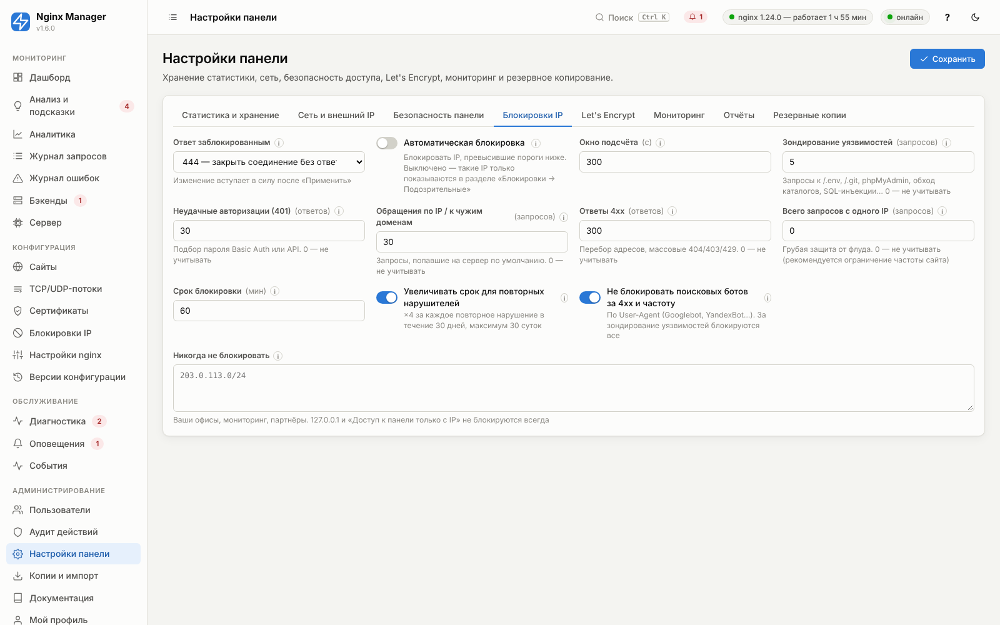
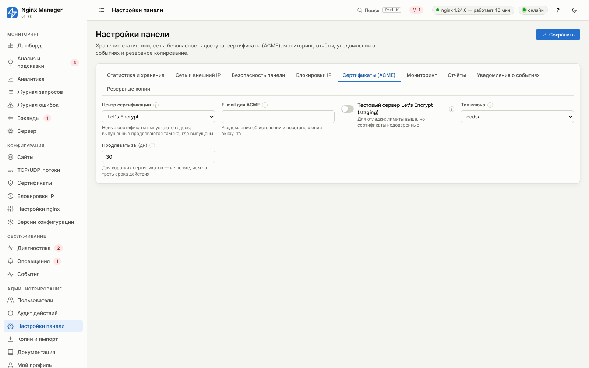
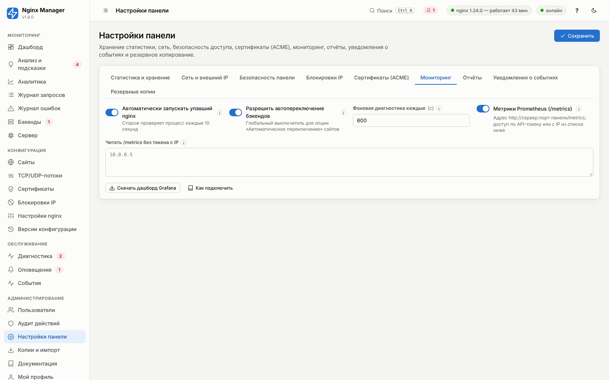
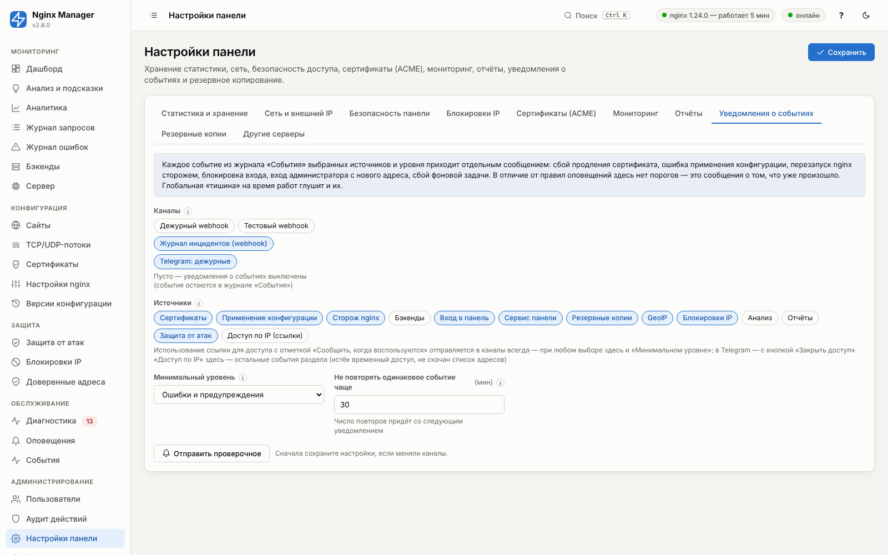

# 13. Настройки панели

Раздел **«Настройки панели»** (только администратор) управляет хранением статистики, сетевыми параметрами панели,
безопасностью доступа, сертификатами (центр ACME, EAB, продление), фоновым мониторингом и резервным копированием. Параметры запуска
сервиса (порт, адрес, пути) задаются в файле `/etc/nginx-manager/panel.conf` — см. [03. Установка](03-installation.md#файл-etcnginx-managerpanelconf).

<!-- GEN:panel -->
<!-- Сгенерировано tools/gen_reference.py — не редактируйте вручную -->

### Статистика и хранение

#### Сохранять журнал запросов в БД — `store_requests`

| Тип | По умолчанию | Диапазон / ед. | Директива nginx | Расширенный |
|---|---|---|---|---|
| переключатель (да/нет) | включено | — | — | нет |

Позволяет искать по истории запросов. Выключите на очень нагруженных серверах.

> **Рекомендация.** Включено; при > 2000 запросов/с — выключите или уменьшите срок хранения.

#### Хранить журнал запросов — `requests_retention_hours`

| Тип | По умолчанию | Диапазон / ед. | Директива nginx | Расширенный |
|---|---|---|---|---|
| целое число | `72` | 1…8760 ч | — | нет |

Сколько часов хранить каждый запрос для поиска и точного подсчёта уникальных IP.

> **Рекомендация.** 72 ч; 24 ч при > 100 запросов/с.

**Пример:** `72`

#### Макс. строк журнала запросов — `requests_max_rows`

| Тип | По умолчанию | Диапазон / ед. | Директива nginx | Расширенный |
|---|---|---|---|---|
| целое число | `5000000` | 10000…500000000 | — | нет |

Жёсткий предел числа строк журнала запросов — старые удаляются ежечасно.

> **Рекомендация.** 5 млн ≈ 2 ГБ.

**Пример:** `5000000`

#### Сохранять каждый N-й запрос — `requests_sample`

| Тип | По умолчанию | Диапазон / ед. | Директива nginx | Расширенный |
|---|---|---|---|---|
| целое число | `1` | 1…1000 | — | да |

Сэмплирование журнала (агрегированная статистика всегда точная)

Сохраняется каждый N-й запрос (агрегированная статистика остаётся точной).

> **Рекомендация.** 1; 5–50 для нагруженных серверов.

**Пример:** `10`

#### Не сохранять в журнал статику — `skip_static_in_log`

| Тип | По умолчанию | Диапазон / ед. | Директива nginx | Расширенный |
|---|---|---|---|---|
| переключатель (да/нет) | выключено | — | — | да |

Запросы к css/js/картинкам не сохраняются в журнал запросов (в статистике учитываются).

#### Хранить поминутную статистику — `minute_retention_days`

| Тип | По умолчанию | Диапазон / ед. | Директива nginx | Расширенный |
|---|---|---|---|---|
| целое число | `14` | 1…365 дн | — | нет |

Поминутная статистика — для графиков до 48 часов.

> **Рекомендация.** 14

**Пример:** `14`

#### Хранить почасовую статистику — `hour_retention_days`

| Тип | По умолчанию | Диапазон / ед. | Директива nginx | Расширенный |
|---|---|---|---|---|
| целое число | `400` | 7…3650 дн | — | нет |

Почасовая статистика — для отчётов за месяцы.

> **Рекомендация.** 400

**Пример:** `400`

#### Хранить почасовые топы — `top_retention_days`

| Тип | По умолчанию | Диапазон / ед. | Директива nginx | Расширенный |
|---|---|---|---|---|
| целое число | `31` | 1…365 дн | — | нет |

Почасовые топы (URI, IP…); дальше — суточные.

> **Рекомендация.** 31

**Пример:** `31`

#### Позиций в каждом топе — `top_keep`

| Тип | По умолчанию | Диапазон / ед. | Директива nginx | Расширенный |
|---|---|---|---|---|
| целое число | `100` | 10…1000 | — | да |

Сколько позиций каждого топа сохранять за час и сутки.

> **Рекомендация.** 100

**Пример:** `100`

#### Хранить журнал ошибок — `errors_retention_days`

| Тип | По умолчанию | Диапазон / ед. | Директива nginx | Расширенный |
|---|---|---|---|---|
| целое число | `30` | 1…365 дн | — | нет |

Срок хранения записей журнала ошибок nginx.

> **Рекомендация.** 30

**Пример:** `30`

#### Хранить системные метрики — `system_retention_days`

| Тип | По умолчанию | Диапазон / ед. | Директива nginx | Расширенный |
|---|---|---|---|---|
| целое число | `30` | 1…365 дн | — | нет |

Срок хранения поминутных метрик сервера.

> **Рекомендация.** 30

**Пример:** `30`

#### Медленный запрос, если дольше — `slow_request_ms`

| Тип | По умолчанию | Диапазон / ед. | Директива nginx | Расширенный |
|---|---|---|---|---|
| целое число | `1000` | 10…600000 мс | — | нет |

Порог для топа «Медленные» и счётчика медленных запросов.

> **Рекомендация.** 1000 мс; 300 мс для API.

**Пример:** `500`

#### Определять страну по IP — `geoip_enabled`

| Тип | По умолчанию | Диапазон / ед. | Директива nginx | Расширенный |
|---|---|---|---|---|
| переключатель (да/нет) | включено | — | — | нет |

Нужна база GeoLite2-Country.mmdb / dbip-country.mmdb и пакет maxminddb.

Определять страну клиента по IP (нужны база mmdb и пакет maxminddb, см. 09).

#### Путь к базе GeoIP — `geoip_path`

| Тип | По умолчанию | Диапазон / ед. | Директива nginx | Расширенный |
|---|---|---|---|---|
| строка | пусто | — | — | да |

Путь к базе .mmdb. Пусто — поиск в /var/lib/nginx-manager/geoip и /usr/share/GeoIP.

**Пример:** `/var/lib/nginx-manager/geoip/dbip-country-lite.mmdb`

#### Скачивать и обновлять бесплатные базы DB-IP Lite — `geoip_auto_update`

| Тип | По умолчанию | Диапазон / ед. | Директива nginx | Расширенный |
|---|---|---|---|---|
| переключатель (да/нет) | включено | — | — | нет |

Страны и сети провайдеров (ASN), раз в месяц; база в «Путь к базе» и GeoLite2 остаются в приоритете.

DB-IP Lite — бесплатные базы (CC BY 4.0) стран и автономных систем, обновляются ежемесячно. Панель скачивает их с download.db-ip.com, а если он недоступен — из зеркала sapics/ip-location-db на GitHub, проверяет и кладёт в /var/lib/nginx-manager/geoip/. Сети провайдеров нужны для аналитики атак по сетям, профиля адреса и своих правил «Сеть (ASN)».

#### Путь к базе ASN — `asn_path`

| Тип | По умолчанию | Диапазон / ед. | Директива nginx | Расширенный |
|---|---|---|---|---|
| строка | пусто | — | — | да |

Пусто — GeoLite2-ASN.mmdb или dbip-asn-lite.mmdb в /var/lib/nginx-manager/geoip/.

**Пример:** `/var/lib/nginx-manager/geoip/GeoLite2-ASN.mmdb`

### Сеть и внешний IP

#### Внешний IP сервера — `external_ip`

| Тип | По умолчанию | Диапазон / ед. | Директива nginx | Расширенный |
|---|---|---|---|---|
| строка | пусто | — | — | нет |

Пусто — определить автоматически (интерфейсы + внешний сервис)

Используется диагностикой для сверки DNS-записей доменов. Обязательно укажите, если сервер за NAT, а внешний сервис определения IP недоступен.

**Пример:** `203.0.113.10`

#### Сервис определения внешнего IP — `ip_detect_url`

| Тип | По умолчанию | Диапазон / ед. | Директива nginx | Расширенный |
|---|---|---|---|---|
| строка | `https://api.ipify.org` | — | — | нет |

Пусто — не обращаться к внешним сервисам.

Сервис, возвращающий внешний IP текстом. Пусто — не обращаться к внешним сервисам.

**Пример:** `https://api.ipify.org`

#### Домен панели — `panel_domain`

| Тип | По умолчанию | Диапазон / ед. | Директива nginx | Расширенный |
|---|---|---|---|---|
| строка | пусто | — | — | нет |

Если задан — nginx будет проксировать этот домен на панель (удобно с HTTPS)

nginx будет проксировать этот домен на панель (с WebSocket и ограничением по IP). После настройки можно закрыть прямой порт панели.

**Пример:** `panel.example.com`

#### Сертификат для домена панели — `panel_certificate_id`

| Тип | По умолчанию | Диапазон / ед. | Директива nginx | Расширенный |
|---|---|---|---|---|
| выбор сертификата | — | — | — | нет |

Сертификат для домена панели. Без сертификата домен панели работает по HTTP.

### Безопасность панели

#### Доступ к панели только с IP — `panel_allow`

| Тип | По умолчанию | Диапазон / ед. | Директива nginx | Расширенный |
|---|---|---|---|---|
| список, по одному значению на строку | пусто | — | — | нет |

Пусто — с любых. Сброс: nmctl allowlist clear.

> **Рекомендация.** Укажите IP офиса/VPN.

#### Время жизни сессии — `session_hours`

| Тип | По умолчанию | Диапазон / ед. | Директива nginx | Расширенный |
|---|---|---|---|---|
| целое число | `12` | 1…720 ч | — | нет |

Через сколько часов бездействия сессия завершается (продлевается при активности).

> **Рекомендация.** 8–12.

**Пример:** `12`

#### Неудачных входов до блокировки — `login_max_attempts`

| Тип | По умолчанию | Диапазон / ед. | Директива nginx | Расширенный |
|---|---|---|---|---|
| целое число | `5` | 3…100 | — | нет |

Неудачных попыток входа с одного IP до временной блокировки.

> **Рекомендация.** 5

**Пример:** `5`

#### Блокировка на — `login_lock_minutes`

| Тип | По умолчанию | Диапазон / ед. | Директива nginx | Расширенный |
|---|---|---|---|---|
| целое число | `15` | 1…1440 мин | — | нет |

Длительность блокировки входа.

> **Рекомендация.** 15

**Пример:** `15`

#### Требовать 2FA для администраторов — `require_2fa_admin`

| Тип | По умолчанию | Диапазон / ед. | Директива nginx | Расширенный |
|---|---|---|---|---|
| переключатель (да/нет) | выключено | — | — | нет |

Администраторы без 2FA после входа направляются на её настройку; пока она не включена, сервер разрешает им только просмотр и свой профиль (создать API-токен тоже нельзя). Включить параметр можно, только настроив 2FA себе.

> **Рекомендация.** Включите после того, как все администраторы настроят 2FA.

### Блокировки IP

#### Ответ заблокированным — `ban_response`

| Тип | По умолчанию | Диапазон / ед. | Директива nginx | Расширенный |
|---|---|---|---|---|
| выбор из списка | `444` (444 — закрыть соединение без ответа) | — | — | нет |

Изменение вступает в силу после «Применить».

Как nginx отвечает адресам из списка блокировок. 444 закрывает соединение без ответа и не тратит трафик; 403 и 429 показывают страницу ошибки.

Варианты:

- `444` — 444 — закрыть соединение без ответа
- `403` — 403 Forbidden (страница ошибки)
- `429` — 429 Too Many Requests

> **Рекомендация.** 444 для сканеров и ботов; 403, если среди заблокированных могут быть люди.

**Пример:** `444`

#### Автоматическая блокировка — `autoban_enabled`

| Тип | По умолчанию | Диапазон / ед. | Директива nginx | Расширенный |
|---|---|---|---|---|
| переключатель (да/нет) | выключено | — | — | нет |

Блокировать IP, превысившие пороги ниже. Выключено — такие IP только показываются в разделе «Блокировки → Подозрительные».

Детектор работает всегда; переключатель определяет, блокировать ли адреса автоматически или только показывать во вкладке «Подозрительные».

> **Рекомендация.** Сначала понаблюдайте неделю, затем включите.

#### Окно подсчёта — `autoban_window`

| Тип | По умолчанию | Диапазон / ед. | Директива nginx | Расширенный |
|---|---|---|---|---|
| целое число | `300` | 30…3600 с | — | нет |

Длительность окна, в котором считаются запросы каждого IP. Окно начинается с первого запроса адреса.

> **Рекомендация.** 300 с.

**Пример:** `300`

#### Зондирование уязвимостей — `autoban_scan`

| Тип | По умолчанию | Диапазон / ед. | Директива nginx | Расширенный |
|---|---|---|---|---|
| целое число | `5` | 0…100000 запросов | — | нет |

Запросы к /.env, /.git, phpMyAdmin, обход каталогов, SQL-инъекции… 0 — не учитывать.

Запросы к служебным файлам и известным путям сканеров (.env, .git, phpMyAdmin), обход каталогов, SQL-инъекции, XSS, Log4Shell. Полный список — глава 17.

> **Рекомендация.** 3–5: обычные посетители таких запросов не делают.

**Пример:** `5`

#### Неудачные авторизации (401) — `autoban_auth`

| Тип | По умолчанию | Диапазон / ед. | Директива nginx | Расширенный |
|---|---|---|---|---|
| целое число | `30` | 0…100000 ответов | — | нет |

Подбор пароля Basic Auth или API. 0 — не учитывать.

Ответы 401 одному адресу за окно — признак подбора пароля.

> **Рекомендация.** 20–30; для API с частыми истечениями токенов — выше.

**Пример:** `30`

#### Обращения по IP / к чужим доменам — `autoban_default_host`

| Тип | По умолчанию | Диапазон / ед. | Директива nginx | Расширенный |
|---|---|---|---|---|
| целое число | `30` | 0…100000 запросов | — | нет |

Запросы, попавшие на сервер по умолчанию. 0 — не учитывать.

Запросы, попавшие на сервер по умолчанию: обращение по IP-адресу или к домену, которого нет в панели.

> **Рекомендация.** 30.

**Пример:** `30`

#### Ответы 4xx — `autoban_4xx`

| Тип | По умолчанию | Диапазон / ед. | Директива nginx | Расширенный |
|---|---|---|---|---|
| целое число | `300` | 0…1000000 ответов | — | нет |

Перебор адресов, массовые 404/403/429. 0 — не учитывать.

Любые ответы 4xx и 444 одному адресу за окно.

> **Рекомендация.** 300; для мобильных API за NAT — 1000 и выше.

**Пример:** `300`

#### Всего запросов с одного IP — `autoban_requests`

| Тип | По умолчанию | Диапазон / ед. | Директива nginx | Расширенный |
|---|---|---|---|---|
| целое число | `0` | 0…10000000 запросов | — | нет |

Грубая защита от флуда. 0 — не учитывать (рекомендуется ограничение частоты сайта)

Все запросы одного адреса за окно — грубая защита от флуда.

> **Рекомендация.** 0 (выключено): для защиты от флуда лучше подходит ограничение частоты сайта.

**Пример:** `6000`

#### Срок блокировки — `autoban_minutes`

| Тип | По умолчанию | Диапазон / ед. | Директива nginx | Расширенный |
|---|---|---|---|---|
| целое число | `60` | 1…525600 мин | — | нет |

Срок первой автоматической блокировки.

> **Рекомендация.** 60 минут.

**Пример:** `60`

#### Увеличивать срок для повторных нарушителей — `autoban_escalate`

| Тип | По умолчанию | Диапазон / ед. | Директива nginx | Расширенный |
|---|---|---|---|---|
| переключатель (да/нет) | включено | — | — | нет |

×4 за каждое повторное нарушение в течение 30 дней, максимум 30 суток.

Повторное нарушение в течение 30 дней умножает срок на 4 (до 30 суток).

> **Рекомендация.** Включено.

#### Не блокировать поисковых ботов за 4xx и частоту — `autoban_ignore_bots`

| Тип | По умолчанию | Диапазон / ед. | Директива nginx | Расширенный |
|---|---|---|---|---|
| переключатель (да/нет) | включено | — | — | нет |

По User-Agent (Googlebot, YandexBot…). За зондирование уязвимостей блокируются все.

Поисковые роботы (по User-Agent) не блокируются за 4xx и частоту; за зондирование уязвимостей блокируются все.

> **Рекомендация.** Включено.

### Сертификаты (ACME)

#### Центр сертификации — `acme_ca`

| Тип | По умолчанию | Диапазон / ед. | Директива nginx | Расширенный |
|---|---|---|---|---|
| выбор из списка | `letsencrypt` (Let's Encrypt) | — | — | нет |

Новые сертификаты выпускаются здесь; выпущенные продлеваются там же, где выпущены.

Где выпускаются новые ACME-сертификаты. Let's Encrypt — бесплатно, без регистрации. ZeroSSL и Google Trust Services — бесплатные альтернативы (резерв на случай лимитов или сбоя Let's Encrypt), требуют ключ EAB из личного кабинета. Свой ACME-сервер — корпоративный центр (step-ca, Smallstep, Vault PKI, EJBCA) для внутренних доменов. Выпущенные сертификаты продлеваются в том центре, где выпущены.

Варианты:

- `letsencrypt` — Let's Encrypt
- `zerossl` — ZeroSSL (нужен ключ EAB)
- `google` — Google Trust Services (нужен ключ EAB)
- `custom` — Свой ACME-сервер (step-ca, Smallstep, корпоративный)

> **Рекомендация.** Let's Encrypt; второй центр держите в запасе.

**Пример:** `letsencrypt`

#### Адрес каталога ACME — `acme_directory`

| Тип | По умолчанию | Диапазон / ед. | Директива nginx | Расширенный |
|---|---|---|---|---|
| строка | пусто | — | — | нет |

Адрес каталога (directory) ACME-сервера — его показывает сам сервер, например step-ca: https://ca.internal:9000/acme/<провайдер>/directory.

**Пример:** `https://ca.internal:9000/acme/acme/directory`

*Показывается, когда `acme_ca` = `custom`.*

#### EAB: идентификатор ключа (Key ID) — `acme_eab_kid`

| Тип | По умолчанию | Диапазон / ед. | Директива nginx | Расширенный |
|---|---|---|---|---|
| строка | пусто | — | — | нет |

External Account Binding — из личного кабинета центра сертификации.

External Account Binding: идентификатор ключа, привязывающий аккаунт ACME к учётной записи у центра сертификации. ZeroSSL: Developer → EAB Credentials; Google: gcloud publicca external-account-keys create.

*Показывается, когда `acme_ca` = `zerossl`, `google`, `custom`.*

#### EAB: HMAC-ключ — `acme_eab_hmac`

| Тип | По умолчанию | Диапазон / ед. | Директива nginx | Расширенный |
|---|---|---|---|---|
| пароль (скрытый ввод) | пусто | — | — | нет |

Секрет EAB (base64url). Нужен один раз — при регистрации аккаунта; в интерфейсе и API не показывается.

*Показывается, когда `acme_ca` = `zerossl`, `google`, `custom`.*

#### Доверенный корневой сертификат ACME-сервера — `acme_ca_bundle`

| Тип | По умолчанию | Диапазон / ед. | Директива nginx | Расширенный |
|---|---|---|---|---|
| строка | пусто | — | — | нет |

Путь к PEM-файлу, если ACME-сервер работает с сертификатом внутреннего центра.

Корневой сертификат внутреннего центра, которым подписан TLS самого ACME-сервера (передаётся certbot как REQUESTS_CA_BUNDLE). Не нужен для публичных центров.

**Пример:** `/etc/step-ca/certs/root_ca.crt`

*Показывается, когда `acme_ca` = `custom`.*

#### E-mail для ACME — `letsencrypt_email`

| Тип | По умолчанию | Диапазон / ед. | Директива nginx | Расширенный |
|---|---|---|---|---|
| строка | пусто | — | — | нет |

Уведомления об истечении и восстановлении аккаунта.

Используется при регистрации аккаунта ACME — на него приходят уведомления о проблемах с продлением.

> **Рекомендация.** Общий адрес администраторов.

**Пример:** `ops@example.com`

#### Тестовый сервер Let's Encrypt (staging) — `letsencrypt_staging`

| Тип | По умолчанию | Диапазон / ед. | Директива nginx | Расширенный |
|---|---|---|---|---|
| переключатель (да/нет) | выключено | — | — | нет |

Для отладки: лимиты выше, но сертификаты недоверенные.

Все новые сертификаты выпускаются на тестовом сервере (недоверенные).

> **Рекомендация.** Только для отладки.

*Показывается, когда `acme_ca` = `letsencrypt`.*

#### Тип ключа — `letsencrypt_key_type`

| Тип | По умолчанию | Диапазон / ед. | Директива nginx | Расширенный |
|---|---|---|---|---|
| выбор из списка | `ecdsa` | — | — | нет |

ECDSA (P-256) — короче и быстрее рукопожатие; RSA 2048 — для очень старых клиентов.

Варианты:

- `ecdsa`
- `rsa`

> **Рекомендация.** ECDSA.

**Пример:** `ecdsa`

#### Продлевать за — `renew_days_before`

| Тип | По умолчанию | Диапазон / ед. | Директива nginx | Расширенный |
|---|---|---|---|---|
| целое число | `30` | 5…60 дн | — | нет |

Для коротких сертификатов — не позже, чем за треть срока действия.

За сколько дней до истечения продлевать ACME-сертификаты. Для коротких сертификатов срок сокращается до трети срока действия: шестидневный продлевается за 2 дня, 45-дневный — за 15.

> **Рекомендация.** 30

**Пример:** `30`

### Мониторинг

#### Автоматически запускать упавший nginx — `auto_restart_nginx`

| Тип | По умолчанию | Диапазон / ед. | Директива nginx | Расширенный |
|---|---|---|---|---|
| переключатель (да/нет) | включено | — | — | нет |

Сторож проверяет процесс каждые 10 секунд.

Сторож проверяет процесс каждые 10 с и запускает nginx (не более 5 раз за 10 минут).

> **Рекомендация.** Включено.

#### Разрешить автопереключение бэкендов — `auto_apply_failover`

| Тип | По умолчанию | Диапазон / ед. | Директива nginx | Расширенный |
|---|---|---|---|---|
| переключатель (да/нет) | включено | — | — | нет |

Глобальный выключатель для опции «Автоматическое переключение» сайтов.

Глобальное разрешение автопереключения бэкендов (включается ещё и в каждом сайте).

> **Рекомендация.** Включено.

#### Фоновая диагностика каждые — `diagnostics_interval`

| Тип | По умолчанию | Диапазон / ед. | Директива nginx | Расширенный |
|---|---|---|---|---|
| целое число | `600` | 60…86400 с | — | нет |

Период фоновой диагностики.

> **Рекомендация.** 600 с.

**Пример:** `600`

#### Метрики Prometheus (/metrics) — `metrics_enabled`

| Тип | По умолчанию | Диапазон / ед. | Директива nginx | Расширенный |
|---|---|---|---|---|
| переключатель (да/нет) | включено | — | — | нет |

Адрес http://сервер:порт-панели/metrics; доступ по API-токену или с IP из списка ниже.

Адрес /metrics в формате Prometheus. Без токена доступен только с адресов из списка ниже.

> **Рекомендация.** Включено.

#### Читать /metrics без токена с IP — `metrics_allow`

| Тип | По умолчанию | Диапазон / ед. | Директива nginx | Расширенный |
|---|---|---|---|---|
| список, по одному значению на строку | пусто | — | — | нет |

Адреса, с которых /metrics читается без API-токена (сервер Prometheus).

> **Рекомендация.** Только адрес системы мониторинга.

**Пример:** `10.0.0.5`

*Показывается, когда `metrics_enabled` = вкл.*

### Отчёты

#### Отправлять регулярный отчёт — `report_enabled`

| Тип | По умолчанию | Диапазон / ед. | Директива nginx | Расширенный |
|---|---|---|---|---|
| переключатель (да/нет) | выключено | — | — | нет |

Сводка нагрузки, ошибок, проблем по анализу и состояния в выбранные каналы.

Регулярная сводка: запросы и их изменение к прошлому периоду, ошибки, время ответа, трафик, сайты, проблемы по встроенному анализу, недоступные бэкенды, сертификаты, блокировки, журнал ошибок nginx.

> **Рекомендация.** Ежедневно — для активно развиваемых проектов, еженедельно — для стабильных.

#### Период — `report_period`

| Тип | По умолчанию | Диапазон / ед. | Директива nginx | Расширенный |
|---|---|---|---|---|
| выбор из списка | `day` (Ежедневно (за прошедшие сутки)) | — | — | нет |

Сутки — с 00:00 до 00:00 вчерашнего дня; неделя — 7 суток до сегодняшней полуночи. Сравнение — с предыдущим таким же периодом.

Варианты:

- `day` — Ежедневно (за прошедшие сутки)
- `week` — Еженедельно (за прошедшие 7 суток)

**Пример:** `day`

#### Час отправки — `report_hour`

| Тип | По умолчанию | Диапазон / ед. | Директива nginx | Расширенный |
|---|---|---|---|---|
| целое число | `9` | 0…23 | — | нет |

По времени сервера.

Час отправки по часовому поясу сервера.

> **Рекомендация.** 9 — к началу рабочего дня.

**Пример:** `9`

#### День недели — `report_weekday`

| Тип | По умолчанию | Диапазон / ед. | Директива nginx | Расширенный |
|---|---|---|---|---|
| выбор из списка | `0` (Понедельник) | — | — | нет |

День отправки еженедельного отчёта.

Варианты:

- `0` — Понедельник
- `1` — Вторник
- `2` — Среда
- `3` — Четверг
- `4` — Пятница
- `5` — Суббота
- `6` — Воскресенье

> **Рекомендация.** Понедельник.

**Пример:** `0`

*Показывается, когда `report_period` = `week`.*

#### Каналы — `report_channels`

| Тип | По умолчанию | Диапазон / ед. | Директива nginx | Расширенный |
|---|---|---|---|---|
| выбор каналов | пусто | — | — | нет |

Каналы настраиваются в разделе «Оповещения → Каналы уведомлений».

Каналы из раздела «Оповещения → Каналы уведомлений». Отчёт можно посмотреть и отправить сразу кнопками под формой.

### Уведомления о событиях

#### Каналы — `event_channels`

| Тип | По умолчанию | Диапазон / ед. | Директива nginx | Расширенный |
|---|---|---|---|---|
| выбор каналов | пусто | — | — | нет |

Пусто — уведомления о событиях выключены (события остаются в журнале «События»)

Куда отправлять уведомления о событиях. Каналы настраиваются в «Оповещения → Каналы уведомлений». Пусто — уведомления о событиях выключены.

> **Рекомендация.** Канал дежурных (Telegram-группа или webhook в систему инцидентов).

#### Источники — `event_sources`

| Тип | По умолчанию | Диапазон / ед. | Директива nginx | Расширенный |
|---|---|---|---|---|
| несколько значений из списка | `certs`, `config`, `watchdog`, `auth`, `panel`, `backup`, `geoip`, `protection`, `access` | — | — | нет |

Использование ссылки для доступа с отметкой «Сообщить, когда воспользуются» отправляется в каналы всегда — при любом выборе здесь и «Минимальном уровне»; в Telegram — с кнопкой «Закрыть доступ». «Доступ по IP» здесь — остальные события раздела (истёк временный доступ, не скачан список адресов)

Какие источники журнала «События» рассылать. По умолчанию — то, что требует реакции человека: сертификаты (сбой выпуска и продления), применение конфигурации (ошибка nginx -t, в том числе при автоприменении), сторож (nginx упал), вход в панель (блокировка перебора, вход администратора с нового адреса), сервис панели (сбой фоновой задачи), резервные копии (сбой выгрузки), GeoIP, защита от атак (включён режим «Под атакой», сбой списков угроз). Бэкенды, блокировки и анализ шумнее — для них лучше правила оповещений с порогами.

Варианты:

- `certs` — Сертификаты
- `config` — Применение конфигурации
- `watchdog` — Сторож nginx
- `health` — Бэкенды
- `auth` — Вход в панель
- `panel` — Сервис панели
- `backup` — Резервные копии
- `geoip` — GeoIP
- `bans` — Блокировки IP
- `insights` — Анализ
- `reports` — Отчёты
- `protection` — Защита от атак
- `access` — Доступ по IP (ссылки)

> **Рекомендация.** Набор по умолчанию.

#### Минимальный уровень — `event_min_level`

| Тип | По умолчанию | Диапазон / ед. | Директива nginx | Расширенный |
|---|---|---|---|---|
| выбор из списка | `warning` (Ошибки и предупреждения) | — | — | нет |

Минимальный уровень события. «Все события» добавляет успешные: каждое применение конфигурации, каждый выпущенный сертификат.

Варианты:

- `error` — Только ошибки
- `warning` — Ошибки и предупреждения
- `info` — Все события

> **Рекомендация.** Ошибки и предупреждения.

**Пример:** `warning`

#### Не повторять одинаковое событие чаще — `event_repeat_minutes`

| Тип | По умолчанию | Диапазон / ед. | Директива nginx | Расширенный |
|---|---|---|---|---|
| целое число | `30` | 0…1440 мин | — | нет |

Число повторов придёт со следующим уведомлением.

Одинаковые события (отличаются только числами — номером версии, временем) не отправляются чаще: следующее уведомление сообщит, сколько раз событие повторилось. Кроме того, действует общий лимит — 30 уведомлений в час.

> **Рекомендация.** 30

**Пример:** `30`

### Резервные копии

#### Хранить автоматических копий — `backup_keep`

| Тип | По умолчанию | Диапазон / ед. | Директива nginx | Расширенный |
|---|---|---|---|---|
| целое число | `14` | 1…365 | — | нет |

Сколько автоматических копий хранить.

> **Рекомендация.** 14

**Пример:** `14`

#### Час ежедневного резервного копирования — `backup_hour`

| Тип | По умолчанию | Диапазон / ед. | Директива nginx | Расширенный |
|---|---|---|---|---|
| целое число | `3` | 0…23 | — | нет |

В какой час (по времени сервера) делать ежедневную копию.

> **Рекомендация.** Час минимальной нагрузки.

**Пример:** `3`

#### Выгружать копии в S3-хранилище — `s3_enabled`

| Тип | По умолчанию | Диапазон / ед. | Директива nginx | Расширенный |
|---|---|---|---|---|
| переключатель (да/нет) | выключено | — | — | нет |

Ежедневная и ручные копии уходят ещё и во внешнее хранилище — переживут потерю сервера.

#### Адрес хранилища (endpoint) — `s3_endpoint`

| Тип | По умолчанию | Диапазон / ед. | Директива nginx | Расширенный |
|---|---|---|---|---|
| строка | пусто | — | — | нет |

Адрес S3-совместимого хранилища без бакета: AWS — https://s3.<регион>.amazonaws.com, Yandex Object Storage — https://storage.yandexcloud.net, Cloudflare R2 — https://<ID аккаунта>.r2.cloudflarestorage.com, MinIO — http(s)://адрес:9000; для VK Cloud, Selectel и других — адрес S3 API из документации провайдера.

**Пример:** `https://storage.yandexcloud.net`

*Показывается, когда `s3_enabled` = вкл.*

#### Регион — `s3_region`

| Тип | По умолчанию | Диапазон / ед. | Директива nginx | Расширенный |
|---|---|---|---|---|
| строка | `us-east-1` | — | — | нет |

AWS — регион бакета; Yandex — ru-central1; Cloudflare R2 — auto; MinIO — us-east-1.

*Показывается, когда `s3_enabled` = вкл.*

#### Бакет — `s3_bucket`

| Тип | По умолчанию | Диапазон / ед. | Директива nginx | Расширенный |
|---|---|---|---|---|
| строка | пусто | — | — | нет |

**Пример:** `backups-example`

*Показывается, когда `s3_enabled` = вкл.*

#### Префикс (папка) в бакете — `s3_prefix`

| Тип | По умолчанию | Диапазон / ед. | Директива nginx | Расширенный |
|---|---|---|---|---|
| строка | `nginx-manager/` | — | — | нет |

Для нескольких серверов в одном бакете — свой префикс у каждого.

*Показывается, когда `s3_enabled` = вкл.*

#### Access key ID — `s3_access_key`

| Тип | По умолчанию | Диапазон / ед. | Директива nginx | Расширенный |
|---|---|---|---|---|
| строка | пусто | — | — | нет |

Ключ доступа сервисного аккаунта с правами только на этот бакет: запись, чтение списка, чтение и удаление объектов.

> **Рекомендация.** Отдельный ключ только для копий.

*Показывается, когда `s3_enabled` = вкл.*

#### Secret access key — `s3_secret_key`

| Тип | По умолчанию | Диапазон / ед. | Директива nginx | Расширенный |
|---|---|---|---|---|
| пароль (скрытый ввод) | пусто | — | — | нет |

*Показывается, когда `s3_enabled` = вкл.*

#### Адресация path-style (endpoint/бакет/ключ) — `s3_path_style`

| Тип | По умолчанию | Диапазон / ед. | Директива nginx | Расширенный |
|---|---|---|---|---|
| переключатель (да/нет) | включено | — | — | да |

Нужна MinIO и большинству совместимых хранилищ; выключите для virtual-hosted (бакет.endpoint)

*Показывается, когда `s3_enabled` = вкл.*

#### Хранить копий в хранилище — `s3_keep`

| Тип | По умолчанию | Диапазон / ед. | Директива nginx | Расширенный |
|---|---|---|---|---|
| целое число | `30` | 0…3650 | — | нет |

0 — не удалять (например, если хранение настроено правилами жизненного цикла бакета)

Сколько последних копий оставлять в хранилище (копия — пара файлов: база и экспорт). Старые удаляются после каждой выгрузки.

> **Рекомендация.** 30 (месяц ежедневных копий).

**Пример:** `30`

*Показывается, когда `s3_enabled` = вкл.*

#### Выгружать и базу данных (со статистикой) — `s3_include_db`

| Тип | По умолчанию | Диапазон / ед. | Директива nginx | Расширенный |
|---|---|---|---|---|
| переключатель (да/нет) | включено | — | — | нет |

Выключено — только JSON-экспорт настроек (килобайты вместо мегабайт)

*Показывается, когда `s3_enabled` = вкл.*

#### Пароль шифрования копий — `s3_encrypt_password`

| Тип | По умолчанию | Диапазон / ед. | Директива nginx | Расширенный |
|---|---|---|---|---|
| пароль (скрытый ввод) | пусто | — | — | нет |

AES-256 (openssl). Пусто — без шифрования. Потеряете пароль — копии не прочитать.

Файлы шифруются перед выгрузкой (AES-256-CBC, ключ из пароля через PBKDF2, 200 000 итераций) и получают суффикс .enc. Расшифровать можно в панели («На сервер») или командой openssl (см. документацию). В интерфейсе и API пароль не показывается.

> **Рекомендация.** Задайте, если хранилищем пользуется кто-то ещё; храните пароль вне сервера.

*Показывается, когда `s3_enabled` = вкл.*

#### Хранить копий перед обновлениями — `backup_keep_update`

| Тип | По умолчанию | Диапазон / ед. | Директива nginx | Расширенный |
|---|---|---|---|---|
| целое число | `5` | 1…100 | — | нет |

Копии базы, кода прежней версии и nginx.conf, которые делает update.sh и nmctl backup. Ручные копии из панели не удаляются.

update.sh и «nmctl backup» сохраняют базу, код прежней версии и nginx.conf. Старше этого числа копии каждого вида удаляются (при каждом обновлении и ежедневном копировании).

> **Рекомендация.** 5.

**Пример:** `5`

### Копия настроек

#### Отдельная копия настроек каждые — `sb_hours`

| Тип | По умолчанию | Диапазон / ед. | Директива nginx | Расширенный |
|---|---|---|---|---|
| целое число | `0` | 0…168 ч | — | нет |

0 — только вместе с ежедневной копией базы. Копия всех настроек — десятки килобайт, её можно делать часто (например, каждый час)

> **Рекомендация.** 1–6 ч, если настройки меняются часто; вместе с «Только если настройки изменились»

#### Только если настройки изменились — `sb_only_changed`

| Тип | По умолчанию | Диапазон / ед. | Директива nginx | Расширенный |
|---|---|---|---|---|
| переключатель (да/нет) | включено | — | — | нет |

Копия по расписанию не создаётся и не отправляется, если с прошлой ничего не поменялось (время входа, использование токенов и проверки сертификатов не считаются)

#### Хранить копий по расписанию на сервере — `sb_keep`

| Тип | По умолчанию | Диапазон / ед. | Директива nginx | Расширенный |
|---|---|---|---|---|
| целое число | `48` | 1…2000 | — | нет |

#### Пароль шифрования копий настроек — `sb_password`

| Тип | По умолчанию | Диапазон / ед. | Директива nginx | Расширенный |
|---|---|---|---|---|
| пароль (скрытый ввод) | пусто | — | — | нет |

Копии по расписанию и всё, что уходит в каналы и хранилища, шифруются им (AES-256). Пусто — пароль шифрования S3 с вкладки «Резервные копии». Без пароля копия во внешние места не отправляется: в ней закрытые ключи сертификатов и пароли интеграций.

#### Отправлять в каналы — `sb_channels`

| Тип | По умолчанию | Диапазон / ед. | Директива nginx | Расширенный |
|---|---|---|---|---|
| выбор каналов | пусто | — | — | нет |

Telegram — файлом в чат, e-mail — вложением: копия окажется у администратора (на компьютере, в телефоне). Slack, Discord и webhook файлы не принимают.

#### Выгружать в основное S3-хранилище — `sb_main_s3`

| Тип | По умолчанию | Диапазон / ед. | Директива nginx | Расширенный |
|---|---|---|---|---|
| переключатель (да/нет) | включено | — | — | нет |

Каталог settings/ под префиксом хранилища с вкладки «Резервные копии» (если выгрузка включена). Ежедневная копия уходит туда и так — вместе с базой.

#### Второе S3-хранилище для копий настроек — `sb_s3`

| Тип | По умолчанию | Диапазон / ед. | Директива nginx | Расширенный |
|---|---|---|---|---|
| переключатель (да/нет) | выключено | — | — | нет |

Другой провайдер или другой аккаунт — копия настроек переживёт потерю и сервера, и основного хранилища.

#### Адрес хранилища (endpoint) — `sb_s3_endpoint`

| Тип | По умолчанию | Диапазон / ед. | Директива nginx | Расширенный |
|---|---|---|---|---|
| строка | пусто | — | — | нет |

**Пример:** `https://s3.eu-central-1.amazonaws.com`

*Показывается, когда `sb_s3` = вкл.*

#### Регион — `sb_s3_region`

| Тип | По умолчанию | Диапазон / ед. | Директива nginx | Расширенный |
|---|---|---|---|---|
| строка | `us-east-1` | — | — | нет |

*Показывается, когда `sb_s3` = вкл.*

#### Бакет — `sb_s3_bucket`

| Тип | По умолчанию | Диапазон / ед. | Директива nginx | Расширенный |
|---|---|---|---|---|
| строка | пусто | — | — | нет |

**Пример:** `nm-settings-example`

*Показывается, когда `sb_s3` = вкл.*

#### Префикс (папка) в бакете — `sb_s3_prefix`

| Тип | По умолчанию | Диапазон / ед. | Директива nginx | Расширенный |
|---|---|---|---|---|
| строка | `nginx-manager-settings/` | — | — | нет |

*Показывается, когда `sb_s3` = вкл.*

#### Access key ID — `sb_s3_access_key`

| Тип | По умолчанию | Диапазон / ед. | Директива nginx | Расширенный |
|---|---|---|---|---|
| строка | пусто | — | — | нет |

*Показывается, когда `sb_s3` = вкл.*

#### Secret access key — `sb_s3_secret_key`

| Тип | По умолчанию | Диапазон / ед. | Директива nginx | Расширенный |
|---|---|---|---|---|
| пароль (скрытый ввод) | пусто | — | — | нет |

*Показывается, когда `sb_s3` = вкл.*

#### Адресация path-style — `sb_s3_path_style`

| Тип | По умолчанию | Диапазон / ед. | Директива nginx | Расширенный |
|---|---|---|---|---|
| переключатель (да/нет) | включено | — | — | да |

*Показывается, когда `sb_s3` = вкл.*

#### Проверять копии настроек раз в — `sb_verify_days`

| Тип | По умолчанию | Диапазон / ед. | Директива nginx | Расширенный |
|---|---|---|---|---|
| целое число | `7` | 0…90 дн | — | нет |

Панель открывает последнюю копию на сервере и последние копии во внешних хранилищах паролем копий, сверяет контрольные суммы, проверяет настройки и пары «сертификат — ключ». Ошибка — событие «ошибка» и уведомление. 0 — не проверять.

#### Хранить копий настроек во внешних хранилищах — `sb_remote_keep`

| Тип | По умолчанию | Диапазон / ед. | Директива nginx | Расширенный |
|---|---|---|---|---|
| целое число | `90` | 0…5000 | — | нет |

Для основного (каталог settings/) и второго хранилища. 0 — не удалять.

### Другие серверы

#### Серверы — `peers`

| Тип | По умолчанию | Диапазон / ед. | Директива nginx | Расширенный |
|---|---|---|---|---|
| таблица элементов | пусто | — | — | нет |

Другие серверы с Nginx Manager: общие блокировки IP и настройки защиты.

Каждый сервер раз в минуту и сразу после изменения отправляет другим свои блокировки (кроме полученных от других), получатель сверяет их: добавляет, обновляет сроки, снимает исчезнувшие. Настройки защиты от атак отправляются при сохранении (если включено у сервера) или кнопкой на странице «Блокировки IP». Связь — по HTTPS с API-токеном сервера-получателя. Настройте серверы друг у друга в обе стороны.

Поля элемента:

| Поле | Тип | По умолчанию | Описание |
|---|---|---|---|
| Название (`name`) | строка | пусто |  |
| Адрес панели (`url`) | строка | пусто | Адрес панели Nginx Manager другого сервера (как в браузере) |
| API-токен (`token`) | строка | пусто | Токен с ролью «оператор» или «администратор» на том сервере (Мой профиль → API-токены) |
| Включён (`enabled`) | переключатель (да/нет) | включено |  |
| Блокировки IP (`bans`) | переключатель (да/нет) | включено | Отправлять свои блокировки на этот сервер |
| Настройки защиты (`protection`) | переключатель (да/нет) | выключено | Отправлять настройки защиты от атак при сохранении (нужен токен администратора) |
| Доверенные адреса (`trusted`) | переключатель (да/нет) | включено | Отправлять свои доверенные адреса вместе с блокировками (нужен токен администратора; с токеном оператора получатель их не примет) |
| Сайты (`sites`) | переключатель (да/нет) | выключено | Синхронизация сайтов: после каждого применения конфигурации здесь отправлять сайты (с сертификатами) на этот сервер и применять их там — для серверов кластера с одинаковыми сайтами. Нужен токен администратора |
| Только сайты с меткой (`sites_tag`) | строка | пусто | Синхронизировать только сайты с этой меткой; пусто — все сайты |
| TCP/UDP-потоки (`streams`) | переключатель (да/нет) | выключено | Синхронизация потоков: после каждого применения конфигурации здесь отправлять все потоки на этот сервер (поток с тем же адресом и портом обновляется, созданные синхронизацией и удалённые здесь — удаляются там). Нужен токен администратора |
| Общие настройки nginx (`global_settings`) | переключатель (да/нет) | выключено | Синхронизация общих настроек nginx после каждого применения конфигурации (кроме своих у каждого сервера: пользователь nginx, резолвер, DH-параметры, conf.d). Нужен токен администратора |

#### Имя этого сервера для других — `peer_name`

| Тип | По умолчанию | Диапазон / ед. | Директива nginx | Расширенный |
|---|---|---|---|---|
| строка | пусто | — | — | нет |

Так блокировки с этого сервера подписаны на других.

**Пример:** `авто — имя хоста`

#### Проверять сертификат HTTPS других серверов — `peers_verify_tls`

| Тип | По умолчанию | Диапазон / ед. | Директива nginx | Расширенный |
|---|---|---|---|---|
| переключатель (да/нет) | включено | — | — | нет |

Выключите для самоподписанных сертификатов панели.

#### Принимать синхронизацию сайтов с других серверов — `peers_accept_sites`

| Тип | По умолчанию | Диапазон / ед. | Директива nginx | Расширенный |
|---|---|---|---|---|
| переключатель (да/нет) | включено | — | — | нет |

Сайты, которые другой сервер присылает в режиме синхронизации, создаются, обновляются и удаляются здесь автоматически (только с токеном администратора)

#### Сравнивать конфигурацию с другими серверами раз в — `peers_compare_hours`

| Тип | По умолчанию | Диапазон / ед. | Директива nginx | Расширенный |
|---|---|---|---|---|
| целое число | `24` | 0…720 ч | — | нет |

Панель сравнивает применённую конфигурацию с каждым сервером из списка (как кнопка «Сравнить») и пишет событие «предупреждение» — с уведомлением, если оно включено, — когда расхождения появились или изменились, и событие, когда конфигурации снова совпали. 0 — не сравнивать.

> **Рекомендация.** 24 ч для кластера одинаковых серверов; 0 — если серверы разные по назначению

#### Выпускать перенесённые сертификаты здесь, если сервер-источник молчит — `cert_takeover_days`

| Тип | По умолчанию | Диапазон / ед. | Директива nginx | Расширенный |
|---|---|---|---|---|
| целое число | `0` | 0…60 дн | — | нет |

Сертификат, перенесённый с другого сервера, продлевается там. Если тот сервер не выходит на связь столько дней, а до истечения меньше 20 дней, панель сама выпускает сертификат здесь (по ACME, с теми же доменами) и переключает на него сайты. 0 — только кнопкой в «Диагностике».

> **Рекомендация.** 3–7 дней для резервного сервера кластера, на который приходят запросы Let's Encrypt

#### Принимать доверенные адреса с других серверов — `peers_accept_trusted`

| Тип | По умолчанию | Диапазон / ед. | Директива nginx | Расширенный |
|---|---|---|---|---|
| переключатель (да/нет) | включено | — | — | нет |

Адреса, доверенные на другом сервере, не блокируются и здесь (видны в разделе «Доверенные адреса» с именем сервера; принимаются только с токеном администратора)

<!-- /GEN:panel -->

## Доверенные адреса

Список настраивается в отдельном разделе панели — «Защита → Доверенные адреса» (подробно — в главе
[17. Блокировки IP](17-bans.md#доверенные-адреса)). Хранится вместе с настройками панели.

<!-- GEN:panel_trusted -->
<!-- Сгенерировано tools/gen_reference.py — не редактируйте вручную -->

### Доверенные адреса и подсети — `trusted_ips`

| Тип | По умолчанию | Диапазон / ед. | Директива nginx | Расширенный |
|---|---|---|---|---|
| таблица элементов | пусто | — | — | нет |

Никогда не блокируются: блокировки IP (ручные, автоматические, с других серверов и из Telegram), фильтр запросов, проверка браузера, списки угроз, свои правила, ограничения частоты, доступ по странам.

Ваши офисы, VPN, мониторинг, платёжные шлюзы и партнёрские серверы. Сайтам с «Доступом только с разрешённых адресов» доверенные адреса открыты, если там включено «Пускать доверенные адреса». Всегда доверенные: 127.0.0.1 и ::1 (сам сервер) и адреса из «Доступ к панели только с IP».

Поля элемента:

| Поле | Тип | По умолчанию | Описание |
|---|---|---|---|
| IP-адрес или подсеть (`address`) | строка | пусто |  |
| Комментарий (`comment`) | строка | пусто |  |
| Действует до (`expires`) | число | — | Временный доступ: по истечении срока запись перестаёт действовать и удаляется из списка (конфигурация применяется автоматически) |

### Списки доверенных адресов по ссылке — `trusted_lists`

| Тип | По умолчанию | Диапазон / ед. | Директива nginx | Расширенный |
|---|---|---|---|---|
| таблица элементов | пусто | — | — | нет |

Файлы со списками адресов (адреса платёжного шлюза, мониторинга, CDN), которые панель скачивает по расписанию: адреса из них доверенные так же, как записи выше. При изменении списка конфигурация переприменяется сама.

> **Рекомендация.** Официальные списки адресов сервисов по HTTPS: платёжного шлюза, мониторинга, системы CI/CD

Поля элемента:

| Поле | Тип | По умолчанию | Описание |
|---|---|---|---|
| Адрес списка (`url`) | строка | пусто |  |
| Комментарий (`comment`) | строка | пусто |  |
| Обновлять раз в (`hours`) | целое число | `24` |  |
| Не шире подсети IPv4 / (`min_prefix`) | целое число | `16` | Подсети шире (например, /8) из списка отбрасываются; для IPv6 — на 16 бит длиннее (/16 → /32). 0 — без ограничения |
| Подтверждать, если изменилось больше (`max_change`) | целое число | `50` | Если новая загрузка отличается от действующей больше чем на столько процентов адресов, она не применяется, пока вы не нажмёте «Принять изменения» (защита от подмены или ошибки в файле). 0 — применять любые изменения |
| Контрольная сумма SHA-256 (`sha256`) | строка | пусто | Для неизменного файла: если содержимое не совпадает с этой суммой, загрузка отклоняется |
| Открытый ключ подписи (Ed25519) (`pubkey`) | строка | пусто | Владелец списка подписывает файл своим ключом (nmctl lists sign или openssl pkeyutl -sign -rawin); панель принимает загрузку, только если подпись из файла «адрес.sig» верна. Список может меняться, а подменить его без закрытого ключа нельзя. При смене ключа укажите старый и новый через пробел (до трёх) — подходит подпись любым из них |
| Адрес файла подписи (`sig_url`) | строка | пусто |  |

<!-- /GEN:panel_trusted -->
