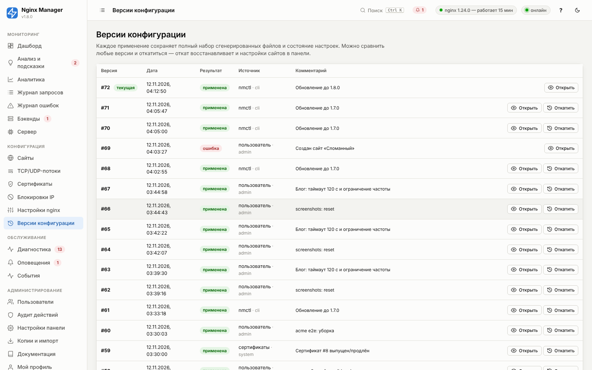
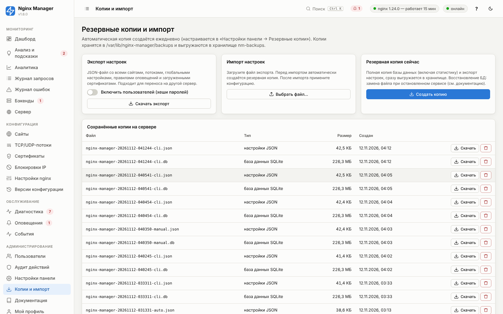
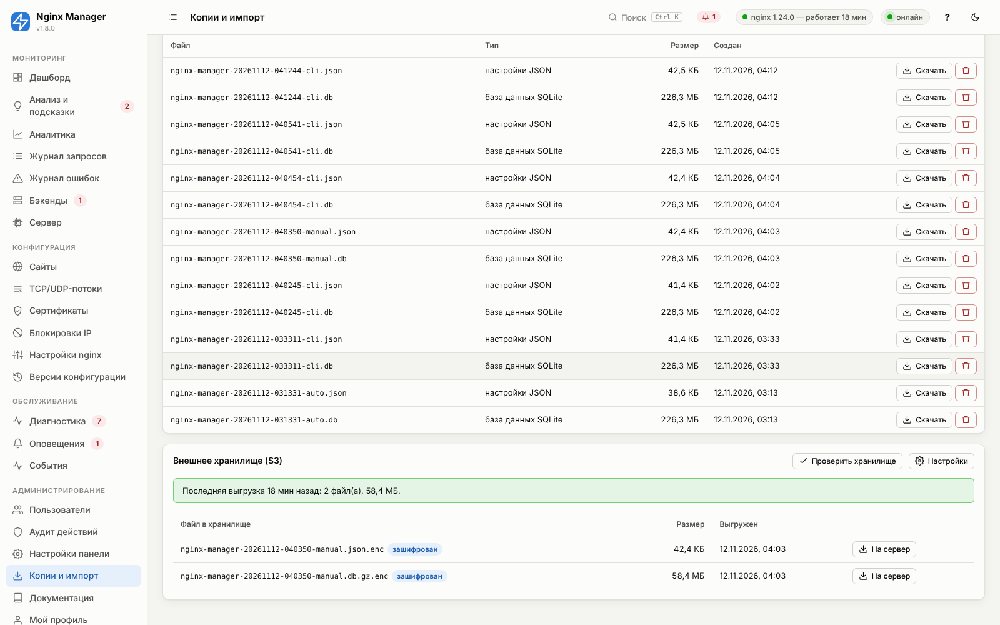

# 15. Версии конфигурации, резервные копии, перенос

## Версии конфигурации



Каждое применение (из панели, `nmctl`, API, автоматическое) создаёт версию, которая хранит:

- **все сгенерированные файлы** (nginx.conf, сайты, потоки, страницы ошибок, htpasswd);
- **снимок настроек** панели: сайты, потоки, глобальные параметры, ссылки на сертификаты;
- автора, источник (пользователь, nmctl, откат, автопереключение, сертификаты), комментарий;
- результат (`применена` / `ошибка`) и вывод nginx.

В окне версии доступны: изменения относительно предыдущей версии, отличия от текущей, просмотр и скачивание
каждого файла, вывод `nginx -t`.

**Откат** («Откатить») восстанавливает настройки сайтов, потоков и глобальные параметры версии в базе панели и
применяет их — создаётся новая версия «Откат к версии N». Сертификаты, пользователи и настройки панели при откате не
меняются. В консоли: `nmctl versions`, `nmctl rollback ID`.

На диске хранятся каталоги 10 последних версий (`/etc/nginx/nginx-manager/versions/`), в базе — 500 последних
записей.

## Резервные копии



| Вид | Создание | Содержимое |
|---|---|---|
| Автоматическая ежедневная | в заданный час (по умолчанию 03:00), хранится 14 штук | файл БД SQLite (включая статистику) + JSON-экспорт настроек с пользователями |
| Ручная | «Создать копию» в панели | то же |
| Из консоли | `nmctl backup` | то же |
| Перед импортом | автоматически | то же |
| Перед обновлением | `update.sh` | БД + архив кода предыдущей версии + копия nginx.conf |
| Финальная при удалении | `uninstall.sh` | архив данных, настроек и конфигурации в `/root` |

**Сколько хранится.** Ежедневные копии — «Хранить автоматических копий» (по умолчанию 14). Копии перед
обновлениями и из консоли (база, архив кода прежней версии, nginx.conf) — «Хранить копий перед обновлениями»
(по умолчанию 5 каждого вида). Лишние удаляются при каждом обновлении и ежедневном копировании. Ручные копии из
панели не удаляются никогда — удаляйте их кнопкой в разделе «Копии и импорт». Настройки — «Настройки панели →
Резервные копии».

Каталог: `/var/lib/nginx-manager/backups/` (права 700). Копии на том же сервере не переживут его потерю —
включите выгрузку во внешнее хранилище (ниже) или копируйте каталог своими средствами (`rsync`, система бэкапов).

## Выгрузка в S3-хранилище

**Настройки панели → «Резервные копии» → «Выгружать копии в S3-хранилище»**. Подходит любое хранилище с
S3 API: AWS S3, Yandex Object Storage, VK Cloud, Selectel, Cloudflare R2, Backblaze B2, MinIO, Ceph. Каждая
ежедневная и каждая ручная копия выгружается: база данных — сжатой gzip (обычно в 3–5 раз меньше), экспорт
настроек — как есть; с паролем шифрования оба файла шифруются (суффикс `.enc`). После выгрузки в хранилище остаётся
«Хранить копий в хранилище» последних копий (0 — не удалять, если хранение задано правилами бакета).



| Хранилище | Адрес (endpoint) | Регион | Адресация |
|---|---|---|---|
| AWS S3 | `https://s3.<регион>.amazonaws.com` | регион бакета, например `eu-central-1` | path-style или virtual-hosted |
| Yandex Object Storage | `https://storage.yandexcloud.net` | `ru-central1` | любая |
| Cloudflare R2 | `https://<ID аккаунта>.r2.cloudflarestorage.com` | `auto` | path-style |
| MinIO | `http(s)://адрес:9000` | `us-east-1` (если не задан свой) | path-style |
| VK Cloud, Selectel, B2 и другие | адрес S3 API из документации провайдера | регион из документации | обычно path-style |

Ключ доступа заведите отдельный, с правами только на этот бакет. Для AWS достаточно политики:

```json
{"Version": "2012-10-17", "Statement": [
  {"Effect": "Allow", "Action": ["s3:ListBucket"], "Resource": "arn:aws:s3:::backups-example"},
  {"Effect": "Allow", "Action": ["s3:PutObject", "s3:GetObject", "s3:DeleteObject"],
   "Resource": "arn:aws:s3:::backups-example/nginx-manager/*"}]}
```

На странице «Копии и импорт»:

- **«Проверить хранилище»** — запись, чтение списка и удаление маленького объекта; ошибка объясняется (403 — ключи
  или права, 404 — бакет или адресация, 301 — регион);
- список копий в хранилище и итог последней выгрузки;
- **«На сервер»** — скачать копию в каталог копий сервера: файл расшифровывается и база распаковывается, дальше —
  обычное восстановление (ниже). Для зашифрованных копий в настройках должен быть указан тот же пароль.

Неудачная выгрузка видна в «Диагностике» (группа «Резервные копии») и записывается в журнал «События» — включите
[уведомления о событиях](11-alerts.md#уведомления-о-событиях), чтобы узнать о ней сразу. Копия на сервере при
этом остаётся.

**Расшифровать вручную** (например, на другом сервере, где панели ещё нет):

```bash
openssl enc -d -aes-256-cbc -pbkdf2 -iter 200000 -salt \
  -in nginx-manager-20261112-030000-auto.db.gz.enc -out nginx-manager-20261112-030000-auto.db.gz   # спросит пароль
gunzip nginx-manager-20261112-030000-auto.db.gz
```

Подпись запросов (AWS Signature V4) панель считает сама, без сторонних библиотек; автотесты сверяют её с
эталонной реализацией botocore и прогоняют выгрузку, хранение и скачивание против эмулятора S3.

## Экспорт и импорт настроек

JSON-экспорт содержит сайты, потоки, глобальные настройки и настройки панели (с ключами S3 и EAB), правила и каналы оповещений,
учётные записи DNS-провайдеров, загруженные и самоподписанные сертификаты (с ключами), опционально — пользователей
(хеши паролей). Статистики в нём нет — это переносимое описание конфигурации. В файле есть секреты (токены каналов
и DNS-провайдеров, ключ EAB, закрытые ключи) — храните его как пароль.

Импорт в режиме «замена» удаляет текущие сайты, потоки, правила и каналы и создаёт их из файла **с прежними
номерами** — история статистики, ссылки правил оповещений на сайты, каналы регулярных отчётов и периоды тишины
остаются связанными. Режим «добавить» (`mode=merge` в API) создаёт объекты с новыми номерами и сам переносит на них
ссылки: правило оповещения по сайту — на новый номер сайта, каналы в правилах и в регулярных отчётах — на новые
каналы, сертификаты с DNS-проверкой — на новые номера учётных записей DNS. Сертификаты с тем же именем и типом не
дублируются. Пароли Basic Auth переносятся (в файле — хеши).
После импорта примените конфигурацию.

## Перенос на другой сервер

```bash
# старый сервер
nmctl export --users > /root/nm-export.json
# новый сервер (после install.sh)
nmctl import /root/nm-export.json
nmctl apply -m "Перенос с proxy-01"
```

Сертификаты Let's Encrypt (`/etc/letsencrypt`) переносятся отдельно или выпускаются заново после переключения DNS:

```bash
rsync -a old:/etc/letsencrypt/ /etc/letsencrypt/
```

Порядок переключения без простоя: перенос настроек → проверка нового сервера по IP через `/etc/hosts` на своей
машине → снижение TTL DNS заранее → переключение A-записей → выпуск/проверка сертификатов.

## Восстановление базы данных из копии

```bash
systemctl stop nginx-manager
cp /var/lib/nginx-manager/nginx-manager.db /root/nm-broken.db       # на всякий случай
cp /var/lib/nginx-manager/backups/nginx-manager-20260101-030000-auto.db /var/lib/nginx-manager/nginx-manager.db
rm -f /var/lib/nginx-manager/nginx-manager.db-wal /var/lib/nginx-manager/nginx-manager.db-shm
chmod 600 /var/lib/nginx-manager/nginx-manager.db
systemctl start nginx-manager
nmctl apply -m "Восстановление из копии"
```
