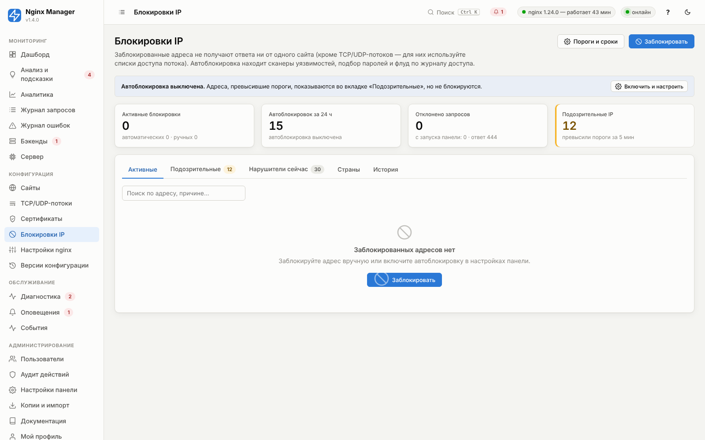
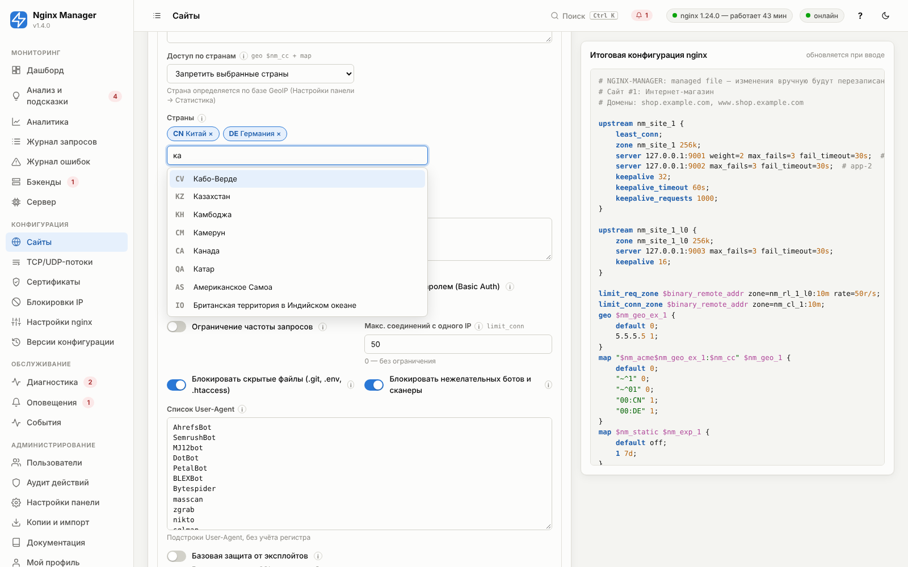
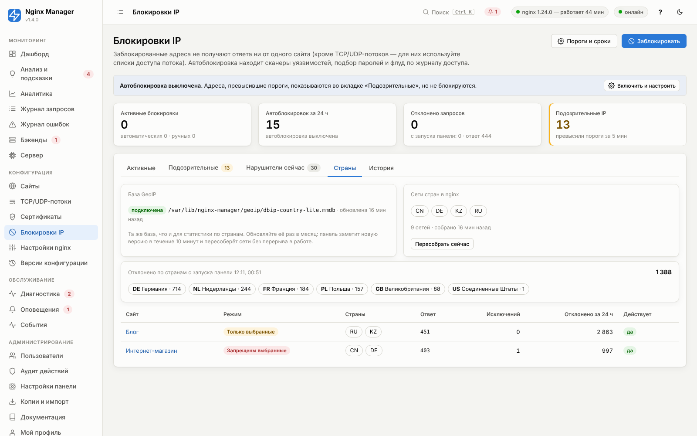

# 17. Блокировки IP и автоблокировка

Раздел **«Блокировки IP»** закрывает доступ ко всем сайтам для отдельных адресов и подсетей: вручную или
автоматически. Автоматическую блокировку можно сравнить с fail2ban: панель уже разбирает каждую строку журнала
доступа, поэтому замечает сканеры уязвимостей, подбор паролей и флуд и блокирует их на заданное время.



## Как это работает

```
журнал доступа ──► детектор (счётчики по IP за окно) ──► подозрительный IP ──► блокировка
                                                               │                  │
                                                     (автоблокировка выкл.)       ▼
                                                      только показывается   bans.conf → nginx -t → reload
```

1. Все блокировки хранятся в базе панели (таблица `bans`) и выгружаются в файл
   `/etc/nginx/nginx-manager/bans.conf` в формате модуля `geo`:

   ```nginx
   203.0.113.7 1;
   198.51.100.0/24 1;
   2001:db8:dead::/48 1;
   ```

2. На уровне `http` этот файл подключён в переменную `$nm_banned`, а каждый server-блок сайтов, переадресация
   HTTP→HTTPS и сервер по умолчанию начинаются с проверки:

   ```nginx
   geo $nm_banned {
       default 0;
       include /etc/nginx/nginx-manager/bans.conf;
   }

   server {
       server_name shop.example.com;
       set $nm_site "1";
       if ($nm_banned) {
           return 444;
       }
       ...
   }
   ```

   Запрос отклоняется **до** выбора location, проксирования, проверки пароля и записи в кэш: заблокированный адрес
   не создаёт нагрузки на приложение. `geo` проверяет адрес за постоянное время, даже если в списке десятки тысяч
   записей.

3. Изменение списка **не создаёт версию конфигурации** и не затрагивает неприменённые правки сайтов: панель
   записывает файл, выполняет `nginx -t` и мягко перезагружает nginx (`reload`). Изменения копятся и уходят в nginx
   не чаще одного раза в 5 секунд. Если nginx не принял файл, панель возвращает прежний, показывает ошибку на
   странице «Блокировки» и в «Событиях» и повторяет попытку.

4. Адрес клиента берётся из `$remote_addr`. Если сервер стоит за CDN или балансировщиком, настройте
   «Реальный IP клиента» в [глобальных настройках](08-global-settings.md), иначе блокировка сработает на адрес CDN.

5. В журнал доступа записывается признак `"bn":"1"` для отклонённых запросов. По нему считаются «Отклонено
   запросов» и счётчик срабатываний у каждой блокировки.

> TCP/UDP-потоки этим списком не защищаются. Для них используйте белый и чёрный списки в настройках потока
> ([06](06-streams.md)).

## Ручная блокировка

Кнопка **«Заблокировать»** на странице «Блокировки IP», в карточке запроса в «Журнале запросов» и в топе
IP-адресов в «Аналитике».

- Можно указать сразу много адресов: по одному в строке, через пробел или запятую. Поддерживаются IPv4, IPv6 и
  подсети CIDR (`/24`, `/64`). Подсети шире `/8` (IPv4) и `/16` (IPv6) не принимаются, чтобы случайно не
  заблокировать половину интернета.
- Срок: от 15 минут до бессрочной блокировки. Срок можно изменить в любой момент списком «Срок…» у записи.
- Свой собственный адрес (с которого открыта панель) заблокировать нельзя. Адреса из «Никогда не блокировать»
  и «Доступ к панели только с IP» блокируются только после явного подтверждения.
- Список активных блокировок можно выгрузить кнопкой «Экспорт списка» (по адресу в строке), а загрузить обратно,
  вставив его в окно блокировки.

Роли: просматривать могут все, блокировать и разблокировать — оператор и администратор, снимать все
автоматические блокировки разом — администратор. Все действия попадают в «Аудит действий».

## Автоматическая блокировка

Включается в **«Настройки панели → Блокировки IP»** (кнопка «Пороги и сроки» на странице блокировок). Пока
автоблокировка выключена, детектор всё равно работает: адреса, превысившие пороги, видны во вкладке
«Подозрительные», и их можно заблокировать одной кнопкой. Это удобный способ сначала понаблюдать, кого бы
заблокировали текущие пороги.

Для каждого IP считается, сколько запросов каждого вида было в **окне подсчёта** (по умолчанию 5 минут; окно
начинается с первого запроса адреса). Достаточно превысить **любой** порог:

| Правило | Что считается | По умолчанию | Кого ловит |
|---|---|---|---|
| **Поиск уязвимостей** | Запросы к служебным файлам и известным путям сканеров (см. ниже) | 5 | Сканеры уязвимостей, ботнеты, ищущие `.env` и phpMyAdmin |
| **Подбор пароля (401)** | Ответы 401 | 30 | Перебор паролей Basic Auth и API |
| **Обращения по IP / к чужим доменам** | Запросы, попавшие на сервер по умолчанию | 30 | Сканеры, обходящие интернет по IP-адресам |
| **Много ошибок 4xx** | Ответы 4xx и 444 | 300 | Перебор адресов, парсеры, «сломанные» клиенты |
| **Слишком много запросов** | Все запросы | выкл. (0) | Грубый флуд с одного адреса |

Нулевой порог выключает правило. Повторно в одном окне адрес не помечается.

**Зондирование уязвимостей** — запросы, которые обычный посетитель не делает (проверяется `$request_uri` в нижнем
регистре, в том числе URL-кодированные варианты):

- служебные файлы: `/.env`, `/.git/`, `/.svn`, `/.htaccess`, `/.htpasswd`, `/.aws/`, `/.ssh/`, `/.DS_Store`,
  `/.vscode/`, `/.idea/`, `.bash_history`;
- утечки конфигурации: `wp-config.php`, `phpinfo.php`, `web.config`, `server-status`, резервные копии
  `*.sql`, `*.bak`, `*.old`, `*.swp`;
- панели и известные уязвимые пути: `phpmyadmin`, `pma`, `adminer`, `cgi-bin/`, `vendor/phpunit`, `boaform`,
  `HNAP1`, `actuator/`, `solr/admin`, `jmx-console`, `manager/html`, `owa/auth`, `_ignition/`,
  `telescope/requests`;
- атаки в адресе: обход каталогов (`../`, `%2e%2e`), `/etc/passwd`, SQL-инъекции (`union select`,
  `information_schema`, `sleep(`, `benchmark(`), XSS (`<script`, `javascript:`), Log4Shell (`${jndi:`).

`/wp-login.php` и `/xmlrpc.php` в список не входят — это обычные адреса WordPress. Защищайте их ограничением
частоты в локации ([05](05-sites.md), вкладка «Безопасность»): при превышении лимита посетитель получает 429,
а сотни 429 подряд сработают по правилу «Много ошибок 4xx».

### Срок и повторные нарушители

Автоматическая блокировка длится «Срок блокировки» (по умолчанию 60 минут). С включённым «Увеличивать срок
для повторных нарушителей» каждое следующее нарушение в течение 30 дней умножает срок на 4:
60 мин → 4 ч → 16 ч → 64 ч → … до 30 суток. История нарушений хранится 30 дней после последнего.

### Исключения

- `127.0.0.0/8`, `::1` и адреса из «Доступ к панели только с IP» не блокируются автоматически никогда.
- «Никогда не блокировать» — ваши офисы, системы мониторинга (Zabbix, UptimeRobot), партнёрские интеграции,
  собственные серверы, обращающиеся к API.
- «Не блокировать поисковых ботов за 4xx и частоту» — Googlebot, YandexBot, Bingbot и другие (по
  User-Agent) не блокируются за массовые 404 и частоту. За зондирование уязвимостей блокируются все: настоящие
  поисковые боты таких запросов не делают, а User-Agent подделать легко.
- Запросы к домену самой панели в подсчёте не участвуют, чтобы администратор не заблокировал себя, пока
  истекшая сессия повторяет запросы с ответом 401.

## Доступ по странам

Кроме отдельных адресов, доступ к сайту можно ограничить по **стране клиента**. Настраивается в карточке сайта:
вкладка **«Безопасность» → «Доступ по странам»**; общая картина — на вкладке **«Страны»** раздела «Блокировки IP».



| Параметр | Варианты и смысл |
|---|---|
| Доступ по странам | **Без ограничений**; **Запретить выбранные страны** — заблокированы только перечисленные; **Разрешить только выбранные** — все остальные получают отказ |
| Страны | Коды ISO 3166-1 (RU, KZ, DE…). Ищите по названию или коду; кнопка «Добавить Евросоюз» добавляет 27 стран ЕС |
| Пускать локальные сети | Только для «Разрешить только выбранные»: адреса 10.0.0.0/8, 172.16.0.0/12, 192.168.0.0/16, 127.0.0.0/8, 100.64.0.0/10, fc00::/7 проходят всегда (у них нет страны) |
| Исключения | IP и подсети, которые пропускаются при любой стране: офис за границей, внешний мониторинг, платёжные шлюзы, вебхуки партнёров |
| Ответ заблокированным | **403** — обычный отказ; **444** — закрыть соединение без ответа; **451** — «недоступно по юридическим причинам» |

### Как это устроено

nginx без стороннего модуля не умеет читать базы GeoIP (`.mmdb`), поэтому панель делает это сама:

```
база GeoIP (mmdb) ──► панель выбирает сети нужных стран ──► geo-countries.conf ──► geo $nm_cc ──► map ──► if
                       и объединяет соседние подсети
```

1. Используется та же база, что и для статистики по странам ([09](09-monitoring.md)): GeoLite2-Country (MaxMind)
   или dbip-country-lite (DB-IP) в каталоге `/var/lib/nginx-manager/geoip/` или по пути из настроек панели.
   Нужен пакет `maxminddb` версии 2.4 и новее (`sudo ./update.sh --with-geoip`).
2. При применении конфигурации панель выбирает из базы сети **только тех стран, что упомянуты в правилах**, и
   пишет файл `/etc/nginx/nginx-manager/geo-countries.conf`. Частным сетям присваивается метка `LAN`:

   ```nginx
   # nm-geo db=/var/lib/nginx-manager/geoip/dbip-country-lite.mmdb mtime=1731400000 countries=CN,DE nets=10312
   10.0.0.0/8 LAN;
   1.0.1.0/24 CN;
   2.16.0.0/13 DE;
   ```

   Даже для крупных стран это десятки тысяч строк: сборка занимает 1–2 секунды, а `geo` проверяет адрес за
   постоянное время.
3. В конфигурации:

   ```nginx
   # http — один раз
   geo $nm_cc { default --; include /etc/nginx/nginx-manager/geo-countries.conf; }
   map $uri $nm_acme { default 0; "~^/\.well-known/acme-challenge/" 1; }

   # файл сайта (режим «Запретить выбранные», есть исключения)
   geo $nm_geo_ex_1 { default 0; 198.51.100.0/24 1; }
   map "$nm_acme$nm_geo_ex_1:$nm_cc" $nm_geo_1 {
       default 0;
       "~^1" 0;        # проверки Let's Encrypt
       "~^01" 0;       # исключения по IP
       "00:CN" 1;
       "00:KP" 1;
   }
   server {
       ...
       if ($nm_banned) { return 444; }
       if ($nm_geo_1) { return 403; }
   ```

   В режиме «Разрешить только выбранные» значение по умолчанию — 1 (отказ), а выбранные страны и `LAN` — 0.
4. **Проверки Let's Encrypt не ограничиваются никогда**: серверы проверки находятся в разных странах, и иначе
   сертификат не выпустится и не продлится.
5. Запросы, отклонённые по стране, отмечаются в журнале доступа признаком `"gb":"1"`. Они не считаются
   нарушениями для автоблокировки и не учитываются в сценарии анализа «Высокая доля 4xx», но видны на вкладке
   «Страны» (по странам и сайтам) и в метрике Prometheus `nm_http_geo_blocked_requests_total{site}`.
6. Панель раз в 10 минут проверяет базу: если вы положили новую версию, она перечитывается, сети пересобираются
   и nginx мягко перезагружается — без версии конфигурации и без перерыва в работе.



### Если базы GeoIP нет

Правила сохраняются, но **не действуют**: панель предупреждает при применении («доступ по странам не
действует — нет базы GeoIP»), диагностика показывает ошибку «Доступ по странам», а анализ — критичную находку
«Ограничение по странам не действует». Так сделано намеренно: без базы режим «Разрешить только выбранные»
закрыл бы сайт для всех.

### Рекомендации

| Задача | Как настроить |
|---|---|
| Отсечь страны, откуда идут атаки и спам | «Запретить выбранные», ответ 444 |
| Сервис для одной-двух стран (госуслуги региона, локальный магазин, внутренний портал) | «Разрешить только выбранные», включите «Пускать локальные сети», добавьте в исключения адреса мониторинга и платёжных систем |
| Сайт за Cloudflare или другим CDN | Сначала настройте «Реальный IP клиента» ([08](08-global-settings.md)) — иначе страной будет страна узла CDN |
| Требование закона о недоступности сайта в стране | «Запретить выбранные», ответ 451 |

Ограничение по странам не заменяет защиту от целевых атак: VPN и прокси в «разрешённой» стране его обходят. Точность
бесплатных баз — около 99% на уровне страны; обновляйте базу раз в месяц (geoipupdate или скачивание dbip-country-lite).

Если после включения режима «Разрешить только выбранные» отклоняется больше 20% запросов к сайту, анализ покажет
находку «Много запросов отклоняется по странам» — проверьте, не отсекаете ли вы своих пользователей.

## Рекомендуемые настройки

| Сценарий | Рекомендация |
|---|---|
| Первое включение | Неделю понаблюдайте за вкладкой «Подозрительные» с выключенной автоблокировкой; добавьте в исключения свои адреса, которые туда попадают. |
| Публичные сайты и магазины | Поиск уязвимостей 5, 401 — 30, по IP — 30, 4xx — 300, срок 60 мин с увеличением. Подходит большинству. |
| API для мобильных приложений | Поднимите порог 4xx до 1000 (клиенты за NAT операторов делят один адрес), а флуд ограничивайте `limit_req`. |
| Сайт за Cloudflare | Обязательно настройте «Реальный IP клиента». Иначе вы заблокируете адреса Cloudflare. |
| Атака прямо сейчас | Найдите адреса в «Аналитике → Топы → IP-адреса» или «Нарушители сейчас», заблокируйте пачкой на сутки. Для атак с тысяч адресов используйте ограничение частоты и CDN. |

## Ответ заблокированным

«Настройки панели → Блокировки IP → Ответ заблокированным» (вступает в силу после «Применить»):

| Вариант | Поведение | Когда выбирать |
|---|---|---|
| **444** (по умолчанию) | Соединение закрывается без ответа | Сканеры и боты: им не за что зацепиться, минимум трафика |
| **403** | Обычная страница «Доступ запрещён» | Если среди заблокированных могут оказаться люди и им нужно понимать, что произошло |
| **429** | «Слишком много запросов» | Для клиентов API, которые умеют повторять запрос позже |

## Где ещё видны блокировки

- **События** и вкладка «История»: каждая автоматическая блокировка, разблокировка, ошибки обновления списка.
- **Оповещения**: метрика «Автоблокировок IP за окно» (`autobans`). Например, правило «больше 20 за 10 минут»
  сообщит о начале массового сканирования.
- **Метрики Prometheus**: `nm_bans_active{source}`, `nm_bans_suspicious`, `nm_http_banned_requests_total{site}`,
  `nm_http_geo_blocked_requests_total{site}` ([09](09-monitoring.md#метрики-prometheus)).
- **REST API**: `GET /api/bans`, `POST /api/bans`, `DELETE /api/bans/{id}`, `POST /api/bans/clear`,
  `GET /api/geo`, `POST /api/geo/rebuild` ([14](14-cli-api.md)).

## Частые вопросы

**Я заблокировал нужный адрес — как вернуть доступ?** «Блокировки IP» → «Разблокировать». Если доступа к панели
нет, удалите строку из `/etc/nginx/nginx-manager/bans.conf` и выполните `nginx -s reload`. Панель восстановит
файл из базы при следующем изменении, поэтому снимите блокировку и в панели, когда доступ вернётся.

**Блокировка добавлена, но запросы проходят.** Проверьте, что конфигурация применялась после обновления панели
до версии 1.1 (в файлах сайтов должна быть строка `if ($nm_banned)`), и что «Реальный IP клиента» настроен,
если перед сервером есть прокси или CDN. Ошибка обновления списка показывается вверху страницы «Блокировки».

**Пользователь из разрешённой страны получает отказ.** Узнайте его IP и страну в «Журнале запросов» (колонка
«Клиент»). Частые причины: VPN или корпоративный прокси в другой стране, роуминг, сайт за CDN без настройки
реального IP, устаревшая база GeoIP. Добавьте адрес в исключения или обновите базу.

**Сколько адресов можно заблокировать?** Десятки тысяч: `geo` хранит их в радикс-дереве, проверка не замедляется.
Перезагрузка nginx с очень большим списком занимает немного больше времени, но выполняется без разрыва
соединений.
