# 17. Блокировки IP и автоблокировка

Раздел **«Блокировки IP»** закрывает доступ ко всем сайтам для отдельных адресов и подсетей: вручную или
автоматически. Автоматическую блокировку можно сравнить с fail2ban: панель уже разбирает каждую строку журнала
доступа, поэтому замечает сканеры уязвимостей, подбор паролей и флуд и блокирует их на заданное время.

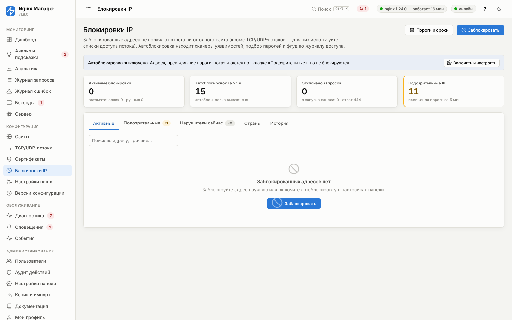

## Как это работает

```
журнал доступа ──► детектор (счётчики по IP за окно) ──► подозрительный IP ──► блокировка
                                                               │                  │
                                                     (автоблокировка выкл.)       ▼
                                                      только показывается   bans.conf → nginx -t → reload
```

1. Все блокировки хранятся в базе панели (таблица `bans`) и выгружаются в файл
   `/etc/nginx/nginx-manager/bans.conf` в формате модуля `geo`:

   ```nginx
   203.0.113.7 1;
   198.51.100.0/24 1;
   2001:db8:dead::/48 1;
   ```

2. На уровне `http` этот файл подключён в переменную `$nm_banned`, а каждый server-блок сайтов, переадресация
   HTTP→HTTPS и сервер по умолчанию начинаются с проверки:

   ```nginx
   geo $nm_banned {
       default 0;
       include /etc/nginx/nginx-manager/bans.conf;
   }

   server {
       server_name shop.example.com;
       set $nm_site "1";
       if ($nm_banned) {
           return 444;
       }
       ...
   }
   ```

   Запрос отклоняется **до** выбора location, проксирования, проверки пароля и записи в кэш: заблокированный адрес
   не создаёт нагрузки на приложение. `geo` проверяет адрес за постоянное время, даже если в списке десятки тысяч
   записей.

3. Изменение списка **не создаёт версию конфигурации** и не затрагивает неприменённые правки сайтов: панель
   записывает файл, выполняет `nginx -t` и мягко перезагружает nginx (`reload`). Изменения копятся и уходят в nginx
   не чаще одного раза в 5 секунд. Если nginx не принял файл, панель возвращает прежний, показывает ошибку на
   странице «Блокировки» и в «Событиях» и повторяет попытку.

4. Адрес клиента берётся из `$remote_addr`. Если сервер стоит за CDN или балансировщиком, настройте
   «Реальный IP клиента» в [глобальных настройках](08-global-settings.md), иначе блокировка сработает на адрес CDN.

5. В журнал доступа записывается признак `"bn":"1"` для отклонённых запросов. По нему считаются «Отклонено
   запросов» и счётчик срабатываний у каждой блокировки.

> TCP/UDP-потоки этим списком не защищаются. Для них используйте белый и чёрный списки в настройках потока
> ([06](06-streams.md)).

## Ручная блокировка

Кнопка **«Заблокировать»** на странице «Блокировки IP», в карточке запроса в «Журнале запросов» и в топе
IP-адресов в «Аналитике».

- Можно указать сразу много адресов: по одному в строке, через пробел или запятую. Поддерживаются IPv4, IPv6 и
  подсети CIDR (`/24`, `/64`). Подсети шире `/8` (IPv4) и `/16` (IPv6) не принимаются, чтобы случайно не
  заблокировать половину интернета.
- Срок: от 15 минут до бессрочной блокировки. Срок можно изменить в любой момент списком «Срок…» у записи.
- Свой собственный адрес (с которого открыта панель) заблокировать нельзя, как и [доверенные
  адреса](#доверенные-адреса). Адреса из «Доступ к панели только с IP» блокируются только после явного
  подтверждения.
- Список активных блокировок можно выгрузить кнопкой «Экспорт списка» (по адресу в строке), а загрузить обратно,
  вставив его в окно блокировки.

Роли: просматривать могут все, блокировать и разблокировать — оператор и администратор, снимать все
автоматические блокировки разом — администратор. Все действия попадают в «Аудит действий».

## Автоматическая блокировка

Включается в **«Настройки панели → Блокировки IP»** (кнопка «Пороги и сроки» на странице блокировок). Пока
автоблокировка выключена, детектор всё равно работает: адреса, превысившие пороги, видны во вкладке
«Подозрительные», и их можно заблокировать одной кнопкой. Это удобный способ сначала понаблюдать, кого бы
заблокировали текущие пороги.

Для каждого IP считается, сколько запросов каждого вида было в **окне подсчёта** (по умолчанию 5 минут; окно
начинается с первого запроса адреса). Достаточно превысить **любой** порог:

| Правило | Что считается | По умолчанию | Кого ловит |
|---|---|---|---|
| **Поиск уязвимостей** | Запросы к служебным файлам и известным путям сканеров (см. ниже) | 5 | Сканеры уязвимостей, ботнеты, ищущие `.env` и phpMyAdmin |
| **Подбор пароля (401)** | Ответы 401 | 30 | Перебор паролей Basic Auth и API |
| **Обращения по IP / к чужим доменам** | Запросы, попавшие на сервер по умолчанию | 30 | Сканеры, обходящие интернет по IP-адресам |
| **Много ошибок 4xx** | Ответы 4xx и 444 | 300 | Перебор адресов, парсеры, «сломанные» клиенты |
| **Слишком много запросов** | Все запросы | выкл. (0) | Грубый флуд с одного адреса |
| **Атаки (фильтр запросов, ModSecurity)** | Срабатывания фильтра запросов и глубокой проверки в режимах «блокировать» и «запись» | 5 | Автоматические сканеры и эксплойты ([19](19-protection.md#автоматика-и-ловушки)) |
| **Ловушка для сканеров** | Обращение к пути-ловушке | 1 (сразу) | Сканеры, перебирающие `/.git/config`, `/.aws/credentials`, пути из robots.txt |

Нулевой порог выключает правило. Повторно в одном окне адрес не помечается. Порог «Атаки» и пути и срок ловушек
задаются на странице «Защита от атак» → «Автоматика и ловушки»; ловушки блокируют адрес даже при выключенной
автоблокировке (на сайтах, где они включены).

**Зондирование уязвимостей** — запросы, которые обычный посетитель не делает (проверяется `$request_uri` в нижнем
регистре, в том числе URL-кодированные варианты):

- служебные файлы: `/.env`, `/.git/`, `/.svn`, `/.htaccess`, `/.htpasswd`, `/.aws/`, `/.ssh/`, `/.DS_Store`,
  `/.vscode/`, `/.idea/`, `.bash_history`;
- утечки конфигурации: `wp-config.php`, `phpinfo.php`, `web.config`, `server-status`, резервные копии
  `*.sql`, `*.bak`, `*.old`, `*.swp`;
- панели и известные уязвимые пути: `phpmyadmin`, `pma`, `adminer`, `cgi-bin/`, `vendor/phpunit`, `boaform`,
  `HNAP1`, `actuator/`, `solr/admin`, `jmx-console`, `manager/html`, `owa/auth`, `_ignition/`,
  `telescope/requests`;
- атаки в адресе: обход каталогов (`../`, `%2e%2e`), `/etc/passwd`, SQL-инъекции (`union select`,
  `information_schema`, `sleep(`, `benchmark(`), XSS (`<script`, `javascript:`), Log4Shell (`${jndi:`).

`/wp-login.php` и `/xmlrpc.php` в список не входят — это обычные адреса WordPress. Защищайте их ограничением
частоты в локации ([05](05-sites.md), вкладка «Безопасность»): при превышении лимита посетитель получает 429,
а сотни 429 подряд сработают по правилу «Много ошибок 4xx».

### Срок и повторные нарушители

Автоматическая блокировка длится «Срок блокировки» (по умолчанию 60 минут). С включённым «Увеличивать срок
для повторных нарушителей» каждое следующее нарушение в течение 30 дней умножает срок на 4:
60 мин → 4 ч → 16 ч → 64 ч → … до 30 суток. История нарушений хранится 30 дней после последнего.

### Исключения

- `127.0.0.0/8`, `::1` и адреса из «Доступ к панели только с IP» не блокируются автоматически никогда.
- [Доверенные адреса](#доверенные-адреса) — ваши офисы, системы мониторинга (Zabbix, UptimeRobot), партнёрские
  интеграции, собственные серверы, обращающиеся к API: не блокируются ни автоматически, ни вручную.
- «Не блокировать поисковых ботов за 4xx и частоту» — Googlebot, YandexBot, Bingbot и другие (по
  User-Agent) не блокируются за массовые 404 и частоту. За зондирование уязвимостей блокируются все: настоящие
  поисковые боты таких запросов не делают, а User-Agent подделать легко.
- Запросы к домену самой панели в подсчёте не участвуют, чтобы администратор не заблокировал себя, пока
  истекшая сессия повторяет запросы с ответом 401.

## Доступ по странам

Кроме отдельных адресов, доступ к сайту можно ограничить по **стране клиента**. Настраивается в карточке сайта:
вкладка **«Безопасность» → «Доступ по странам»**; общая картина — на вкладке **«Страны»** раздела «Блокировки IP».

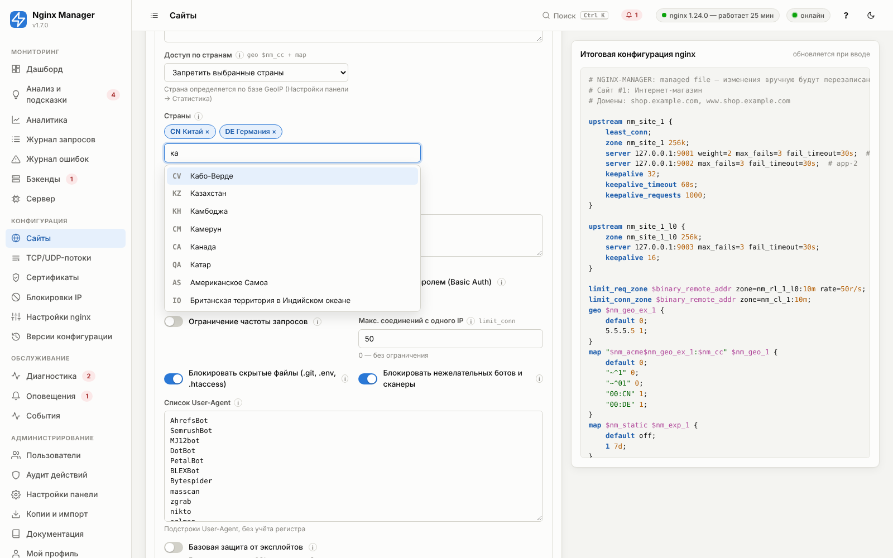

| Параметр | Варианты и смысл |
|---|---|
| Доступ по странам | **Без ограничений**; **Запретить выбранные страны** — заблокированы только перечисленные; **Разрешить только выбранные** — все остальные получают отказ |
| Страны | Коды ISO 3166-1 (RU, KZ, DE…). Ищите по названию или коду; кнопка «Добавить Евросоюз» добавляет 27 стран ЕС |
| Пускать локальные сети | Только для «Разрешить только выбранные»: адреса 10.0.0.0/8, 172.16.0.0/12, 192.168.0.0/16, 127.0.0.0/8, 100.64.0.0/10, fc00::/7 проходят всегда (у них нет страны) |
| Исключения | IP и подсети, которые пропускаются при любой стране: офис за границей, внешний мониторинг, платёжные шлюзы, вебхуки партнёров |
| Ответ заблокированным | **403** — обычный отказ; **444** — закрыть соединение без ответа; **451** — «недоступно по юридическим причинам» |

### Как это устроено

nginx без стороннего модуля не умеет читать базы GeoIP (`.mmdb`), поэтому панель делает это сама:

```
база GeoIP (mmdb) ──► панель выбирает сети нужных стран ──► geo-countries.conf ──► geo $nm_cc ──► map ──► if
                       и объединяет соседние подсети
```

1. Используется та же база, что и для статистики по странам ([09](09-monitoring.md)): GeoLite2-Country (MaxMind)
   или dbip-country-lite (DB-IP) в каталоге `/var/lib/nginx-manager/geoip/` или по пути из настроек панели.
   Нужен пакет `maxminddb` версии 2.4 и новее (`sudo ./update.sh --with-geoip`).
2. При применении конфигурации панель выбирает из базы сети **только тех стран, что упомянуты в правилах**, и
   пишет файл `/etc/nginx/nginx-manager/geo-countries.conf`. Частным сетям присваивается метка `LAN`:

   ```nginx
   # nm-geo db=/var/lib/nginx-manager/geoip/dbip-country-lite.mmdb mtime=1731400000 countries=CN,DE nets=10312
   10.0.0.0/8 LAN;
   1.0.1.0/24 CN;
   2.16.0.0/13 DE;
   ```

   Даже для крупных стран это десятки тысяч строк: сборка занимает 1–2 секунды, а `geo` проверяет адрес за
   постоянное время.
3. В конфигурации:

   ```nginx
   # http — один раз
   geo $nm_cc { default --; include /etc/nginx/nginx-manager/geo-countries.conf; }
   map $uri $nm_acme { default 0; "~^/\.well-known/acme-challenge/" 1; }

   # файл сайта (режим «Запретить выбранные», есть исключения)
   geo $nm_geo_ex_1 { default 0; 198.51.100.0/24 1; }
   map "$nm_acme$nm_geo_ex_1:$nm_cc" $nm_geo_1 {
       default 0;
       "~^1" 0;        # проверки Let's Encrypt
       "~^01" 0;       # исключения по IP
       "00:CN" 1;
       "00:KP" 1;
   }
   server {
       ...
       if ($nm_banned) { return 444; }
       if ($nm_geo_1) { return 403; }
   ```

   В режиме «Разрешить только выбранные» значение по умолчанию — 1 (отказ), а выбранные страны и `LAN` — 0.
4. **Проверки Let's Encrypt не ограничиваются никогда**: серверы проверки находятся в разных странах, и иначе
   сертификат не выпустится и не продлится.
5. Запросы, отклонённые по стране, отмечаются в журнале доступа признаком `"gb":"1"`. Они не считаются
   нарушениями для автоблокировки и не учитываются в сценарии анализа «Высокая доля 4xx», но видны на вкладке
   «Страны» (по странам и сайтам) и в метрике Prometheus `nm_http_geo_blocked_requests_total{site}`.
6. Панель раз в 10 минут проверяет базу: если вы положили новую версию, она перечитывается, сети пересобираются
   и nginx мягко перезагружается — без версии конфигурации и без перерыва в работе.

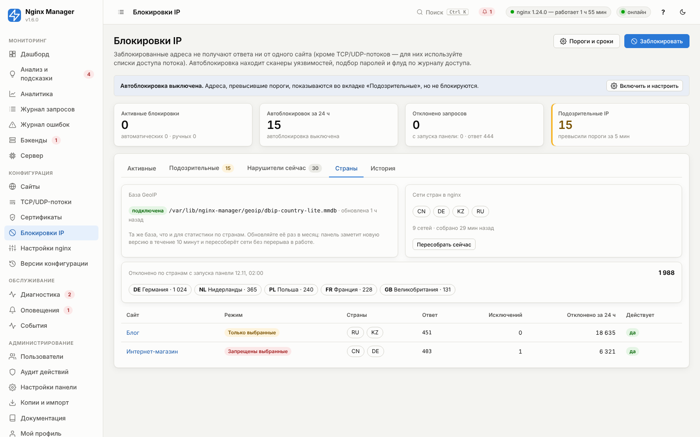

### Если базы GeoIP нет

Правила сохраняются, но **не действуют**: панель предупреждает при применении («доступ по странам не
действует — нет базы GeoIP»), диагностика показывает ошибку «Доступ по странам», а анализ — критичную находку
«Ограничение по странам не действует». Так сделано намеренно: без базы режим «Разрешить только выбранные»
закрыл бы сайт для всех.

### Рекомендации

| Задача | Как настроить |
|---|---|
| Отсечь страны, откуда идут атаки и спам | «Запретить выбранные», ответ 444 |
| Сервис для одной-двух стран (госуслуги региона, локальный магазин, внутренний портал) | «Разрешить только выбранные», включите «Пускать локальные сети», добавьте в исключения адреса мониторинга и платёжных систем |
| Сайт за Cloudflare или другим CDN | Сначала настройте «Реальный IP клиента» ([08](08-global-settings.md)) — иначе страной будет страна узла CDN |
| Требование закона о недоступности сайта в стране | «Запретить выбранные», ответ 451 |

Ограничение по странам не заменяет защиту от целевых атак: VPN и прокси в «разрешённой» стране его обходят. Точность
бесплатных баз — около 99% на уровне страны; обновляйте базу раз в месяц (geoipupdate или скачивание dbip-country-lite).

Если после включения режима «Разрешить только выбранные» отклоняется больше 20% запросов к сайту, анализ покажет
находку «Много запросов отклоняется по странам» — проверьте, не отсекаете ли вы своих пользователей.

## Базы GeoIP и их обновление

Панель сама скачивает и раз в месяц обновляет бесплатные базы **DB-IP Lite** (лицензия CC BY 4.0) — страны
(`dbip-country-lite.mmdb`) и сети провайдеров, автономные системы (`dbip-asn-lite.mmdb`), — с download.db-ip.com, а
если сайт недоступен, из зеркала sapics/ip-location-db на GitHub. Новая база проверяется (открывается, отвечает на
запрос, для ASN — есть номера автономных систем) и заменяет старую атомарно; повреждённая загрузка рабочую базу не
трогает. Повтор после ошибки — через 6 часов. Выключается настройкой «Скачивать и обновлять бесплатные базы DB-IP
Lite» («Настройки панели → Статистика и хранение»). База из «Путь к базе GeoIP» / «Путь к базе ASN» и GeoLite2
(MaxMind) в каталоге остаются важнее.

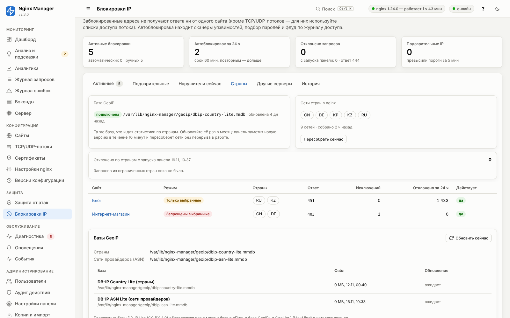

Сети провайдеров нужны для аналитики атак по сетям, колонки «Сеть» у атакующих адресов, профиля адреса и своих
правил «Сеть провайдера (ASN)» ([глава 19](19-protection.md#свои-правила)). Состояние баз и кнопка «Обновить сейчас»
— на вкладке «Страны» этой страницы.

## Доверенные адреса

Раздел **«Защита → Доверенные адреса»** — общий список IP-адресов и подсетей, которые панель **никогда не
блокирует**: ваши офисы и VPN, мониторинг, платёжные шлюзы и партнёрские серверы.

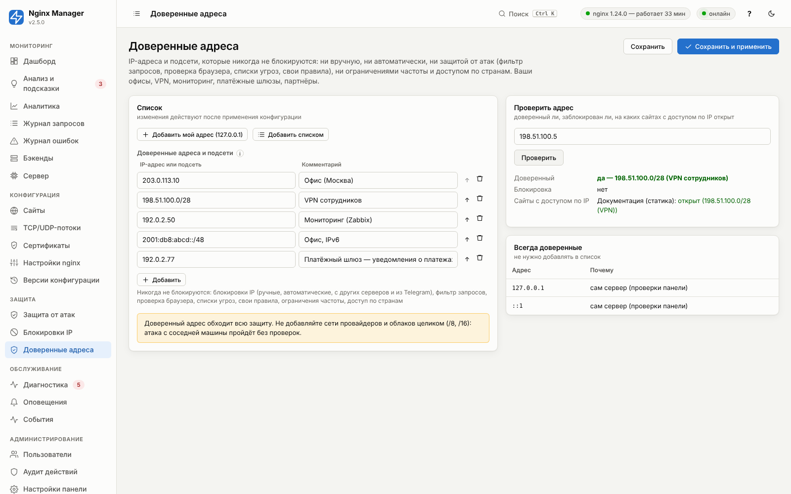

Что значит «никогда не блокировать»:

| Механизм | Что происходит с доверенным адресом |
|---|---|
| Блокировки IP | Не блокируется ни вручную (кнопка, API, `/ban` в Telegram — отказ с объяснением), ни автоматически, ни блокировками с других серверов. Если адрес входит в заблокированную подсеть, он остаётся открытым: в файле блокировок он записан отдельной строкой «не блокировать», а nginx выбирает самую точную подсеть |
| Уже действующие блокировки | При сохранении списка блокировки адресов, вошедших в него, снимаются |
| Защита от атак | Без проверок: фильтр запросов, проверка браузера и «Под атакой», списки угроз, свои правила, ModSecurity, ловушки |
| Ограничения частоты | Не считаются ни в ограничениях сайта (`limit_req`, `limit_conn`), ни в правилах ограничения частоты защиты |
| Доступ по странам | Пускаются при любых настройках стран |
| Доступ по IP (у сайта) | Пускаются, если у сайта включено «Пускать доверенные адреса» (по умолчанию включено) |
| AbuseIPDB, события | Жалобы не отправляются, событие «Активный атакующий» не создаётся |

Всегда доверенные (без записи в список): сам сервер — `127.0.0.1` и `::1` — и адреса из «Настройки панели →
Безопасность → Доступ к панели только с IP».

**Как пользоваться.** «Добавить мой адрес» вносит адрес, с которого вы сейчас работаете; «Добавить списком» — по
строке на адрес, после адреса через пробел или `#` — комментарий; «Из файла…» в том же окне находит адреса в любом
текстовом файле (список, CSV, JSON, выгрузка из другой системы). Поле «Проверить адрес» показывает, доверенный ли
адрес (и какой записью), заблокирован ли он сейчас и на каких сайтах с доступом по IP он открыт. Изменения вступают в
силу после применения конфигурации («Сохранить и применить»): доверенные адреса участвуют в картах nginx.

> **Осторожно с широкими подсетями.** Доверенный адрес обходит всю защиту. Не добавляйте сети провайдеров и облаков
> целиком (`/8`, `/16`): атака с соседней машины в той же сети пройдёт без проверок. Подсеть `0.0.0.0/0` панель не
> примет.

**Временные записи.** Колонка «Действует до» задаёт срок записи («на 8 часов», «на неделю»…): по истечении панель
сама удаляет запись и переприменяет последнюю применённую конфигурацию — так же, как временный доступ к сайту
([«Доступ по IP → Временный доступ»](05-sites.md#временный-доступ)).

**Полученные с других серверов.** Если серверы связаны (раздел [«Несколько серверов»](#несколько-серверов)), их
доверенные адреса действуют и здесь — карточка «Получены с других серверов» показывает адрес, сервер и время
последней сверки. Изменить или удалить такую запись можно только на сервере-источнике; проверка адреса и отказ в
блокировке называют сервер («с сервера «web-2»»). Своя запись того же адреса важнее полученной.

Прежние списки «Никогда не блокировать» (настройки блокировок) и «Доверенные IP» (защита от атак) при обновлении
переносятся сюда автоматически, с комментарием, откуда взят адрес. Доверенные адреса отдельного сайта (вкладка
«Защита от атак» сайта) остаются в настройках сайта — они действуют только на нём.

## Несколько серверов

Если сайты обслуживают несколько серверов с Nginx Manager (например, за балансировщиком или в разных странах),
блокировки IP можно сделать общими: адрес, заблокированный вручную или автоматически на любом сервере, за минуту
блокируется на всех.

**Как настроить.** На каждом сервере в «Мой профиль → API-токены» создайте токен с ролью «оператор» (или
«администратор», если сервер должен принимать и настройки защиты). Затем в «Настройки панели → Другие серверы»
добавьте остальные серверы: название, адрес панели (`https://203.0.113.20:8088`), токен того сервера. Задайте «Имя
этого сервера для других» — им подписываются блокировки. Для панели с самоподписанным сертификатом выключите
«Проверять сертификат HTTPS других серверов».

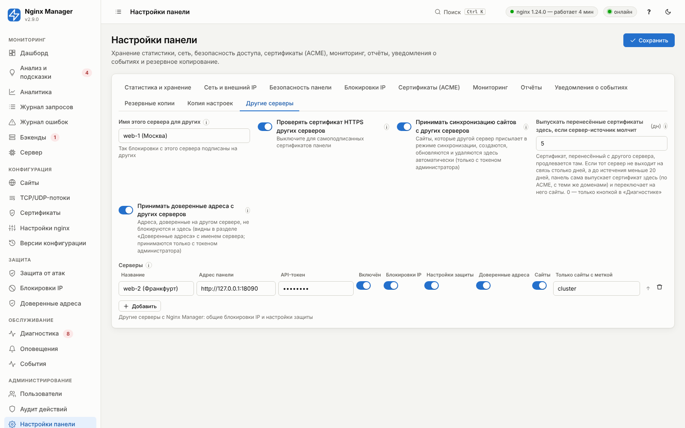

**Как работает.** Каждый сервер раз в минуту и через несколько секунд после изменения отправляет каждому серверу свой
полный список действующих блокировок, кроме полученных от других (так нет «эха»). Получатель сверяет блокировки этого
источника: добавляет новые, обновляет сроки, снимает исчезнувшие. Своя блокировка того же адреса важнее (свой срок и
причина); адреса из списков доверенных получателя не блокируются. Потерянное сообщение (сервер был недоступен)
исправляется следующей сверкой. Полученные блокировки видны в списке с причиной «с сервера «web-2»…»; снять их нужно
на исходном сервере — иначе следующая сверка вернёт их.

**Доверенные адреса** уходят вместе с блокировками: каждый сервер отправляет свой список (только свои действующие
записи — полученные от других дальше не передаются), получатель заменяет список этого источника, снимает блокировки
вошедших в него адресов и переприменяет последнюю применённую конфигурацию (его неприменённые правки не
затрагиваются). Доверенный адрес снимает всю защиту, поэтому получатель принимает список **только с токеном
администратора** (с токеном оператора — блокировки принимаются, а в колонке «Доверенные адреса» у отправителя видно
«не приняты: нужен токен администратора») и только если у него включено «Настройки панели → Другие серверы →
Принимать доверенные адреса с других серверов». Отправку на конкретный сервер выключает флажок «Доверенные адреса» в
его строке — тогда получатель убирает ранее полученные адреса.

**Настройки защиты от атак** (фильтр запросов, свои правила, списки угроз, база уязвимостей, ModSecurity и т. д.)
отправляются кнопкой «Отправить настройки защиты» или автоматически при сохранении — для серверов с включённым
флажком «Настройки защиты». Получатель применяет последнюю применённую версию конфигурации с новыми настройками (его
неприменённые правки не затрагиваются) с проверкой `nginx -t`, а если nginx не принял — возвращает прежние.
Подключение CrowdSec у получателя остаётся его собственным (у каждого сервера свой агент и ключ).

**Правила, привязанные к сайтам** (свои правила и правила частоты с заполненным полем «Сайты»), переносятся по
доменам: номера сайтов на серверах разные, поэтому отправитель передаёт вместе с настройками домены своих сайтов, а
получатель находит у себя сайт с тем же доменом (любым из списка, без учёта регистра). Пример: правило «Только из
России для /admin» для сайта №3 «Магазин» (`shop.example.ru`, `www.shop.example.ru`) на web-1 станет правилом для
сайта №7 на web-2, если там сайт №7 обслуживает `www.shop.example.ru`. Правило для нескольких сайтов переносится с
теми из них, что нашлись; если не нашёлся ни один — правило на этот сервер не переносится. Свои правила получателя,
привязанные к сайтам, которых нет у отправителя, сохраняются. В колонке «Настройки защиты» видно, сколько правил
сайтов перенесено и сколько пропущено («нет таких сайтов»).

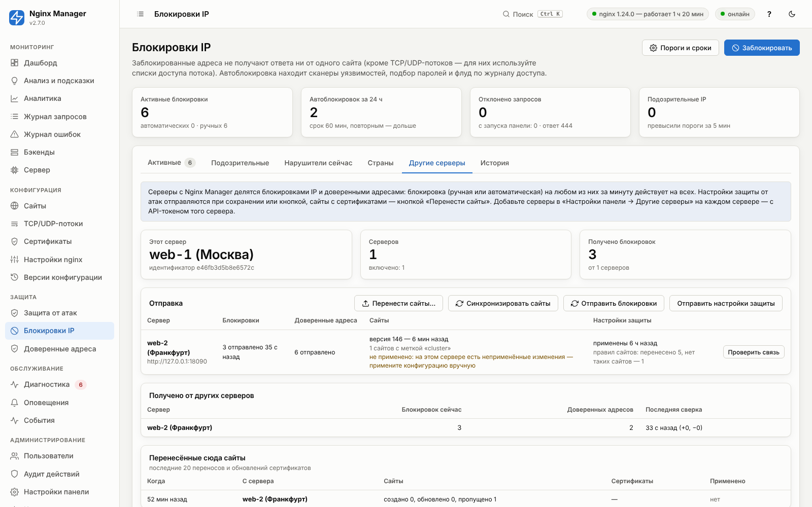

Вкладка «Другие серверы» на этой странице показывает этот сервер, состояние отправки на каждый сервер (сколько
блокировок и доверенных адресов отправлено и когда, ошибка), полученные от других серверов блокировки и доверенные
адреса, перенесённые сюда сайты и кнопки «Перенести сайты…», «Отправить блокировки», «Отправить настройки защиты»,
«Проверить связь».

### Перенос сайтов и сертификатов

Кнопка **«Перенести сайты…»** (здесь и «Сайты → На другой сервер…») копирует выбранные сайты на другой сервер со
всеми настройками: домены, бэкенды, локации, кэш, безопасность, защита от атак, доступ по IP, пользователи Basic Auth
(хеши паролей — сами пароли панель не хранит). Так собирается кластер из нескольких одинаковых серверов за одним
доменом (DNS round-robin, балансировщик), готовится резервный узел или выполняется переезд.

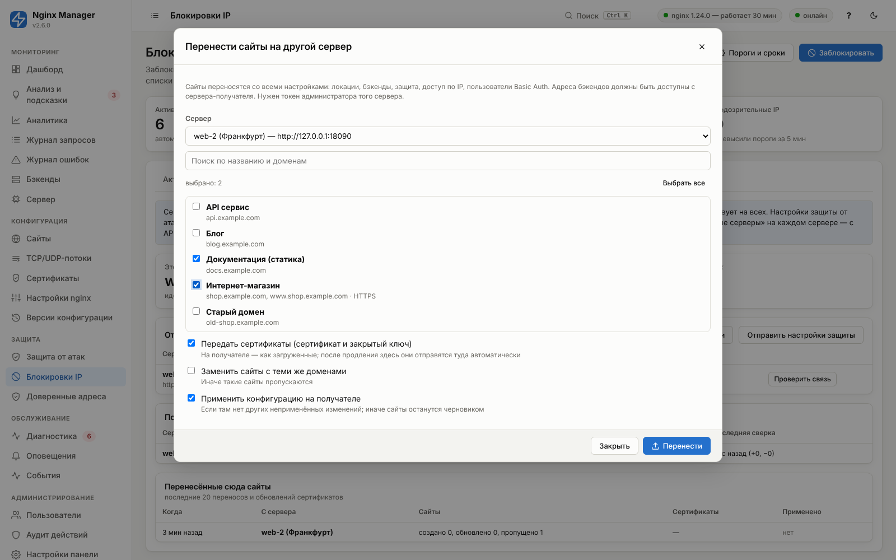

| Параметр | Что делает |
|---|---|
| Сервер | Куда переносить (сервер из «Настройки панели → Другие серверы»; нужен токен **администратора** того сервера) |
| Сайты | Список с поиском по названию и доменам; «Выбрать все» |
| Передать сертификаты | Сертификат и закрытый ключ сайтов уходят вместе с ними. На получателе — как загруженные, с пометкой «(с сервера «web-1»)» |
| Заменить сайты с теми же доменами | Сайт получателя, у которого совпадает хотя бы один домен, обновляется настройками отправителя; без флажка такой сайт пропускается |
| Применить конфигурацию на получателе | После переноса получатель применяет конфигурацию с проверкой `nginx -t` — если у него нет других неприменённых изменений (иначе сайты остаются черновиком, а в ответе — причина) |

Результат показывается сразу: по каждому сайту — «создан», «обновлён», «пропущен» или «ошибка» с пояснением.
Получатель сам подстраивает то, что на разных серверах разное:

- **номер сертификата** заменяется местным; если сертификат не передавали — выбирается подходящий местный по доменам,
  а если такого нет — HTTPS у сайта выключается (с пометкой в результате);
- **зона кэша**, которой у получателя нет, заменяется первой существующей;
- сертификаты сохраняются только для сайтов, которые создаются или обновляются, — у пропущенных лишних
  сертификатов не остаётся.

**Продление.** Отправитель запоминает, куда переносил сертификаты. Когда сертификат продлён (Let's Encrypt и любой
другой центр по ACME), панель отправляет новый сертификат на те же серверы, а получатель обновляет файлы на месте и
переприменяет конфигурацию, если сертификат используется. Так продлевать сертификат нужно только на одном сервере —
том, куда приходят проверки Let's Encrypt (или с DNS-проверкой). Сертификат, удалённый на получателе, при продлении
не восстанавливается.

**Если сервер-источник пропал.** Получатель следит за перенесёнными сертификатами в «Диагностике» (группа «SSL»):

| Ситуация | Результат проверки |
|---|---|
| Сервер-источник выходит на связь (присылает блокировки, сайты или сертификаты), но до истечения меньше 10 дней | Предупреждение «продлённый оттуда не пришёл» — проверьте продление на источнике |
| Сервер-источник молчит больше суток, до истечения меньше 20 дней | Предупреждение (меньше 7 дней — ошибка) «не выходит на связь N дн.» |

У обеих проверок есть кнопка **«Выпустить сертификат здесь»**: панель выпускает по ACME (Let's Encrypt или ваш центр
из «Настройки панели → ACME») сертификат с теми же доменами — HTTP-проверкой, для wildcard — DNS-проверкой первой
учётной записью DNS, — а после выпуска сама переключает на него все сайты, где был перенесённый сертификат, и
применяет конфигурацию. Дальше сертификат продлевается на этом сервере. HTTP-проверка пройдёт, только если запросы
Let's Encrypt к домену приходят на этот сервер (DNS указывает на него или балансировщик пропускает
`/.well-known/acme-challenge/` сюда); иначе используйте DNS-проверку. Сервер, принимающий синхронизацию сайтов,
после выпуска получит прежний сертификат обратно при следующей синхронизации — выпускайте здесь, когда
источник действительно выведен из работы, и отключите синхронизацию.

### Синхронизация сайтов

Для кластера из одинаковых серверов (DNS round-robin, балансировщик, резервный узел) сайты можно не переносить
кнопкой, а **синхронизировать**: включите у сервера в «Настройки панели → Другие серверы» флажок **«Сайты»** и при
необходимости **«Только сайты с меткой»** (например, `cluster` — тогда на другой сервер уходят только сайты с этой
меткой, а у каждого сервера могут быть и свои). Нужен токен **администратора** того сервера.

После каждого применения конфигурации здесь (из панели, `nmctl apply`, откатом) панель за несколько секунд
отправляет сайты **последней применённой версии** — не черновики — на сервер-получатель, и тот:

- создаёт новые сайты и обновляет изменённые; сайт ищется по номеру у источника, поэтому смена доменов на источнике
  не создаёт дубликат; неизменённые сайты не трогаются;
- **удаляет** сайты, которые на источнике удалили или исключили из синхронизации (сняли метку), — но только те, что
  синхронизация сама создала. Сайт, который был на получателе до синхронизации (совпал по домену), при выходе из
  синхронизации остаётся, просто больше не обновляется;
- принимает сертификаты: первый раз — целиком, дальше — только новые и продлённые (сертификат, который получатель
  уже знает, не пересылается);
- применяет конфигурацию с проверкой `nginx -t` — если у него нет своих неприменённых изменений. Иначе сайты
  остаются в его базе и применятся вместе с его изменениями, а у отправителя в колонке «Сайты» видно «не применено:
  …».

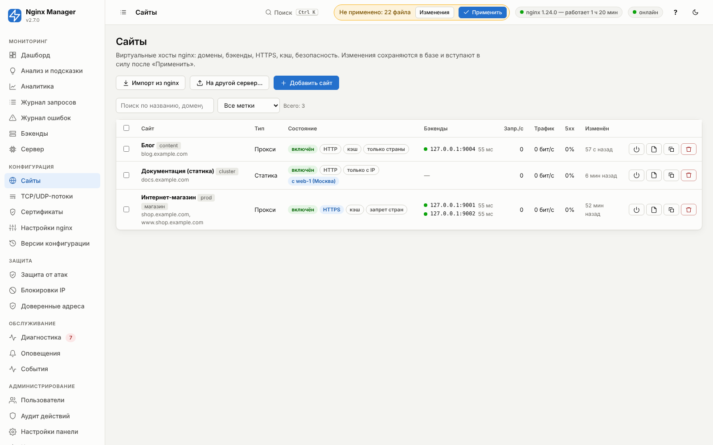

На получателе такие сайты помечены в списке («с web-1 (Москва)»), а в карточке сайта — предупреждение: правки там
будут перезаписаны следующей синхронизацией, менять сайт нужно на источнике. Вкладка «Другие серверы» получателя
показывает карточку «Синхронизация сайтов сюда» (с какого сервера, сколько сайтов, когда), отправителя — колонку
«Сайты» (какая версия отправлена, сколько сайтов, результат) и кнопку «Синхронизировать сайты» (отправить заново).
Сайты, полученные синхронизацией с другого сервера, дальше не пересылаются — так нет «эха» при настройке в обе
стороны. Приём синхронизации выключается на получателе: «Настройки панели → Другие серверы → Принимать
синхронизацию сайтов с других серверов».

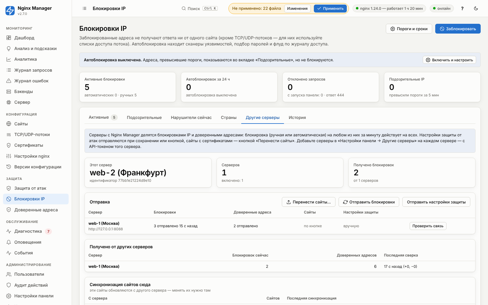

Что не переносится: адреса бэкендов остаются прежними (они должны быть доступны с сервера-получателя — для кластера
это обычно внутренние адреса приложения), TCP/UDP-потоки, глобальные настройки nginx, правила оповещений; правила
защиты, привязанные к сайтам, переносит отправка настроек защиты (по доменам). Перенос записывается в журнал аудита и
события обоих серверов; вкладка «Другие серверы» получателя показывает последние 20 переносов. То же из консоли:
`nmctl transfer --to web-2 --sites 1,3` (или `--tag cluster`, `--all`; `--no-certs`, `--overwrite`, `--no-apply`),
состояние связи и обмена — `nmctl peers`.

### Сравнение конфигурации серверов

Кнопка **«Сравнить»** в строке сервера (вкладка «Другие серверы») показывает, чем применённая конфигурация этого
сервера отличается от того: в кластере одинаковых серверов так видно, что что-то забыли перенести или поменяли
только на одном.

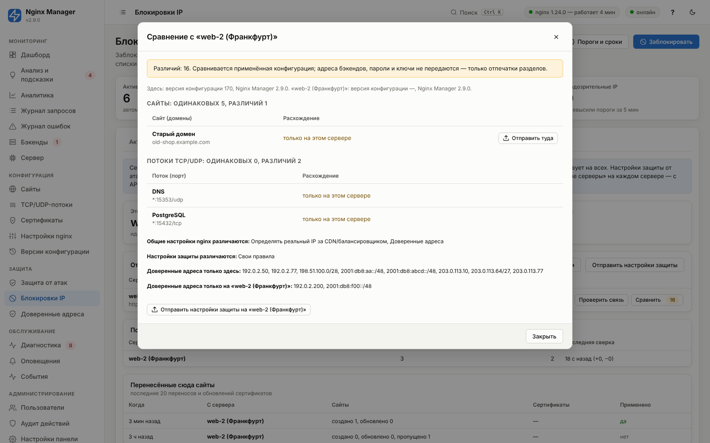

| Что сравнивается | Как сопоставляется | Что показывается |
|---|---|---|
| Сайты | по доменам (номера сайтов на серверах разные) | только здесь / только там / различаются: какие вкладки (бэкенды, HTTPS, доступ по IP, пути, кэш…), включён ли сайт; сертификаты на разные домены или со сроком, отличающимся больше чем на 3 дня |
| TCP/UDP-потоки | по внешнему порту и протоколу | то же |
| Настройки nginx | по полям | какие поля различаются |
| Защита от атак | по полям; правила, привязанные к сайтам, — по доменам сайтов | какие поля различаются (CrowdSec не сравнивается — у каждого сервера свой ключ) |
| Доверенные адреса | свои записи каждого сервера | адреса только здесь и только там |

Другой сервер отдаёт только **отпечатки** разделов (SHA-256) — адреса бэкендов, пароли, ключи и токены не
передаются. Сравнивается применённая конфигурация (неприменённые правки не учитываются); названия и заметки
сайтов — нет. Нужен токен оператора или администратора того сервера и версия 2.8 на обоих. Число различий
последнего сравнения видно на кнопке; из окна можно сразу перенести недостающие сайты кнопкой «Перенести
сайты…».

## Рекомендуемые настройки

| Сценарий | Рекомендация |
|---|---|
| Первое включение | Неделю понаблюдайте за вкладкой «Подозрительные» с выключенной автоблокировкой; добавьте в исключения свои адреса, которые туда попадают. |
| Публичные сайты и магазины | Поиск уязвимостей 5, 401 — 30, по IP — 30, 4xx — 300, срок 60 мин с увеличением. Подходит большинству. |
| API для мобильных приложений | Поднимите порог 4xx до 1000 (клиенты за NAT операторов делят один адрес), а флуд ограничивайте `limit_req`. |
| Сайт за Cloudflare | Обязательно настройте «Реальный IP клиента». Иначе вы заблокируете адреса Cloudflare. |
| Атака прямо сейчас | Найдите адреса в «Аналитике → Топы → IP-адреса» или «Нарушители сейчас», заблокируйте пачкой на сутки. Для атак с тысяч адресов используйте ограничение частоты и CDN. |

## Ответ заблокированным

«Настройки панели → Блокировки IP → Ответ заблокированным» (вступает в силу после «Применить»):

| Вариант | Поведение | Когда выбирать |
|---|---|---|
| **444** (по умолчанию) | Соединение закрывается без ответа | Сканеры и боты: им не за что зацепиться, минимум трафика |
| **403** | Обычная страница «Доступ запрещён» | Если среди заблокированных могут оказаться люди и им нужно понимать, что произошло |
| **429** | «Слишком много запросов» | Для клиентов API, которые умеют повторять запрос позже |

## Где ещё видны блокировки

- **События** и вкладка «История»: каждая автоматическая блокировка, разблокировка, ошибки обновления списка.
- **Оповещения**: метрика «Автоблокировок IP за окно» (`autobans`). Например, правило «больше 20 за 10 минут»
  сообщит о начале массового сканирования.
- **Метрики Prometheus**: `nm_bans_active{source}`, `nm_bans_suspicious`, `nm_http_banned_requests_total{site}`,
  `nm_http_geo_blocked_requests_total{site}` ([09](09-monitoring.md#метрики-prometheus)).
- **REST API**: `GET /api/bans`, `POST /api/bans`, `DELETE /api/bans/{id}`, `POST /api/bans/clear`,
  `GET /api/geo`, `POST /api/geo/rebuild` ([14](14-cli-api.md)).

## Частые вопросы

**Я заблокировал нужный адрес — как вернуть доступ?** «Блокировки IP» → «Разблокировать». Если доступа к панели
нет, удалите строку из `/etc/nginx/nginx-manager/bans.conf` и выполните `nginx -s reload`. Панель восстановит
файл из базы при следующем изменении, поэтому снимите блокировку и в панели, когда доступ вернётся.

**Блокировка добавлена, но запросы проходят.** Проверьте, что конфигурация применялась после обновления панели
до версии 1.1 (в файлах сайтов должна быть строка `if ($nm_banned)`), и что «Реальный IP клиента» настроен,
если перед сервером есть прокси или CDN. Ошибка обновления списка показывается вверху страницы «Блокировки».

**Пользователь из разрешённой страны получает отказ.** Узнайте его IP и страну в «Журнале запросов» (колонка
«Клиент»). Частые причины: VPN или корпоративный прокси в другой стране, роуминг, сайт за CDN без настройки
реального IP, устаревшая база GeoIP. Добавьте адрес в исключения или обновите базу.

**Сколько адресов можно заблокировать?** Десятки тысяч: `geo` хранит их в радикс-дереве, проверка не замедляется.
Перезагрузка nginx с очень большим списком занимает немного больше времени, но выполняется без разрыва
соединений.
