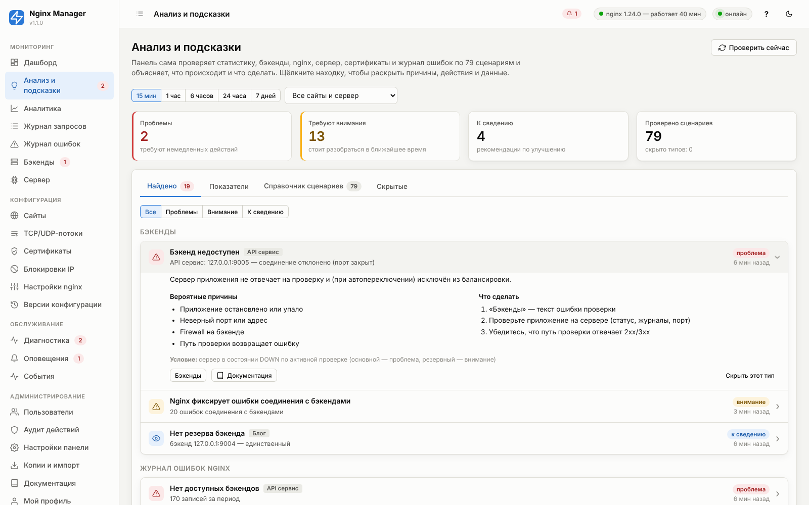
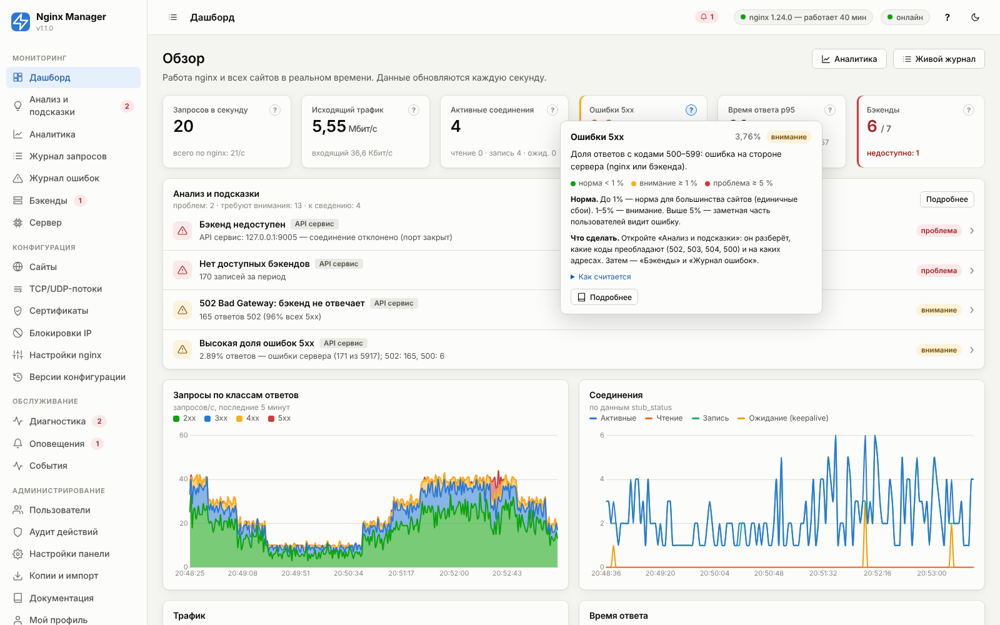

# 18. Встроенный анализ и подсказки

Панель не только показывает графики, но и сама их читает: оценивает каждый показатель («норма», «внимание»,
«проблема»), находит типовые проблемы и объясняет, что происходит, почему и что сделать. Анализ работает без
настройки и без внешних сервисов.

## Где это видно в панели

| Место | Что показывает |
|---|---|
| **Значок «?» на карточке показателя** (дашборд, аналитика, сервер, бэкенды) | Что означает показатель, как считается, пороги нормы, текущая оценка и что делать. Карточка с плохим значением выделяется цветной полосой слева. |
| **Дашборд → «Анализ и подсказки»** | Главные находки за последние 15 минут, обновляется раз в 30 секунд. |
| **Аналитика → «Анализ за период»** | Находки за выбранный период и сайт (например, «что было вчера ночью»). |
| **Раздел «Анализ и подсказки»** | Все находки, оценка всех показателей, справочник сценариев, скрытые подсказки. |
| **Значок в меню** | Число проблем (красный) или находок «внимание» (жёлтый) за последние 15 минут. |
| **Оповещения** | Метрика `insights_crit` — число проблем по анализу; правило «больше 0» сообщит о любой найденной проблеме ([11](11-alerts.md)). |

## Как работает анализ

1. **Период и сайт.** Анализ берёт статистику за выбранный период (по умолчанию 15 минут) — по всем сайтам
   вместе и **по каждому сайту отдельно**, поэтому находка указывает конкретный сайт. Если та же проблема
   найдена у отдельных сайтов, общая находка «по всем сайтам» не дублируется.
2. **Источники данных:** поминутная статистика (коды ответов, перцентили, кэш, TLS, боты, статика), топы
   (адреса с ошибками, медленные адреса, IP), журнал ошибок nginx, активные проверки бэкендов, stub_status,
   ресурсы сервера, сертификаты, состояние конфигурации, блокировки и сборщик статистики.
3. **Сравнение с обычным уровнем.** Для просадок и всплесков трафика и роста времени ответа период
   сравнивается со средним за предыдущие сутки (по почасовой статистике). Эти сценарии включаются, когда есть
   хотя бы 6 часов истории.
4. **Минимальный объём.** Проценты оцениваются только при достаточном числе запросов (условие указано у каждого
   сценария), чтобы 1 ошибка из 3 запросов ночью не выглядела как «33% ошибок».
5. **Уровни.** **Проблема** — пользователи уже страдают или вот-вот начнут, нужны действия сейчас.
   **Внимание** — отклонение от нормы, стоит разобраться в ближайшее время. **К сведению** — рекомендации
   по надёжности, безопасности и скорости.
6. **Частота.** Результат кэшируется на 15 секунд; в фоне анализ последних 15 минут выполняется раз в минуту
   (для значка в меню и оповещений). Для каждой находки запоминается, когда она впервые появилась.

### Как читать находку

Щелчок по находке раскрывает:

- **что это значит** — объяснение простыми словами;
- **вероятные причины** — от самых частых к редким;
- **что сделать** — по шагам, с кнопками перехода в нужный раздел панели и в документацию;
- **данные** — на чём основан вывод: адреса с ошибками, медленные адреса, IP, сообщения журнала;
- **условие** — точное правило срабатывания.

### Скрытие подсказок

Если рекомендация вам не подходит (например, «Нет резерва бэкенда» для тестового сайта), нажмите **«Скрыть этот
тип»** в раскрытой находке. Скрытые типы не показываются в списке, на дашборде, в значке меню и не учитываются в
метрике оповещений. Вернуть — вкладка «Скрытые» → «Показывать снова». Скрывать могут оператор и администратор;
действие попадает в аудит.

## Показатели и пороги

Пороги, по которым окрашиваются карточки и которые указаны в подсказках «?». Порог «Активных соединений»
рассчитывается для вашего сервера: ёмкость = `worker_connections × число воркеров / 2`.

<!-- GEN:insight_metrics -->
<!-- Сгенерировано tools/gen_reference.py из app/models.py -->
| Показатель | Что показывает | Норма / внимание / проблема | Что делать |
|---|---|---|---|
| **Запросов в секунду** (`rps`) | Сколько HTTP-запросов в секунду обрабатывают все сайты (или выбранный сайт). Число строк журнала доступа за последние 10 секунд (на дашборде) или за период (в аналитике), делённое на длительность. «Всего по nginx» — по stub_status, включая запросы без записи в журнал. | без порогов — важна динамика. Абсолютного «правильного» значения нет: важны резкие изменения. Анализ сравнивает текущую нагрузку с тем же показателем за предыдущие сутки и сообщает о просадке или всплеске. | Резкое падение — проверьте DNS, сертификат, доступность сервера извне. Резкий рост — проверьте топ IP-адресов и User-Agent: это может быть бот, парсер или атака. |
| **Исходящий трафик** (`bandwidth`) | Объём данных, отправляемых клиентам (ответы целиком, с заголовками). Сумма $bytes_sent за 10 секунд × 8 / 10. | без порогов — важна динамика. Сравнивайте с пропускной способностью канала сервера: устойчиво выше 70% канала — повод включить сжатие, кэш статики или CDN. | Найдите самые «тяжёлые» адреса: Аналитика → Топы → URI (колонка «Трафик»). Включите gzip, кэш статики и заголовки Expires; большие файлы отдавайте через CDN. |
| **Активные соединения** (`connections`) | Все открытые клиентские соединения nginx (чтение запроса, отправка ответа, ожидание keepalive). stub_status: Active connections. Ёмкость = worker_connections × число воркеров / 2 (при проксировании каждый запрос занимает два соединения: к клиенту и к бэкенду). | < 70% ёмкости / ≥ 70% / ≥ 90%. До 70% ёмкости — норма; 70–90% — внимание; выше 90% — nginx начнёт отклонять соединения. | Увеличьте worker_connections и worker_rlimit_nofile (Настройки nginx → Процессы), уменьшите keepalive_timeout. Если соединений много в состоянии «ожидание» — это простаивающие keepalive. |
| **Ошибки 5xx** (`err5`) | Доля ответов с кодами 500–599: ошибка на стороне сервера (nginx или бэкенда). Ответы 5xx / все ответы за период × 100. На дашборде — за последнюю минуту. | < 1 % / ≥ 1 % / ≥ 5 % (оценивается от 20 запросов). До 1% — норма для большинства сайтов (единичные сбои). 1–5% — внимание. Выше 5% — заметная часть пользователей видит ошибку. | Откройте «Анализ и подсказки»: он разберёт, какие коды преобладают (502, 503, 504, 500) и на каких адресах. Затем — «Бэкенды» и «Журнал ошибок». |
| **Ошибки 4xx** (`err4`) | Доля ответов 400–499: запрос клиента не может быть выполнен (нет страницы, нет доступа, лимит). Ответы 4xx / все ответы × 100. | < 15 % / ≥ 15 % / ≥ 35 % (оценивается от 50 запросов). До 15% — обычно (404 от ботов, favicon, устаревшие ссылки). Выше — стоит разобраться, какие коды и адреса преобладают. | Аналитика → Топы → «Ошибки 4xx». Много 404 — битые ссылки или сканеры; 403 — правила доступа; 429 — лимиты частоты; 401 — подбор паролей; 413 — размер загрузок. |
| **Время ответа p95** (`p95`) | 95% запросов обслужены быстрее этого времени. Лучше среднего отражает то, что видят пользователи. 95-й перцентиль $request_time по гистограмме (12 корзин от 5 мс до 10 с) с интерполяцией. | < 1000 мс / ≥ 1000 мс / ≥ 3000 мс (оценивается от 20 запросов). До 1 с — хорошо для страниц и API; 1–3 с — пользователи замечают задержку; выше 3 с — проблема. Для скачиваний и долгих API-операций пороги выше. | Сравните со временем бэкенда: если бэкенд медленный — оптимизируйте приложение или добавьте кэш; если медленно только nginx→клиент — проверьте размер ответов, сжатие и канал. |
| **Среднее время ответа** (`rt_avg`) | Среднее $request_time — от получения первого байта запроса до отправки последнего байта ответа. Сумма $request_time / число запросов. | < 500 мс / ≥ 500 мс / ≥ 1500 мс (оценивается от 20 запросов). До 500 мс — хорошо. Среднее искажается редкими очень долгими запросами — смотрите также p95. | См. «Медленные запросы» в аналитике и «Время бэкенда». |
| **Время бэкенда** (`urt_avg`) | Сколько в среднем отвечает приложение (без учёта передачи ответа клиенту). Среднее $upstream_response_time по запросам, ушедшим на бэкенд. | < 500 мс / ≥ 500 мс / ≥ 1500 мс (оценивается от 20 запросов). До 500 мс — хорошо. Если близко к общему времени ответа — узкое место в приложении. | Оптимизируйте медленные адреса приложения, добавьте кэш (вкладка «Кэш» сайта), масштабируйте бэкенды. |
| **Кэш (HIT)** (`hit_ratio`) | Доля ответов из кэша nginx среди всех ответов, прошедших через кэш. HIT / (HIT + MISS + EXPIRED + BYPASS + STALE + …) × 100. | > 20 % / ≤ 20 % / ≤ 5 % (оценивается от 200 запросов). Зависит от сайта: для статики и публичных страниц 60–95%; для API и личных кабинетов кэш обычно не нужен. Ниже 20% при включённом кэше — кэш почти не работает. | Проверьте заголовки ответа приложения: Cache-Control: private/no-store и Set-Cookie запрещают кэширование; правила обхода по cookie; время жизни кэша. |
| **Доля ботов** (`bots`) | Запросы от поисковых роботов, мониторинга, скриптов и библиотек (по User-Agent). Запросы с User-Agent ботов / все запросы × 100. | < 50 % / ≥ 50 % / ≥ 80 % (оценивается от 200 запросов). 10–40% — обычно для публичных сайтов. Больше половины — заметная нагрузка не от людей. | Топ User-Agent и IP в аналитике; ограничение частоты; блокировка вредных ботов (вкладка «Безопасность» сайта) и автоблокировка сканеров. |
| **Недоступные бэкенды** (`backends_down`) | Серверы приложений, не прошедшие активную проверку панели. Состояние DOWN после «Неудач до DOWN» подряд неуспешных проверок. | < 0.5 / ≥ 0.5 / ≥ 0.5. 0. Любой недоступный основной сервер снижает запас прочности; если недоступны все — сайт отвечает 502. | Страница «Бэкенды» покажет ошибку проверки. Проверьте, запущено ли приложение и слушает ли оно нужный адрес и порт. |
| **Задержка проверки бэкенда** (`backend_latency`) | Время ответа бэкенда на запрос проверки доступности. Последняя активная проверка (HTTP-запрос на путь проверки или TCP-подключение). | < 500 мс / ≥ 500 мс / ≥ 2000 мс. Обычно единицы–десятки миллисекунд в локальной сети. | Медленная проверка — признак перегрузки приложения. Используйте лёгкий путь проверки (/health без обращений к БД). |
| **Доступность бэкенда** (`uptime`) | Доля успешных активных проверок с момента запуска панели. Успешные проверки / все проверки × 100. | > 99 % / ≤ 99 % / ≤ 95 %. 99,9% и выше — стабильно. Ниже 99% — сервер периодически пропадает. | Нестабильный бэкенд: смотрите журналы приложения, перезапуски контейнеров, нехватку памяти. |
| **CPU** (`cpu`) | Загрузка процессора сервера всеми процессами. psutil: доля времени CPU вне простоя за 2 секунды. | < 80 % / ≥ 80 % / ≥ 95 %. До 70–80% длительно — нормально. Выше 90% — растёт время ответа, возможны таймауты. | Если нагружает nginx (карточка «Nginx CPU»): снизьте уровень gzip (4–5), включите кэш TLS-сессий, кэшируйте ответы. Если приложение на этом же сервере — масштабируйте его. |
| **Память** (`mem`) | Используемая оперативная память (без учёта кэша файловой системы). psutil: (total − available) / total. | < 85 % / ≥ 85 % / ≥ 95 %. До 85% — нормально. Выше 95% — риск OOM-killer и использования swap. | Найдите потребителей (top, ps). Для nginx: уменьшите зоны кэша/лимитов и буферы. |
| **Диск** (`disk`) | Заполнение раздела (корневого и раздела с журналами). psutil: used / total для / и каталога журналов nginx. | < 85 % / ≥ 85 % / ≥ 95 %. До 85%. При заполнении на 100% nginx не сможет писать журналы и кэш, а панель — статистику. | Сократите сроки хранения (Настройки панели → Статистика и хранение), проверьте ротацию журналов (logrotate), очистите кэш nginx и старые резервные копии. |
| **Нагрузка (load average) на ядро** (`load`) | Средняя длина очереди процессов, готовых к выполнению, в расчёте на одно ядро. load average за 1 минуту / число ядер. | < 1.5 / ≥ 1.5 / ≥ 3. До 1 на ядро — запас есть; 1,5–3 — очередь; выше 3 — перегрузка (или ожидание диска). | Высокий load при низком CPU — ожидание диска (I/O): проверьте журналы, swap, кэш на диске. |
<!-- /GEN:insight_metrics -->

## Справочник сценариев

Ниже — все ситуации, которые распознаёт анализ. Тот же справочник с поиском доступен в панели: «Анализ и
подсказки» → «Справочник сценариев».

<!-- GEN:insight_scenarios -->
<!-- Сгенерировано tools/gen_reference.py из app/models.py -->

## Доступность и ошибки

### Высокая доля ошибок 5xx

*Идентификатор:* `e5xx_rate`. *Когда срабатывает:* доля ответов 5xx ≥ 1% (внимание) или ≥ 5% (проблема) при ≥ 50 запросах за период.

Часть пользователей получает ошибку сервера вместо страницы. Анализ отдельно сообщает, какой код преобладает (502, 503, 504, 500) — у каждого своя причина.

**Вероятные причины:**

- Бэкенд недоступен или перегружен
- Ошибки в коде приложения после выкладки
- Таймауты при обращении к базе данных или внешним сервисам
- Слишком строгие лимиты или режим обслуживания

**Что сделать:**

1. Посмотрите разбор по кодам ниже и адреса с ошибками (данные находки)
2. Откройте «Бэкенды» — все ли серверы доступны
3. Отфильтруйте журнал запросов по статусу 5xx
4. Если ошибки начались после выкладки — откатите приложение

### Сайт фактически недоступен

*Идентификатор:* `site_down`. *Когда срабатывает:* ≥ 90% ответов сайта — ошибки 5xx при ≥ 20 запросах за период.

Почти все посетители сайта видят ошибку.

**Вероятные причины:**

- Все бэкенды остановлены или недоступны по сети
- Приложение падает при старте
- Неверный адрес или порт бэкенда после изменения настроек

**Что сделать:**

1. Проверьте «Бэкенды»: состояние и текст ошибки проверки
2. Проверьте, запущено ли приложение (systemctl status, docker ps) и слушает ли нужный порт (ss -tlnp)
3. Если сайт сломался после изменения настроек — откатите версию конфигурации
4. Включите режим обслуживания сайта, чтобы показать понятную страницу

### 502 Bad Gateway: бэкенд не отвечает

*Идентификатор:* `e502`. *Когда срабатывает:* среди ответов 5xx ≥ 20% (и не меньше 5) — код 502.

Nginx не смог получить ответ от бэкенда: соединение отклонено, сброшено или закрыто до ответа.

**Вероятные причины:**

- Приложение не запущено или упало (OOM, ошибка при старте)
- Неверный адрес/порт бэкенда
- Бэкенд закрывает соединение (лимит воркеров PHP-FPM/gunicorn, несовместимый keepalive)
- Все серверы группы временно исключены (max_fails)

**Что сделать:**

1. «Бэкенды» — какие серверы недоступны и почему
2. «Журнал ошибок» — категории «Бэкенд отклоняет соединения», «Бэкенд закрыл соединение до ответа»
3. Перезапустите приложение и проверьте его журналы
4. При массовых сбросах соединений попробуйте уменьшить keepalive к бэкенду

### 504 Gateway Timeout: бэкенд не успевает ответить

*Идентификатор:* `e504`. *Когда срабатывает:* среди ответов 5xx ≥ 20% (и не меньше 5) — код 504.

Бэкенд принял запрос, но не ответил за proxy_read_timeout (по умолчанию 60 с).

**Вероятные причины:**

- Медленные запросы к базе данных
- Перегрузка приложения (все воркеры заняты)
- Долгие операции (отчёты, экспорт), выполняемые синхронно
- Зависания внешних API

**Что сделать:**

1. Найдите медленные адреса: Аналитика → Топы → «Медленные»
2. Оптимизируйте эти запросы или выполняйте их в фоне
3. Для действительно долгих операций увеличьте «Таймаут чтения» в локации
4. Масштабируйте бэкенд (больше воркеров или серверов)

### 503 Service Unavailable

*Идентификатор:* `e503`. *Когда срабатывает:* среди ответов 5xx ≥ 20% (и не меньше 5) — код 503.

Nginx отказал в обслуживании: сработал лимит, включён режим обслуживания или нет доступных бэкендов.

**Вероятные причины:**

- Ограничение частоты или соединений (если код лимита 503)
- Включён режим обслуживания сайта
- «no live upstreams» — все бэкенды исключены
- Бэкенд сам отвечает 503 (перегрузка, деплой)

**Что сделать:**

1. Проверьте «Журнал ошибок» — категории «Сработал лимит…» и «Нет доступных бэкендов»
2. Проверьте режим обслуживания в настройках сайта
3. Если лимит срабатывает на обычных пользователях — увеличьте rate/burst

### 500 Internal Server Error: ошибки приложения

*Идентификатор:* `e500`. *Когда срабатывает:* среди ответов 5xx ≥ 20% (и не меньше 5) — код 500.

Ошибку вернуло само приложение: необработанное исключение, ошибка базы данных, неверная конфигурация.

**Вероятные причины:**

- Ошибка в коде после выкладки
- Недоступна база данных или кэш
- Закончилось место на диске у приложения

**Что сделать:**

1. Найдите запрос в журнале и возьмите его X-Request-ID — по нему ищите в журналах приложения
2. Проверьте адреса с ошибками в данных находки
3. Откатите последнюю выкладку приложения

### Много ответов 4xx

*Идентификатор:* `e4xx_rate`. *Когда срабатывает:* доля ответов 4xx ≥ 15% (внимание) или ≥ 35% (проблема) при ≥ 100 запросах.

Значительная часть запросов не может быть выполнена по вине клиента. Отдельные находки разбирают конкретные коды.

**Вероятные причины:**

- Сканеры и боты, перебирающие адреса
- Битые ссылки после изменения структуры сайта
- Слишком строгие правила доступа или лимиты

**Что сделать:**

1. Аналитика → Топы → «Ошибки 4xx»
2. Посмотрите IP с наибольшим числом ошибок и при необходимости заблокируйте их

### Много 404 Not Found

*Идентификатор:* `e404`. *Когда срабатывает:* 404 ≥ 5% всех запросов и не меньше 20 за период.

Запрашиваются несуществующие адреса.

**Вероятные причины:**

- Битые ссылки на сайте или во внешних источниках
- Удалённые страницы без перенаправлений
- Сканеры уязвимостей
- Неверный корневой каталог статического сайта или префикс локации

**Что сделать:**

1. Посмотрите самые частые адреса с 404 в данных находки
2. Для перемещённых страниц настройте перенаправления (локация с действием «Перенаправить»)
3. Если это сканеры — включите автоблокировку

### Много 403 Forbidden

*Идентификатор:* `e403`. *Когда срабатывает:* 403 ≥ 3% всех запросов и не меньше 20.

Доступ запрещён правилами nginx или приложением.

**Вероятные причины:**

- Белые/чёрные списки IP, блокировка ботов и эксплойтов
- Неверные права на файлы статики
- Приложение запрещает доступ (CSRF, авторизация)

**Что сделать:**

1. Журнал ошибок — категория «Доступ запрещён правилом»
2. Проверьте вкладку «Безопасность» сайта
3. Отфильтруйте журнал запросов по статусу 403 и посмотрите адреса и IP

### Срабатывают лимиты частоты (429)

*Идентификатор:* `e429`. *Когда срабатывает:* 429 ≥ 1% всех запросов и не меньше 10.

Клиенты превышают ограничение частоты запросов (limit_req) или соединений.

**Вероятные причины:**

- Лимит слишком строгий для реальной нагрузки (SPA, мобильные приложения делают много запросов)
- Пользователи за одним NAT или прокси делят один IP
- Атака или парсер

**Что сделать:**

1. Посмотрите, с каких IP идут 429: если это обычные пользователи — увеличьте rate и burst
2. Для API используйте ключ лимита по токену, а не по IP
3. Если это атака — заблокируйте адреса

### Много неудачных авторизаций (401)

*Идентификатор:* `e401`. *Когда срабатывает:* 401 ≥ 3% всех запросов и не меньше 20.

Запросы с неверными или отсутствующими учётными данными.

**Вероятные причины:**

- Подбор паролей Basic Auth или API
- Истёкшие токены у клиентов
- Неверная настройка Basic Auth

**Что сделать:**

1. Посмотрите IP с ошибками 401: массовые попытки с одного адреса — подбор пароля
2. Включите автоблокировку (правило «Подбор пароля»)
3. Ограничьте частоту запросов к странице входа

### Отклонены слишком большие запросы (413)

*Идентификатор:* `e413`. *Когда срабатывает:* хотя бы один ответ 413 за период.

Клиент отправил тело запроса больше client_max_body_size (по умолчанию 1 МБ).

**Вероятные причины:**

- Загрузка файлов или изображений больше лимита
- Большие JSON-запросы API

**Что сделать:**

1. Увеличьте «Макс. размер тела запроса» в настройках сайта или только для локации загрузки (например, 50m)
2. Убедитесь, что приложение принимает такие размеры

### Клиенты не дожидаются ответа (499)

*Идентификатор:* `e499`. *Когда срабатывает:* 499 ≥ 2% всех запросов и не меньше 10.

Клиент закрыл соединение до того, как nginx отправил ответ.

**Вероятные причины:**

- Медленные ответы: пользователь ушёл со страницы или сработал таймаут клиента/балансировщика
- Мобильные клиенты с плохой связью
- Таймаут внешнего балансировщика меньше времени ответа

**Что сделать:**

1. Найдите медленные адреса и ускорьте их
2. Проверьте таймауты балансировщика или CDN перед сервером

### Некорректные запросы (400, 414, 431, 494)

*Идентификатор:* `e400`. *Когда срабатывает:* ответы 400/414/431/494 ≥ 1% и не меньше 10.

Запросы, которые nginx не смог разобрать: слишком длинный URI или заголовки, неверный формат.

**Вероятные причины:**

- Слишком большие cookie (много счётчиков, большие JWT)
- Очень длинные URL (фильтры, трекинг)
- Обычный HTTP на HTTPS-порт
- Сканеры

**Что сделать:**

1. Увеличьте large_client_header_buffers (Настройки nginx → Буферы)
2. Сократите размер cookie в приложении

### Соединения закрыты без ответа (444)

*Идентификатор:* `e444`. *Когда срабатывает:* 444 ≥ 10% всех запросов и не меньше 20.

Nginx закрыл соединение без ответа: запрос к неизвестному домену (сервер по умолчанию) или с заблокированного IP.

**Вероятные причины:**

- Сканеры, обращающиеся по IP-адресу сервера
- Блокировки IP
- Домен указывает на сервер, но не добавлен в панель

**Что сделать:**

1. Если среди запросов есть ваш домен — добавьте его в сайт
2. Иначе это нормальная защита — действий не требуется

## Производительность

### Медленные ответы (p95)

*Идентификатор:* `latency_p95`. *Когда срабатывает:* 95-й перцентиль времени ответа ≥ 1 с (внимание) или ≥ 3 с (проблема) при ≥ 50 запросах.

Каждый двадцатый запрос (и хуже) обслуживается дольше порога — пользователи замечают задержку.

**Вероятные причины:**

- Медленное приложение или база данных
- Перегрузка сервера (CPU, диск)
- Большие ответы и медленные клиенты
- Нет кэширования повторяющихся ответов

**Что сделать:**

1. Смотрите находки «Узкое место — бэкенд» / «Медленная передача клиентам»
2. Аналитика → Топы → «Медленные»
3. Включите кэш для публичных страниц, сжатие для текстовых ответов

### Узкое место — бэкенд

*Идентификатор:* `slow_backend`. *Когда срабатывает:* среднее время бэкенда ≥ 500 мс и составляет ≥ 70% общего времени ответа.

Почти всё время запроса уходит на ожидание ответа приложения.

**Вероятные причины:**

- Тяжёлые запросы к базе данных
- Недостаточно воркеров приложения
- Обращения к медленным внешним сервисам

**Что сделать:**

1. Профилируйте самые медленные адреса
2. Кэшируйте ответы (вкладка «Кэш») или используйте «устаревший кэш при ошибке»
3. Добавьте серверы бэкенда и балансировку least_conn

### Медленная передача клиентам

*Идентификатор:* `slow_clients`. *Когда срабатывает:* общее время ответа в 2 раза и более (и на ≥ 300 мс) больше времени бэкенда.

Бэкенд отвечает быстро, но передача ответа клиенту занимает много времени.

**Вероятные причины:**

- Большие ответы (изображения, файлы, JSON) без сжатия
- Медленные мобильные клиенты
- Ограничение скорости (limit_rate)
- Узкий канал сервера

**Что сделать:**

1. Включите gzip для текстовых типов
2. Отдавайте статику и большие файлы через CDN
3. Проверьте «Ограничение скорости» в производительности сайта

### Время ответа выросло

*Идентификатор:* `latency_regression`. *Когда срабатывает:* p95 за период ≥ 2× от p95 за предыдущие сутки и ≥ 300 мс.

Сервис стал заметно медленнее, чем обычно.

**Вероятные причины:**

- Новая версия приложения
- Рост нагрузки
- Деградация базы данных
- Фоновые задачи (резервное копирование, индексация)

**Что сделать:**

1. Сравните графики времени ответа и нагрузки в аналитике
2. Проверьте, что менялось: выкладки, версии конфигурации, события

### Много медленных запросов

*Идентификатор:* `slow_share`. *Когда срабатывает:* ≥ 5% запросов медленнее порога «медленного запроса» (настройки панели) при ≥ 100 запросах.

Заметная доля запросов выполняется дольше порога.

**Вероятные причины:**

- Конкретные тяжёлые адреса (отчёты, поиск, экспорт)
- Блокировки в базе данных

**Что сделать:**

1. Посмотрите адреса в данных находки и оптимизируйте их
2. Вынесите тяжёлые операции в фон

## Трафик

### Трафик резко снизился

*Идентификатор:* `traffic_drop`. *Когда срабатывает:* запросов в секунду < 30% от среднего за предыдущие сутки (проблема — < 5%), при среднем ≥ 0,5 rps и периоде ≥ 10 минут.

Посетителей стало заметно меньше обычного — возможно, сайт недоступен извне.

**Вероятные причины:**

- Проблемы DNS или истёкший домен
- Истёк сертификат — браузеры не открывают сайт
- Блокировка на уровне провайдера, CDN или firewall
- Сбой фронтенда или рекламных кампаний
- Естественное снижение (ночь, выходные)

**Что сделать:**

1. Откройте сайт извне (с телефона через мобильную сеть)
2. Проверьте сертификаты и DNS в диагностике
3. Проверьте, не пропали ли запросы на уровне CDN/балансировщика

### Резкий всплеск трафика

*Идентификатор:* `traffic_spike`. *Когда срабатывает:* запросов в секунду ≥ 3× от среднего за предыдущие сутки и ≥ 5 rps.

Нагрузка значительно выше обычной.

**Вероятные причины:**

- Рекламная кампания или публикация
- Бот, парсер или DDoS уровня приложения
- Повторы запросов из-за ошибок клиента

**Что сделать:**

1. Посмотрите топ IP-адресов и User-Agent в аналитике
2. Если трафик нежелательный — ограничьте частоту и заблокируйте источники
3. Если легитимный — проверьте запас по CPU и соединениям

### Один IP создаёт большую часть запросов

*Идентификатор:* `single_ip`. *Когда срабатывает:* один адрес — ≥ 30% запросов при ≥ 300 запросах за период.

Нагрузка сосредоточена на одном клиенте.

**Вероятные причины:**

- Парсер или бот
- Система мониторинга или интеграция партнёра
- Корпоративный NAT/прокси
- Не настроен «Реальный IP клиента» — все запросы видны с адреса CDN/балансировщика

**Что сделать:**

1. Посмотрите запросы с этого IP в журнале
2. Если это CDN/балансировщик — настройте «Реальный IP клиента» в глобальных настройках
3. Если это нежелательный клиент — ограничьте частоту или заблокируйте

### Сайт не получает запросов

*Идентификатор:* `no_traffic_site`. *Когда срабатывает:* включённый сайт без запросов за период ≥ 30 минут, хотя за прошлые сутки запросы были.

К сайту перестали обращаться.

**Вероятные причины:**

- Домен перенаправлен на другой сервер (DNS)
- Сайт выключен на внешнем балансировщике/CDN
- Опечатка в домене после изменения настроек

**Что сделать:**

1. Проверьте DNS-записи домена в диагностике
2. Проверьте домены сайта в настройках

## Бэкенды

### Бэкенд недоступен

*Идентификатор:* `backend_down`. *Когда срабатывает:* сервер в состоянии DOWN по активной проверке (основной — проблема, резервный — внимание).

Сервер приложения не отвечает на проверку и (при автопереключении) исключён из балансировки.

**Вероятные причины:**

- Приложение остановлено или упало
- Неверный порт или адрес
- Firewall на бэкенде
- Путь проверки возвращает ошибку

**Что сделать:**

1. «Бэкенды» — текст ошибки проверки
2. Проверьте приложение на сервере (статус, журналы, порт)
3. Убедитесь, что путь проверки отвечает 2xx/3xx

### Недоступны все серверы группы

*Идентификатор:* `backend_all_down`. *Когда срабатывает:* все основные серверы сайта или локации в состоянии DOWN.

Запросам сайта некуда идти: посетители получают 502 (или страницу резервного сервера, если он есть).

**Вероятные причины:**

- Остановлены все экземпляры приложения
- Сетевая проблема между nginx и бэкендами
- Неверные адреса после изменения настроек

**Что сделать:**

1. Восстановите хотя бы один сервер
2. Добавьте резервный сервер (backup) или включите режим обслуживания с понятной страницей

### Нестабильный бэкенд

*Идентификатор:* `backend_unstable`. *Когда срабатывает:* доступность по проверкам между 50% и 99% при ≥ 20 проверках.

Сервер периодически пропадает и возвращается.

**Вероятные причины:**

- Перезапуски приложения (падения, OOM, лимиты контейнера)
- Перегрузка — проверка не укладывается в таймаут
- Сетевые потери

**Что сделать:**

1. Посмотрите историю проверок на странице «Бэкенды»
2. Сопоставьте с журналами приложения и перезапусками контейнеров
3. Увеличьте таймаут проверки, если сервер просто медленный

### Бэкенд медленно отвечает на проверку

*Идентификатор:* `backend_slow`. *Когда срабатывает:* время ответа на проверку ≥ 500 мс (проблема — ≥ 2 с).

Даже лёгкий запрос проверки выполняется долго — сервер перегружен.

**Вероятные причины:**

- Перегрузка приложения
- Путь проверки делает тяжёлую работу (БД, внешние сервисы)

**Что сделать:**

1. Используйте лёгкий путь проверки (/health без обращений к БД)
2. Проверьте нагрузку на сервере приложения

### Нет резерва бэкенда

*Идентификатор:* `single_backend`. *Когда срабатывает:* у сайта-прокси один сервер бэкенда и нет резервного.

Любой сбой единственного сервера делает сайт недоступным.

**Вероятные причины:**

- Так настроено изначально

**Что сделать:**

1. Добавьте второй сервер или резервный (backup) — хотя бы со страницей «технические работы»
2. Включите «устаревший кэш при ошибке» для публичных страниц

### Нет активной проверки бэкендов

*Идентификатор:* `no_healthcheck`. *Когда срабатывает:* у сайта-прокси выключены активные проверки.

Панель не узнает о падении бэкенда, пока не начнутся ошибки у пользователей.

**Вероятные причины:**

- Проверки выключены в настройках сайта

**Что сделать:**

1. Включите «Активные проверки» на вкладке «Бэкенды» сайта (путь /health или /)

### Nginx фиксирует ошибки соединения с бэкендами

*Идентификатор:* `passive_errors`. *Когда срабатывает:* ≥ 10 ошибок соединения с бэкендами в журнале ошибок с запуска панели.

Запросы пользователей натыкаются на недоступные или сбрасывающие соединение серверы.

**Вероятные причины:**

- Бэкенд перегружен или перезапускается
- Лимит соединений приложения

**Что сделать:**

1. Смотрите «Пассивные ошибки» на странице «Бэкенды» и журнал ошибок

## Кэш и статика

### Кэш почти не работает

*Идентификатор:* `cache_low_hit`. *Когда срабатывает:* у сайта включён кэш, через кэш прошло ≥ 200 ответов, а доля HIT < 20%.

Запросы идут мимо кэша на бэкенд — кэш занимает место, но не снижает нагрузку.

**Вероятные причины:**

- Приложение отдаёт Cache-Control: private/no-cache/no-store или Set-Cookie на каждой странице
- Слишком короткое время жизни
- Правила обхода по cookie срабатывают у всех посетителей
- Уникальные URL (метки, параметры)

**Что сделать:**

1. Посмотрите статусы кэша в аналитике (BYPASS, EXPIRED, MISS)
2. Включите «Игнорировать заголовки кэширования бэкенда» только если уверены, что ответы публичные
3. Уберите трекинг-параметры из ключа кэша

### Много статики без кэширования

*Идентификатор:* `static_no_cache`. *Когда срабатывает:* ≥ 40% запросов сайта — статика, кэш и срок хранения статики выключены, ≥ 500 запросов.

Браузеры заново запрашивают картинки, стили и скрипты при каждом визите.

**Вероятные причины:**

- Не задан «Срок кэширования статики в браузере»

**Что сделать:**

1. Включите срок хранения статики (например, 7d) в производительности сайта
2. Рассмотрите кэш nginx или CDN для статики

### Отдаётся устаревший кэш

*Идентификатор:* `cache_stale`. *Когда срабатывает:* ≥ 5% ответов кэша — STALE/UPDATING.

Nginx отдаёт устаревшие копии: обычно потому, что бэкенд отвечает ошибками или долго.

**Вероятные причины:**

- Бэкенд отвечает ошибками — кэш маскирует сбой
- Медленное обновление кэша

**Что сделать:**

1. Проверьте бэкенд, даже если пользователи ошибок не видят

## Безопасность

### Большая доля ботов

*Идентификатор:* `bots_share`. *Когда срабатывает:* ≥ 50% запросов от ботов при ≥ 200 запросах.

Значительная часть нагрузки создаётся не людьми.

**Вероятные причины:**

- Поисковые роботы при переиндексации
- Парсеры и SEO-сервисы
- Мониторинг с высокой частотой

**Что сделать:**

1. Посмотрите топ User-Agent
2. Включите «Блокировать вредных ботов» и ограничение частоты
3. Ограничьте обход в robots.txt (Crawl-delay для поддерживающих роботов)

### Обнаружены сканеры уязвимостей

*Идентификатор:* `scanners`. *Когда срабатывает:* есть подозрительные IP (превысили пороги автоблокировки), а автоблокировка выключена.

Адреса перебирают служебные файлы, подбирают пароли или флудят, и они пока не блокируются.

**Вероятные причины:**

- Автоматические сканеры интернета (это происходит со всеми публичными серверами)

**Что сделать:**

1. Включите автоблокировку (Настройки панели → Блокировки IP)
2. Или заблокируйте адреса вручную со вкладки «Подозрительные»

### Список блокировок не применён

*Идентификатор:* `bans_error`. *Когда срабатывает:* nginx не принял файл блокировок.

Новые блокировки не действуют.

**Вероятные причины:**

- Ошибка в действующей конфигурации nginx
- Проблема с правами на файл

**Что сделать:**

1. Диагностика → «Список блокировок IP» → «Повторить»

### Сайт работает без HTTPS

*Идентификатор:* `no_https`. *Когда срабатывает:* у сайта выключен HTTPS, при этом к нему ≥ 50 запросов за период.

Данные посетителей (пароли, cookie) передаются открытым текстом; браузеры помечают сайт «Не защищён»; поисковики понижают такие сайты.

**Вероятные причины:**

- HTTPS не настроен

**Что сделать:**

1. Выпустите бесплатный сертификат Let's Encrypt и включите HTTPS с перенаправлением

### Много запросов по HTTP без перенаправления

*Идентификатор:* `http_not_redirected`. *Когда срабатывает:* у сайта есть HTTPS, но перенаправление HTTP→HTTPS выключено и ≥ 10% запросов идут по HTTP.

Часть посетителей работает по незащищённому соединению.

**Вероятные причины:**

- Выключено «Перенаправлять HTTP → HTTPS»

**Что сделать:**

1. Включите перенаправление и затем HSTS

### HTTPS без HSTS

*Идентификатор:* `no_hsts`. *Когда срабатывает:* у сайта включены HTTPS и перенаправление, но HSTS выключен.

Первый запрос по HTTP может быть перехвачен (атака SSL stripping).

**Вероятные причины:**

- HSTS не включён

**Что сделать:**

1. Включите HSTS (начните с max-age=300 и увеличивайте до 31536000)

### Клиенты используют устаревший TLS

*Идентификатор:* `tls_legacy`. *Когда срабатывает:* ≥ 1% запросов по TLS 1.0/1.1.

Устаревшие протоколы небезопасны и не поддерживаются современными браузерами.

**Вероятные причины:**

- Старые устройства и библиотеки
- Разрешён профиль TLS «Old»

**Что сделать:**

1. Посмотрите, кто эти клиенты (User-Agent в журнале)
2. Если они не критичны — используйте профиль Intermediate (TLS 1.2/1.3)

## Сервер и nginx

### Nginx не запущен

*Идентификатор:* `nginx_down`. *Когда срабатывает:* мастер-процесс nginx не найден.

Все сайты недоступны.

**Вероятные причины:**

- Ошибка конфигурации при перезапуске
- Порт занят другим процессом
- Ручная остановка

**Что сделать:**

1. Диагностика покажет причину; «Запустить» на странице «Сервер»
2. Сторож панели запускает nginx автоматически, если это включено

### Соединения близки к пределу

*Идентификатор:* `conn_capacity`. *Когда срабатывает:* активных соединений ≥ 70% (проблема — ≥ 90%) от worker_connections × воркеры / 2.

Скоро nginx перестанет принимать новые соединения.

**Вероятные причины:**

- Рост нагрузки
- Долгий keepalive_timeout держит простаивающие соединения
- Медленные клиенты или атака slowloris

**Что сделать:**

1. Увеличьте worker_connections (например, 8192–16384) и worker_rlimit_nofile (≥ 2× значения)
2. Уменьшите keepalive_timeout до 15–30 с
3. Ограничьте соединения с одного IP

### Nginx отбрасывает соединения

*Идентификатор:* `conn_dropped`. *Когда срабатывает:* stub_status: принято соединений больше, чем обработано (accepts > handled).

Часть соединений закрыта сразу из-за нехватки ресурсов.

**Вероятные причины:**

- Исчерпан worker_connections
- Исчерпан лимит открытых файлов

**Что сделать:**

1. Увеличьте worker_connections и worker_rlimit_nofile
2. Проверьте журнал ошибок — категории «Не хватает worker_connections» и «Исчерпан лимит открытых файлов»

### Высокая загрузка CPU

*Идентификатор:* `cpu_high`. *Когда срабатывает:* средняя загрузка CPU за 10 минут ≥ 80% (проблема — ≥ 95%).

Процессор почти полностью занят — растёт время ответа.

**Вероятные причины:**

- Рост трафика
- Приложение на этом же сервере
- Высокий уровень gzip
- Много новых TLS-соединений

**Что сделать:**

1. Посмотрите «Nginx CPU» на странице «Сервер»
2. Для nginx: gzip_comp_level 4–5, кэш TLS-сессий, кэш ответов
3. Перенесите тяжёлые процессы на другие серверы

### Мало свободной памяти

*Идентификатор:* `mem_high`. *Когда срабатывает:* память ≥ 85% (проблема — ≥ 95%) или swap ≥ 20%.

Системе не хватает памяти: замедление из-за swap и риск завершения процессов (OOM).

**Вероятные причины:**

- Приложения на сервере
- Большие зоны кэша/лимитов nginx
- Утечка памяти

**Что сделать:**

1. Найдите потребителей памяти (top, ps aux --sort=-rss)
2. Уменьшите буферы и зоны nginx, если nginx занимает много

### Заканчивается место на диске

*Идентификатор:* `disk_high`. *Когда срабатывает:* заполнение корневого раздела или раздела журналов ≥ 85% (проблема — ≥ 95%).

При полном диске nginx не сможет писать журналы и кэш, панель — статистику.

**Вероятные причины:**

- Журналы без ротации
- Большой кэш nginx
- Хранение журнала запросов
- Резервные копии

**Что сделать:**

1. Сократите сроки хранения в настройках панели
2. Проверьте logrotate
3. Очистите кэш и старые копии (du -sh /var/log/* /var/cache/nginx*)

### Высокая очередь процессов (load average)

*Идентификатор:* `load_high`. *Когда срабатывает:* load average за минуту ≥ 1,5 (проблема — ≥ 3) на ядро.

Процессы ждут CPU или диск.

**Вероятные причины:**

- Нехватка CPU
- Медленный диск, активный swap

**Что сделать:**

1. Сравните с загрузкой CPU: если CPU низкий — проблема в дисковом вводе-выводе

### Nginx перезапускался автоматически

*Идентификатор:* `nginx_restarts`. *Когда срабатывает:* сторож панели запускал упавший nginx за последние 10 минут.

Nginx падал — сайты были недоступны несколько секунд.

**Вероятные причины:**

- Ошибка в конфигурации, применённой вручную в обход панели
- Нехватка памяти (OOM)
- Сбой модуля

**Что сделать:**

1. Проверьте «События» и журнал ошибок nginx
2. Запустите диагностику

## Сертификаты

### Сертификат скоро истечёт

*Идентификатор:* `cert_expiring`. *Когда срабатывает:* используемый сертификат истекает менее чем через 21 день (проблема — менее 7 дней).

После истечения браузеры покажут предупреждение, и большинство посетителей уйдёт.

**Вероятные причины:**

- Не сработало автопродление Let's Encrypt
- Загруженный вручную сертификат не обновлён

**Что сделать:**

1. Для Let's Encrypt — «Продлить» и посмотреть журнал выпуска
2. Проверьте домен кнопкой «Проверить домен»: DNS и доступность порта 80
3. Для своих сертификатов — загрузите новый

### Ошибка сертификата

*Идентификатор:* `cert_error`. *Когда срабатывает:* сертификат в состоянии «ошибка», «истёк» или «нет файла».

HTTPS сайтов с этим сертификатом не работает или отключён.

**Вероятные причины:**

- Файлы удалены или не совпадают с ключом
- Сертификат истёк
- Выпуск завершился ошибкой

**Что сделать:**

1. Откройте «Сертификаты» и журнал выпуска
2. Перевыпустите или загрузите заново

## Конфигурация

### Конфигурация nginx не проходит проверку

*Идентификатор:* `config_test_failed`. *Когда срабатывает:* последняя проверка nginx -t завершилась ошибкой.

Nginx работает со старой конфигурацией, но следующий перезапуск может его остановить.

**Вероятные причины:**

- Файлы в /etc/nginx изменены вручную
- Удалён сертификат или файл, на который ссылается конфигурация

**Что сделать:**

1. Диагностика покажет ошибку и предложит применить последнюю рабочую версию

### Есть неприменённые изменения

*Идентификатор:* `config_pending`. *Когда срабатывает:* в панели есть сохранённые, но не применённые изменения.

Сохранённые настройки ещё не действуют в nginx.

**Вероятные причины:**

- Изменения сохранены кнопкой «Сохранить» без применения

**Что сделать:**

1. Нажмите «Изменения», проверьте разницу и «Применить»

## Сбор данных

### Журнал доступа разбирается с ошибками

*Идентификатор:* `log_parse_errors`. *Когда срабатывает:* ≥ 1% строк журнала доступа не удалось разобрать.

Часть запросов не попадает в статистику.

**Вероятные причины:**

- В журнал nm-access.log пишет конфигурация с другим форматом (ручные правки, другой софт)

**Что сделать:**

1. Не указывайте свой access_log с этим файлом в «Своих директивах»
2. Состояние сборщика — на странице «Сервер»

### Статистика не поступает

*Идентификатор:* `collector_stale`. *Когда срабатывает:* nginx обрабатывает запросы (stub_status), а в журнал доступа ничего не пишется ≥ 10 минут.

Графики и аналитика не отражают реальную нагрузку.

**Вероятные причины:**

- Выключены журналы у сайтов
- Конфигурация не применена после установки панели
- Нет места на диске

**Что сделать:**

1. Примените конфигурацию
2. Проверьте «Сборщик статистики» на странице «Сервер» и диагностику

## Журнал ошибок nginx

Каждая категория журнала ошибок nginx — отдельный сценарий. Уровень находки: «критическая» категория — проблема (с 1 записи), «ошибка» и «предупреждение» — внимание (с 5 и 10 записей), «информация» — к сведению (с 50 записей).

| Сценарий | Условие | Что означает и что делать |
|---|---|---|
| **Бэкенд не ответил вовремя** (`log_upstream_timeout`) | ≥ 5 записей категории «Бэкенд не ответил вовремя» в журнале ошибок nginx за период | Бэкенд обрабатывает запрос дольше proxy_read_timeout. Проверьте нагрузку и медленные запросы приложения (журнал → фильтр по времени ответа). Для длительных операций увеличьте «Таймаут чтения» сайта или локации. |
| **Бэкенд отклоняет соединения** (`log_upstream_refused`) | ≥ 5 записей категории «Бэкенд отклоняет соединения» в журнале ошибок nginx за период | Приложение не запущено или слушает другой порт/адрес. Проверьте сервис на бэкенде и порт в настройках сайта. Страница «Бэкенды» покажет, какой именно сервер недоступен. |
| **Бэкенд недоступен по сети** (`log_upstream_unreachable`) | ≥ 5 записей категории «Бэкенд недоступен по сети» в журнале ошибок nginx за период | Нет маршрута до сервера бэкенда: проверьте сеть, VPN, firewall на бэкенде и правильность IP. |
| **Бэкенд сбросил соединение** (`log_upstream_reset`) | ≥ 5 записей категории «Бэкенд сбросил соединение» в журнале ошибок nginx за период | Приложение аварийно закрыло соединение (падение воркера, лимиты, keepalive-несовместимость). Если ошибка массовая — попробуйте уменьшить keepalive до 0 и проверьте журналы приложения. |
| **Бэкенд закрыл соединение до ответа** (`log_upstream_closed`) | ≥ 5 записей категории «Бэкенд закрыл соединение до ответа» в журнале ошибок nginx за период | Приложение завершило соединение раньше времени — смотрите его журналы (часто это падение/таймаут PHP-FPM, gunicorn, node). |
| **Бэкенд временно исключён (max_fails)** (`log_upstream_disabled`) | ≥ 10 записей категории «Бэкенд временно исключён (max_fails)» в журнале ошибок nginx за период | Nginx исключил сервер из балансировки на fail_timeout после max_fails неудачных попыток. Это следствие других ошибок (отказ соединения, таймаут) — устраните их причину. |
| **Нет доступных бэкендов** (`log_no_live_upstreams`) | ≥ 1 записей категории «Нет доступных бэкендов» в журнале ошибок nginx за период | Все серверы группы помечены недоступными (max_fails). Восстановите бэкенды или добавьте резервный (backup). |
| **Ошибка DNS** (`log_host_not_found`) | ≥ 5 записей категории «Ошибка DNS» в журнале ошибок nginx за период | Не удаётся разрешить имя. Укажите resolver в глобальных настройках или используйте IP-адреса. |
| **Слишком большой заголовок ответа бэкенда** (`log_upstream_big_header`) | ≥ 5 записей категории «Слишком большой заголовок ответа бэкенда» в журнале ошибок nginx за период | Увеличьте proxy_buffer_size (например, 32k) в настройках сайта (Проксирование → дополнительно) или глобально. Причина — большие cookie или заголовки приложения. |
| **Слишком большое тело запроса (413)** (`log_body_too_large`) | ≥ 10 записей категории «Слишком большое тело запроса (413)» в журнале ошибок nginx за период | Клиент загружает файл больше client_max_body_size. Увеличьте «Макс. размер тела запроса» сайта, если это легитимная загрузка. |
| **Ответ буферизуется на диск** (`log_buffered_to_file`) | ≥ 10 записей категории «Ответ буферизуется на диск» в журнале ошибок nginx за период | Ответы бэкенда не помещаются в proxy_buffers. Это работает, но медленнее. Увеличьте proxy_buffers (например, 32 16k) или выключите буферизацию для крупных скачиваний. |
| **Сработал лимит частоты запросов** (`log_limit_req`) | ≥ 10 записей категории «Сработал лимит частоты запросов» в журнале ошибок nginx за период | Клиент превысил rate limit. Если это легитимные пользователи — увеличьте rate/burst в разделе «Безопасность». |
| **Сработал лимит соединений** (`log_limit_conn`) | ≥ 10 записей категории «Сработал лимит соединений» в журнале ошибок nginx за период | Клиент превысил лимит одновременных соединений. Увеличьте значение, если это прокси/NAT многих пользователей. |
| **Ошибка TLS-рукопожатия клиента** (`log_ssl_handshake`) | ≥ 50 записей категории «Ошибка TLS-рукопожатия клиента» в журнале ошибок nginx за период | Обычно это сканеры или устаревшие клиенты. Массовые ошибки после смены профиля TLS — признак слишком строгих настроек (профиль Modern). |
| **Ошибка TLS к бэкенду** (`log_upstream_ssl`) | ≥ 5 записей категории «Ошибка TLS к бэкенду» в журнале ошибок nginx за период | Не удаётся установить TLS с https-бэкендом. Проверьте протокол бэкенда, SNI и проверку сертификата. |
| **Не хватает worker_connections** (`log_worker_connections`) | ≥ 1 записей категории «Не хватает worker_connections» в журнале ошибок nginx за период | Увеличьте worker_connections в глобальных настройках (и worker_rlimit_nofile ≥ 2× значения). |
| **Исчерпан лимит открытых файлов** (`log_too_many_files`) | ≥ 1 записей категории «Исчерпан лимит открытых файлов» в журнале ошибок nginx за период | Увеличьте worker_rlimit_nofile в глобальных настройках и LimitNOFILE в systemd-юните nginx. |
| **Нет прав доступа** (`log_permission_denied`) | ≥ 5 записей категории «Нет прав доступа» в журнале ошибок nginx за период | Процесс nginx не может открыть файл или подключиться. Проверьте права на каталоги, а на RHEL — SELinux (setsebool -P httpd_can_network_connect 1). Диагностика предложит исправление. |
| **Файл не найден** (`log_file_not_found`) | ≥ 50 записей категории «Файл не найден» в журнале ошибок nginx за период | Запрошен несуществующий файл (статика, favicon.ico и т.п.). Обычно не требует действий. |
| **Доступ запрещён правилом** (`log_access_forbidden`) | ≥ 50 записей категории «Доступ запрещён правилом» в журнале ошибок nginx за период | Сработали списки доступа allow/deny. Если блокируются нужные клиенты — проверьте «Безопасность». |
| **Ошибка Basic Auth** (`log_auth_failed`) | ≥ 10 записей категории «Ошибка Basic Auth» в журнале ошибок nginx за период | Неверный логин/пароль. Много ошибок с одного IP — возможный перебор паролей: добавьте IP в чёрный список или ограничьте частоту. |
| **Клиент закрыл соединение** (`log_client_closed`) | ≥ 50 записей категории «Клиент закрыл соединение» в журнале ошибок nginx за период | Пользователь закрыл страницу до ответа (код 499 в журнале). Массово — признак медленного бэкенда. |
| **Порт занят** (`log_bind_failed`) | ≥ 1 записей категории «Порт занят» в журнале ошибок nginx за период | Другой процесс занимает порт. Диагностика → «Порты» покажет, какой. |
| **Ошибка конфигурации** (`log_config`) | ≥ 1 записей категории «Ошибка конфигурации» в журнале ошибок nginx за период | Проверьте последнюю применённую версию конфигурации. |
<!-- /GEN:insight_scenarios -->

## Частые вопросы

**Анализ показывает «Сайт работает без HTTPS» для внутреннего сайта.** Скройте этот тип подсказок — или
выпустите сертификат: для внутренних сайтов подойдёт самоподписанный.

**Почему «Трафик резко снизился» ночью?** Сравнение идёт со средним за сутки. Для сайтов с сильным суточным
ритмом смотрите график в аналитике; если такие находки мешают — скройте тип `traffic_drop`.

**Можно ли изменить пороги?** Пороги подобраны под типичные веб-сайты и API и описаны выше. Оповещения о
конкретных метриках со своими порогами настраиваются в разделе «Оповещения» — их можно комбинировать с
анализом.

**Находка исчезла сама.** Анализ всегда смотрит на текущий период: когда ситуация нормализуется, находка
пропадает. История — в «Аналитике» (выберите прошедший период) и в «Событиях».
